# Data model

> Generated from the Django migrations; do not edit by hand. Regenerate with
> `uv run python scripts/generate_er_diagram.py`; its `--check` option fails when this file is stale.

Column types are PostgreSQL types with every character outside letters, digits and
underscores replaced by `_`. Keys: `PK` primary, `FK` foreign, `UK` unique. Column
comments mark nullable columns and name the referenced column of a foreign key.
Relationship labels name the foreign key column on the child table. Constraint and
index definitions are the DDL Django emits, with whitespace other than spaces and
non-printing characters shown as `\uXXXX` escapes. Implicit indexes on foreign key
and `db_index` columns are not listed.

Foreign keys from model fields are `DEFERRABLE INITIALLY DEFERRED`.
Composite foreign keys and triggers exist only in `RunSQL` migrations; they are read
from the migration files and listed with the constraints of their table as written
there, not drawn as relationships. Schema changes made by migration Python code are
not visible to this document, and `django_migrations` has no model and is not shown.

## Overview

55 tables and 111 single-column foreign keys.

```mermaid
erDiagram
    accounts_membership
    accounts_tenant
    accounts_userlanguagepreference
    accounts_workspaceadminchange
    accounts_workspaceinvitation
    accounts_workspacememberremoval
    pyracast_authentication_cache
    regions_auditevent
    regions_region
    regions_regionlocationchangerequest
    connections_provideraccount
    connections_sitebinding
    forecasts_collectionjob
    forecasts_collectionschedule
    forecasts_dispatcherstatus
    forecasts_forecastresult
    forecasts_forecastsnapshot
    forecasts_historicalreferenceimport
    forecasts_referencecapacitynormalization
    forecasts_requestattempt
    plants_calibrationactivation
    plants_calibrationrun
    plants_forecastissuance
    plants_plant
    plants_plantconfiguration
    plants_plantevent
    plants_plantsubmission
    plants_productionobservation
    incidents_incidentrevision
    incidents_plantincident
    notifications_notificationdelivery
    notifications_notificationsettings
    notifications_reminderschedule
    metering_epiascollectionjob
    metering_epiasconnection
    metering_epiassnapshot
    change_requests_changerequest
    change_requests_incidentchange
    change_requests_productionchangeitem
    auth_group
    auth_group_permissions
    auth_permission
    auth_user
    auth_user_groups
    auth_user_user_permissions
    django_content_type
    django_session
    django_admin_log
    account_emailaddress
    account_emailconfirmation
    socialaccount_socialaccount
    socialaccount_socialapp
    socialaccount_socialtoken
    mfa_authenticator
    usersessions_usersession
    auth_user ||--o{ accounts_membership : "user_id"
    accounts_tenant ||--o{ accounts_membership : "tenant_id"
    auth_user ||--o| accounts_userlanguagepreference : "user_id"
    auth_user ||--o{ accounts_workspaceadminchange : "actor_id"
    auth_user ||--o{ accounts_workspaceadminchange : "administrator_id"
    auth_user |o--o{ accounts_workspaceadminchange : "previous_administrator_id"
    accounts_tenant ||--o{ accounts_workspaceadminchange : "tenant_id"
    auth_user ||--o{ accounts_workspaceinvitation : "created_by_id"
    accounts_tenant ||--o{ accounts_workspaceinvitation : "tenant_id"
    auth_user ||--o{ accounts_workspacememberremoval : "actor_id"
    accounts_tenant ||--o{ accounts_workspacememberremoval : "tenant_id"
    auth_user ||--o{ accounts_workspacememberremoval : "user_id"
    auth_user ||--o{ regions_auditevent : "actor_id"
    connections_provideraccount |o--o{ regions_auditevent : "provider_account_id"
    regions_region |o--o{ regions_auditevent : "region_id"
    connections_sitebinding |o--o{ regions_region : "approved_binding_id"
    accounts_tenant ||--o{ regions_region : "tenant_id"
    regions_region ||--o{ regions_regionlocationchangerequest : "region_id"
    auth_user ||--o{ regions_regionlocationchangerequest : "requested_by_id"
    auth_user |o--o{ regions_regionlocationchangerequest : "reviewed_by_id"
    auth_user |o--o{ connections_provideraccount : "authorized_by_id"
    connections_provideraccount ||--o{ connections_sitebinding : "provider_account_id"
    regions_region ||--o{ connections_sitebinding : "region_id"
    connections_sitebinding ||--o{ forecasts_collectionjob : "binding_id"
    forecasts_historicalreferenceimport |o--o{ forecasts_collectionjob : "reference_import_id"
    regions_region ||--o| forecasts_collectionschedule : "region_id"
    forecasts_forecastsnapshot ||--o| forecasts_forecastresult : "snapshot_id"
    connections_sitebinding ||--o{ forecasts_forecastsnapshot : "binding_id"
    forecasts_collectionjob ||--o| forecasts_forecastsnapshot : "job_id"
    connections_sitebinding ||--o{ forecasts_historicalreferenceimport : "binding_id"
    auth_user ||--o{ forecasts_historicalreferenceimport : "imported_by_id"
    auth_user ||--o{ forecasts_referencecapacitynormalization : "authorized_by_id"
    forecasts_forecastsnapshot ||--o| forecasts_referencecapacitynormalization : "snapshot_id"
    forecasts_forecastsnapshot ||--o{ forecasts_referencecapacitynormalization : "source_snapshot_id"
    connections_sitebinding ||--o{ forecasts_referencecapacitynormalization : "target_binding_id"
    connections_sitebinding |o--o{ forecasts_requestattempt : "binding_id"
    forecasts_collectionjob |o--o{ forecasts_requestattempt : "job_id"
    connections_provideraccount ||--o{ forecasts_requestattempt : "provider_account_id"
    auth_user |o--o{ plants_calibrationactivation : "actor_id"
    plants_calibrationrun |o--o{ plants_calibrationactivation : "calibration_id"
    plants_plant ||--o{ plants_calibrationactivation : "plant_id"
    plants_plantconfiguration ||--o{ plants_calibrationactivation : "configuration_id"
    connections_sitebinding ||--o{ plants_calibrationrun : "binding_id"
    plants_calibrationactivation |o--o{ plants_calibrationrun : "comparison_activation_id"
    auth_user ||--o{ plants_calibrationrun : "requested_by_id"
    plants_plant ||--o{ plants_calibrationrun : "plant_id"
    plants_plantconfiguration ||--o{ plants_calibrationrun : "configuration_id"
    plants_calibrationrun |o--o{ plants_forecastissuance : "calibration_id"
    forecasts_forecastsnapshot ||--o{ plants_forecastissuance : "snapshot_id"
    plants_plant ||--o{ plants_forecastissuance : "plant_id"
    plants_plantconfiguration ||--o{ plants_forecastissuance : "configuration_id"
    auth_user |o--o{ plants_plant : "automatic_calibration_enabled_by_id"
    regions_region ||--o{ plants_plant : "region_id"
    plants_plantconfiguration |o--o{ plants_plant : "current_configuration_id"
    connections_sitebinding ||--o{ plants_plantconfiguration : "binding_id"
    auth_user ||--o{ plants_plantconfiguration : "created_by_id"
    plants_plant ||--o{ plants_plantconfiguration : "plant_id"
    regions_region ||--o{ plants_plantconfiguration : "region_id"
    auth_user |o--o{ plants_plantevent : "actor_id"
    plants_plant ||--o{ plants_plantevent : "plant_id"
    plants_plant ||--o| plants_plantsubmission : "plant_id"
    auth_user ||--o{ plants_plantsubmission : "submitted_by_id"
    plants_plantconfiguration ||--o{ plants_productionobservation : "configuration_id"
    plants_plant ||--o{ plants_productionobservation : "plant_id"
    auth_user ||--o{ plants_productionobservation : "recorded_by_id"
    plants_productionobservation |o--o| plants_productionobservation : "supersedes_id"
    auth_user ||--o{ incidents_incidentrevision : "actor_id"
    incidents_plantincident ||--o{ incidents_incidentrevision : "incident_id"
    auth_user ||--o{ incidents_plantincident : "created_by_id"
    plants_plantconfiguration ||--o{ incidents_plantincident : "declared_configuration_id"
    plants_plant ||--o{ incidents_plantincident : "plant_id"
    auth_user ||--o{ incidents_plantincident : "updated_by_id"
    connections_sitebinding ||--o{ notifications_notificationdelivery : "binding_id"
    forecasts_forecastsnapshot |o--o{ notifications_notificationdelivery : "snapshot_id"
    notifications_reminderschedule ||--o{ notifications_notificationdelivery : "schedule_id"
    auth_user |o--o{ notifications_reminderschedule : "configured_by_id"
    regions_region ||--o{ notifications_reminderschedule : "region_id"
    plants_plantconfiguration ||--o{ metering_epiascollectionjob : "configuration_id"
    plants_plant ||--o{ metering_epiascollectionjob : "plant_id"
    metering_epiasconnection ||--o{ metering_epiascollectionjob : "connection_id"
    auth_user ||--o{ metering_epiasconnection : "connected_by_id"
    plants_plant ||--o| metering_epiasconnection : "plant_id"
    plants_plantconfiguration ||--o{ metering_epiassnapshot : "configuration_id"
    metering_epiasconnection ||--o{ metering_epiassnapshot : "connection_id"
    metering_epiascollectionjob ||--o{ metering_epiassnapshot : "job_id"
    plants_plantconfiguration ||--o{ change_requests_changerequest : "configuration_id"
    plants_plant ||--o{ change_requests_changerequest : "plant_id"
    auth_user ||--o{ change_requests_changerequest : "proposed_by_id"
    auth_user |o--o{ change_requests_changerequest : "reviewed_by_id"
    incidents_incidentrevision |o--o{ change_requests_incidentchange : "applied_revision_id"
    incidents_plantincident |o--o{ change_requests_incidentchange : "incident_id"
    change_requests_changerequest ||--o| change_requests_incidentchange : "request_id"
    plants_productionobservation |o--o{ change_requests_productionchangeitem : "applied_observation_id"
    plants_productionobservation |o--o{ change_requests_productionchangeitem : "expected_head_id"
    change_requests_changerequest ||--o{ change_requests_productionchangeitem : "request_id"
    auth_group ||--o{ auth_group_permissions : "group_id"
    auth_permission ||--o{ auth_group_permissions : "permission_id"
    django_content_type ||--o{ auth_permission : "content_type_id"
    auth_user ||--o{ auth_user_groups : "user_id"
    auth_group ||--o{ auth_user_groups : "group_id"
    auth_user ||--o{ auth_user_user_permissions : "user_id"
    auth_permission ||--o{ auth_user_user_permissions : "permission_id"
    django_content_type |o--o{ django_admin_log : "content_type_id"
    auth_user ||--o{ django_admin_log : "user_id"
    auth_user ||--o{ account_emailaddress : "user_id"
    account_emailaddress ||--o{ account_emailconfirmation : "email_address_id"
    auth_user ||--o{ socialaccount_socialaccount : "user_id"
    socialaccount_socialaccount ||--o{ socialaccount_socialtoken : "account_id"
    socialaccount_socialapp |o--o{ socialaccount_socialtoken : "app_id"
    auth_user ||--o{ mfa_authenticator : "user_id"
    auth_user ||--o{ usersessions_usersession : "user_id"
```

## accounts (`pyracast.accounts`)

```mermaid
erDiagram
    accounts_membership {
        bigint id PK
        varchar_6 role
        integer user_id FK "references auth_user.id"
        bigint tenant_id FK "references accounts_tenant.id"
    }
    accounts_tenant {
        bigint id PK
        varchar_200 name
    }
    accounts_userlanguagepreference {
        bigint id PK
        varchar_2 language
        integer user_id FK, UK "references auth_user.id"
    }
    accounts_workspaceadminchange {
        bigint id PK
        timestamp_with_time_zone created_at
        integer actor_id FK "references auth_user.id"
        integer administrator_id FK "references auth_user.id"
        integer previous_administrator_id FK "nullable; references auth_user.id"
        bigint tenant_id FK "references accounts_tenant.id"
    }
    accounts_workspaceinvitation {
        bigint id PK
        varchar_254 email
        varchar_64 token_hash UK
        timestamp_with_time_zone created_at
        timestamp_with_time_zone expires_at
        timestamp_with_time_zone accepted_at "nullable"
        varchar_9 delivery_status
        integer created_by_id FK "references auth_user.id"
        bigint tenant_id FK "references accounts_tenant.id"
    }
    accounts_workspacememberremoval {
        bigint id PK
        timestamp_with_time_zone created_at
        integer actor_id FK "references auth_user.id"
        bigint tenant_id FK "references accounts_tenant.id"
        integer user_id FK "references auth_user.id"
    }
    pyracast_authentication_cache {
        varchar_255 cache_key PK
        jsonb value
        timestamp_with_time_zone expires "nullable"
    }
    auth_user ||--o{ accounts_membership : "user_id"
    accounts_tenant ||--o{ accounts_membership : "tenant_id"
    auth_user ||--o| accounts_userlanguagepreference : "user_id"
    auth_user ||--o{ accounts_workspaceadminchange : "actor_id"
    auth_user ||--o{ accounts_workspaceadminchange : "administrator_id"
    auth_user |o--o{ accounts_workspaceadminchange : "previous_administrator_id"
    accounts_tenant ||--o{ accounts_workspaceadminchange : "tenant_id"
    auth_user ||--o{ accounts_workspaceinvitation : "created_by_id"
    accounts_tenant ||--o{ accounts_workspaceinvitation : "tenant_id"
    auth_user ||--o{ accounts_workspacememberremoval : "actor_id"
    accounts_tenant ||--o{ accounts_workspacememberremoval : "tenant_id"
    auth_user ||--o{ accounts_workspacememberremoval : "user_id"
```

### Constraints and indexes

#### `accounts_membership`

- `one_workspace_admin`: `UNIQUE INDEX ("tenant_id") WHERE "role" = 'admin'`
- `unique_tenant_membership`: `UNIQUE ("tenant_id", "user_id")`
- `valid_workspace_role`: `CHECK ("role" IN ('admin', 'viewer'))`

#### `accounts_tenant`

- `unique_workspace_name`: `UNIQUE INDEX ((LOWER(TRIM("name"))))`
- `workspace_name_not_blank`: `CHECK (NOT ("name"::text ~  E'^\\s*$'))`

#### `accounts_userlanguagepreference`

- `supported_user_language`: `CHECK ("language" IN ('en', 'tr'))`

#### `accounts_workspaceinvitation`

- `workspaceinvitation_delivery_status_chk`: `CHECK ("delivery_status" IN ('pending', 'sent', 'failed', 'uncertain'))`

## regions (`pyracast.regions`)

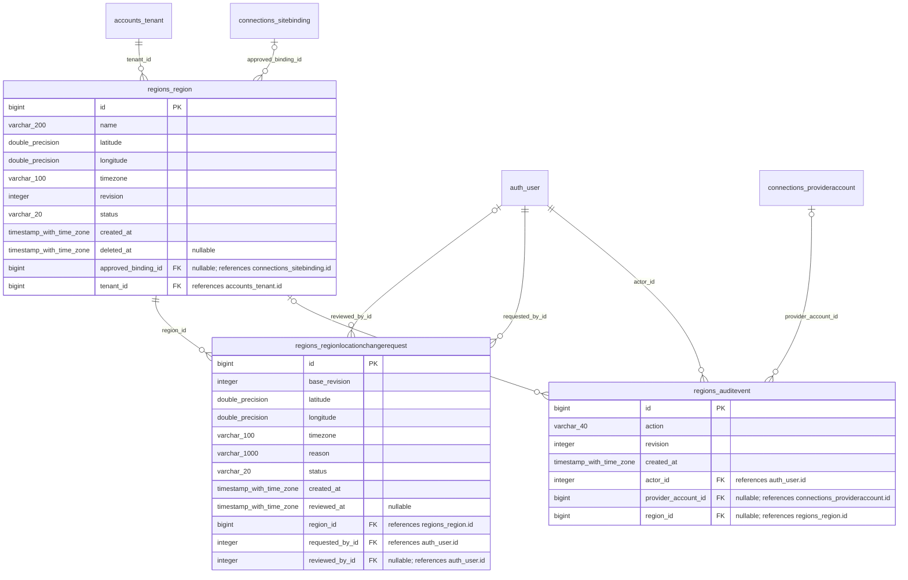

### Constraints and indexes

#### `regions_auditevent`

- `audit_exactly_one_target`: `CHECK ((("provider_account_id" IS NULL AND "region_id" IS NOT NULL) OR ("provider_account_id" IS NOT NULL AND "region_id" IS NULL)))`
- `auditevent_action_chk`: `CHECK ("action" IN ('region_renamed', 'location_change_requested', 'location_change_approved', 'location_change_rejected', 'location_change_rebased', 'binding_configured', 'connection_validated', 'region_approved', 'region_rejected', 'region_suspended', 'region_trashed', 'region_restored', 'collection_schedule_updated', 'historical_reference_imported', 'reference_capacity_normalized', 'provider_account_created', 'provider_secret_rotated', 'provider_cooldown_cleared'))`
- column check (name generated by PostgreSQL): `CHECK ("revision" >= 0)`

#### `regions_region`

- `approved_binding_region_fk`: `FOREIGN KEY (approved_binding_id, id) REFERENCES connections_sitebinding (id, region_id) DEFERRABLE INITIALLY DEFERRED`
- `one_active_region_per_tenant_location`: `UNIQUE INDEX ("tenant_id", (ROUND(("latitude")::numeric, 6)), (ROUND(("longitude")::numeric, 6))) WHERE "deleted_at" IS NULL`
- `region_latitude`: `CHECK (("latitude" >=  -90.0 AND "latitude" <= 90.0))`
- `region_longitude`: `CHECK (("longitude" >=  -180.0 AND "longitude" <= 180.0))`
- `region_status`: `CHECK ("status" IN ('pending', 'approved', 'suspended', 'rejected'))`
- `region_status_approved_binding_chk`: `CHECK ((NOT ("status" = 'approved') OR "approved_binding_id" IS NOT NULL))`
- column check (name generated by PostgreSQL): `CHECK ("revision" >= 0)`

#### `regions_regionlocationchangerequest`

- `location_request_latitude`: `CHECK (("latitude" >=  -90.0 AND "latitude" <= 90.0))`
- `location_request_longitude`: `CHECK (("longitude" >=  -180.0 AND "longitude" <= 180.0))`
- `location_request_review_state`: `CHECK ((("reviewed_at" IS NULL AND "reviewed_by_id" IS NULL AND "status" = 'pending') OR ("reviewed_at" IS NOT NULL AND "reviewed_by_id" IS NOT NULL AND "status" IN ('approved', 'rejected'))))`
- `one_pending_region_location_request`: `UNIQUE INDEX ("region_id") WHERE "status" = 'pending'`
- `regionlocationchangerequest_status_chk`: `CHECK ("status" IN ('pending', 'approved', 'rejected'))`
- column check (name generated by PostgreSQL): `CHECK ("base_revision" >= 0)`

## connections (`pyracast.connections`)

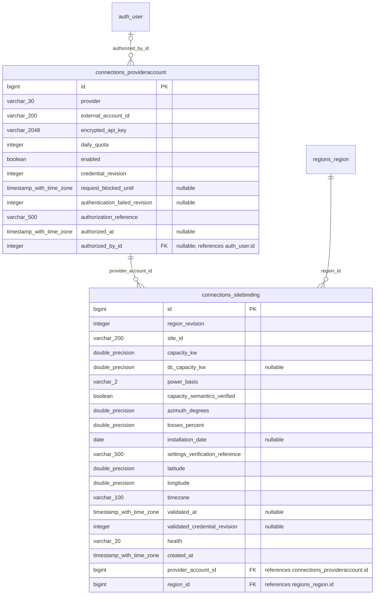

### Constraints and indexes

#### `connections_provideraccount`

- `canonical_provider_account`: `UNIQUE INDEX ((CASEFOLD(BTRIM("provider", ' \u0009\u000a\u000d\u000b\u000c\u001c\u001d\u001e\u001f\u0085\u00a0\u1680\u2000\u2001\u2002\u2003\u2004\u2005\u2006\u2007\u2008\u2009\u200a\u2028\u2029\u202f\u205f\u3000') COLLATE "pg_unicode_fast")), (CASEFOLD(BTRIM("external_account_id", ' \u0009\u000a\u000d\u000b\u000c\u001c\u001d\u001e\u001f\u0085\u00a0\u1680\u2000\u2001\u2002\u2003\u2004\u2005\u2006\u2007\u2008\u2009\u200a\u2028\u2029\u202f\u205f\u3000') COLLATE "pg_unicode_fast")))`
- `provider_account_encrypted_api_key`: `CHECK ((("encrypted_api_key" = '' AND "provider" = 'fixture') OR "encrypted_api_key"::text LIKE 'encrypted:v1:%'))`
- `provideraccount_authentication_failed_revision_chk`: `CHECK (("authentication_failed_revision" IS NULL OR ("authentication_failed_revision" >= 1 AND "authentication_failed_revision" <= ("credential_revision"))))`
- `provideraccount_credential_revision_chk`: `CHECK ("credential_revision" >= 1)`
- `provideraccount_daily_quota_chk`: `CHECK (("daily_quota" >= 1 AND "daily_quota" <= 10))`
- `provideraccount_provider_chk`: `CHECK ("provider" IN ('fixture', 'solcast'))`
- column check (name generated by PostgreSQL): `CHECK ("authentication_failed_revision" >= 0)`
- column check (name generated by PostgreSQL): `CHECK ("credential_revision" >= 0)`
- column check (name generated by PostgreSQL): `CHECK ("daily_quota" >= 0)`

#### `connections_sitebinding`

- `binding_account_identity`: `UNIQUE ("id", "provider_account_id")`
- `binding_azimuth`: `CHECK (("azimuth_degrees" >= 0.0 AND "azimuth_degrees" < 360.0))`
- `binding_capacity`: `CHECK ("capacity_kw" > 0.0)`
- `binding_capacity_finite`: `CHECK ("capacity_kw" < 'Infinity'::float8)`
- `binding_dc_capacity`: `CHECK (("dc_capacity_kw" IS NULL OR ("dc_capacity_kw" > 0.0 AND "dc_capacity_kw" < 'Infinity'::float8)))`
- `binding_health`: `CHECK ("health" IN ('unknown', 'healthy', 'error'))`
- `binding_latitude`: `CHECK (("latitude" >=  -90.0 AND "latitude" <= 90.0))`
- `binding_longitude`: `CHECK (("longitude" >=  -180.0 AND "longitude" <= 180.0))`
- `binding_losses`: `CHECK (("losses_percent" >= 0.0 AND "losses_percent" < 100.0))`
- `binding_power_basis`: `CHECK ("power_basis" IN ('ac', 'dc'))`
- `binding_region_identity`: `UNIQUE ("id", "region_id")`
- `sitebinding_region_region_revision_uniq`: `UNIQUE ("region_id", "region_revision")`
- `sitebinding_validated_chk`: `CHECK ((("validated_at" IS NULL AND "validated_credential_revision" IS NULL) OR ("validated_at" IS NOT NULL AND "validated_credential_revision" IS NOT NULL)))`
- column check (name generated by PostgreSQL): `CHECK ("region_revision" >= 0)`
- column check (name generated by PostgreSQL): `CHECK ("validated_credential_revision" >= 0)`

## forecasts (`pyracast.forecasts`)

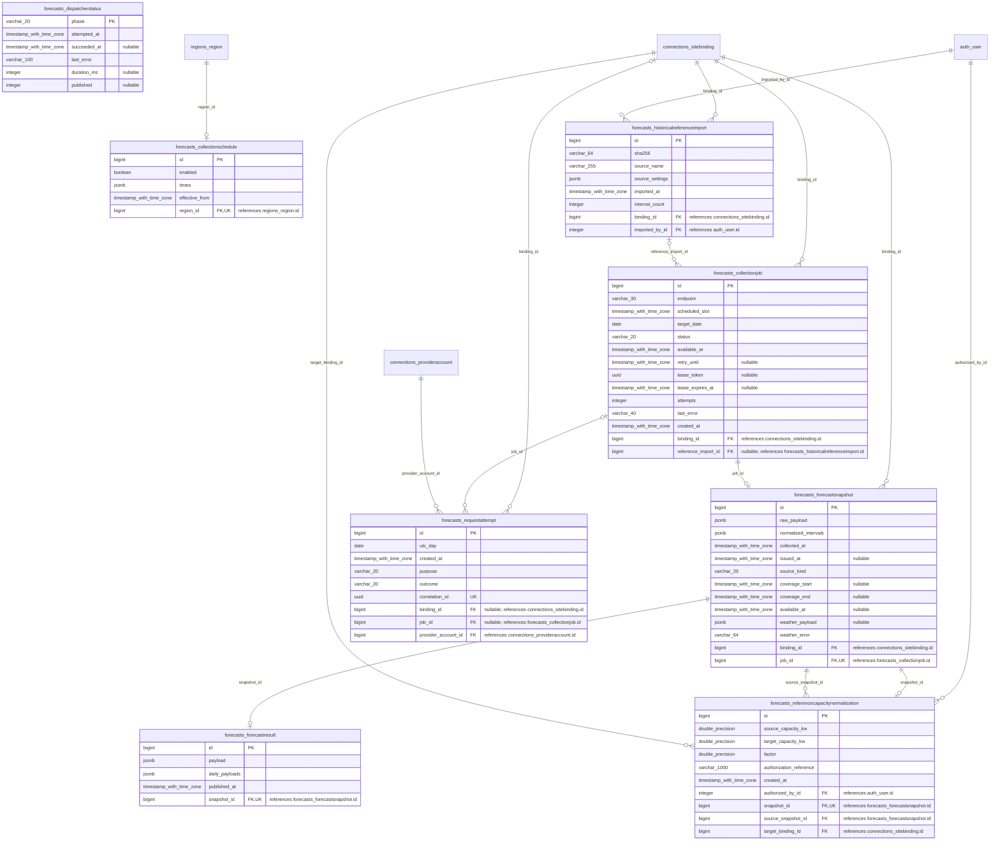

### Constraints and indexes

#### `forecasts_collectionjob`

- `collection_dispatch_due`: `INDEX ("available_at", "id") WHERE "status" IN ('pending', 'retry', 'running')`
- `collection_import_binding_fk`: `FOREIGN KEY (reference_import_id, binding_id) REFERENCES forecasts_historicalreferenceimport (id, binding_id) DEFERRABLE INITIALLY DEFERRED`
- `collection_job_binding_identity`: `UNIQUE ("id", "binding_id")`
- `collection_job_status`: `CHECK ("status" IN ('pending', 'running', 'retry', 'succeeded', 'failed', 'stale'))`
- `collectionjob_binding_endpoint_scheduled_slot_uniq`: `UNIQUE INDEX ("binding_id", "endpoint", "scheduled_slot") WHERE "endpoint" IN ('forecasts', 'estimated_actuals')`
- `collectionjob_endpoint_chk`: `CHECK ("endpoint" IN ('forecasts', 'estimated_actuals', 'historical_import', 'scaled_forecasts', 'scaled_estimated_actuals'))`
- `collectionjob_import_status_chk`: `CHECK (("reference_import_id" IS NULL OR "status" = 'succeeded'))`
- `collectionjob_lease_chk`: `CHECK ((("lease_expires_at" IS NOT NULL AND "lease_token" IS NOT NULL AND "status" IN ('running')) OR ("lease_expires_at" IS NULL AND "lease_token" IS NULL AND NOT ("status" IN ('running')))))`
- `collectionjob_reference_import_chk`: `CHECK ((("endpoint" = 'historical_import' AND "reference_import_id" IS NOT NULL) OR (NOT ("endpoint" = 'historical_import') AND "reference_import_id" IS NULL)))`
- `unique_import_reference_day`: `UNIQUE ("reference_import_id", "target_date")`
- column check (name generated by PostgreSQL): `CHECK ("attempts" >= 0)`

#### `forecasts_dispatcherstatus`

- `dispatcher_phase_valid`: `CHECK ("phase" IN ('collection', 'notifications', 'calibration', 'retention', 'metering'))`
- column check (name generated by PostgreSQL): `CHECK ("duration_ms" >= 0)`
- column check (name generated by PostgreSQL): `CHECK ("published" >= 0)`

#### `forecasts_forecastsnapshot`

- `snapshot_binding_identity`: `UNIQUE ("id", "binding_id")`
- `snapshot_binding_source_age`: `INDEX ("binding_id", "source_kind", "collected_at" DESC, "available_at" DESC, "id" DESC)`
- `snapshot_coverage_bounds`: `CHECK ((("coverage_end" IS NULL AND "coverage_start" IS NULL) OR ("coverage_end" > ("coverage_start") AND "coverage_end" IS NOT NULL AND "coverage_start" IS NOT NULL)))`
- `snapshot_job_binding_fk`: `FOREIGN KEY (job_id, binding_id) REFERENCES forecasts_collectionjob (id, binding_id) DEFERRABLE INITIALLY DEFERRED`
- `snapshot_source_kind`: `CHECK ("source_kind" IN ('forecast', 'estimated_actuals'))`

#### `forecasts_historicalreferenceimport`

- `historicalreferenceimport_immutable`: `TRIGGER BEFORE UPDATE FOR EACH ROW EXECUTE FUNCTION refuse_historicalreferenceimport_update()`
- `reference_import_binding_identity`: `UNIQUE ("id", "binding_id")`
- `unique_historical_reference_import`: `UNIQUE ("binding_id", "sha256")`
- column check (name generated by PostgreSQL): `CHECK ("interval_count" >= 0)`

#### `forecasts_referencecapacitynormalization`

- `finite_positive_reference_scale`: `CHECK (("factor" > 0.0 AND "factor" < 'Infinity'::float8))`
- `normalization_distinct_source`: `CHECK (NOT ("snapshot_id" = ("source_snapshot_id")))`
- `normalization_snapshot_binding_fk`: `FOREIGN KEY (snapshot_id, target_binding_id) REFERENCES forecasts_forecastsnapshot (id, binding_id) DEFERRABLE INITIALLY DEFERRED`
- `normalization_source_capacity`: `CHECK (("source_capacity_kw" > 0.0 AND "source_capacity_kw" < 'Infinity'::float8))`
- `normalization_target_capacity`: `CHECK (("target_capacity_kw" > 0.0 AND "target_capacity_kw" < 'Infinity'::float8))`
- `referencecapacitynormalization_factor_chk`: `CHECK (ABS((("factor" * "source_capacity_kw") - "target_capacity_kw")) <= ("target_capacity_kw" * 1e-09))`
- `unique_reference_capacity_normalization`: `UNIQUE ("source_snapshot_id", "target_binding_id")`

#### `forecasts_requestattempt`

- `request_account_day`: `INDEX ("provider_account_id", "utc_day")`
- `request_attempt_outcome`: `CHECK ("outcome" IN ('uncertain', 'succeeded', 'failed'))`
- `request_binding_account_fk`: `FOREIGN KEY (binding_id, provider_account_id) REFERENCES connections_sitebinding (id, provider_account_id) DEFERRABLE INITIALLY DEFERRED`
- `request_job_binding_fk`: `FOREIGN KEY (job_id, binding_id) REFERENCES forecasts_collectionjob (id, binding_id) DEFERRABLE INITIALLY DEFERRED`
- `request_job_requires_binding`: `CHECK (("job_id" IS NULL OR "binding_id" IS NOT NULL))`
- `requestattempt_purpose_chk`: `CHECK ("purpose" IN ('forecast', 'estimated_actuals', 'validation', 'inspect_settings', 'inspect_forecast'))`

## plants (`pyracast.plants`)

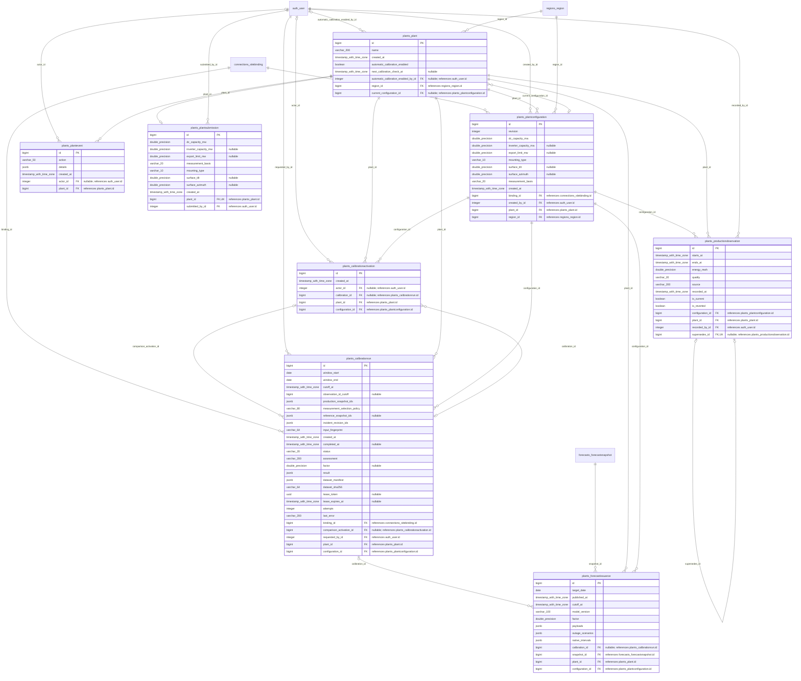

### Constraints and indexes

#### `plants_calibrationactivation`

- `activation_calibration_config_fk`: `FOREIGN KEY (calibration_id, configuration_id) REFERENCES plants_calibrationrun (id, configuration_id) DEFERRABLE INITIALLY DEFERRED`
- `activation_config_owner_fk`: `FOREIGN KEY (configuration_id, plant_id) REFERENCES plants_plantconfiguration (id, plant_id) DEFERRABLE INITIALLY DEFERRED`
- `activation_id_config_unique`: `UNIQUE ("id", "configuration_id")`

#### `plants_calibrationrun`

- `calibration_comparison_config_fk`: `FOREIGN KEY (comparison_activation_id, configuration_id) REFERENCES plants_calibrationactivation (id, configuration_id) DEFERRABLE INITIALLY DEFERRED`
- `calibration_config_binding_fk`: `FOREIGN KEY (configuration_id, binding_id) REFERENCES plants_plantconfiguration (id, binding_id) DEFERRABLE INITIALLY DEFERRED`
- `calibration_config_owner_fk`: `FOREIGN KEY (configuration_id, plant_id) REFERENCES plants_plantconfiguration (id, plant_id) DEFERRABLE INITIALLY DEFERRED`
- `calibration_factor_finite`: `CHECK (("factor" IS NULL OR ("factor" > 0.0 AND "factor" < 'Infinity'::float8)))`
- `calibration_id_config_unique`: `UNIQUE ("id", "configuration_id")`
- `calibration_status_valid`: `CHECK ("status" IN ('pending', 'running', 'ready', 'insufficient', 'rejected', 'failed', 'superseded'))`
- `calibration_window_valid`: `CHECK ("window_end" >= ("window_start"))`
- `calibrationrun_last_error_chk`: `CHECK ("last_error" IN ('', 'attempt_limit', 'invalid_cutoff', 'invalid_calibration_data'))`
- `calibrationrun_lease_chk`: `CHECK ((("lease_expires_at" IS NOT NULL AND "lease_token" IS NOT NULL AND "status" IN ('running')) OR ("lease_expires_at" IS NULL AND "lease_token" IS NULL AND NOT ("status" IN ('running')))))`
- `plant_one_pending_calibration`: `UNIQUE INDEX ("plant_id") WHERE "status" IN ('pending', 'running')`
- column check (name generated by PostgreSQL): `CHECK ("attempts" >= 0)`
- column check (name generated by PostgreSQL): `CHECK ("observation_id_cutoff" >= 0)`

#### `plants_forecastissuance`

- `forecast_issuance_before_daylight`: `CHECK ("published_at" < ("cutoff_at"))`
- `forecast_issuance_factor_finite`: `CHECK (("factor" > 0.0 AND "factor" < 'Infinity'::float8))`
- `forecast_issuance_unique`: `UNIQUE ("plant_id", "snapshot_id", "target_date")`
- `immutable_forecast_issuance`: `TRIGGER BEFORE INSERT OR UPDATE FOR EACH ROW EXECUTE FUNCTION guard_forecast_issuance()`
- `issuance_baseline_factor_identity`: `CHECK (("calibration_id" IS NOT NULL OR "factor" = 1.0))`
- `issuance_calibration_configuration_fk`: `FOREIGN KEY (calibration_id, configuration_id) REFERENCES plants_calibrationrun (id, configuration_id) DEFERRABLE INITIALLY DEFERRED`
- `issuance_configuration_owner_fk`: `FOREIGN KEY (configuration_id, plant_id) REFERENCES plants_plantconfiguration (id, plant_id) DEFERRABLE INITIALLY DEFERRED`
- `issuance_plant_day`: `INDEX ("plant_id", "target_date")`

#### `plants_plant`

- `one_plant_per_region`: `UNIQUE ("region_id")`
- `plant_current_config_owner_fk`: `FOREIGN KEY (current_configuration_id, id) REFERENCES plants_plantconfiguration (id, plant_id) DEFERRABLE INITIALLY DEFERRED`
- `plant_region_identity`: `UNIQUE ("id", "region_id")`

#### `plants_plantconfiguration`

- `configuration_binding_region_fk`: `FOREIGN KEY (binding_id, region_id) REFERENCES connections_sitebinding (id, region_id) DEFERRABLE INITIALLY DEFERRED`
- `configuration_plant_region_fk`: `FOREIGN KEY (plant_id, region_id) REFERENCES plants_plant (id, region_id) DEFERRABLE INITIALLY DEFERRED`
- `plant_angles_require_fixed`: `CHECK (("mounting_type" = 'fixed' OR ("surface_azimuth" IS NULL AND "surface_tilt" IS NULL)))`
- `plant_config_id_binding_unique`: `UNIQUE ("id", "binding_id")`
- `plant_config_id_plant_unique`: `UNIQUE ("id", "plant_id")`
- `plant_config_revision_positive`: `CHECK ("revision" >= 1)`
- `plant_config_revision_unique`: `UNIQUE ("plant_id", "revision")`
- `plant_dc_capacity_finite`: `CHECK (("dc_capacity_mw" > 0.0 AND "dc_capacity_mw" < 'Infinity'::float8))`
- `plant_export_limit_finite`: `CHECK (("export_limit_mw" IS NULL OR ("export_limit_mw" > 0.0 AND "export_limit_mw" < 'Infinity'::float8)))`
- `plant_inverter_capacity_finite`: `CHECK (("inverter_capacity_mw" IS NULL OR ("inverter_capacity_mw" > 0.0 AND "inverter_capacity_mw" < 'Infinity'::float8)))`
- `plant_measurement_basis_valid`: `CHECK ("measurement_basis" IN ('net_export', 'ac_generation'))`
- `plant_mounting_type_supported`: `CHECK ("mounting_type" IN ('unknown', 'fixed', 'tracking'))`
- `plant_surface_azimuth_valid`: `CHECK (("surface_azimuth" IS NULL OR ("surface_azimuth" >= 0.0 AND "surface_azimuth" < 360.0)))`
- `plant_surface_tilt_valid`: `CHECK (("surface_tilt" IS NULL OR ("surface_tilt" >= 0.0 AND "surface_tilt" <= 90.0)))`
- column check (name generated by PostgreSQL): `CHECK ("revision" >= 0)`

#### `plants_plantevent`

- `plantevent_action_chk`: `CHECK ("action" IN ('submission_saved', 'configuration_created', 'plant_renamed', 'observations_imported', 'production_changed', 'epias_connected', 'epias_disconnected', 'calibration_requested', 'calibration_scheduled', 'calibration_completed', 'calibration_activated', 'calibration_automatically_activated', 'calibration_reset', 'calibration_automation_enabled', 'calibration_automation_disabled', 'calibration_automatic_skipped'))`

#### `plants_plantsubmission`

- `submission_angles_require_fixed`: `CHECK (("mounting_type" = 'fixed' OR ("surface_azimuth" IS NULL AND "surface_tilt" IS NULL)))`
- `submission_azimuth_valid`: `CHECK (("surface_azimuth" IS NULL OR ("surface_azimuth" >= 0.0 AND "surface_azimuth" < 360.0)))`
- `submission_dc_capacity_finite`: `CHECK (("dc_capacity_mw" > 0.0 AND "dc_capacity_mw" < 'Infinity'::float8))`
- `submission_export_finite`: `CHECK (("export_limit_mw" IS NULL OR ("export_limit_mw" > 0.0 AND "export_limit_mw" < 'Infinity'::float8)))`
- `submission_inverter_finite`: `CHECK (("inverter_capacity_mw" IS NULL OR ("inverter_capacity_mw" > 0.0 AND "inverter_capacity_mw" < 'Infinity'::float8)))`
- `submission_measurement_basis`: `CHECK ("measurement_basis" IN ('net_export', 'ac_generation'))`
- `submission_mounting_supported`: `CHECK ("mounting_type" IN ('unknown', 'fixed', 'tracking'))`
- `submission_tilt_valid`: `CHECK (("surface_tilt" IS NULL OR ("surface_tilt" >= 0.0 AND "surface_tilt" <= 90.0)))`

#### `plants_productionobservation`

- `observation_config_owner_fk`: `FOREIGN KEY (configuration_id, plant_id) REFERENCES plants_plantconfiguration (id, plant_id) DEFERRABLE INITIALLY DEFERRED`
- `plant_observation_duration`: `CHECK (("ends_at" = ("starts_at" + '0:30:00'::interval) OR "ends_at" = ("starts_at" + '1:00:00'::interval)))`
- `plant_observation_energy_finite`: `CHECK (("energy_mwh" >= 0.0 AND "energy_mwh" < 'Infinity'::float8))`
- `plant_observation_no_overlap`: `EXCLUDE USING GIST ("plant_id" WITH =, (TSTZRANGE("starts_at", "ends_at", '[)')) WITH &&) WHERE (("is_current" AND NOT "is_reverted"))`
- `plant_observation_quality_valid`: `CHECK ("quality" IN ('valid', 'outage', 'curtailed', 'invalid'))`
- `plant_observation_revert_has_source`: `CHECK ((NOT "is_reverted" OR "supersedes_id" IS NOT NULL))`
- `plant_observation_unique`: `UNIQUE INDEX ("plant_id", "starts_at", "ends_at") WHERE "is_current"`
- `productionobservation_revision_guard`: `TRIGGER BEFORE INSERT OR UPDATE FOR EACH ROW EXECUTE FUNCTION guard_productionobservation_revision()`

## incidents (`pyracast.incidents`)

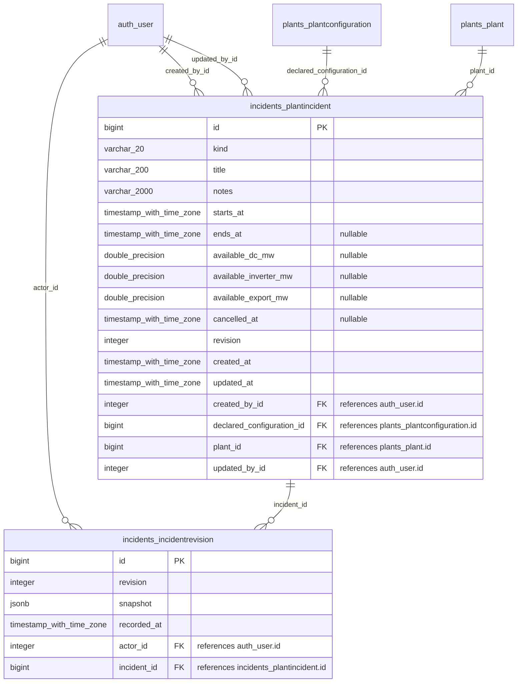

### Constraints and indexes

#### `incidents_incidentrevision`

- `incident_revision_unique`: `UNIQUE ("incident_id", "revision")`
- column check (name generated by PostgreSQL): `CHECK ("revision" >= 0)`

#### `incidents_plantincident`

- `incident_dc_finite`: `CHECK (("available_dc_mw" IS NULL OR ("available_dc_mw" >= 0.0 AND "available_dc_mw" < 'Infinity'::float8)))`
- `incident_declared_config_owner_fk`: `FOREIGN KEY (declared_configuration_id, plant_id) REFERENCES plants_plantconfiguration (id, plant_id) DEFERRABLE INITIALLY DEFERRED`
- `incident_export_finite`: `CHECK (("available_export_mw" IS NULL OR ("available_export_mw" >= 0.0 AND "available_export_mw" < 'Infinity'::float8)))`
- `incident_inverter_finite`: `CHECK (("available_inverter_mw" IS NULL OR ("available_inverter_mw" >= 0.0 AND "available_inverter_mw" < 'Infinity'::float8)))`
- `incident_kind_valid`: `CHECK ("kind" IN ('inverter', 'panels', 'grid', 'other', 'multiple'))`
- `incident_no_overlap`: `EXCLUDE USING GIST ("plant_id" WITH =, (TSTZRANGE("starts_at", "ends_at", '[)')) WITH &&) WHERE ("cancelled_at" IS NULL)`
- `incident_valid_interval`: `CHECK (("ends_at" IS NULL OR "ends_at" > ("starts_at")))`
- column check (name generated by PostgreSQL): `CHECK ("revision" >= 0)`

## notifications (`pyracast.notifications`)

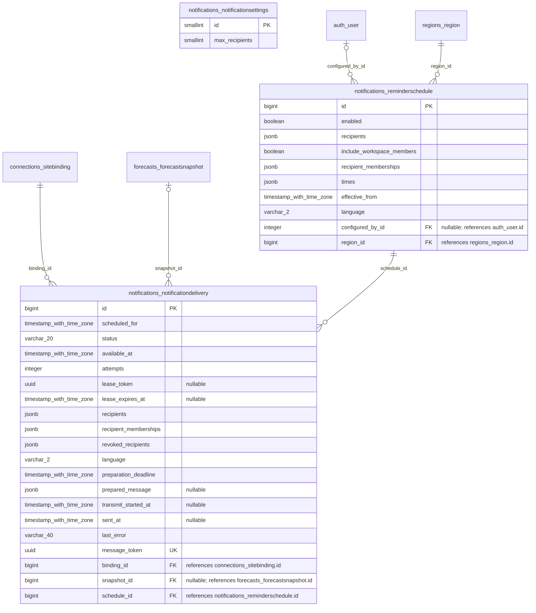

### Constraints and indexes

#### `notifications_notificationdelivery`

- `notification_delivery_language_valid`: `CHECK ("language" IN ('en', 'tr'))`
- `notification_delivery_sending_prepared`: `CHECK ((NOT ("status" = 'sending') OR "prepared_message" IS NOT NULL))`
- `notification_delivery_status_valid`: `CHECK ("status" IN ('pending', 'retry', 'sending', 'sent', 'failed', 'uncertain', 'skipped', 'cancelled'))`
- `notification_dispatch_ready`: `INDEX ("available_at", "id") WHERE "status" IN ('pending', 'retry', 'sending')`
- `notificationdelivery_last_error_chk`: `CHECK ("last_error" IN ('', 'missed_schedule', 'delivery_deadline_exceeded', 'cancelled_by_settings_change', 'schedule_or_authority_changed', 'no_recipients', 'invalid_recipient', 'recipient_limit_exceeded', 'definition_trashed', 'interrupted_send', 'interrupted_connection', 'mail_not_sent', 'mail_configuration_invalid', 'mail_credentials_rejected', 'mail_authorization_revoked', 'mail_rate_limited', 'mail_rejected', 'mail_sender_forbidden', 'mail_preparation_failed', 'mail_outcome_uncertain'))`
- `notificationdelivery_lease_chk`: `CHECK ((("lease_expires_at" IS NOT NULL AND "lease_token" IS NOT NULL AND "status" IN ('sending', 'uncertain')) OR ("lease_expires_at" IS NULL AND "lease_token" IS NULL AND NOT ("status" IN ('sending')))))`
- `notificationdelivery_prepared_format_chk`: `CHECK (("prepared_message" -> 'format') IN ('"xlsx"'::jsonb, '"plain"'::jsonb))`
- `notificationdelivery_prepared_kind_chk`: `CHECK (("prepared_message" -> 'kind') IN ('"current"'::jsonb, '"saved_complete"'::jsonb, '"saved_partial"'::jsonb, '"unavailable"'::jsonb))`
- `unique_reminder_group_slot`: `UNIQUE ("schedule_id", "scheduled_for")`
- column check (name generated by PostgreSQL): `CHECK ("attempts" >= 0)`

#### `notifications_notificationsettings`

- `positive_notification_recipient_limit`: `CHECK ("max_recipients" >= 1)`
- `singleton_notification_settings`: `CHECK ("id" = 1)`
- column check (name generated by PostgreSQL): `CHECK ("id" >= 0)`
- column check (name generated by PostgreSQL): `CHECK ("max_recipients" >= 0)`

#### `notifications_reminderschedule`

- `one_reminder_schedule_per_region`: `UNIQUE ("region_id")`
- `reminder_schedule_language_valid`: `CHECK ("language" IN ('en', 'tr'))`

## metering (`pyracast.metering`)

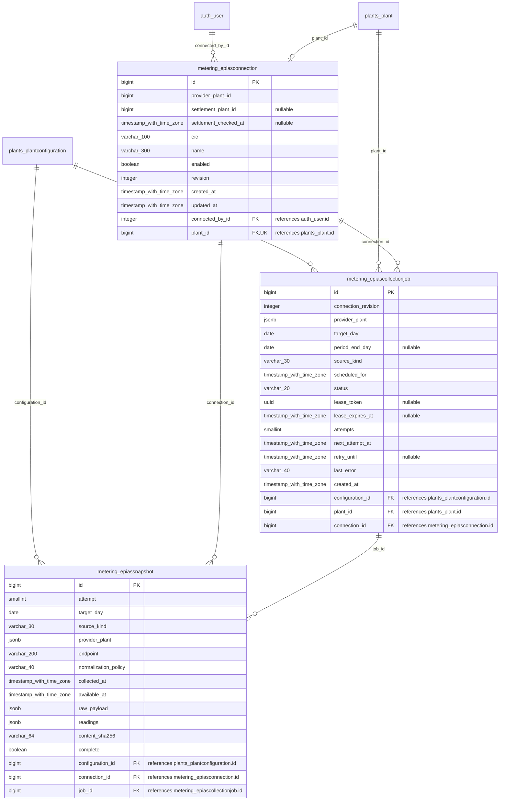

### Constraints and indexes

#### `metering_epiascollectionjob`

- `epias_job_configuration_plant_fk`: `FOREIGN KEY (configuration_id, plant_id) REFERENCES plants_plantconfiguration (id, plant_id) DEFERRABLE INITIALLY DEFERRED`
- `epias_job_connection_plant_fk`: `FOREIGN KEY (connection_id, plant_id) REFERENCES metering_epiasconnection (id, plant_id) DEFERRABLE INITIALLY DEFERRED`
- `epias_job_lineage_unique`: `UNIQUE ("id", "connection_id", "configuration_id")`
- `epias_job_period_valid`: `CHECK (("period_end_day" IS NULL OR "period_end_day" >= ("target_day")))`
- `epias_job_revision_positive`: `CHECK ("connection_revision" >= 1)`
- `epias_job_source_valid`: `CHECK ("source_kind" IN ('realtime_generation', 'settlement_injection'))`
- `epias_job_status_valid`: `CHECK ("status" IN ('pending', 'running', 'succeeded', 'failed', 'superseded', 'awaiting_publication'))`
- `epias_unique_collection_slot`: `UNIQUE ("connection_id", "connection_revision", "configuration_id", "source_kind", "target_day", "scheduled_for")`
- `epiascollectionjob_lease_chk`: `CHECK ((("lease_expires_at" IS NOT NULL AND "lease_token" IS NOT NULL AND "status" IN ('running')) OR ("lease_expires_at" IS NULL AND "lease_token" IS NULL AND NOT ("status" IN ('running')))))`
- `metering_ep_status_11e228_idx`: `INDEX ("status", "next_attempt_at")`
- column check (name generated by PostgreSQL): `CHECK ("attempts" >= 0)`
- column check (name generated by PostgreSQL): `CHECK ("connection_revision" >= 0)`

#### `metering_epiasconnection`

- `epias_connection_plant_identity`: `UNIQUE ("id", "plant_id")`
- `epias_revision_positive`: `CHECK ("revision" >= 1)`
- column check (name generated by PostgreSQL): `CHECK ("provider_plant_id" >= 0)`
- column check (name generated by PostgreSQL): `CHECK ("revision" >= 0)`
- column check (name generated by PostgreSQL): `CHECK ("settlement_plant_id" >= 0)`

#### `metering_epiassnapshot`

- `epias_acquisition_attempt_positive`: `CHECK ("attempt" >= 1)`
- `epias_acquisition_source_valid`: `CHECK ("source_kind" IN ('realtime_generation', 'settlement_injection'))`
- `epias_snapshot_job_lineage_fk`: `FOREIGN KEY (job_id, connection_id, configuration_id) REFERENCES metering_epiascollectionjob (id, connection_id, configuration_id) DEFERRABLE INITIALLY DEFERRED`
- `epias_unique_job_acquisition`: `UNIQUE ("job_id", "attempt", "target_day")`
- `epiassnapshot_immutable`: `TRIGGER BEFORE UPDATE FOR EACH ROW EXECUTE FUNCTION refuse_epiassnapshot_update()`
- `metering_ep_connect_df32e3_idx`: `INDEX ("connection_id", "target_day", "available_at")`
- column check (name generated by PostgreSQL): `CHECK ("attempt" >= 0)`

## change_requests (`pyracast.change_requests`)

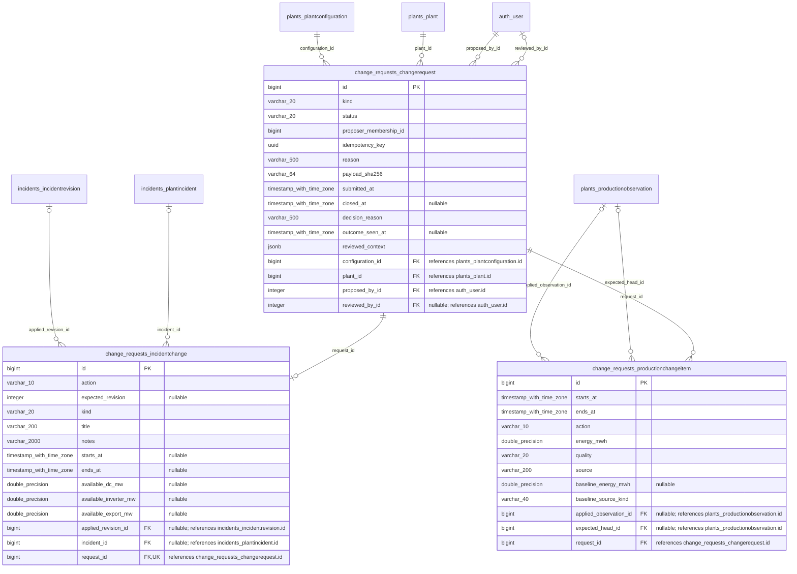

### Constraints and indexes

#### `change_requests_changerequest`

- `change_requ_plant_i_04f7db_idx`: `INDEX ("plant_id", "status", "submitted_at")`
- `change_request_idempotency_unique`: `UNIQUE ("proposer_membership_id", "idempotency_key")`
- `change_request_kind_valid`: `CHECK ("kind" IN ('production', 'incident'))`
- `change_request_review_state`: `CHECK ((("closed_at" IS NULL AND "decision_reason" = '' AND "outcome_seen_at" IS NULL AND "reviewed_by_id" IS NULL AND "status" = 'pending') OR ("closed_at" IS NOT NULL AND "outcome_seen_at" IS NULL AND "reviewed_by_id" IS NULL AND "status" = 'withdrawn') OR ("closed_at" IS NOT NULL AND "reviewed_by_id" IS NOT NULL AND "status" IN ('approved', 'rejected'))))`
- `changerequest_status_chk`: `CHECK ("status" IN ('pending', 'approved', 'rejected', 'withdrawn'))`
- `proposal_configuration_owner_fk`: `FOREIGN KEY (configuration_id, plant_id) REFERENCES plants_plantconfiguration (id, plant_id) DEFERRABLE INITIALLY DEFERRED`
- column check (name generated by PostgreSQL): `CHECK ("proposer_membership_id" >= 0)`

#### `change_requests_incidentchange`

- `incidentchange_action_chk`: `CHECK ("action" IN ('create', 'update', 'resolve', 'cancel'))`
- `incidentchange_kind_chk`: `CHECK ("kind" IN ('', 'inverter', 'panels', 'grid', 'other', 'multiple'))`
- `proposal_incident_dc_finite`: `CHECK (("available_dc_mw" IS NULL OR ("available_dc_mw" >= 0.0 AND "available_dc_mw" < 'Infinity'::float8)))`
- `proposal_incident_end_required`: `CHECK ((NOT ("action" = 'resolve') OR "ends_at" IS NOT NULL))`
- `proposal_incident_export_finite`: `CHECK (("available_export_mw" IS NULL OR ("available_export_mw" >= 0.0 AND "available_export_mw" < 'Infinity'::float8)))`
- `proposal_incident_inverter_finite`: `CHECK (("available_inverter_mw" IS NULL OR ("available_inverter_mw" >= 0.0 AND "available_inverter_mw" < 'Infinity'::float8)))`
- `proposal_incident_target_valid`: `CHECK ((("action" = 'create' AND "expected_revision" IS NULL AND "incident_id" IS NULL) OR ("action" IN ('update', 'resolve', 'cancel') AND "expected_revision" >= 1 AND "expected_revision" IS NOT NULL AND "incident_id" IS NOT NULL)))`
- `proposal_incident_values_valid`: `CHECK (("action" IN ('resolve', 'cancel') OR ("action" IN ('create', 'update') AND "kind" IN ('inverter', 'panels', 'grid', 'other', 'multiple') AND "starts_at" IS NOT NULL AND NOT ("title" = ''))))`
- column check (name generated by PostgreSQL): `CHECK ("expected_revision" >= 0)`

#### `change_requests_productionchangeitem`

- `productionchangeitem_baseline_source_kind_chk`: `CHECK ("baseline_source_kind" IN ('', 'manual', 'realtime_generation', 'settlement_injection'))`
- `proposal_baseline_energy_finite`: `CHECK (("baseline_energy_mwh" IS NULL OR ("baseline_energy_mwh" >= 0.0 AND "baseline_energy_mwh" < 'Infinity'::float8)))`
- `proposal_production_action_valid`: `CHECK ("action" IN ('set', 'revert'))`
- `proposal_production_energy_finite`: `CHECK (("energy_mwh" >= 0.0 AND "energy_mwh" < 'Infinity'::float8))`
- `proposal_production_interval_unique`: `UNIQUE ("request_id", "starts_at", "ends_at")`
- `proposal_production_interval_valid`: `CHECK ("ends_at" > ("starts_at"))`
- `proposal_production_quality_valid`: `CHECK ("quality" IN ('valid', 'outage', 'curtailed', 'invalid'))`

## auth (`django.contrib.auth`)

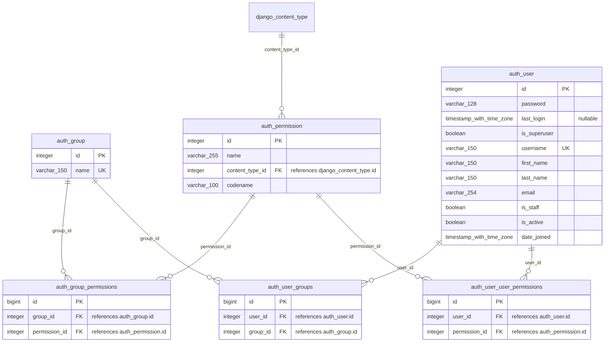

### Constraints and indexes

#### `auth_group_permissions`

- `unique_together` (name generated by Django): `UNIQUE ("group_id", "permission_id")`

#### `auth_permission`

- `unique_together` (name generated by Django): `UNIQUE ("content_type_id", "codename")`

#### `auth_user_groups`

- `unique_together` (name generated by Django): `UNIQUE ("user_id", "group_id")`

#### `auth_user_user_permissions`

- `unique_together` (name generated by Django): `UNIQUE ("user_id", "permission_id")`

## contenttypes (`django.contrib.contenttypes`)

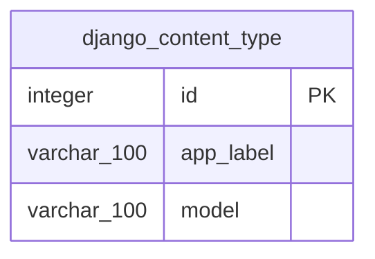

### Constraints and indexes

#### `django_content_type`

- `unique_together` (name generated by Django): `UNIQUE ("app_label", "model")`

## sessions (`django.contrib.sessions`)

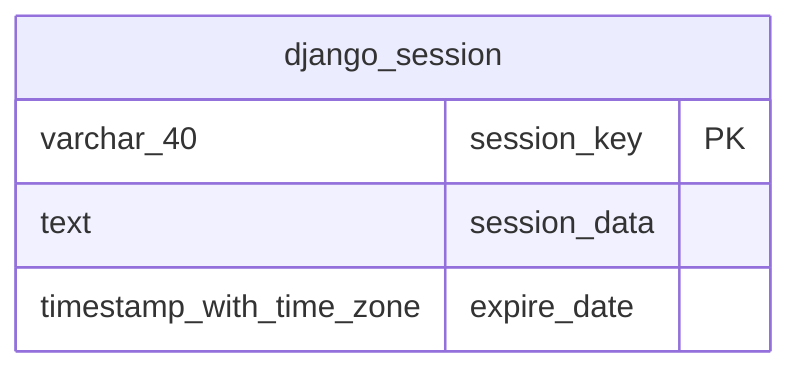

### Constraints and indexes

None beyond primary keys, foreign keys and unique columns.

## admin (`django.contrib.admin`)

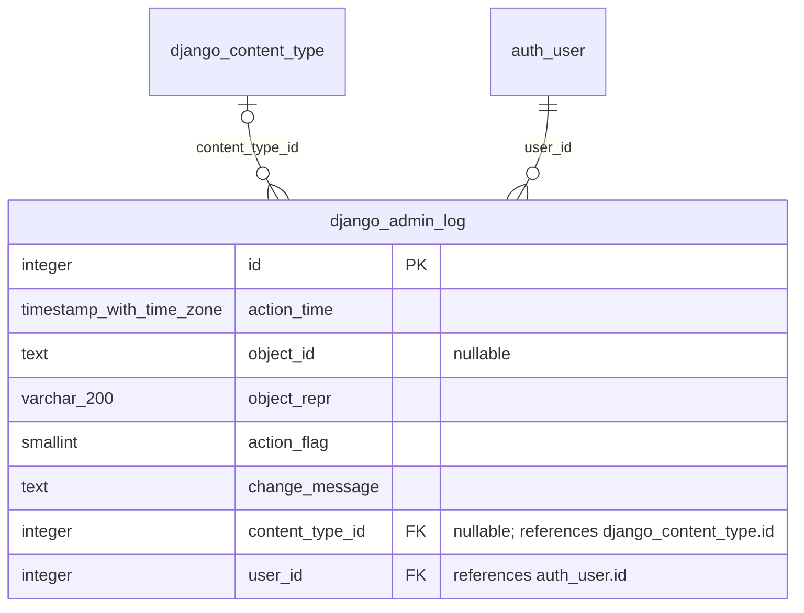

### Constraints and indexes

#### `django_admin_log`

- column check (name generated by PostgreSQL): `CHECK ("action_flag" >= 0)`

## account (`allauth.account`)

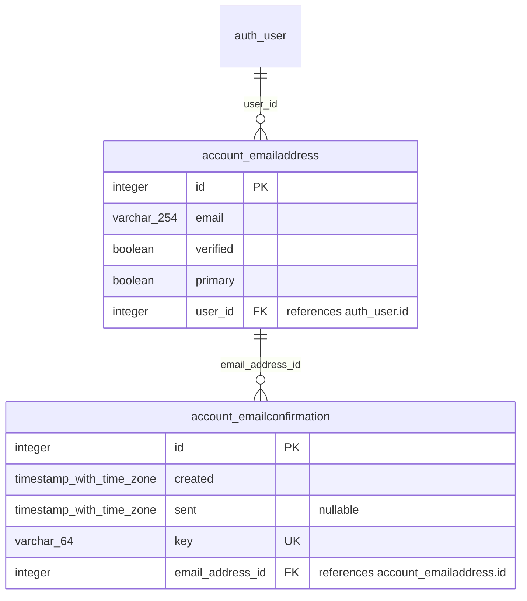

### Constraints and indexes

#### `account_emailaddress`

- `unique_primary_email`: `UNIQUE INDEX ("user_id", "primary") WHERE "primary"`
- `unique_verified_email`: `UNIQUE INDEX ("email") WHERE "verified"`
- `unique_together` (name generated by Django): `UNIQUE ("user_id", "email")`

## socialaccount (`allauth.socialaccount`)

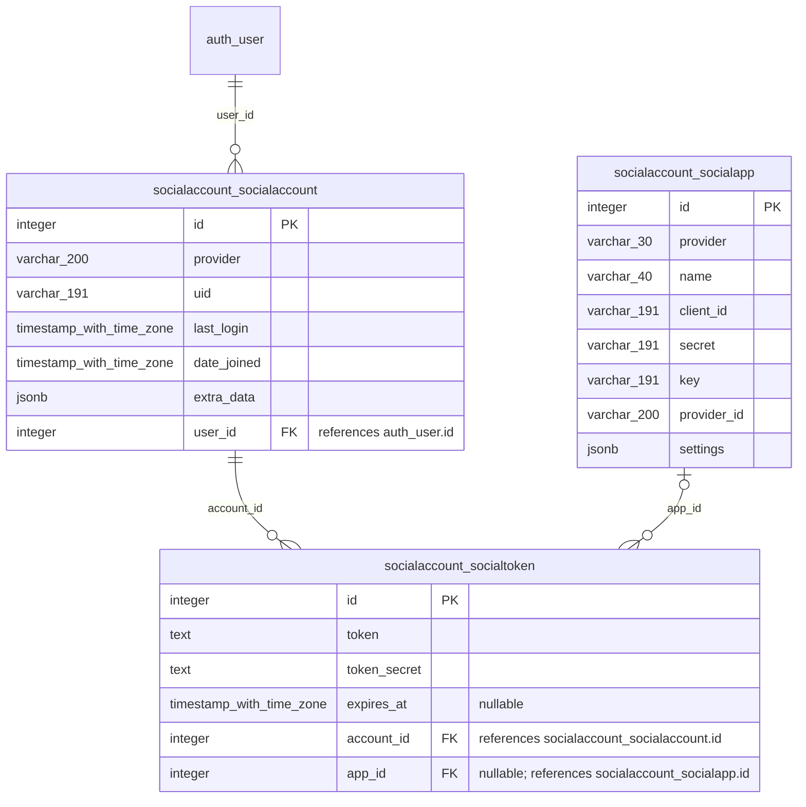

### Constraints and indexes

#### `socialaccount_socialaccount`

- `unique_together` (name generated by Django): `UNIQUE ("provider", "uid")`

#### `socialaccount_socialtoken`

- `unique_together` (name generated by Django): `UNIQUE ("app_id", "account_id")`

## mfa (`allauth.mfa`)

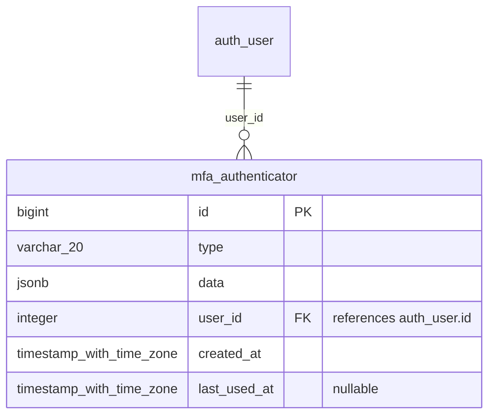

### Constraints and indexes

#### `mfa_authenticator`

- `unique_authenticator_type`: `UNIQUE INDEX ("user_id", "type") WHERE "type" IN ('totp', 'recovery_codes')`

## usersessions (`allauth.usersessions`)

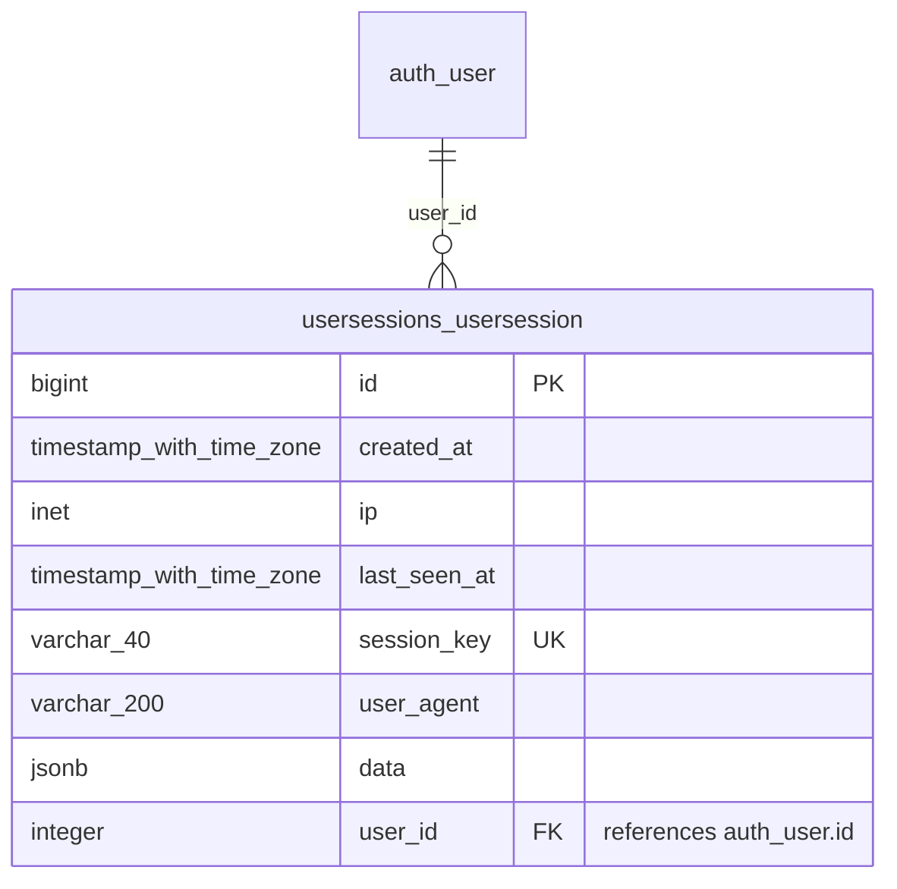

### Constraints and indexes

None beyond primary keys, foreign keys and unique columns.
