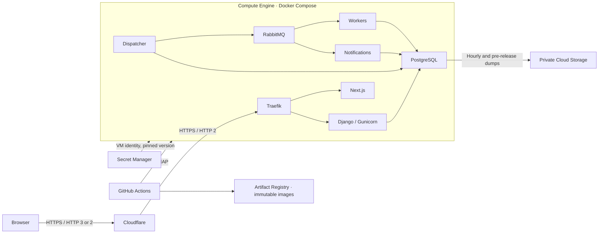

# Google Cloud deployment

This deployment prioritizes low initial cost. One Compute Engine VM runs Traefik,
Next.js, the Django API, collection/calibration workers, a separate notification
worker, the dispatcher, RabbitMQ and PostgreSQL. The default is an `e2-medium`
(4 GiB RAM, one sustained vCPU exposed as two shared vCPUs) in `europe-west1-b`
(Belgium), keeping the base price close to the US region while reducing latency
for users in Türkiye.
PostgreSQL and RabbitMQ use a persistent data disk. Hourly and pre-release database
dumps go to private Cloud Storage with seven-day retention. The recovery-point
target is one hour while scheduled backups succeed; there is no point-in-time
recovery. Application and database availability depend on this one VM. Releases
include a maintenance window.



Images and dependencies are pinned; containers run without root, with read-only
filesystems and resource limits. GitHub deploys through
[Workload Identity Federation](https://docs.cloud.google.com/iam/docs/workload-identity-federation-with-deployment-pipelines),
without a service-account key. Application containers use Distroless runtimes and
target Linux amd64. Windows remains a native development and test platform.

## Gateway and image security

Traefik uses only file-based routing and public ACME certificate issuance. Its
administration API, dashboard and Docker discovery are disabled. Static settings
live in `deploy/compose.yaml`; routes and TLS policy live in `deploy/routes.yml`.
Port 80 is public for ACME HTTP-01; port 443 accepts only the reviewed Cloudflare
IPv4 ranges. Certificates persist on the data disk. Cloudflare Free proxies public
HTTPS with **Full (strict)** origin encryption; Traefik retains a publicly trusted
Let's Encrypt certificate. Cloudflare's edge may serve IPv6 visitors while the
origin VM remains IPv4-only.

Enable HTTP/3, HTTP/2 and TLS 1.3 at Cloudflare, with TLS 1.2 as the minimum and
0-RTT disabled. Keep [HTTP/2 to origin](https://developers.cloudflare.com/speed/optimization/protocol/http2-to-origin/)
enabled; Traefik negotiates it through ALPN. Cloudflare's
[HTTP/3 support](https://developers.cloudflare.com/speed/optimization/protocol/http3/)
applies to visitors, not origin connections.

Traefik accepts forwarded headers only from the published Cloudflare networks.
Django trusts only the gateway's fixed container address; `pyracast/proxy.py`
resolves the client the Cloudflare edge appended, removes every forwarding and
Cloudflare identity header and hands the result to the application in an internal
header the gateway strips from every request. Review changes to the official
[IPv4](https://www.cloudflare.com/ips-v4) and [IPv6](https://www.cloudflare.com/ips-v6)
lists against both `deploy/compose.yaml` and the Terraform ingress rules.

`deploy/routes.yml` gives each client (the address Cloudflare appended) a request-rate
and a concurrent-request budget per router, with a tighter rate on `/api/auth/`. Traefik
builds a separate limiter for every router, including each router's copy on the
loopback entrypoint, so a client that spends one router's budget keeps its budget on
the others. Each router also limits the body size; an API body over its limit gets the
API error body `request_too_large`. Rate and concurrency refusals are plain 429 answers. The gateway owns HSTS, `nosniff`, `Permissions-Policy`
and `Cross-Origin-Opener-Policy`; the applications own CSP, `Referrer-Policy` and cache
control, and both CSPs report violations to `/api/csp-reports/`.

Authenticated Origin Pulls stay off until the host names the authority of the edge's
client certificate. To enable them: create a CA and a client certificate it signs,
upload the certificate to Cloudflare as a zone-level Authenticated Origin Pulls
certificate and turn the feature on (the edge then presents it; nothing changes yet),
then set `origin_pull_ca` in `terraform.tfvars` to the CA's PEM, apply, run the startup
script to refresh `/etc/pyracast/host.json` and release. Before maintenance the installer
refuses a value with no certificate or with any PEM block that does not load as an
X.509 certificate. Host-local probes (release readiness, watchdog, reset tool) use the
loopback-only port 8443, which never asks for the edge's certificate, so a release that
requires origin pulls is ready only when `deploy/probe_origin_pull.py` also sees port
443 refuse a TLS 1.3 handshake without a client certificate (alert
`certificate_required`). Traefik closes that handshake instead when it rejects the TLS
option and completes it when its routers are missing. The probe first runs right after
the new gateway starts, so either outcome fails the release as a failure before
`migrate` does: the previous release serves again. The probe proves that the origin
asks for a certificate, not that the edge's certificate is signed by this authority: a
valid but wrong authority gives a successful release that Cloudflare cannot reach. So
check at once that the site still answers through Cloudflare, and go back if it does
not; on the VM,
`python3 /opt/pyracast/current/deploy/probe_origin_pull.py DOMAIN` reports the refusal.
To go back, set `origin_pull_ca = ""`, apply, refresh `host.json` and release; the
edge certificate can stay.

`deploy/gateway/` builds upstream Traefik as a pinned Go tool, verifying module
checksums. Review dependency updates with the container build and HTTPS smoke
test. After editing its module requirements, regenerate the locks without a local
Go installation:

```bash
docker build --target lockfiles --output type=local,dest=deploy/gateway deploy/gateway
```

CI scans the exact backend, web, gateway, RabbitMQ and PostgreSQL images before
merge, and Release scans them again from the verified archives before any cloud
credential exists. All HIGH/CRITICAL findings block deployment, including unfixed
findings; there are no vulnerability exceptions. Every scan must also carry a package
inventory and match the selected immutable image identity. Scan results reflect the
vulnerability database at verification time.

`deploy/postgres/Dockerfile` uses stable PostgreSQL 18.7 on Alpine 3.24, with the
unused root privilege-switching helper removed. PostgreSQL always runs as UID/GID
70. Alpine uses musl rather than glibc; a new database uses its own locale behavior.
Do not mount an existing Debian database directory into this image; use a tested
logical dump and restore when moving existing data.
`deploy/rabbitmq/Dockerfile` is the official RabbitMQ image without the base's `pebble`
service manager, which the broker never runs but the scan counts; no production image
comes from a public registry.

Artifact Registry SHA tags locate builds; deployment, scanning and smoke tests use
the resolved immutable digest. Tags remain mutable so cleanup can remove old
artifacts. The policy selects versions older than 30 days for deletion, retains
the 20 newest versions of each package and always keeps `production` tags. Image
indexes, SBOMs and provenance can consume multiple versions per release; 20
versions does not mean 20 complete releases. Release reads only the image
identities from the VM's current `release.env` (four for a release from before the
built broker image, which ran the public one), validates their repository and
digests and verifies `production` retention tags before publishing. Access or
malformed-release errors stop the release; only an absent current release is
treated as first deployment. Successful deployment moves the five retention tags
to the verified new digests. This preserves an older running version even after
many failed builds. Cleanup starts in dry-run mode. Inspect its results and verify
the live retention tags before setting `artifact_cleanup_dry_run = false` in
`terraform.tfvars` and applying it. See the [cleanup policy rules](https://docs.cloud.google.com/artifact-registry/docs/repositories/cleanup-policy).

## What you need

1. A Google Cloud project with billing enabled, and permission to provision its
   network, VM, Cloud Storage, IAM, secrets and monitoring resources.
2. A domain/subdomain whose DNS you can edit, such as `forecast.example.com`.
3. A Google Workspace Gmail sender and an internal OAuth Desktop client with only
   `gmail.send`, or an SMTP service with STARTTLS on port 587. Configure the mail
   provider's SPF/DKIM/DMARC records. Console mail is rejected in production.
4. Repository administration access to configure the GitHub `production`
   environment and variables.

Use Google Cloud Shell for infrastructure commands; this keeps cloud setup the same
for Windows and Ubuntu developers. Application development still uses native
Python 3.15.2 and uv. Small host bootstrap helpers use Ubuntu's system Python;
the application always runs its pinned container interpreter. Infrastructure
requires Terraform **1.17.2**; install that
stable version using [HashiCorp's instructions](https://developer.hashicorp.com/terraform/install)
and verify its published checksum. Do not use a service-account JSON key.

For 730 hours/month in `europe-west1`, budget approximately **USD 37–42/month** for
the default VM, 30 GiB standard boot disk, 30 GiB balanced data disk, one IPv4
address, small backups, image storage and low traffic. This excludes tax, domain,
mail/provider subscriptions, trial credits and commitments. The VM alone is about
USD 26.91/month, the disks USD 4.20/month and IPv4 USD 3.65/month: a baseline of
USD 34.76/month before backups, image storage and traffic. This conservatively
prices both disks without Free Tier credits; allowances depend on billing-account
usage. Verify current [VM](https://cloud.google.com/products/compute/pricing/general-purpose),
[disk](https://cloud.google.com/compute/disks-image-pricing) and
[network](https://cloud.google.com/vpc/pricing) prices before applying Terraform.
Set a Billing budget and alerts; alerts do not cap spending. Measure memory during
collection and calibration before resizing, and read the costliest statements from
`pg_stat_statements` (preloaded, created by `bootstrap.sql`) as the `postgres` superuser;
low HTTP traffic does not remove
the always-on worker, broker and database footprint. This is a single-VM deployment
with no automatic failover.

## First setup

### 1. Create the infrastructure

Clone this repository in Cloud Shell and work from its root. Replace the project
name below. The state bucket must be globally unique and kept private; the person
running Terraform needs access to it. It is intentionally separate from the
application so destroying an environment cannot destroy its state.

```bash
export PROJECT_ID=your-project-id
gcloud storage buckets create "gs://$PROJECT_ID-pyracast-tfstate" \
  --project="$PROJECT_ID" --location=europe-west1 --uniform-bucket-level-access --public-access-prevention
gcloud storage buckets update "gs://$PROJECT_ID-pyracast-tfstate" --project="$PROJECT_ID" --versioning
cp infra/terraform/terraform.tfvars.example infra/terraform/terraform.tfvars
```

Edit `terraform.tfvars`: set `project_id`, `domain`, `acme_email` and your Google
account in `operator_members`. Keep region and zone consistent. Secret replication
is immutable: when moving an existing deployment, set `secret_replica_location`
to its original region to retain its secrets and versions. Keep the existing state
bucket in its original location; its location does not determine the VM region.
The repository
and owner numeric IDs already identify `erkurtharun/pyracast`; forks must change
these IDs and the repository name.

```bash
terraform -chdir=infra/terraform init \
  -backend-config="bucket=$PROJECT_ID-pyracast-tfstate" -backend-config=prefix=production
terraform -chdir=infra/terraform plan -out=production.tfplan
terraform -chdir=infra/terraform apply production.tfplan
terraform -chdir=infra/terraform output
```

Create a Cloudflare **A record** for the configured domain pointing to `instance_ip`.
Initially select **DNS only**. Keep edge HTTPS redirects disabled so HTTP-01
challenges continue to reach port 80 during certificate renewal; Traefik redirects
other HTTP requests itself. Do not add an origin AAAA record.
Traefik obtains and renews its certificate through public port 80. After the release
passes its local HTTPS certificate check, switch the record to **Proxied** and set
**SSL/TLS → Overview → Full (strict)**. Then verify the public HTTPS site. DNS-only
HTTPS access is blocked by the Cloudflare-only origin firewall. Keep Cloudflare
Pseudo IPv4 disabled and retain visitor IP headers; do not add a Worker or another
proxy without reviewing the trust chain. Do not configure cache rules that cache
authentication, API or administration responses.

SSH is accessible only through IAP. Terraform enables OS Login and grants the
named operators access to this VM. Wait for its startup script to finish:

```bash
gcloud compute ssh pyracast --project="$PROJECT_ID" --zone=europe-west1-b --tunnel-through-iap
sudo journalctl -u google-startup-scripts.service --no-pager -n 80
sudo docker compose version
```

### 2. Add secrets

Run secret setup from the repository root on your local Windows or Ubuntu
workstation, with uv, an authenticated Google Cloud CLI and a browser. The helper
generates application encryption, broker and database keys and asks for the mail
backend and sender. It refuses to overwrite existing files; preserve existing
secrets when adding Gmail to an existing deployment. Weather is initially disabled.

```bash
uv run --locked python deploy/create_secrets.py
```

For the Workspace sender, choose `gmail` and `info@pyracast.app`. Enable the Gmail
API in the project. In **Google Auth Platform**, configure the application name
**Pyracast**, its support/contact address, **Internal** audience and only
`https://www.googleapis.com/auth/gmail.send`. Internal audience requires the
project to belong to the sender's Workspace organization. A trial's standalone
organization is different: use a separate, unbilled OAuth-only project under the
Workspace organization in that case. Keep the application infrastructure and
Secret Manager in the deployment project. Under **Clients → Create client**,
select **Desktop app**, name it **Pyracast**, and save its JSON to the ignored local
file `secrets/gmail-client.json`. Then run:

```bash
uv run --locked python deploy/authorize_gmail.py --sender info@pyracast.app
```

Approve send access as `info@pyracast.app` in the browser. The helper uses a random
loopback port, state and PKCE; it requests only `gmail.send` with offline access.
It sends one check mail from the sender to itself and only then atomically adds the
Gmail credentials/backend/sender to `secrets/runtime.json`, preserving the existing
application keys. It does not upload secrets. Use `--no-browser` for a manually opened authorization URL, or `--replace`
when deliberately replacing existing Gmail credentials. Do not print or paste the
client JSON or refresh token. An external application left in **Testing** expires
its Gmail refresh token after seven days; it is unsuitable for unattended delivery.

For `smtp`, the secret helper instead asks for the SMTP host, login and verified
sender. After completing the selected mail setup, upload the files:

```bash
gcloud secrets versions add pyracast-runtime --project="$PROJECT_ID" --data-file=secrets/runtime.json
gcloud secrets versions add pyracast-migration --project="$PROJECT_ID" --data-file=secrets/migration.json
gcloud secrets versions add pyracast-database --project="$PROJECT_ID" --data-file=secrets/database.json
```

The first runtime and database versions are **1**, pinned in Terraform. The runtime
secret is a JSON object of application settings and `RABBITMQ_DEFAULT_PASS`; the migration
secret contains only `PGUSER` and `PGPASSWORD`; the database secret contains only
`POSTGRES_PASSWORD`. Values never enter Terraform state,
image layers or GitHub variables. The VM writes restricted files for each release
under `/run/pyracast/releases/<release>`, so staging a new release never changes the
running one; Compose reads them literally, without shell evaluation or `$` substitution.
Preserve the Django encryption key separately from the database backup. After
secure backup/upload, remove the local `secrets/` files. Do not paste secret values
into issues, chat or workflow logs. Plant Solcast keys remain in the MFA-protected
administration interface; optional shared EPIAS/weather credentials can be added
to the runtime JSON when authorized.

The first release initializes an empty PostgreSQL data directory. Every release
applies [deploy/bootstrap.sql](../deploy/bootstrap.sql) through
`deploy/bootstrap_database.py`, before maintenance and again after `migrate`; a
second run changes nothing. It creates or converges `pyracast_owner` for migrations
and `pyracast_app` for application DML, sets the owner's password from the secrets
only when it differs (the runtime role's password: see "Key rotation" below), keeps
the migration ledger read-only for `pyracast_app`,
installs `btree_gist` and removes public schema creation. Neither application
identity is a superuser or can create databases, and the superuser signs in only
over the database container's local socket (`deploy/postgres/pg_hba.conf`).
Existing databases require a reviewed import/ownership transfer and a restore
rehearsal; provisioning is not a migration plan.

### 3. Enable delivery

Google and Microsoft sign-in are optional. Configure separate **Web** OAuth
clients; the Gmail sender's Desktop client is not a sign-in client. Use these
exact production redirect URIs:

| Provider | Redirect URI | Application configuration |
| --- | --- | --- |
| Google | `https://pyracast.app/api/accounts/google/login/callback/` | External audience; identity scopes only (`openid`, `email`). Publish the audience for general access. |
| Microsoft | `https://pyracast.app/api/accounts/microsoft/login/callback/` | Any organizational directory and personal Microsoft accounts; delegated `User.Read`; no implicit grant or public-client flow. |

Add `PYRACAST_GOOGLE_CLIENT_ID`, `PYRACAST_GOOGLE_CLIENT_SECRET`,
`PYRACAST_MICROSOFT_CLIENT_ID` and `PYRACAST_MICROSOFT_CLIENT_SECRET` to the runtime
secret. Set both values for a provider or neither; a single value stops the
application at startup. Keep
client secrets on the backend, rotate them before expiry, and use separate clients
for local development. Login does not request mailbox access or retain provider
tokens. Account connections are managed in **Account settings → Connected
accounts**.

For Google **Branding**, use app name **Pyracast**, support/developer contact
**info@pyracast.app**, homepage `https://pyracast.app/`, privacy policy
`https://pyracast.app/privacy/` and terms `https://pyracast.app/terms/`.
Add `pyracast.app` as an authorized domain and verify its ownership in Search Console
with a project owner/editor account. Keep the public operator/contact details accurate.
Publish the External audience and complete any requested brand verification; changing
branding can require verifying and publishing the new draft. JavaScript origins are
not needed for this backend authorization-code flow. These settings belong to the
sign-in project, not the internal Gmail sender project.

In GitHub, create **Settings → Environments → production**. Restrict deployment
branches to `main`; enable required reviewers if you want a human release gate.
Protect `main` with the `CI result` check, which passes only when every other CI job
passed or, for Sonar alone, was skipped. The workflow independently requires that check of the exact current `main`
commit's CI run; a failed test, stale commit, fork or pull-request run cannot deploy.

Use `terraform -chdir=infra/terraform output -json github_environment_variables`
to obtain the nonsecret values. Add the `GCP_*` values as **production environment
variables**, configuring the optional variables only after the prerequisites below.
`GCP_MIGRATION_SECRET` is the short secret ID (for example `pyracast-migration`)
passed to `gcloud --secret`, without a `projects/.../secrets/` prefix. Set
`migration_secret_version` in Terraform to the enabled version of that secret before
adding `GCP_MIGRATION_SECRET_VERSION`; without that variable releases read `latest`.
`PYRACAST_PUBLIC_ORIGIN` makes each release request `/api/session/` and `/app/`
through Cloudflare after the install (without it the run warns that it did not); add
it once a request from a GitHub runner reaches the site without a challenge.
Add **`GCP_DEPLOY_ENABLED=true` as a repository variable**, because the initial
authorization job runs before entering the production environment.

Run **Actions → Release → Run workflow → main** after CI is green. Subsequent
successful `main` CI runs trigger it automatically. The workflow:

1. Verifies the image artifact from that exact successful CI run, whose CI already
   tested these exact images, and scans it again before any cloud credential exists,
   rejecting HIGH/CRITICAL vulnerabilities. A run whose commit `main` has moved past
   ends as a skip; only the deploy job waits for another release, and it checks `main`
   again just before the transfer. A run that `main` passes after the scan's check
   therefore ends cancelled, not skipped, and transfers nothing.
2. Publishes the backend, web, gateway, PostgreSQL and RabbitMQ images without
   rebuilding. OCI digests, SBOM and provenance are preserved; all five release
   references are immutable.
3. Transfers the release through IAP using a short-lived OIDC identity and starts the
   installer in the transient unit `pyracast-release-<sha>-<run>-<attempt>.service`,
   so a cancelled job or a dropped tunnel does not stop it; the job follows its journal
   (`journalctl -u` that unit) and reconnects. The installer's interface is
   `install-release.sh SHA BACKEND_IMAGE WEB_IMAGE GATEWAY_IMAGE POSTGRES_IMAGE RABBITMQ_IMAGE BUNDLE MIGRATION_JSON`.
4. Checks configuration, that containers cannot reach the metadata server, database
   provisioning and the owner's access, the migration plan, that every stored secret
   decrypts with the release's staged secrets (`check_secrets` in the new image) and
   the shipped systemd units; nothing the serving release reads changes before
   maintenance. It then stops the dispatcher and drains workers while the site still
   serves, starts the new gateway with its maintenance notice, stops the API and web
   servers, gives the runtime role the release's password and probes it, takes a
   database dump and waits for its off-host upload before upgrading
   PostgreSQL/RabbitMQ, records the maintenance's recovery point, migrates with the
   schema owner, and starts the tested
   revision; "A release that fails during maintenance" below covers failures. The
   plan step refuses a database whose migration ledger names Pyracast migrations that
   are no longer in the release (a database from before the migration baseline); the
   running release keeps serving until the database is reset.
5. Promotes `current` only after container readiness checks and a local HTTPS request
   verify the public certificate, routing and database health, then installs the
   release's watchdog and backup units. Each build has its own release directory;
   a redeploy never edits the live one. It records the serving and the previous
   release in `/var/lib/pyracast/release-state.json` and removes every other release
   directory, its staged secrets and the images no kept release uses.

Image artifacts expire after one day and are deleted after successful deployment.
Retry a failed Release while its artifact remains available; otherwise run
**Actions → CI → Run workflow → main**. A successful CI run on `main` triggers
Release automatically, so nothing else is needed after a failed deployment.
To redeploy `main`:

1. Run CI on `main`. Its automatic Release deploys unless the classification
   skips it.
2. If that Release run's summary says "Nothing to release" (`main` differs from
   the deployed commit only in unshipped paths; see "Verification boundary"
   below), run **Actions → Release → Run workflow → main** while that CI run's
   image artifact is unexpired (one day). Once it has expired, repeat step 1 and
   dispatch Release after its automatic Release skipped again.
When retrying CI, **Re-run failed jobs** is enough: each job reads the artifacts of the
attempt that produced them, and Release, also when re-run, takes the newest images built
up to the CI attempt that triggered it.

Runtime and deployment accounts have separate secret access. The deploy account
can administer this VM and therefore has a privileged production trust boundary;
protect repository administration and the production environment accordingly.

### 4. Create the administrator and verify the service

On the VM through IAP:

```bash
sudo -i
cd /opt/pyracast/current
docker compose --env-file deploy/release.env -f deploy/compose.yaml exec api pyracast createsuperuser
docker compose --env-file deploy/release.env -f deploy/compose.yaml exec api \
  pyracast provision_admin_mfa --username YOUR_ADMIN --email admin@example.com
```

Enroll the private authenticator URI immediately; do not put it in logs or tickets.
Run `pyracast check_mail --send-to YOUR_ADDRESS` in the `api` container to send one
reminder-shaped test mail; without `--send-to` it only opens the transport, as the
release does after each install (a failure is a warning in the release log). Exit
codes: 0 accepted, 1 invalid `--send-to` address, 2 configuration invalid, 3 credentials
rejected, 4 Gmail authorization revoked (run `authorize_gmail.py --replace`), 5 sender
forbidden, 6 message rejected, 7 rate limited, 8 not sent, 9 outcome uncertain,
10 preparation failed. Open the HTTPS site and test signup, verification mail,
login, MFA and one authorized plant. Check the Cloud Monitoring notification address and confirm a test alert.
Test an actual provider collection and mail acceptance separately; synthetic CI
fixtures do not establish provider access or inbox delivery.

## Operations and recovery

- **Health and logs:** `/health/live/` checks HTTP process liveness without the
  database; `/health/ready/` also checks PostgreSQL. They expose no operational
  details and are not cached. HTTPS uptime alerts detect sustained API/database
  failure. Container stdout/stderr goes to Cloud Logging with a bounded local
  cache. Logging is best effort: the API logs in blocking mode, but the gcplogs
  client can still drop entries on overflow or outage; the other containers log
  nonblocking. `pyracast.security` lines, including those of `exec` commands, go to
  the container stream through `PYRACAST_SECURITY_LOG_PATH`. Log-based alerts in
  `monitoring.tf` count them; the release does not apply Terraform, so after a
  change there run the `plan`/`apply` commands above and confirm the policies
  under Monitoring → Alerting. Durable job/audit records remain in PostgreSQL. API logs omit query strings and
  referrers. A 500 `server_error` answer carries a `request_id`; search the logs for its
  `api_server_error` traceback. A 503 `request_timeout` reference identifies an
  `api_request_timeout` traceback. Database error detail can appear in either log.
  Inspect `docker compose ... ps`, `logs --tail 100` and
  `journalctl -u pyracast.service`. Never run `compose config` without `--quiet`
  or export container environment diagnostics: they can disclose secrets.
- **Background delivery:** HTTP readiness does not prove dispatcher/queue health.
  Run `docker compose ... exec api pyracast check_delivery_health` and inspect the
  administration Operations screen. Alert on stale dispatch, failed collections,
  uncertain email delivery, failed/stale backups and VM disk/memory pressure.
  A worker that exhausts its five automatic retries stays stopped until restarted.
  Do not automatically resend an email marked `uncertain`.
- **Host supervision:** `pyracast-watchdog.timer` runs independent checks (capacity,
  backup age, containers, delivery at most every five minutes, origin certificate)
  within one deadline and ends each run with a `pyracast_watchdog_heartbeat` whose
  `state` is `ok`, `blocked`, `unit_failed` or `lock_busy`; a missing heartbeat
  alerts. It restarts application containers only under the release lock and never
  restarts or starts a stopped PostgreSQL or RabbitMQ; it only recreates missing
  ones. The watchdog and backup units ship in
  `deploy/systemd/` and are installed by each release and at boot; change them there,
  not on the host.
- **Planned host maintenance:** run `sudo systemctl stop pyracast` and wait before
  restarting Docker, rebooting or stopping the VM. Workers get 660 seconds for
  their existing 600-second drain and broker cleanup. Google host failure or a
  forced console stop can interrupt that budget; DB leases and idempotency recover
  safe work. No configuration can promise graceful completion after host failure.
- **Failed deployment:** before stopping anything, the installer durably creates
  `/var/lib/pyracast/release-blocked`; a first deployment initializes PostgreSQL
  under the same block. Even after an abrupt host restart, systemd refuses automatic
  application startup while this marker exists. Application containers retry
  process failures up to five times; they rely on systemd for host startup so Docker
  cannot bypass the migration block. "A release that fails during maintenance"
  below says what each failure leaves and how to recover. A rerun of the verified
  release after remediation also clears the marker on success. Never use
  `migrate --fake` or automatically reverse migrations.
- **Rollback:** prefer a reviewed Git revert on `main`, successful CI and Release.
  This deploys the former behavior with the current database. Only do this after
  confirming schema compatibility. An incompatible schema change needs a forward
  fix or explicit database restore; moving an image tag does not undo a database.
- **Backups:** the host's hourly timer uploads a custom-format PostgreSQL dump to
  the private backup bucket; each release requires another successful dump before
  migration, which `backup.py --kind prerelease` takes only under the release lock its
  installer passes (`--lock-fd`). The hourly backup waits up to ten minutes for the
  release lock and reports `pyracast_backup_skipped` when a release keeps the lock or stays blocked;
  that skip exits 75, which `pyracast-backup.service` counts as success, while any
  other failure leaves the unit failed.
  The lock is `/var/lib/pyracast/release.lock` (root only), shared with the watchdog,
  the reset tool and the stop of `pyracast.service`. Hourly backups and releases
  exclude each other through it from the dump to the replacement of
  `/var/lib/pyracast/last-backup.json`, so the pointer always names the newest
  snapshot; a release waits up to its 300-second lock timeout for a running backup and
  otherwise stops without changing anything. The bucket keeps object versions:
  lifecycle cleanup deletes every generation seven days after its creation
  (asynchronously), so a deleted or replaced dump stays recoverable until then. Find it
  with `gcloud storage ls --all-versions gs://BUCKET/OBJECT` and copy
  `gs://BUCKET/OBJECT#GENERATION` back to `gs://BUCKET/OBJECT`. Every read and write
  of the bucket is in the Cloud Storage Data Access audit log. Check the last
  successful upload, not just timer activation. A one-hour recovery point depends on successful hourly backups;
  failures increase possible data loss, and there is no WAL/PITR recovery. Keep
  the external encryption key separately. Rehearse `pg_restore` into a separate
  PostgreSQL 18 database and measure recovery time before launch and regularly
  afterward. Restore tests must include restricted roles, constraints, saved
  forecasts and decryption. After restoring an older request ledger, suspend
  provider collection for the remaining UTC quota day unless its complete ledger
  can be recovered. A data disk or VM snapshot alone is not an off-host logical
  backup or a restore test.
- **Key rotation:** add a numeric runtime secret version, update Terraform's
  `runtime_secret_version`, apply it, and run the VM startup script through a
  controlled maintenance session to refresh `/etc/pyracast/host.json`, then
  redeploy `main`: run CI on `main`; if its automatic Release skipped the
  deployment ("Nothing to release"), dispatch Release while that run's image
  artifact is unexpired (see the redeploy steps under the release procedure).
  Django encryption rotation keeps the old key in `PYRACAST_SECRET_KEY_FALLBACKS`;
  after that release, run `pyracast reencrypt_secrets --verify` in the `api`
  container and remove the old key only once `pyracast check_secrets
  --require-primary` exits 0. Every release refuses, before maintenance, a key set
  that cannot read a stored secret. `check_secrets` exits 1 when a secret is
  unreadable or malformed (it names the rows, never values) and 2 under
  `--require-primary` when one still needs a fallback key; `reencrypt_secrets` exits
  1 or 2 for the same causes and then commits nothing. RabbitMQ's `RABBITMQ_DEFAULT_PASS`
  only initializes a new data directory: existing broker passwords require a
  coordinated `rabbitmqctl change_password` and application restart. Never delete
  the broker data volume to rotate a password. A database password changed in the
  secrets reaches its SQL role with the next release: the owner's in preflight (the
  serving release does not use it), while the runtime role's password changes only after
  that release has stopped the serving API and web servers, together with the secret
  the new release starts with; a release that fails before `migrate` starts the
  previous release with that secret too.
- **Patching and storage:** review weekly Dependabot PRs, rebuild and test images;
  exact image digests do not update themselves. The daily `Image rescan` workflow
  rebuilds the release images from `main` and scans them; a failed run needs an
  image update. Review Ubuntu security updates and
  pinned Docker/Compose/PostgreSQL versions during planned maintenance. PostgreSQL
  major upgrades need a separately rehearsed dump/restore or `pg_upgrade` procedure.
  Each release keeps the serving and the previous release with their images and
  removes the rest; never run volume pruning in production. Monitor registry/backup/log
  retention and adjust deliberately to control cost.

## Database reset and restore

`deploy/reset_database.py` runs as root on the VM under the host's Python 3 and the
standard library. Every subcommand takes the release lock without waiting, refuses
before it changes anything unless the step before it verifiably succeeded, prints one
`==>` line per step and ends by printing the next command. Exit status 0 means done,
2 means refused ("Refused: ... No data was changed."), 1 means a step failed and 130
means interrupted; both of the last name the command to run next. Run the commands
inside `tmux` so that a dropped IAP session does not interrupt them.

`prepare` writes a maintenance identity into `/var/lib/pyracast/release-blocked` and
records it in `/var/lib/pyracast/reset/session.json` with the verified object. The
session belongs to that maintenance only: the installer keeps the marker's content
and removes the marker after a successful release, so a later maintenance starts
without one. Whoever changes the database during a maintenance first marks the
session replaced, naming the object that holds the data the previous release served:
`reset` and `restore` do, and so does a release before its `migrate` ("A release that
fails during maintenance"). `reset` runs only on the object of the current session;
once the session is replaced, `abort`, `prepare` and a `restore` of any other object
refuse and name the `restore` command for that object.

| Subcommand | Requires | Does |
| --- | --- | --- |
| `prepare` | the release lock is free, no `release-blocked` marker, the site answers `/health/ready/` | writes the marker, stops the application in the installer's order (PostgreSQL, RabbitMQ and the gateway with its maintenance notice stay up), dumps the database into `/var/lib/pyracast/reset/`, uploads it as `postgres/<stamp>-prereset-<uuid>.dump`, restores it into a throwaway PostgreSQL without network, compares every table's row count with the live database, exports the Solcast forecast snapshots with their site parameters as `<archive>.solcast.jsonl.gz`, checks it against the database's count and uploads it too; records both objects' SHA-256 and the counts and opens the session; prints them with the release commit, its image digests, the runtime secret version and any earlier archives kept on the host |
| `abort` | the marker; the session does not say the database changed in this maintenance; `migrate --check` of the release in `/opt/pyracast/current` passes on the database | writes the runtime secrets with that release, starts it with `docker compose --env-file deploy/release.env -f deploy/compose.yaml up --detach --wait`, probes `/health/ready/` and removes the marker and the session |
| `reset --confirm OBJECT` | the marker, no running, restarting or paused application container, `OBJECT` is the session's archive and its file and Solcast export still have the recorded SHA-256, both database roles | writes the runtime secrets; purges every RabbitMQ queue, dead-letter queues included, and checks that none holds a message; marks the session replaced and syncs it; runs `DROP DATABASE pyracast WITH (FORCE)` and `CREATE DATABASE pyracast`; applies `deploy/bootstrap.sql`; checks that the owner can create a table, that the runtime role can connect and read but cannot write the migration ledger, and that the owner lost database `CREATE`. The marker stays |
| `restore --confirm OBJECT` | the marker, no application container, `OBJECT` is the session's object once the database changed in this maintenance, a pre-reset archive's Solcast export still has the recorded SHA-256, the archive has applied migrations, both database roles | writes the runtime secrets; uses the archive `prepare` kept, or downloads `OBJECT` (a pre-reset archive with its Solcast export) from the backup bucket, checks each against the bucket's MD5 and size and verifies them in a throwaway PostgreSQL first; then purges the queues, recreates the database as `reset` does, restores the archive with its owners and privileges, applies `deploy/bootstrap.sql` again over the archive's privileges, compares every table's row count with the record, checks both roles and `migrate --check`, starts the release in `/opt/pyracast/current`, probes readiness and removes the marker and the session |

When the start, readiness or the service unit fails or is interrupted, `abort` and
`restore` write the marker back and send each stop command of the installer's
order, each even after an earlier step failed. Ctrl-C and SIGTERM wait until these
steps were attempted and the report is printed (the command running at that moment
still receives a terminal Ctrl-C and may fail), and a broken or closed console
skips nothing and keeps the exit status. They then print every error with its
captured output, any signal that arrived (exit status 130), the outcome of each
stop command, the state they observe (whether the marker holds the session
identity, which application containers still run) and the next step: the same
command once no application container runs and the marker holds the identity,
otherwise first the stop command or the identity to write back.
Both render the environment files with the release they start, and after removing the
marker they reset and start `pyracast.service`, which refused to start while it existed.

### One-time reset of the production database

**What is gone:** every row of the database: users, second factors and sessions;
workspaces, memberships and invitations; plants and their configurations; provider
accounts with their encrypted keys; forecasts, the provider request ledger,
observations, EPIAS data, calibrations, outages, change requests, reminders, audit
events and rate-limit counters. The owner enters the provider account again and
customers sign up again; if the provider key was used that UTC day, the first plant
is approved the next day. **What is kept:** host configuration, Secret Manager
secrets, certificates, and the archive and Solcast export of step 1; step 9 loads the
export's live Solcast collections back. A restore starts the release in
`/opt/pyracast/current` only after its `migrate --check` passes on the restored data.

Run each command on the VM through IAP after `sudo -i`, inside `tmux`. A dry run of
steps 1 and 2 (`prepare`, then `abort`) at any quiet moment proves the dump, upload,
verification and restart on the real host in about five minutes of downtime.

1. Prepare. Type:

   ```bash
   python3 /opt/pyracast/current/deploy/reset_database.py /etc/pyracast/host.json prepare
   ```

   Expect `==> Blocking automatic starts with /var/lib/pyracast/release-blocked`,
   `==> Stopping dispatcher`, `==> Stopping worker, notifications`,
   `==> Stopping api, web`, `==> Dumping database pyracast`,
   `==> Uploading gs://BUCKET/postgres/...-prereset-....dump`,
   `==> Restoring the archive into a throwaway PostgreSQL`,
   `==> Exporting the Solcast snapshots` and its upload line, then
   `Pre-reset archive verified: ...` with `Object:`, `SHA-256:`, `Archive:`,
   `Solcast export:`, `Solcast SHA-256:`, `Solcast snapshots:` (0 is valid),
   `Release commit:`, one `..._IMAGE=` line per image, `Runtime secret version:`,
   the table and row totals and one `table count` line per table. Write these down.
   The site is down from here. A refusal names its cause and changes nothing; any
   later failure or an interruption ends with the `abort` command to run.
2. To stop here instead, type the `abort` command `prepare` printed:

   ```bash
   python3 /opt/pyracast/current/deploy/reset_database.py /etc/pyracast/host.json abort
   ```

   Expect `==> Writing the runtime secrets with /opt/pyracast/current/deploy/runtime_secrets.py`,
   `==> Checking that the release in /opt/pyracast/current has every migration it needs applied`,
   `==> Starting the release in /opt/pyracast/current` and
   `The previous release serves again and the marker is removed.` After a dry run,
   copy and verify its archive as in step 3 before deleting it in step 10.
3. Copy both objects, the archive and the Solcast export, off the host and out of
   the bucket's seven-day lifecycle, on your own machine:
   `gcloud storage cp gs://BUCKET/OBJECT gs://BUCKET/EXPORT .`, then check that
   `sha256sum` (Windows: `Get-FileHash -Algorithm SHA256`) shows each printed
   SHA-256. The archive's provider keys decrypt only with the printed runtime
   secret version.
4. Reset. Type the command `prepare` printed, with the object name exactly as shown:

   ```bash
   python3 /opt/pyracast/current/deploy/reset_database.py /etc/pyracast/host.json reset --confirm OBJECT
   ```

   Expect the runtime secrets line, `==> Purged N queues: ...`,
   `==> Dropping and recreating database pyracast`,
   `==> Applying deploy/bootstrap.sql`,
   `==> Checking the owner and runtime roles`, then
   `Database pyracast is empty, provisioned and reachable by both roles.`, the note
   that the marker stays, and the `restore` command for step 6.
5. Release: **Actions → Release → Run workflow → main**. It needs an unexpired
   image artifact of the current `main` commit's CI run (one day); otherwise run
   **Actions → CI → Run workflow → main** first. The installer migrates the empty
   database, starts the services, probes readiness and removes the marker, which
   ends the session.
6. Only if step 5 fails before promotion, type the `restore` command `reset`
   printed. That is the case when `/var/lib/pyracast/release-blocked` still exists
   and `readlink -f /opt/pyracast/current` still names the release that served
   before the reset, whether the run failed in preflight (no "Release failed during
   maintenance." line) or later. Use the object of step 1, never the one in
   `last-backup.json`: once the release has taken its own backup, that is a dump of
   the empty database.

   ```bash
   python3 /opt/pyracast/current/deploy/reset_database.py /etc/pyracast/host.json restore --confirm OBJECT
   ```

   Expect the runtime secrets line, the purge, recreate and role lines of step 4,
   `==> Restoring <archive> with owners and privileges`, `==> Applying
   deploy/bootstrap.sql` again, the role and migration check lines,
   `==> Starting the release in /opt/pyracast/current`, and
   `OBJECT is restored and the previous release serves again; the marker is removed.`
   Production then serves the previous release with its data. A failure after
   promotion prints "Release SHA is serving" instead: the new release already serves
   the newly migrated database and the marker is gone, so `restore` refuses; run the
   command the log names to finish the release. The erased data stays in the archive
   of step 1.
7. Create the first administrator as in "Create the administrator and verify the
   service" above.
8. The watchdog may report `last_verified_backup_older_than_90_minutes` once after
   a long maintenance, until the next hourly backup.
9. The provider's live endpoint reaches back only seven days. Once the plant's Solcast
   binding is approved again with the same site and settings and its historical file is
   imported, restore the export's live collections from `/opt/pyracast/current`, first
   with `--dry-run`, then without it (`EXPORT` is the export of step 1 or your copy):

   ```bash
   docker compose --env-file deploy/release.env -f deploy/compose.yaml exec -T api \
     pyracast restore_provider_snapshots --username YOUR_ADMIN --tenant-id TENANT \
     --region-id REGION --binding-id BINDING --export - --dry-run < EXPORT
   ```

   The export carries each snapshot's availability and job row. Each forecast and
   estimated-actuals snapshot becomes a native collection of the binding, available from
   its exported time, its job stored as it was (slot, target date, availability, retry
   bound, attempts, last error). The summary names per
   endpoint what is restored or skipped and why, and per local day whether native
   estimated actuals are complete. A live row of another site or with other settings
   refuses the whole run, naming the settings; a second run adds nothing. When the
   provider site is the same and only its installation date was entered differently on
   the new binding, add `--accept-recorded-difference installation_date` to both runs:
   the summary and each restored row record both values. Never accept it when the
   provider site's settings really changed. Imports and scaled copies are
   skipped: import the source file again, and normalize the reference capacity again
   from the restored source binding.
10. Once your off-host copies show the printed SHA-256 values, delete the archives
    and exports on the host; they hold every erased row:

    ```bash
    rm -rf /var/lib/pyracast/reset
    ```

An interrupted `prepare` is recovered with `abort`, then `prepare` again; running
`prepare` while the marker exists refuses and names that `abort`. An interrupted
`reset` or `restore` is run again, and a `reset` can always be followed by `restore`.

### A release that fails during maintenance

The Release run is red in every case below. The installer never restores an earlier
password. A release it leaves serving runs as a restart of `pyracast.service` or a
reboot would start it: with the secrets `/etc/pyracast/host.json` names, whose runtime
password the runtime role has. It changes that password only while no API or web
container runs, in a session that logs no statement text.

On a failure during maintenance the installer stops the application in the drain
order. The gateway keeps the maintenance notice, unless the helper in
`/opt/pyracast/current` predates the notice (the first upgrade to it): that helper's
`restore` refuses beside the gateway, so the gateway and the notice stop too and the
site is unreachable until recovery. Only if every stop succeeded does the runtime role
get `host.json`'s secret. Before its record (below), in an upgrade that began without
the marker, the installer then starts the previous release as `pyracast.service` does,
probes readiness and removes the marker; a start that does not serve is stopped
again.

Right before `migrate`, an upgrade records the maintenance's one recovery point in the
helper's session (`/var/lib/pyracast/reset/session.json`): a session that holds the
marker stays, a prepared reset's now marked replaced; without one, the database is
unchanged in this maintenance and the session names this run's pre-release dump. A
failure to record exits before `migrate`. Every later run of the maintenance keeps that
session. The log names the state and prints its recovery, read from the session:

| State | Marker | `current` | Runtime password | Running | Recovery |
| --- | --- | --- | --- | --- | --- |
| Refused before the lock, or the lock timed out | unchanged | unchanged | unchanged | unchanged | none |
| Preflight (staging, images, checks, provisioning, plan, `check_secrets`), or a first installation before its marker | none added | unchanged | unchanged | unchanged: the previous release, nothing on a first installation, or what an earlier maintenance left | fix the cause and release again; an earlier maintenance's recovery still applies |
| Before the record, resumed | removed | previous | `host.json`'s | previous release | fix the cause and release again |
| The session does not say the database changed in this maintenance | yes | previous | `host.json`'s | PostgreSQL and RabbitMQ unless their start failed; the notice if the log says it shows | `abort` |
| The session says the database changed: a release reached `migrate`, or a `reset` or `restore` ran | session identity | previous | `host.json`'s | PostgreSQL and RabbitMQ unless their start failed; the notice if the log says it shows | a forward fix, or `restore --confirm` the session's object |
| The session file cannot be read | yes | previous | `host.json`'s | PostgreSQL and RabbitMQ unless their start failed; the notice if the log says it shows | none the helper accepts; the log names the file |
| A stop or the password change failed, at any stage: this row applies before the rows above | yes | previous | as the run left it | what `docker compose ... ps` lists | stop it, run the password command below, then the recovery of the session's row |
| First installation, after its marker | yes | none | `host.json`'s, or not set yet | PostgreSQL unless its start failed; the notice if the log says it shows | fix the cause and release again |
| After promotion | removed | new | `host.json`'s | new release | the printed command that finishes the release |
| Killed or rebooted after the marker, before promotion | yes | previous | `host.json`'s once the run changed it | after a reboot PostgreSQL and RabbitMQ | release again; or stop the application, run the password command, then the recovery `python3 /opt/pyracast/releases/<release>/deploy/release_record.py /etc/pyracast/host.json recovery` prints |
| Killed after `current` moved | yes | new | `host.json`'s | the new release, or after a reboot support only | `bash /opt/pyracast/current/deploy/install-units.sh install /opt/pyracast/current && rm /var/lib/pyracast/release-blocked && systemctl start pyracast.service` |

A preflight refusal changes nothing the serving release reads; provisioning may have
set the owner's password, which that release does not use. When the staged keys cannot
read a stored secret, the run exits with `check_secrets`' status after it names the
rows. During a key rotation `host.json` names a runtime secret the serving release does
not run with until a release succeeds, so release right after changing it.

The password command renders the release's secrets from `host.json` and needs nothing
from `/run`, which a reboot empties; `<release>` is the release directory
(`<sha>-<hash>`) the log names:

```bash
python3 /opt/pyracast/releases/<release>/deploy/runtime_secrets.py /etc/pyracast/host.json \
  && docker compose --env-file /opt/pyracast/releases/<release>/deploy/release.env \
    -f /opt/pyracast/releases/<release>/deploy/compose.yaml \
    up -d --no-recreate --wait --wait-timeout 180 postgres \
  && python3 /opt/pyracast/releases/<release>/deploy/bootstrap_database.py \
    switch-runtime /opt/pyracast/releases/<release> /run/pyracast/releases/<release>
```

`abort` and `restore` run `python3 /opt/pyracast/current/deploy/reset_database.py
/etc/pyracast/host.json`. `abort` starts the release in `current`; it refuses when the
session says the database changed or that release's `migrate --check` fails on it.
`restore --confirm` accepts only the session's object once the database changed. A
pre-release dump exists only in the backup bucket, which deletes objects after seven
days: `restore` downloads it, checks the bucket's MD5 and size and counts its rows in a
throwaway PostgreSQL before it drops anything. Both start PostgreSQL
and RabbitMQ from the previous release's Compose file and refuse without the marker;
`restore` also refuses while an application container runs. After promotion the new
release serves the migrated database: `restore` refuses without the marker, and the
previous release may not fit the schema. The release state file and pruning keep that
release's directory and images for a reviewed rollback.

## Verification boundary

`deploy/smoke.sh BACKEND_IMAGE WEB_IMAGE GATEWAY_IMAGE POSTGRES_IMAGE RABBITMQ_IMAGE` runs the actual production Compose
services with disposable PostgreSQL, volumes and locally issued TLS certificates.
HTTPS checks validate the certificate chain and hostname. It provisions the database
twice, changes both roles' passwords while the server logs, samples and parses every
statement and finds no verifier or password in that log, applies migrations under the restricted
owner, provisions again, checks that
the runtime role can neither create tables nor write the migration ledger and that
the superuser cannot sign in over TCP, checks frontend/API/static
routing, forged proxy headers (also from a simulated Cloudflare peer), the exact
gateway headers, each router's body limit, and that each router refuses one client at
its own rate budget (and each but the `/api/auth/` router at its own in-flight budget)
while the next router still grants that client its whole budget, publishes one
synthetic forecast through the real RabbitMQ worker, and exercises dispatcher and
idle worker stop. Through the gateway it also checks the anonymous `/api/session/` JSON shape, that a
wrong-password sign-in gets the normal 400 `email_password_mismatch` refusal and
that the `/app/` workspace app shell loads.
On those rows it runs `reset_database.py` `prepare`, checks that the gateway then
answers 503 with `Retry-After` (the maintenance page for a navigation, the
`maintenance` API error for an API call), then `abort`; `prepare`,
`reset`, a refused `abort`, a pre-release dump of the empty database, `migrate` from zero under the
restricted owner and a start; then the stop a failed release leaves and `restore`,
after which ownership, privileges, stored rows and a stored password are back and
the site is ready; last it requires the edge certificate, and the origin-pull probe
passes with the edge's authority and fails with one Traefik cannot load while the
loopback port still answers. `deploy/test-release.sh` runs the installer against a model of which
secret each release starts with and which one the runtime role's password matches. It
proves that a failure before `migrate` starts the previous release with the secret
`host.json` names, that no password change happens while API or web run or after a
failed stop, that the printed password command works after `/run` is emptied, that a
reset session keeps its marker and is recovered with its own archive, that a second
release in the same maintenance and a kill during `migrate` keep the first recovery
point, that pruning keeps the previous release, that a release whose job is
cancelled during `migrate` still completes and can be followed again, and that a
release whose public port does not enforce required origin pulls resumes the previous
release.
`deploy/test-broker-rollback.sh BACKEND_IMAGE RABBITMQ_IMAGE` starts the public broker of
the releases before the built one, the built broker and that public broker again on one
data volume, and each keeps the queued work and accepts more: a failed release returns to
the previous broker, and RabbitMQ does not guarantee downgrades.
`tests/test_deployment_previous_helper.py` runs each recovery the installer prints
through the current helper and the one on `main` before the maintenance notice,
against a model of the database, and counts it only when the previous release serves
again.
`tests/test_operations_contracts.py` keeps the values that `deploy/`,
`infra/terraform` and the workflows restate in agreement: worker queues, the
watchdog and drain service lists, the shipped units and host paths, stop grace
periods, alert event names,
Cloudflare ranges, the gateway trust anchor, router prefixes, limits and header
owners, timeouts, the CI result job, Gmail constants and `host.json` keys. Change
those values together with that test.
It does not prove GCP IAM, backup upload/restore, the metadata firewall itself (each
release probes it before maintenance), public
DNS, ACME, Cloud Logging or live Gmail/SMTP/provider behavior. `compose.smoke.yaml` is test
configuration only. Never apply it to a production Compose project.

CI also retains native Windows and Ubuntu quality, browser, scientific and package
checks and validates Terraform without provisioning resources. BuildKit caches
each image separately; PRs can read the main cache but cannot publish or deploy.
Superseded CI runs are cancelled; production deployments remain serialized.
An automatic release whose changes since the newest `production` deployment,
when that deployment succeeded, lie only in unshipped paths (`docs/`, backend
and web tests, `scripts/`, agent, scanner and Dependabot configuration, the root
and `web/` Git ignore files and `web/.prettierignore`; the exact list is in
`deploy/release_scope.py`) skips the `deploy` job and names that deployed commit
in the run summary; any doubt deploys. The classification never skips a manual
dispatch of Release, which still needs green CI and an unexpired artifact for
the current `main` commit and is refused when `main` advanced after the
dispatch; it is also how to redeploy after a manual recovery.
Windows backend tests run in two groups, with complete test selection and the
combined 100% coverage floor verified before release. Sonar starts when the Linux
coverage reports are ready. Merged `main` still runs all checks because its source
can differ from the PR's tested merge. Test timings are retained for seven days.
The actual cloud
deployment and restore exercise remain operator acceptance steps after project,
DNS and mail configuration.
