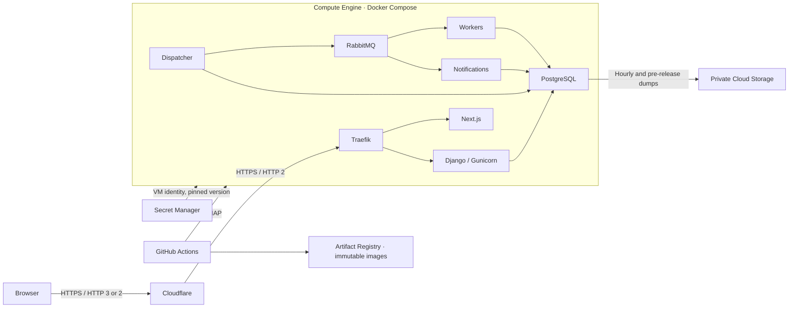

# Google Cloud deployment

This deployment prioritizes low initial cost. One Compute Engine VM runs Traefik,
Next.js, the Django API, collection/calibration workers, a separate notification
worker, the dispatcher, RabbitMQ and PostgreSQL. The default is an `e2-medium`
(4 GiB RAM, one sustained vCPU exposed as two shared vCPUs) in `europe-west1-b`
(Belgium), keeping the base price close to the US region while reducing latency
for users in Türkiye.
PostgreSQL and RabbitMQ use a persistent data disk. Hourly and pre-release database
dumps go to private Cloud Storage with seven-day retention. The recovery-point
target is one hour while scheduled backups succeed; there is no point-in-time
recovery. Application and database availability depend on this one VM. Releases
include a maintenance window.



Images and dependencies are pinned; containers run without root, with read-only
filesystems and resource limits. GitHub deploys through
[Workload Identity Federation](https://docs.cloud.google.com/iam/docs/workload-identity-federation-with-deployment-pipelines),
without a service-account key. Application containers use Distroless runtimes and
target Linux amd64. Windows remains a native development and test platform.

## Gateway and image security

Traefik uses only file-based routing and public ACME certificate issuance. Its
administration API, dashboard and Docker discovery are disabled. Static settings
live in `deploy/compose.yaml`; routes and TLS policy live in `deploy/routes.yml`.
Port 80 is public for ACME HTTP-01; port 443 accepts only the reviewed Cloudflare
IPv4 ranges. Certificates persist on the data disk. Cloudflare Free proxies public
HTTPS with **Full (strict)** origin encryption; Traefik retains a publicly trusted
Let's Encrypt certificate. Cloudflare's edge may serve IPv6 visitors while the
origin VM remains IPv4-only.

Enable HTTP/3, HTTP/2 and TLS 1.3 at Cloudflare, with TLS 1.2 as the minimum and
0-RTT disabled. Keep [HTTP/2 to origin](https://developers.cloudflare.com/speed/optimization/protocol/http2-to-origin/)
enabled; Traefik negotiates it through ALPN. Cloudflare's
[HTTP/3 support](https://developers.cloudflare.com/speed/optimization/protocol/http3/)
applies to visitors, not origin connections.

Traefik accepts forwarded headers only from the published Cloudflare networks.
Django trusts only the gateway's fixed container address, then resolves the
gateway-appended peer and the client immediately before a trusted Cloudflare edge.
It ignores a visitor-supplied prefix and removes raw forwarding/Cloudflare identity
headers before application code. Direct origin requests cannot select a client IP
by sending `X-Forwarded-For` or `CF-Connecting-IP`. Review changes to the official
[IPv4](https://www.cloudflare.com/ips-v4) and [IPv6](https://www.cloudflare.com/ips-v6)
lists against both `deploy/compose.yaml` and the Terraform ingress rules.

`deploy/gateway/` builds upstream Traefik as a pinned Go tool, verifying module
checksums. Review dependency updates with the container build and HTTPS smoke
test. After editing its module requirements, regenerate the locks without a local
Go installation:

```bash
docker build --target lockfiles --output type=local,dest=deploy/gateway deploy/gateway
```

CI and Release scan the exact backend, web, gateway, RabbitMQ and PostgreSQL
images. All HIGH/CRITICAL findings block deployment, including unfixed findings;
there are no vulnerability exceptions. Support-image checks also require package
inventory and a scan matching the selected immutable image identity. Scan results
reflect the vulnerability database at verification time.

`deploy/postgres/Dockerfile` uses stable PostgreSQL 18.7 on Alpine 3.24, with the
unused root privilege-switching helper removed. PostgreSQL always runs as UID/GID
70. Alpine uses musl rather than glibc; a new database uses its own locale behavior.
Do not mount an existing Debian database directory into this image; use a tested
logical dump and restore when moving existing data.

Artifact Registry SHA tags locate builds; deployment, scanning and smoke tests use
the resolved immutable digest. Tags remain mutable so cleanup can remove old
artifacts. The policy selects versions older than 30 days for deletion, retains
the 20 newest versions of each package and always keeps `production` tags. Image
indexes, SBOMs and provenance can consume multiple versions per release; 20
versions does not mean 20 complete releases. Release reads only the four image
identities from the VM's current `release.env`, validates their repository and
digests and verifies `production` retention tags before publishing. Access or
malformed-release errors stop the release; only an absent current release is
treated as first deployment. Successful deployment moves the four retention tags
to the verified new digests. This preserves an older running version even after
many failed builds. Cleanup starts in dry-run mode. Inspect its results and verify
the live retention tags before setting `artifact_cleanup_dry_run = false` in
`terraform.tfvars` and applying it. See the [cleanup policy rules](https://docs.cloud.google.com/artifact-registry/docs/repositories/cleanup-policy).

## What you need

1. A Google Cloud project with billing enabled, and permission to provision its
   network, VM, Cloud Storage, IAM, secrets and monitoring resources.
2. A domain/subdomain whose DNS you can edit, such as `forecast.example.com`.
3. A Google Workspace Gmail sender and an internal OAuth Desktop client with only
   `gmail.send`, or an SMTP service with STARTTLS on port 587. Configure the mail
   provider's SPF/DKIM/DMARC records. Console mail is rejected in production.
4. Repository administration access to configure the GitHub `production`
   environment and variables.

Use Google Cloud Shell for infrastructure commands; this keeps cloud setup the same
for Windows and Ubuntu developers. Application development still uses native
Python 3.15.2 and uv. Small host bootstrap helpers use Ubuntu's system Python;
the application always runs its pinned container interpreter. Infrastructure
requires Terraform **1.17.2**; install that
stable version using [HashiCorp's instructions](https://developer.hashicorp.com/terraform/install)
and verify its published checksum. Do not use a service-account JSON key.

For 730 hours/month in `europe-west1`, budget approximately **USD 37–42/month** for
the default VM, 30 GiB standard boot disk, 30 GiB balanced data disk, one IPv4
address, small backups, image storage and low traffic. This excludes tax, domain,
mail/provider subscriptions, trial credits and commitments. The VM alone is about
USD 26.91/month, the disks USD 4.20/month and IPv4 USD 3.65/month: a baseline of
USD 34.76/month before backups, image storage and traffic. This conservatively
prices both disks without Free Tier credits; allowances depend on billing-account
usage. Verify current [VM](https://cloud.google.com/products/compute/pricing/general-purpose),
[disk](https://cloud.google.com/compute/disks-image-pricing) and
[network](https://cloud.google.com/vpc/pricing) prices before applying Terraform.
Set a Billing budget and alerts; alerts do not cap spending. Measure memory during
collection and calibration before resizing; low HTTP traffic does not remove
the always-on worker, broker and database footprint. This is a single-VM deployment
with no automatic failover.

## First setup

### 1. Create the infrastructure

Clone this repository in Cloud Shell and work from its root. Replace the project
name below. The state bucket must be globally unique and kept private; the person
running Terraform needs access to it. It is intentionally separate from the
application so destroying an environment cannot destroy its state.

```bash
export PROJECT_ID=your-project-id
gcloud storage buckets create "gs://$PROJECT_ID-pyracast-tfstate" \
  --project="$PROJECT_ID" --location=europe-west1 --uniform-bucket-level-access --public-access-prevention
gcloud storage buckets update "gs://$PROJECT_ID-pyracast-tfstate" --project="$PROJECT_ID" --versioning
cp infra/terraform/terraform.tfvars.example infra/terraform/terraform.tfvars
```

Edit `terraform.tfvars`: set `project_id`, `domain`, `acme_email` and your Google
account in `operator_members`. Keep region and zone consistent. Secret replication
is immutable: when moving an existing deployment, set `secret_replica_location`
to its original region to retain its secrets and versions. Keep the existing state
bucket in its original location; its location does not determine the VM region.
The repository
and owner numeric IDs already identify `erkurtharun/pyracast`; forks must change
these IDs and the repository name.

```bash
terraform -chdir=infra/terraform init \
  -backend-config="bucket=$PROJECT_ID-pyracast-tfstate" -backend-config=prefix=production
terraform -chdir=infra/terraform plan -out=production.tfplan
terraform -chdir=infra/terraform apply production.tfplan
terraform -chdir=infra/terraform output
```

Create a Cloudflare **A record** for the configured domain pointing to `instance_ip`.
Initially select **DNS only**. Keep edge HTTPS redirects disabled so HTTP-01
challenges continue to reach port 80 during certificate renewal; Traefik redirects
other HTTP requests itself. Do not add an origin AAAA record.
Traefik obtains and renews its certificate through public port 80. After the release
passes its local HTTPS certificate check, switch the record to **Proxied** and set
**SSL/TLS → Overview → Full (strict)**. Then verify the public HTTPS site. DNS-only
HTTPS access is blocked by the Cloudflare-only origin firewall. Keep Cloudflare
Pseudo IPv4 disabled and retain visitor IP headers; do not add a Worker or another
proxy without reviewing the trust chain. Do not configure cache rules that cache
authentication, API or administration responses.

SSH is accessible only through IAP. Terraform enables OS Login and grants the
named operators access to this VM. Wait for its startup script to finish:

```bash
gcloud compute ssh pyracast --project="$PROJECT_ID" --zone=europe-west1-b --tunnel-through-iap
sudo journalctl -u google-startup-scripts.service --no-pager -n 80
sudo docker compose version
```

### 2. Add secrets

Run secret setup from the repository root on your local Windows or Ubuntu
workstation, with uv, an authenticated Google Cloud CLI and a browser. The helper
generates application encryption, broker and database keys and asks for the mail
backend and sender. It refuses to overwrite existing files; preserve existing
secrets when adding Gmail to an existing deployment. Weather is initially disabled.

```bash
uv run --locked python deploy/create_secrets.py
```

For the Workspace sender, choose `gmail` and `info@pyracast.app`. Enable the Gmail
API in the project. In **Google Auth Platform**, configure the application name
**Pyracast**, its support/contact address, **Internal** audience and only
`https://www.googleapis.com/auth/gmail.send`. Internal audience requires the
project to belong to the sender's Workspace organization. A trial's standalone
organization is different: use a separate, unbilled OAuth-only project under the
Workspace organization in that case. Keep the application infrastructure and
Secret Manager in the deployment project. Under **Clients → Create client**,
select **Desktop app**, name it **Pyracast**, and save its JSON to the ignored local
file `secrets/gmail-client.json`. Then run:

```bash
uv run --locked python deploy/authorize_gmail.py --sender info@pyracast.app
```

Approve send access as `info@pyracast.app` in the browser. The helper uses a random
loopback port, state and PKCE; it requests only `gmail.send` with offline access.
It atomically adds the Gmail credentials/backend/sender to `secrets/runtime.json`
while preserving the existing application keys. It does not send mail or upload
secrets. Use `--no-browser` for a manually opened authorization URL, or `--replace`
when deliberately replacing existing Gmail credentials. Do not print or paste the
client JSON or refresh token. An external application left in **Testing** expires
its Gmail refresh token after seven days; it is unsuitable for unattended delivery.

For `smtp`, the secret helper instead asks for the SMTP host, login and verified
sender. After completing the selected mail setup, upload the files:

```bash
gcloud secrets versions add pyracast-runtime --project="$PROJECT_ID" --data-file=secrets/runtime.json
gcloud secrets versions add pyracast-migration --project="$PROJECT_ID" --data-file=secrets/migration.json
gcloud secrets versions add pyracast-database --project="$PROJECT_ID" --data-file=secrets/database.json
```

The first runtime and database versions are **1**, pinned in Terraform. The runtime
secret is a JSON object of application settings and `RABBITMQ_DEFAULT_PASS`; the migration
secret contains only `PGUSER` and `PGPASSWORD`; the database secret contains only
`POSTGRES_PASSWORD`. Values never enter Terraform state,
image layers or GitHub variables. The VM writes restricted files under `/run`;
Compose reads them literally, without shell evaluation or `$` substitution.
Preserve the Django encryption key separately from the database backup. After
secure backup/upload, remove the local `secrets/` files. Do not paste secret values
into issues, chat or workflow logs. Plant Solcast keys remain in the MFA-protected
administration interface; optional shared EPIAS/weather credentials can be added
to the runtime JSON when authorized.

The first release initializes an empty PostgreSQL data directory and runs
[deploy/bootstrap.sql](../deploy/bootstrap.sql). It creates `pyracast_owner` for
migrations and `pyracast_app` for application DML, installs `btree_gist` and removes
public schema creation. Neither application identity is a superuser or can create
databases. Existing databases require a reviewed import/ownership transfer and a
restore rehearsal; do not use the fresh-database bootstrap as a migration plan.

### 3. Enable delivery

Google and Microsoft sign-in are optional. Configure separate **Web** OAuth
clients; the Gmail sender's Desktop client is not a sign-in client. Use these
exact production redirect URIs:

| Provider | Redirect URI | Application configuration |
| --- | --- | --- |
| Google | `https://pyracast.app/api/accounts/google/login/callback/` | External audience; identity scopes only (`openid`, `email`). Publish the audience for general access. |
| Microsoft | `https://pyracast.app/api/accounts/microsoft/login/callback/` | Any organizational directory and personal Microsoft accounts; delegated `User.Read`; no implicit grant or public-client flow. |

Add `PYRACAST_GOOGLE_CLIENT_ID`, `PYRACAST_GOOGLE_CLIENT_SECRET`,
`PYRACAST_MICROSOFT_CLIENT_ID` and `PYRACAST_MICROSOFT_CLIENT_SECRET` to the runtime
secret. Each provider appears only when both of its values are configured. Keep
client secrets on the backend, rotate them before expiry, and use separate clients
for local development. Login does not request mailbox access or retain provider
tokens. Account connections are managed in **Account → Security**.

For Google **Branding**, use app name **Pyracast**, support/developer contact
**info@pyracast.app**, homepage `https://pyracast.app/`, privacy policy
`https://pyracast.app/privacy/` and terms `https://pyracast.app/terms/`.
Add `pyracast.app` as an authorized domain and verify its ownership in Search Console
with a project owner/editor account. Keep the public operator/contact details accurate.
Publish the External audience and complete any requested brand verification; changing
branding can require verifying and publishing the new draft. JavaScript origins are
not needed for this backend authorization-code flow. These settings belong to the
sign-in project, not the internal Gmail sender project.

In GitHub, create **Settings → Environments → production**. Restrict deployment
branches to `main`; enable required reviewers if you want a human release gate.
Protect `main` with pull requests and the existing Windows/Ubuntu CI checks.
The workflow independently requires successful CI for the exact current `main`
commit; a failed test, stale commit, fork or pull-request run cannot deploy.

Use `terraform -chdir=infra/terraform output -json github_environment_variables`
to obtain the nonsecret values. Add them as **production environment variables**.
`GCP_MIGRATION_SECRET` is the short secret ID (for example `pyracast-migration`)
passed to `gcloud --secret`, without a `projects/.../secrets/` prefix.
Add **`GCP_DEPLOY_ENABLED=true` as a repository variable**, because the initial
authorization job runs before entering the production environment.

Run **Actions → Release → Run workflow → main** after CI is green. Subsequent
successful `main` CI runs trigger it automatically. The workflow:

1. Verifies the image artifact from that exact successful CI run, then publishes
   its backend, web, gateway and PostgreSQL images without rebuilding. OCI digests,
   SBOM and provenance are preserved; all four release references are immutable.
2. Rejects HIGH/CRITICAL image vulnerabilities and tests the exact image digests.
3. Transfers the release through IAP using a short-lived OIDC identity.
4. Checks configuration and database access, stops producers and drains workers,
   takes a database dump and waits for its off-host upload before upgrading
   PostgreSQL/RabbitMQ, migrates with the schema owner, and starts the tested
   revision. A failed backup leaves the application stopped and blocks migration.
5. Promotes `current` only after container readiness checks and a local HTTPS request
   verify the public certificate, routing and database health.

Image artifacts expire after one day and are deleted after successful deployment.
Retry a failed Release while its artifact remains available; otherwise run
**Actions → CI → Run workflow → main**. A successful CI run on `main` triggers
Release automatically, so nothing else is needed after a failed deployment.
To redeploy `main`:

1. Run CI on `main`. Its automatic Release deploys unless the classification
   skips it.
2. If that Release run's summary says "Nothing to release" (`main` differs from
   the deployed commit only in unshipped paths; see "Verification boundary"
   below), run **Actions → Release → Run workflow → main** while that CI run's
   image artifact is unexpired (one day). Once it has expired, repeat step 1 and
   dispatch Release after its automatic Release skipped again.
When retrying CI, choose **Re-run all jobs** so reports and images belong to the
same attempt; **Re-run failed jobs** cannot supply a complete release record.

Runtime and deployment accounts have separate secret access. The deploy account
can administer this VM and therefore has a privileged production trust boundary;
protect repository administration and the production environment accordingly.

### 4. Create the administrator and verify the service

On the VM through IAP:

```bash
sudo -i
cd /opt/pyracast/current
docker compose --env-file deploy/release.env -f deploy/compose.yaml exec api pyracast createsuperuser
docker compose --env-file deploy/release.env -f deploy/compose.yaml exec api \
  pyracast provision_admin_mfa --username YOUR_ADMIN --email admin@example.com
```

Enroll the private authenticator URI immediately; do not put it in logs or tickets.
Open the HTTPS site and test signup, verification mail, login, MFA and one authorized
plant. Check the Cloud Monitoring notification address and confirm a test alert.
Test an actual provider collection and mail acceptance separately; synthetic CI
fixtures do not establish provider access or inbox delivery.

## Operations and recovery

- **Health and logs:** `/health/live/` checks HTTP process liveness without the
  database; `/health/ready/` also checks PostgreSQL. They expose no operational
  details and are not cached. HTTPS uptime alerts detect sustained API/database
  failure. Container stdout/stderr goes to Cloud Logging with a bounded local
  cache. Nonblocking logging can drop entries during overload/network failure;
  durable job/audit records remain in PostgreSQL. API logs omit query strings and
  referrers. Inspect `docker compose ... ps`, `logs --tail 100` and
  `journalctl -u pyracast.service`. Never run `compose config` without `--quiet`
  or export container environment diagnostics: they can disclose secrets.
- **Background delivery:** HTTP readiness does not prove dispatcher/queue health.
  Run `docker compose ... exec api pyracast check_delivery_health` and inspect the
  administration Operations screen. Alert on stale dispatch, failed collections,
  uncertain email delivery, failed/stale backups and VM disk/memory pressure.
  A worker that exhausts its five automatic retries stays stopped until restarted.
  Do not automatically resend an email marked `uncertain`.
- **Planned host maintenance:** run `sudo systemctl stop pyracast` and wait before
  restarting Docker, rebooting or stopping the VM. Workers get 660 seconds for
  their existing 600-second drain and broker cleanup. Google host failure or a
  forced console stop can interrupt that budget; DB leases and idempotency recover
  safe work. No configuration can promise graceful completion after host failure.
- **Failed deployment:** preflight failures preserve the running release. Before
  stopping ingress and producers, the script durably creates
  `/var/lib/pyracast/release-blocked`; only then does it drain workers, back up the
  existing database and upgrade support services. A first deployment initializes
  PostgreSQL under the same block before its initial backup. Any maintenance
  failure leaves the application stopped without downgrading support images.
  The block clears only after readiness and release promotion; even
  after an abrupt host restart, systemd refuses automatic application startup
  while this marker exists. Application containers retry process failures up to
  five times; they rely on systemd for host startup so Docker cannot bypass the
  migration block. Inspect the migration outcome and repair forward or restore
  into a separate database. Rerun the verified release after remediation; success
  clears the marker. Never use `migrate --fake` or automatically reverse migrations.
- **Rollback:** prefer a reviewed Git revert on `main`, successful CI and Release.
  This deploys the former behavior with the current database. Only do this after
  confirming schema compatibility. An incompatible schema change needs a forward
  fix or explicit database restore; moving an image tag does not undo a database.
- **Backups:** the host's hourly timer uploads a custom-format PostgreSQL dump to
  the private backup bucket; each release requires another successful dump before
  migration. Cloud Storage lifecycle cleanup expires objects after seven days;
  deletion is asynchronous. Check the last successful upload, not just timer
  activation. A one-hour recovery point depends on successful hourly backups;
  failures increase possible data loss, and there is no WAL/PITR recovery. Keep
  the external encryption key separately. Rehearse `pg_restore` into a separate
  PostgreSQL 18 database and measure recovery time before launch and regularly
  afterward. Restore tests must include restricted roles, constraints, saved
  forecasts and decryption. After restoring an older request ledger, suspend
  provider collection for the remaining UTC quota day unless its complete ledger
  can be recovered. A data disk or VM snapshot alone is not an off-host logical
  backup or a restore test.
- **Key rotation:** add a numeric runtime secret version, update Terraform's
  `runtime_secret_version`, apply it, and run the VM startup script through a
  controlled maintenance session to refresh `/etc/pyracast/host.json`, then
  redeploy `main`: run CI on `main`; if its automatic Release skipped the
  deployment ("Nothing to release"), dispatch Release while that run's image
  artifact is unexpired (see the redeploy steps under the release procedure).
  Django encryption rotation also requires `PYRACAST_SECRET_KEY_FALLBACKS` and
  `reencrypt_secrets` before removing old keys. RabbitMQ's `RABBITMQ_DEFAULT_PASS`
  only initializes a new data directory: existing broker passwords require a
  coordinated `rabbitmqctl change_password` and application restart. Never delete
  the broker data volume to rotate a password. Database password rotation likewise
  changes the actual SQL role as well as Secret Manager.
- **Patching and storage:** review weekly Dependabot PRs, rebuild and test images;
  exact image digests do not update themselves. Review Ubuntu security updates and
  pinned Docker/Compose/PostgreSQL versions during planned maintenance. PostgreSQL
  major upgrades need a separately rehearsed dump/restore or `pg_upgrade` procedure.
  Remove old unused images/releases only after retaining a known-good rollback
  revision; never run volume pruning in production. Monitor registry/backup/log
  retention and adjust deliberately to control cost.

## Verification boundary

`deploy/smoke.sh BACKEND_IMAGE WEB_IMAGE GATEWAY_IMAGE POSTGRES_IMAGE` runs the actual production Compose
services with disposable PostgreSQL, volumes and locally issued TLS certificates.
HTTPS checks validate the certificate chain and hostname. It applies migrations under the restricted owner,
checks that the runtime role cannot create tables, checks frontend/API/static
routing and forged proxy headers, including a simulated Cloudflare socket peer
with a forged forwarding prefix, publishes one synthetic forecast through the
real RabbitMQ worker, and exercises dispatcher and idle worker stop. Through the
gateway it also checks the anonymous `/api/session/` JSON shape, that a
wrong-password sign-in gets the normal 400 `email_password_mismatch` refusal and
that the `/app/` sign-in page loads.
`tests/test_operations_contracts.py` keeps the values that `deploy/`,
`infra/terraform` and the workflows restate in agreement: worker queues, the
watchdog and drain service lists, stop grace periods, alert event names,
Cloudflare ranges, the gateway trust anchor, router prefixes, timeouts, the
body limit, the CI jobs the release waits for, Gmail constants and `host.json`
keys. Change those values together with that test.
It does not prove GCP IAM, backup upload/restore, metadata firewall rules, public
DNS, ACME, Cloud Logging or live Gmail/SMTP/provider behavior. `compose.smoke.yaml` is test
configuration only. Never apply it to a production Compose project.

CI also retains native Windows and Ubuntu quality, browser, scientific and package
checks and validates Terraform without provisioning resources. BuildKit caches
each image separately; PRs can read the main cache but cannot publish or deploy.
Superseded CI runs are cancelled; production releases remain serialized.
An automatic release whose changes since the newest `production` deployment,
when that deployment succeeded, lie only in unshipped paths (`docs/`, backend
and web tests, `scripts/`, agent, scanner and Dependabot configuration, the root
and `web/` Git ignore files and `web/.prettierignore`; the exact list is in
`deploy/release_scope.py`) skips the `deploy` job and names that deployed commit
in the run summary; any doubt deploys. The classification never skips a manual
dispatch of Release, which still needs green CI and an unexpired artifact for
the current `main` commit and is refused when `main` advanced after the
dispatch; it is also how to redeploy after a manual recovery.
Windows backend tests run in two groups, with complete test selection and the
combined 100% coverage floor verified before release. Sonar starts when the Linux
coverage reports are ready. Merged `main` still runs all checks because its source
can differ from the PR's tested merge. Test timings are retained for seven days.
The actual cloud
deployment and restore exercise remain operator acceptance steps after project,
DNS and mail configuration.
