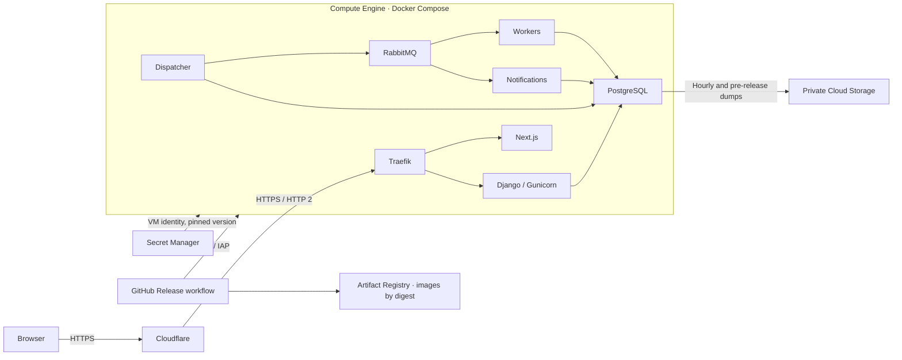

# Google Cloud deployment

The deployment is chosen for a low initial cost. One Compute Engine VM (`e2-medium` in
`europe-west1-b` by default) runs Traefik, Next.js, the Django API, the collection and
calibration worker, the notification worker, the dispatcher, RabbitMQ and PostgreSQL under
Docker Compose. PostgreSQL, RabbitMQ and the gateway's certificates live on a persistent data
disk. Hourly and pre-release database dumps go to a private Cloud Storage bucket that keeps
every generation seven days. The recovery-point target is one hour while hourly backups
succeed; there is no point-in-time recovery and no failover, and a release has a maintenance
window.



This page holds the operator's procedures. How each part works is in its flow page:
[release-pipeline](flows/release-pipeline.md),
[edge-gateway-and-tls](flows/edge-gateway-and-tls.md),
[security-headers-and-proxy-trust](flows/security-headers-and-proxy-trust.md),
[infrastructure-provisioning](flows/infrastructure-provisioning.md),
[secret-provisioning](flows/secret-provisioning.md),
[encryption-key-rotation](flows/encryption-key-rotation.md),
[database-migration](flows/database-migration.md),
[backup-and-restore-rehearsal](flows/backup-and-restore-rehearsal.md),
[host-supervision-and-alerting](flows/host-supervision-and-alerting.md),
[database-reset-and-restore](flows/database-reset-and-restore.md) and
[dependency-and-code-scanning](flows/dependency-and-code-scanning.md).

## Edge, gateway and images

Configure Cloudflare as the code expects:

- The DNS record is an **A record** to the `instance_ip` output and **Proxied**, with
  **SSL/TLS → Full (strict)**: Traefik holds a publicly trusted Let's Encrypt certificate and
  port 443 admits only the Cloudflare IPv4 ranges. Add no AAAA record; the VM is IPv4-only.
- Edge HTTPS redirects stay off, so HTTP-01 challenges reach the public port 80; Traefik
  redirects other HTTP requests itself.
- HTTP/2 to origin on, TLS 1.2 as the minimum and 0-RTT off. Keep the visitor IP headers and
  Pseudo IPv4 off: `src/pyracast/proxy.py` resolves the client from the address Cloudflare
  appends. Add no Worker or other proxy without reviewing that chain, and no cache rule for
  authentication, API or administration responses.

The Cloudflare ranges are copied in `deploy/compose.yaml` (IPv4 and IPv6, for header trust) and
in the Terraform firewall (IPv4). Review changes to the published
[IPv4](https://www.cloudflare.com/ips-v4) and [IPv6](https://www.cloudflare.com/ips-v6) lists
against both.

**Authenticated Origin Pulls** are off while `origin_pull_ca` is empty. To require them:

1. From the VM, check that `curl https://DOMAIN/health/live/` answers `ok` through Cloudflare
   without a challenge.
2. Create a CA and a client certificate it signs, upload the certificate to Cloudflare as a
   zone-level Authenticated Origin Pulls certificate and turn the feature on.
3. Set `origin_pull_ca` in `terraform.tfvars` to the CA's PEM, apply, run the startup script
   (`sudo google_metadata_script_runner startup`) to refresh `/etc/pyracast/host.json` and
   release. The release refuses, before maintenance, a value that does not load as X.509
   certificates.

With origin pulls required, each release asks `/health/live/` through the edge
(`deploy/edge_gate.py`: up to 12 requests 5 seconds apart, until the origin answers `ok` or the
edge answers a challenge) before the new release becomes current. In an upgrade that began
without the maintenance marker it runs before `migrate`, so a failure starts the previous
release again; otherwise a failure leaves maintenance on. A Cloudflare challenge of the VM
fails at once and names the remedies: an edge rule that lets the host's health request through,
or no origin pulls. Host probes use the loopback-only port 8443, which never asks for the edge's
certificate. To go back, set `origin_pull_ca = ""`, apply, refresh `host.json` and release.

`deploy/gateway/` builds Traefik from source as a pinned Go tool. After editing its module
requirements, regenerate the locks without a local Go installation:

```bash
docker build --target lockfiles --output type=local,dest=deploy/gateway deploy/gateway
```

CI and Release scan all five images; a HIGH or CRITICAL finding blocks deployment unless a
reviewed, dated entry of `deploy/image-scan-exceptions.json` accepts it for that package and
service. `deploy/postgres/Dockerfile` runs PostgreSQL 18.7 on Alpine (musl): never mount an
existing Debian data directory into it; move data with a tested dump and restore.

Artifact Registry cleanup deletes versions older than 30 days, keeps the 20 newest of each
package and always keeps `production` tags; each successful release moves the five `production`
tags to its digests. Cleanup starts in dry-run mode: inspect its results and the live tags before
setting `artifact_cleanup_dry_run = false`.

## What you need

1. A Google Cloud project with billing enabled and permission to provision its network, VM,
   Cloud Storage, IAM, secrets and monitoring.
2. A domain or subdomain whose DNS you can edit.
3. A Google Workspace Gmail sender with an internal OAuth Desktop client limited to
   `gmail.send`, or an SMTP service with STARTTLS on port 587. Configure the mail provider's
   SPF, DKIM and DMARC records. Console mail is refused in production.
4. Administration access to the GitHub repository, for the `production` environment and the
   variables.

Run infrastructure commands in Google Cloud Shell with Terraform **1.17.2** (verify its published
checksum), never with a service-account JSON key. Application development uses native
Python 3.15.2 and uv; the host helpers use Ubuntu's system Python. Set a Billing budget and
alerts before applying Terraform.

## First setup

### 1. Create the infrastructure

The state bucket must be globally unique and private, and stays separate from the application so
destroying the environment cannot destroy its state:

```bash
export PROJECT_ID=your-project-id
gcloud storage buckets create "gs://$PROJECT_ID-pyracast-tfstate" \
  --project="$PROJECT_ID" --location=europe-west1 --uniform-bucket-level-access --public-access-prevention
gcloud storage buckets update "gs://$PROJECT_ID-pyracast-tfstate" --project="$PROJECT_ID" --versioning
cp infra/terraform/terraform.tfvars.example infra/terraform/terraform.tfvars
```

Edit `terraform.tfvars`: `project_id`, `domain`, `acme_email` (also the alert address; the host
settings need its domain to be dot-separated labels) and your
account in `operator_members`; keep region and zone consistent. Secret replication is
immutable: when moving an existing deployment, set `secret_replica_location` to its original
region. A fork changes `github_repository`, `github_repository_id` and `github_owner_id`.

```bash
terraform -chdir=infra/terraform init \
  -backend-config="bucket=$PROJECT_ID-pyracast-tfstate" -backend-config=prefix=production
terraform -chdir=infra/terraform plan -out=production.tfplan
terraform -chdir=infra/terraform apply production.tfplan
terraform -chdir=infra/terraform output
```

Point the Cloudflare A record at `instance_ip` as **DNS only** until the first release passes its
local HTTPS check, then switch it to **Proxied** with Full (strict) and verify the public site.

SSH works only through IAP with OS Login. The startup script runs at every boot and changes only
what differs from Terraform's version. When the pinned Docker packages or the Docker
configuration changed, it restarts Docker, and with it the application, only while no release
holds the lock. After an apply that changes it, run it again and check its journal:

```bash
gcloud compute ssh INSTANCE --project="$PROJECT_ID" --zone=ZONE --tunnel-through-iap
sudo google_metadata_script_runner startup
sudo journalctl -u google-startup-scripts.service --no-pager -n 80
```

`INSTANCE` and `ZONE` are the `instance_name` and `zone` outputs.

### 2. Add secrets

Prepare the secret files on a Windows or Ubuntu workstation with uv and an authenticated Google
Cloud CLI. `deploy/host_secrets.py` keeps them in the ignored `secrets/` directory and never
prints a value:

```bash
uv run --locked python deploy/host_secrets.py create
uv run --locked python deploy/host_secrets.py check
```

`create` generates the encryption key and the broker and database passwords, asks for the mail
backend and sender, and refuses to overwrite existing files. `check` names each problem by file
and key. `set KEY` stores one runtime setting typed without echo (EPIAS credentials). `unset KEY`
removes a key the application no longer reads, which `check` reports until then; it refuses a key
the host contract knows or the file lacks. Run it once the release that stopped reading the key
is live, then release the file as a runtime change ("Key rotation"). `rotate` and
`drop-fallbacks` are under "Key rotation".

For the Gmail sender, enable the Gmail API. In **Google Auth Platform** use an **Internal**
audience and only `https://www.googleapis.com/auth/gmail.send`; Internal requires the OAuth
project to belong to the sender's Workspace organization (otherwise use a separate, unbilled
OAuth-only project there). Create a **Desktop app** client, save its JSON as
`secrets/gmail-client.json` and run:

```bash
uv run --locked python deploy/authorize_gmail.py --sender SENDER
```

Approve send access as the sender. The helper sends one check mail from the sender to itself and
only then adds the Gmail credentials to `secrets/runtime.json`
([gmail-sender-authorization](flows/gmail-sender-authorization.md)). For `smtp`, `create` asks
for the host, login and sender instead. Then upload the files:

```bash
gcloud secrets versions add pyracast-runtime --project="$PROJECT_ID" --data-file=secrets/runtime.json
gcloud secrets versions add pyracast-migration --project="$PROJECT_ID" --data-file=secrets/migration.json
gcloud secrets versions add pyracast-database --project="$PROJECT_ID" --data-file=secrets/database.json
```

Terraform pins version **1** of each secret (`runtime_secret_version`, `database_secret_version`,
`migration_secret_version`). Keep a copy of the encryption key apart from the database backups,
then remove the local `secrets/` files. Never paste a secret into an issue, chat or workflow log.
Plant Solcast keys are entered in the administration interface, not in these files.

Every release provisions the database with [deploy/bootstrap.sql](../deploy/bootstrap.sql): the
schema owner `pyracast_owner` runs migrations, the runtime role `pyracast_app` has DML only, and
the superuser signs in only over the database container's local socket
([database-migration](flows/database-migration.md)). An existing database from elsewhere needs a
reviewed import and a restore rehearsal.

### 3. Enable delivery

Google and Microsoft sign-in are optional and use their own **Web** OAuth clients:

| Provider | Redirect URI | Application configuration |
| --- | --- | --- |
| Google | `https://DOMAIN/api/accounts/google/login/callback/` | External audience, published; scopes `openid` and `email` |
| Microsoft | `https://DOMAIN/api/accounts/microsoft/login/callback/` | Organizational and personal accounts; delegated `User.Read`; no implicit grant or public-client flow |

Store `PYRACAST_GOOGLE_CLIENT_ID` and `PYRACAST_GOOGLE_CLIENT_SECRET`, or the `MICROSOFT` pair, in
the runtime secret: both of a pair or neither, since one alone stops the application at startup.
Google's branding names the homepage `https://DOMAIN/`, the privacy policy
`https://DOMAIN/privacy/` and the terms `https://DOMAIN/terms/`, with the domain verified as
authorized. Rotate the client secrets before they expire.

In GitHub, create the environment **production**, restrict its deployment branches to `main`
and add reviewers if you want a human gate. Protect `main` with the `CI result` check. Add the
values of `terraform -chdir=infra/terraform output -json github_environment_variables` as
production environment variables. `PYRACAST_PUBLIC_ORIGIN` makes each release request
`/api/session/` and `/app/` through Cloudflare once it is installed; while it is empty the run
only warns. Add `GCP_DEPLOY_ENABLED=true` as a **repository** variable, since the authorization
job runs outside the environment.

Run **Actions → Release → Run workflow → main** after CI is green. Later CI runs on `main` start
Release by themselves ([release-pipeline](flows/release-pipeline.md) has the authorization rule).
On the VM the installer runs in the transient unit `pyracast-release-<sha>-<run>-<attempt>.service`,
so a cancelled job or a dropped tunnel does not stop it: follow it with `journalctl -u` that unit.
The installer checks configuration, secrets and the migration plan before it changes anything,
drains the dispatcher and workers while the site serves, shows the maintenance notice, takes a
dump and waits for its upload, migrates and promotes `/opt/pyracast/current` only after a local
HTTPS readiness check. It keeps the serving and the previous release and prunes the others.

Image artifacts expire after one day. To retry, re-run the failed Release while its artifact
exists ("Re-run all jobs" for an early start, which refuses a partial re-run), otherwise run
**Actions → CI → Run workflow → main**. Re-running a failed CI job of a commit that is already
released starts a Release run that is refused; that refusal needs no action. To redeploy `main`
(for example after a key rotation):

1. Run CI on `main`; its automatic Release deploys.
2. If that Release run's summary says "Nothing to release" (`main` differs from the deployed
   commit only in unshipped paths, listed in `deploy/release_scope.py`), run
   **Actions → Release → Run workflow → main** while that CI run's artifact is unexpired.

The checkout action leaves those unshipped paths out of the checkout of every job that builds the
images or the release bundle and of every Release job (patterns: output of
`python3 deploy/release_scope.py sparse-patterns`). A pull request's CI builds, scans and
smoke-tests the images from that checkout, so an image build that needs a listed path fails there;
such a path does not belong on the list. Release's own jobs use the same checkout but first run in
the release after a merge.

The deploy account can administer the VM; protect repository administration and the production
environment as a production trust boundary.

### 4. Create the administrator and verify the service

On the VM through IAP:

```bash
sudo -i
cd /opt/pyracast/current
docker compose --env-file deploy/release.env -f deploy/compose.yaml exec api \
  pyracast bootstrap_admin --email admin@example.com
```

Verify mail first: the first sign-in mails a code to this address. The command asks for a
password and shows the authenticator setup once, in this terminal only. For an existing account
the address must be verified on it, or be its only, primary address; otherwise nothing is
stored. A lost or compromised authenticator is removed with
`pyracast reset_mfa --email ADDRESS --reason lost_device|compromised`, which ends the account's
sessions and mails it a notice; then run `bootstrap_admin` again. Both commands take `--dry-run`
([platform-admin-bootstrap](flows/platform-admin-bootstrap.md)).

`pyracast check_mail --send-to ADDRESS` in the `api` container sends one test mail; without
`--send-to` it only opens the transport, as each release does (a failure is a warning in the
release log). Exit codes: 0 accepted, 1 invalid `--send-to` address, 2 configuration invalid,
3 credentials rejected, 4 Gmail authorization revoked (on the workstation, run
`authorize_gmail.py --sender SENDER --replace` as in "Add secrets" and release the file as a
runtime change), 5 sender forbidden, 6 message rejected, 7 rate limited, 8 not sent, 9 outcome
uncertain, 10 preparation failed.

Then test signup, verification mail, sign-in, MFA and one authorized plant on the public site,
confirm the Cloud Monitoring notification channel and send a test alert (below). A real provider
collection and inbox delivery are proven only here, not by CI.

## Operations and recovery

Inspect the host from `/opt/pyracast/current` as root with
`docker compose --env-file deploy/release.env -f deploy/compose.yaml` (`compose` below):
`compose ps`, `compose logs --tail 100 SERVICE` and `journalctl -u pyracast.service`. Never run
`compose config` without `--quiet` or print container environments: they hold secrets.

- **Health and logs:** `/health/live/` is process liveness; `/health/ready/` also checks
  PostgreSQL and is the uptime check. Container output goes to Cloud Logging through `gcplogs`.
  The other containers log non-blocking and can drop lines under pressure; the API logs in
  blocking mode, so every write of the API to stdout and stderr waits for the logging driver,
  which can still drop entries when its own buffer overflows. A 500 `server_error` answer
  carries a `request_id`: search for its `api_server_error` line; a 503 `request_timeout`
  reference names an `api_request_timeout` line. `pyracast.security` lines are also kept 365
  days in the log bucket `pyracast-security`
  ([audit-trail](flows/audit-trail.md)); read older ones with
  `gcloud logging read 'FILTER' --bucket=pyracast-security --location=REGION --view=_AllLogs --freshness=365d`.
  Alert policies live in `infra/terraform/monitoring.tf`; the release does not apply Terraform,
  so after a change there run `plan` and `apply`.
- **Background delivery:** HTTP readiness does not prove the dispatcher or the queues. The
  watchdog runs `pyracast check_delivery_health` in `api` at most every five minutes; run it by
  hand and read the administration Operations screen. Never resend an email marked `uncertain`
  automatically.
- **Host supervision:** `pyracast-watchdog.timer` checks capacity, release block, backup age,
  restore rehearsal, the service unit, containers, delivery, the origin certificate and origin
  pulls, and ends each run with a heartbeat. It restarts failed application containers only under
  the release lock and never restarts a stopped PostgreSQL or RabbitMQ; it only recreates missing
  ones. The watchdog, backup and rehearsal units ship in `deploy/systemd/` and are installed by
  each release and at boot: change them there, not on the host.
- **Planned host maintenance:** run `sudo systemctl stop pyracast` and wait for it before
  restarting Docker, rebooting or stopping the VM; workers get 660 seconds to drain. A host
  failure or forced stop can cut that short; leases and idempotent jobs recover the work.
- **Failed deployment:** before stopping anything the installer creates
  `/var/lib/pyracast/release-blocked`, and `pyracast.service` refuses to start while it exists,
  also after a reboot. Application containers restart on failure at most five times and are
  started on boot only by that unit, so Docker cannot bypass the block. See "A release that fails
  during maintenance". Never use `migrate --fake` or reverse migrations automatically.
- **Rollback:** release a reviewed revert on `main` after confirming that the former code fits
  the current schema. An incompatible schema needs a forward fix or a database restore; moving an
  image tag does not undo a database.
- **Account erasure** cannot be undone. In `api`, `pyracast erase_account --account ID` is a dry
  run that lists what would change; take a backup
  (`sudo systemctl start pyracast-backup.service`, then check its upload), then add `--execute`.
  Backups keep the erased data until they expire ([account-erasure](flows/account-erasure.md)).
- **Backups:** `pyracast-backup.timer` uploads an hourly custom-format dump; each release takes
  another under its own lock before migrating. Releases, hourly backups, the watchdog's
  recovery, the reset tool and the stop of `pyracast.service` share the root-only lock
  `/var/lib/pyracast/release.lock`; the hourly backup waits up to ten minutes for it and skips
  when it stays held or a release is blocked (exit 75, a success for the unit). `/var/lib/pyracast/last-backup.json` names
  the newest verified dump. Check the last successful upload, not the timer. The bucket keeps
  object versions and its lifecycle deletes every generation seven days after creation: find a
  deleted or replaced dump with `gcloud storage ls --all-versions gs://BUCKET/OBJECT` and copy
  `gs://BUCKET/OBJECT#GENERATION` back to `gs://BUCKET/OBJECT`. Bucket reads and writes are in the
  Cloud Storage Data Access audit log. After restoring an older provider request ledger, keep
  provider collection off for the rest of that UTC quota day unless its ledger can be recovered.
  A disk or VM snapshot is not an off-host logical backup.
- **Restore rehearsal:** `pyracast-rehearsal.timer` runs `deploy/rehearsal.py` an hour after boot
  and every Sunday at 03:00. It restores the dump `last-backup.json` names into a throwaway
  PostgreSQL without network, compares every table's row count, runs `migrate --check` (`--plan`
  for a pre-release dump) and requires a stored secret to decrypt; the outcome goes to
  `/var/lib/pyracast/last-rehearsal.json`. The watchdog reports a failed rehearsal, or none passed
  within eight days of uptime. Run one now with `systemctl start pyracast-rehearsal.service`.
- **Optional backup protection**, off until set in `terraform.tfvars` and applied:
  `backup_retention_days` (up to 7) forbids permanent deletion of each generation for that many
  days at no extra storage cost; `data_disk_snapshot_days` (up to 7) takes a daily data-disk
  snapshot; `backup_daily_tier = true` keeps the first hourly backup of each UTC day for 30 days
  under `daily/` once the startup script has run again. The daily tier breaks the published
  seven-day statement: change `web/src/features/public-site/legal-copy.ts` first. To restore a
  `daily/` object with the reset tool, copy it to a `postgres/` name.
- **Key rotation:** `deploy/host_secrets.py rotate secret-key|runtime-password|owner-password`
  changes the local file. A runtime change (`secret-key`, `runtime-password`, and `set`, `unset`
  or `drop-fallbacks`) is uploaded as a new version of `pyracast-runtime`; set
  `runtime_secret_version` to it, apply, run the startup script to refresh `host.json` and
  redeploy `main` at once: the next start of `pyracast.service` reads the new version.
  `owner-password` is uploaded as a new version of `pyracast-migration`; set
  `migration_secret_version` and the `GCP_MIGRATION_SECRET_VERSION` variable to it, apply and
  redeploy `main`: only the release reads the migration secret. The release sets the owner's
  password before maintenance and the runtime role's once API and web have stopped. A new
  secret key keeps the old one first in `PYRACAST_SECRET_KEY_FALLBACKS`; after that release run
  `pyracast reencrypt_secrets --verify` in `api`, and once `pyracast check_secrets
  --require-primary` exits 0, run `host_secrets.py drop-fallbacks` and release it as a runtime
  change (upload, `runtime_secret_version`, apply, startup script, `main`).
  `check_secrets` exits 1 when a secret is unreadable or malformed and 2 under
  `--require-primary` when one still needs a fallback; `reencrypt_secrets` exits 1 or 2 for the
  same causes and commits nothing. Every release refuses, before maintenance, a key set that
  cannot read a stored secret. `RABBITMQ_DEFAULT_PASS` and `POSTGRES_PASSWORD` only initialize a
  new data directory, so `rotate` refuses them: change them in a planned maintenance
  (`rabbitmqctl change_password` and an application restart for the broker), never by deleting
  a data volume ([encryption-key-rotation](flows/encryption-key-rotation.md)).
- **Patching:** review the weekly Dependabot pull requests; image digests do not update
  themselves. The daily `Image rescan` workflow scans images rebuilt from `main`, or the deployed
  `production` digests once `image_rescan_reader = true` is applied and the repository variable
  `GCP_IMAGE_RESCAN` holds `terraform -chdir=infra/terraform output -raw image_rescan_setting`; a
  failed run needs an image update. Review Ubuntu updates and the pinned Docker packages in
  planned maintenance. A PostgreSQL major upgrade needs its own rehearsed dump and restore. Never
  prune volumes in production.

### Releases under open windows

A release stops the old web container before the new one serves, so one build answers at a time. An
open window keeps the build it loaded until it navigates: the next in-app navigation meets an answer
of another build id and loads a document of the new build, and while a value is unsaved the browser
asks first (`docs/flows/installed-app.md`). The server accepts the session an old document signed in
with for at most 90 days after that sign-in, and only while it sends a request at least every 30
days (the session limits, `src/pyracast/accounts/sessions.py`); a document suspended for longer can
still send a request later and is refused. While the product is in development no release keeps request shapes, stored
formats or the manifest compatible for such a document: the new release answers its requests as it
stands, and the next navigation loads the current build. Files of the replaced build
are not kept.

### App worker

A browser that opened the app keeps the service worker served at `/app/sw.js`
(`web/public/app/sw.js`) until a successful update check installs another script. A document
navigation under `/app/` asks for the address (a move inside an open window does not); a check
that fails, offline, on an answer other than the script or on a script that does not run, leaves
the installed worker until a later check succeeds. So every release serves the address, and the
release a failed one falls back to serves it as well, since every release from the installable
app on does. The address answers `text/javascript` with `no-store` and its own policy; the
container smoke pins those headers, the manifest and the icons. The worker passes every navigation
on; only one the server does not answer gets a saved page of the device's copy or the notice, and it
writes the copy only to empty it when it expired or the person removed it on a saved page
(`docs/flows/installed-app.md`).

- **Withdrawal:** a release whose change is exactly these edits:
  1. move `web/public/app/sw.js` with `git mv` to `sw-previous.js` in `web/testing/`; it keeps the worker that browsers hold, which
     the proof installs first;
  2. `cp web/testing/sw-withdraw.js web/public/app/sw.js` serves the script that unregisters itself;
  3. remove the registering component `worker-registration.tsx` in `web/src/lib/` with `git rm`,
     and its import and `<WorkerRegistration />` from `web/src/app/app/layout.tsx`.

  `web/tests/support/worker-state.ts` reads an address serving `sw-withdraw.js` as the withdrawn
  state, and the model test and `npm run test:production` then prove it: a fresh visit registers
  nothing, and a browser holding the previous worker loses its registration at its next successful
  update check and keeps its open window. A revert of the withdrawal commit makes the worker active
  again.
- **Withdrawal of offline reading alone:** a release that sets `SAVED_FIGURES` in
  `web/src/lib/saved/feature.ts` to `false` and serves the worker without its reader and saved pages.
  `web/tests/support/worker-state.ts` reads it as the state "saved figures withdrawn": the round trip
  of `npm run test:production` is replaced by a case that offers no switch and sends no days read, the
  saved-pages suites do not run and `web/tests/saved-figures-withdrawn.spec.ts` does.
  Every document then deletes the copy and forgets its flag when it starts, and the switch, its offer
  and the refresh render and run nothing. The deletion at start stays for at least one further
  release, 90 days later, since a window of the withdrawn build can turn the switch on until its
  session ends. A withdrawal of the worker turns the constant off in the same release
  (`docs/flows/saved-figures.md`).
- **Rollback:** a revert of the faulty change through CI and Release, never an older image and
  never a revert of the worker as a whole.
- **Watch:** CSP reports for `worker-src` and the status of `/app/sw.js` and the manifest. A device
  without a connection rightly shows the notice, and a report keeps only the blocked origin and the
  first segment of the page's path, so a notice or a `worker-src` report starts a withdrawal or a
  rollback only when an online client confirms it while `/health/ready/` is green.

### Alert events

The host scripts write these events to the `pyracast-operations` log; `deploy/operations_events.py`
holds the list with each event's severity and alert. A `match` event has its own log-match policy
in `monitoring.tf` with at most one notification an hour; `pyracast_runtime_restarted` alerts
through a threshold on its log-based metric, the heartbeat through its absence, and every other
event raises no alert. Lines carry ids, states and counts only.
`sudo python3 /opt/pyracast/current/deploy/operations_events.py --test-alert EVENT` writes one
sample line with `test: true` and changes nothing else; it exits 1 when the line could not be
written. A test line of an alerted event opens an incident on its policy; test lines never count
as a heartbeat or a restart. Never delete `release-blocked` by hand.

| Event | Means | Check first | Recover |
| --- | --- | --- | --- |
| `pyracast_watchdog_heartbeat` | One watchdog run ended; `state` is `ok`, `blocked`, `unit_failed` or `lock_busy`. Its absence for 15 minutes alerts | `systemctl status pyracast-watchdog.timer`, `journalctl -u pyracast-watchdog.service` | Start the timer; a down VM needs a start |
| `pyracast_watchdog_step_failed` | One watchdog check (`step`) timed out or raised; the line names the step, the outcome and the error type | The other lines of the same run | Run that step by hand as listed below the table; the other checks still ran |
| `pyracast_host_capacity` | A disk has less than 15 percent free or memory less than 10 percent available | `df -h / /var/lib/pyracast`, `free -m` | Free or grow the disk; find the process holding memory |
| `pyracast_runtime_unhealthy` | A container stays unhealthy after the restart, PostgreSQL or RabbitMQ is unhealthy (`services`), or `pyracast.service` is failed or inactive while no release or stop holds the release lock (`unit_state`) | `compose ps`, `compose logs --tail 100 SERVICE`, `systemctl status pyracast.service` | Fix the cause; `systemctl restart pyracast` once it is gone |
| `pyracast_runtime_restarted` | The watchdog restarted `services` and they recovered. One line notifies nobody; three runs that restart containers within an hour raise the repeated-restarts alert (counted in total, not per service). A test alert writes a test line, which that count leaves out, so it can neither raise nor hide the alert | The container's last exit: `docker inspect --format '{{.State.ExitCode}} {{.State.OOMKilled}} {{.State.FinishedAt}}' CONTAINER`; memory: `free -m`, `docker stats --no-stream`; the release that preceded the first restart: the release log, `readlink /opt/pyracast/current` | Fix what the exit names; if the loop began with a release, release a fix or revert |
| `pyracast_delivery_unhealthy` | The delivery health check failed: `alarms` with counts, `dispatch_phases`, `broker_unreachable`, `missing_queues`; `outcome: unreadable` when it printed no report | The Operations page, `pyracast check_delivery_health` in `api` | Restart the worker or dispatcher it names; correct the data the check lists |
| `pyracast_release_blocked` | A release has kept the site in maintenance for `hours` since the attempt that began the block | "A release that fails during maintenance", the release log | Rerun the verified release or follow the printed recovery |
| `pyracast_certificate_expiring` | The origin certificate has less than a quarter of its lifetime left: renewal is failing | Gateway logs, port 80 reachability | Fix the ACME challenge; the gateway renews by itself |
| `pyracast_origin_pull_unenforced` | Origin pulls are required, but port 443 accepts a handshake without the edge certificate | Gateway logs, `python3 /opt/pyracast/current/deploy/probe_origin_pull.py DOMAIN` | Redeploy the release; check `origin_pull_ca` |
| `pyracast_backup_succeeded` | A dump was uploaded | None | None |
| `pyracast_backup_skipped` | A release held the lock or stayed blocked | Whether a release runs | None; the next hour backs up |
| `pyracast_backup_failed` | A dump failed or was stopped, or the last verified one is older than 90 minutes of uptime | `journalctl -u pyracast-backup.service`, the bucket | Fix the cause; `systemctl start pyracast-backup.service`; release nothing before one succeeds |
| `pyracast_backup_setting_invalid` | `daily_backups` in `/etc/pyracast/host.json` is neither true nor false. An hourly run ends failed: one that took its backup kept it, a skipped one took none; a pre-release backup only warns | The file and `backup_daily_tier` in Terraform | Rewrite the file from Terraform's value with `sudo google_metadata_script_runner startup` |
| `pyracast_backup_daily_copied` | The day's first backup was copied under `daily/` | None | None |
| `pyracast_backup_daily_copy_failed` | The hourly dump succeeded, its daily copy did not (`error`) | The bucket and its IAM | The next hour retries |
| `pyracast_rehearsal_passed` | A restore rehearsal passed | None | None |
| `pyracast_rehearsal_failed` | A rehearsal failed in `step`; the watchdog then reports `pyracast_rehearsal_unhealthy` | `journalctl -u pyracast-rehearsal.service` | Fix the step; `systemctl start pyracast-rehearsal.service` |
| `pyracast_rehearsal_unhealthy` | The last rehearsal failed or none passed within eight days of uptime | `/var/lib/pyracast/last-rehearsal.json` | As for `pyracast_rehearsal_failed` |
| `pyracast_secrets_failed` | The environment files of a release, a service start or the reset tool were not prepared (`category`, `secret`) | The release log, `journalctl -u pyracast.service` | Fix the secret version or permission it names; release again |

A failed watchdog step by hand, in `/opt/pyracast/current` with
`compose=(docker compose --env-file deploy/release.env -f deploy/compose.yaml)`:

- `capacity`: `df -h / /var/lib/pyracast` and `grep Mem /proc/meminfo`.
- `release_blocked`, `backup_age`, `rehearsal`: read `/var/lib/pyracast/release-blocked`,
  `last-backup.json` or `last-rehearsal.json`.
- `unit`: `systemctl is-active pyracast.service`.
- `runtime`: `"${compose[@]}" ps --all`, then `docker inspect` of the containers it lists.
- `delivery`: `"${compose[@]}" exec -T api pyracast check_delivery_health`.
- `certificate`: `openssl s_client -connect 127.0.0.1:8443 -servername DOMAIN </dev/null | openssl x509 -noout -dates`.
- `origin_pull`: `python3 deploy/probe_origin_pull.py DOMAIN --attempts 1`.

### Other alerts

| Alert | Means | Do |
| --- | --- | --- |
| HTTPS readiness failure | `/health/ready/` failed from at least two checker locations for five minutes | Check the VM, PostgreSQL and the latest release; check `/var/lib/pyracast/release-blocked` before restarting anything |
| Watchdog heartbeat missing | No heartbeat for fifteen minutes | As for `pyracast_watchdog_heartbeat` |
| Repeated container restarts | Three watchdog runs within an hour restarted containers | As for `pyracast_runtime_restarted` |
| Security alerts (`sign_in_lockouts`, `second_factor_lockouts`, `authorization_refusals`, `csrf_refusals`, `invitation_limits`, `proxy_headers`, `admin_factor`) | `pyracast.security` lines of that event crossed their ten-minute threshold | Read those lines in the `pyracast-security` bucket for the clients, accounts or workspaces involved; for `proxy_headers` check the gateway and the peer address; for `admin_factor` confirm that the change was planned |

## Database reset and restore

`deploy/reset_database.py` runs as root on the VM under the host's Python 3. Every subcommand
takes the release lock without waiting, refuses before it changes anything unless the step before
it verifiably succeeded, prints one `==>` line per step and ends with the next command. Exit 0
means done, 2 refused ("Refused: ... No data was changed."), 1 a failed step and 130 an
interruption; both of the last print the command to run next. Run it inside `tmux`, so a dropped
IAP session does not interrupt it. The mechanism and every refusal are in
[database-reset-and-restore](flows/database-reset-and-restore.md).

| Subcommand | Does |
| --- | --- |
| `prepare` | With the site ready and no marker: writes the marker with a new session identity, stops the application (the gateway keeps the maintenance notice), dumps the database, uploads it as `postgres/<stamp>-prereset-<uuid>.dump`, verifies it in a throwaway PostgreSQL against the live row counts, exports and uploads the Solcast snapshots, and prints the objects, their SHA-256, the release, its images and the runtime secret version |
| `abort` | While the database is unchanged in this maintenance: checks `migrate --check` of the release in `/opt/pyracast/current`, starts it, probes readiness and removes the marker |
| `reset --confirm OBJECT` | With the session's archive and export unchanged and no application container: purges every queue, drops and recreates database `pyracast`, applies `deploy/bootstrap.sql` and checks both roles. The marker stays |
| `restore --confirm OBJECT` | Restores a verified archive (the host's copy, or downloaded and checked against the bucket) with owners and privileges, compares the row counts, checks the roles and `migrate --check`, starts the release in `/opt/pyracast/current` and removes the marker. Once the database changed in this maintenance it accepts only the session's object |

When a start fails or is interrupted, `abort` and `restore` write the marker back, stop the
application again and print every error, the state they observe and the next step.

### Reset the production database

**What is gone:** every row: accounts, second factors and sessions, workspaces and invitations,
plants, provider accounts with their keys, forecasts, the provider request ledger, observations,
EPIAS data, calibrations, outages, change requests, reminders, audit events and rate-limit
counters. Customers sign up again and the owner enters the provider account again; if the
provider key was used that UTC day, the first plant is approved the next day. **What is kept:**
host configuration, Secret Manager secrets, certificates, and the archive and Solcast export of
step 1, whose live collections step 9 loads back.

Run each command on the VM after `sudo -i`, inside `tmux`. `prepare` followed by `abort` at a
quiet moment proves the dump, upload, verification and restart on the real host with a few
minutes of downtime.

1. Prepare:

   ```bash
   python3 /opt/pyracast/current/deploy/reset_database.py /etc/pyracast/host.json prepare
   ```

   It ends with `Pre-reset archive verified: ...` and the object, archive and export lines;
   write them down. The site is down from here. A later failure prints the `abort` command.
2. To stop here instead:

   ```bash
   python3 /opt/pyracast/current/deploy/reset_database.py /etc/pyracast/host.json abort
   ```

   It ends with
   `The previous release serves again and the marker is removed. Nothing else to do.`
   The archive and export of step 1 stay in `/var/lib/pyracast/reset`; delete the directory as in
   step 10 once you no longer need them.
3. On your own machine, copy both objects out of the bucket's seven-day lifecycle:
   `gcloud storage cp gs://BUCKET/OBJECT gs://BUCKET/EXPORT .`, and check that `sha256sum`
   (Windows: `Get-FileHash -Algorithm SHA256`) shows each printed SHA-256. The archive's provider
   keys decrypt only with the printed runtime secret version.
4. Reset, with the object name exactly as printed:

   ```bash
   python3 /opt/pyracast/current/deploy/reset_database.py /etc/pyracast/host.json reset --confirm OBJECT
   ```

   It ends with `Database pyracast is empty, provisioned and reachable by both roles.` and the
   `restore` command for step 6.
5. Release: **Actions → Release → Run workflow → main** (with an unexpired CI artifact of the
   current `main` commit, otherwise run CI first). The installer migrates the empty database,
   starts the services and removes the marker.
6. Only if step 5 fails before promotion (`/var/lib/pyracast/release-blocked` still exists and
   `readlink -f /opt/pyracast/current` still names the release that served before), run the
   `restore` command `reset` printed, with the object of step 1, never the one in
   `last-backup.json`, which may be a dump of the empty database:

   ```bash
   python3 /opt/pyracast/current/deploy/reset_database.py /etc/pyracast/host.json restore --confirm OBJECT
   ```

   It ends with `OBJECT is restored and the previous release serves again; the marker is
   removed.` A failure after promotion prints "Release SHA is serving" instead: run the command
   it names to finish the release.
7. Create the first administrator as in "Create the administrator and verify the service".
8. The watchdog may report `last_verified_backup_older_than_90_minutes` once after a long
   maintenance, until the next hourly backup.
9. Once the plant's Solcast binding is approved again with the same site and settings and its
   historical file is imported, load the export's live collections back from
   `/opt/pyracast/current`, first with `--dry-run`, then without it (`EXPORT` is the export of
   step 1 or your copy):

   ```bash
   docker compose --env-file deploy/release.env -f deploy/compose.yaml exec -T api \
     pyracast restore_provider_snapshots --username YOUR_ADMIN --tenant-id TENANT \
     --region-id REGION --binding-id BINDING --export - --dry-run < EXPORT
   ```

   The summary names per endpoint what is restored or skipped and why; a second run adds
   nothing. When only the installation date was entered differently on the new binding, add
   `--accept-recorded-difference installation_date` to both runs; never when the provider
   site's settings really changed. Imports and scaled copies are not restored: import the source
   file again and normalize the reference capacity again
   ([provider-snapshot-restore](flows/provider-snapshot-restore.md)).
10. Once your off-host copies show the printed SHA-256 values, delete the host copies; they hold
    every erased row:

    ```bash
    rm -rf /var/lib/pyracast/reset
    ```

An interrupted `prepare` is recovered with `abort`, then `prepare` again. An interrupted `reset`
or `restore` is run again, and a `reset` can always be followed by `restore`.

### A release that fails during maintenance

The Release run is red, and the release log names the state and prints its recovery command,
read from the maintenance session `/var/lib/pyracast/reset/session.json`. Before stopping
anything an upgrade's installer creates the marker; right before `migrate` it records the one
recovery point of the maintenance in that session (its own pre-release dump, kept on the host,
or the object of a prepared reset), so recovery needs neither the bucket nor a token. On a
failure it stops the application, and the gateway keeps the maintenance notice unless the log
says otherwise. A failure before `migrate` of an upgrade that began without the marker starts the
previous release again by itself.

The installer never restores an earlier password: a release it leaves serving runs with the
secrets `/etc/pyracast/host.json` names, as a restart of `pyracast.service` or a reboot would
start it, and the runtime role's password changes only while no API or web container runs.

| State | Marker | `current` | Running | Recovery |
| --- | --- | --- | --- | --- |
| Refused before the lock, the lock timed out, or preflight failed (staging, images, checks, provisioning, plan, `check_secrets`) | unchanged | unchanged | unchanged | fix the cause and release again; an earlier maintenance's recovery still applies |
| Failed before `migrate`, previous release resumed | removed | previous | previous release | fix the cause and release again |
| Failed; the database is unchanged in this maintenance | yes | previous | PostgreSQL, RabbitMQ and the notice, as the log says | `abort` |
| Failed; the database changed (a release reached `migrate`, or a `reset` or `restore` ran) | yes | previous | PostgreSQL, RabbitMQ and the notice, as the log says | a forward fix, or `restore --confirm` the session's object |
| The session file cannot be read | yes | previous | as above | none the helper accepts; the log names the file |
| A stop or the password change failed: this row applies before the rows above | yes | previous | what `compose ps` lists | stop it, run the password command below, then the recovery of the session's row |
| First installation failed after its marker | yes | none | PostgreSQL, the notice, as the log says | fix the cause and release again |
| Failed after promotion | removed | new | new release | the printed command that finishes the release |
| Killed or rebooted after the marker, before promotion | yes | previous | after a reboot PostgreSQL and RabbitMQ | release again; or stop the application, run the password command, then the recovery `python3 /opt/pyracast/releases/<release>/deploy/release_record.py /etc/pyracast/host.json recovery` prints |
| Killed after `current` moved | yes | new | the new release, or after a reboot PostgreSQL and RabbitMQ | `bash /opt/pyracast/current/deploy/install-units.sh install /opt/pyracast/current && rm /var/lib/pyracast/release-blocked && systemctl start pyracast.service` |

The recovery commands are
`python3 /opt/pyracast/current/deploy/reset_database.py /etc/pyracast/host.json abort` and
`python3 /opt/pyracast/current/deploy/reset_database.py /etc/pyracast/host.json restore --confirm OBJECT`.
`abort` refuses once the database changed in this maintenance or when `migrate --check` of the
release in `current` fails; `restore` refuses while an application container runs. After
promotion the new release serves the migrated database and `restore` refuses; the previous
release and its images stay on the host for a reviewed rollback.

The password command renders the release's secrets from `host.json` and needs nothing from
`/run`, which a reboot empties; `<release>` is the release directory (`<sha>-<hash>`) the log
names:

```bash
python3 /opt/pyracast/releases/<release>/deploy/runtime_secrets.py /etc/pyracast/host.json \
  && docker compose --env-file /opt/pyracast/releases/<release>/deploy/release.env \
    -f /opt/pyracast/releases/<release>/deploy/compose.yaml \
    up -d --no-recreate --wait --wait-timeout 180 postgres \
  && python3 /opt/pyracast/releases/<release>/deploy/bootstrap_database.py \
    switch-runtime /opt/pyracast/releases/<release> /run/pyracast/releases/<release>
```

## Verification boundary

CI builds, scans and smoke-tests the exact production images on a disposable Compose stack
(`deploy/smoke.sh`, whose TLS probes set TLS 1.2 as their floor), runs the installer against its failure modes (`deploy/test-release.sh`) and
the broker downgrade (`deploy/test-broker-rollback.sh`), and validates Terraform without
provisioning ([release-pipeline](flows/release-pipeline.md),
[developer-quality-gate](flows/developer-quality-gate.md)). `tests/test_operations_contracts.py`
and `tests/test_host_contract.py` keep the values that `deploy/`, `infra/terraform` and the
workflows restate in agreement: change those values together with these tests.
`deploy/compose.smoke.yaml` is test configuration only; never apply it to a production Compose
project.

CI does not prove GCP IAM, the real bucket upload, the metadata firewall itself (each release
probes it before maintenance), public DNS, ACME, Cloud Logging or live Gmail, SMTP or provider
behavior. These, and a restore on the real host, remain operator acceptance steps after project,
DNS and mail configuration.
