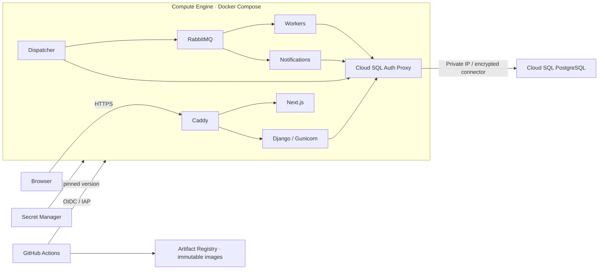

# Google Cloud deployment

This deployment prioritizes low initial cost. One Compute Engine VM runs Caddy,
Next.js, the Django API, collection/calibration workers, a separate notification
worker, the dispatcher and RabbitMQ. Cloud SQL PostgreSQL holds authoritative data.
The VM and database use one region; the default database is zonal. Application
availability depends on this one VM. Releases include a maintenance window.



The practical production baseline is reproducible builds, restricted identities,
separate schema ownership, backups, monitored health and a recoverable release
process. It follows [Docker build guidance](https://docs.docker.com/build/building/best-practices/),
[Google workload federation](https://docs.cloud.google.com/iam/docs/workload-identity-federation-with-deployment-pipelines)
and [Django's deployment checklist](https://docs.djangoproject.com/en/6.1/howto/deployment/checklist/).
Cloud Run's [ten-second termination window](https://docs.cloud.google.com/run/docs/container-contract#instance-shutdown)
does not match the current worker drain contract. Kubernetes adds operating cost
without removing this small installation's application constraints. The retired
[Compute Engine container startup agent](https://docs.cloud.google.com/compute/docs/containers/prepare-for-container-agent-shutdown)
is not used: the VM has explicit startup and systemd configuration. Application
images use Google's [Distroless runtime](https://github.com/GoogleContainerTools/distroless)
without shells or package managers, with the exact Python/Node versions copied
from pinned build images. The Python runtime contains the native modules needed
by this PostgreSQL application; optional SQLite, interactive terminal and GUI
extensions are excluded. Copied native libraries retain package provenance for
vulnerability scanning. These images are application artifacts, not general
purpose Python/Node development environments. Production images target Linux
amd64; Windows remains a native development and test platform.

## Gateway dependency review

The gateway builds Caddy 2.11.9 with Go 1.27.4 and locked dependencies in
`deploy/gateway/`. It updates `golang.org/x/net` to 0.62.0 and
`klauspost/compress` to 1.20.2, addressing the HTML parser and compression
advisories and the Go HTTP server fix. See the primary
[HTML parser advisory](https://pkg.go.dev/vuln/GO-2026-6860),
[compression advisory](https://pkg.go.dev/vuln/GO-2026-6865) and
[Go HTTP server advisory](https://pkg.go.dev/vuln/GO-2026-6859).

One raw HIGH finding remains: `CVE-2026-116587` in go-jose/v3 3.0.5 has no upstream
v3 fix. Its RSA private-JWK parser remains compiled. The reviewed deployment
disables administration and configures only reverse-proxy, encoding, header and
request-size handlers. It exposes no ACME server or JWK/JWT processing endpoint.
The [vulnerable path](https://github.com/go-jose/go-jose/security/advisories/GHSA-mgcc-cww5-fp2q)
would be exposed by Smallstep's
[ACME server middleware](https://github.com/smallstep/certificates/blob/v0.30.2/acme/api/middleware.go).
Caddy's outbound ACME client and its public
[HTTP-01 challenge responder](https://github.com/caddyserver/certmagic/blob/v0.25.6/httphandlers.go)
do not provide that API. Request size limits and timeouts are separate controls.

`deploy/gateway/review.json` records this configuration-dependent not-affected
decision, expiring **2026-11-27**. The gate requires the exact compiled binary
SHA-256, both production configuration hashes, disabled administration, a restricted
adapted handler set, and the exact CVE, module version and binary path. Each raw
scan must match the selected immutable image identity. A changed binary,
configuration, finding, missing inventory or expired review fails the gate.
Review dependency updates deliberately and remove or reassess the decision when
the upstream dependency changes. The standard Caddy build also retains deprecated
OpenPGP helpers in optional PKI dependencies; a separate Go symbol scan reports
that upstream limitation.

Ubuntu CI and release jobs run `deploy/scan-support.sh`, deriving RabbitMQ and
Cloud SQL proxy references from Compose and scanning them alongside the gateway.
They print raw findings before applying the bounded decision: the current gateway
result is **one raw HIGH, one reviewed not affected**; RabbitMQ and the SQL proxy
have zero HIGH/CRITICAL findings in the verified artifacts. New HIGH/CRITICAL
findings, including unfixed findings, block release. These results describe the
reviewed artifacts and vulnerability database at verification time.

## What you need

1. A Google Cloud project with billing enabled, and permission to provision its
   network, VM, Cloud SQL, IAM, secrets and monitoring resources.
2. A domain/subdomain whose DNS you can edit, such as `forecast.example.com`.
3. An SMTP service with a verified sender, STARTTLS on port 587, credentials and
   the provider's SPF/DKIM/DMARC records. Console mail is rejected in production.
4. Repository administration access to configure the GitHub `production`
   environment and variables.

Use Google Cloud Shell for the following commands; this keeps cloud setup the same
for Windows and Ubuntu developers. Application development still uses native
Python 3.15.2 and uv. Small host bootstrap helpers use Ubuntu's system Python;
the application always runs its pinned container interpreter. Infrastructure
requires Terraform **1.17.2**; install that
stable version using [HashiCorp's instructions](https://developer.hashicorp.com/terraform/install)
and verify its published checksum. Do not use a service-account JSON key.

The default VM has 2 vCPU / 8 GiB; Cloud SQL has 1 vCPU / 3.75 GiB. Expect a paid,
always-running installation, not a free-tier server. Compute and SQL alone are
roughly US$100/month at representative on-demand rates, before disks, public IPv4,
backups, logs, image storage, traffic, mail and taxes. Confirm the actual region
and currency in the [Google pricing calculator](https://cloud.google.com/products/calculator),
using the [Compute](https://cloud.google.com/compute/all-pricing) and
[Cloud SQL](https://cloud.google.com/sql/pricing) rates before applying Terraform.
Set a Billing budget and 50/80/100% alerts; budget alerts do not cap spending.
Smaller VM/SQL tiers are configurable after measuring memory, connection and CPU
usage. `database_ha=true` increases database resilience and cost; it does not make
the single application VM highly available.

## First setup

### 1. Create the infrastructure

Clone this repository in Cloud Shell and work from its root. Replace the project
name below. The state bucket must be globally unique and kept private; the person
running Terraform needs access to it. It is intentionally separate from the
application so destroying an environment cannot destroy its state.

```bash
export PROJECT_ID=your-project-id
gcloud config set project "$PROJECT_ID"
gcloud storage buckets create "gs://$PROJECT_ID-pyracast-tfstate" \
  --location=europe-west1 --uniform-bucket-level-access --public-access-prevention
gcloud storage buckets update "gs://$PROJECT_ID-pyracast-tfstate" --versioning
cp infra/terraform/terraform.tfvars.example infra/terraform/terraform.tfvars
```

Edit `terraform.tfvars`: set `project_id`, `domain`, `acme_email` and your Google
account in `operator_members`. Keep region and zone consistent. The repository
and owner numeric IDs already identify `erkurtharun/pyracast`; forks must change
these IDs and the repository name.

```bash
terraform -chdir=infra/terraform init \
  -backend-config="bucket=$PROJECT_ID-pyracast-tfstate" -backend-config=prefix=production
terraform -chdir=infra/terraform plan -out=production.tfplan
terraform -chdir=infra/terraform apply production.tfplan
terraform -chdir=infra/terraform output
```

Create an **A record** for the configured domain pointing to `instance_ip`. Do not
add an AAAA record; this installation is IPv4-only. Caddy obtains and renews HTTPS
certificates when the application is deployed and DNS resolves. If using a DNS
provider with an HTTP proxy, initially use DNS-only; introducing another proxy
requires an explicit trusted-client-IP configuration.

SSH is accessible only through IAP. Terraform enables OS Login and grants the
named operators access to this VM. Wait for its startup script to finish:

```bash
gcloud compute ssh pyracast --zone=europe-west1-b --tunnel-through-iap
sudo journalctl -u google-startup-scripts.service --no-pager -n 80
sudo docker compose version
```

### 2. Initialize the database roles

Set the initial `postgres` administrator password without putting it in shell
history, then open **Cloud SQL → pyracast → Cloud SQL Studio**, database
`pyracast`, user `postgres`:

```bash
gcloud sql users set-password postgres --instance=pyracast --prompt-for-password
```

Run the SQL in [deploy/bootstrap.sql](../deploy/bootstrap.sql) once. It creates
`pyracast_owner` for migrations and `pyracast_app` for application DML, installs
`btree_gist`, removes public schema creation and grants future table/sequence
access. Neither application identity is a superuser or can create databases.
Set distinct strong passwords and save them in your password manager:

```bash
gcloud sql users set-password pyracast_owner --instance=pyracast --prompt-for-password
gcloud sql users set-password pyracast_app --instance=pyracast --prompt-for-password
```

Existing databases need a reviewed ownership/grant transfer and a restore
rehearsal; do not rerun the fresh-database bootstrap blindly. Database roles created
through SQL avoid Cloud SQL's automatically privileged built-in-user defaults.

### 3. Add secrets

From the repository root, run the prompt-based helper. It generates new application
encryption and broker keys and asks for the passwords from step 2 and SMTP details.
It refuses to overwrite existing files. Weather is initially disabled until an
authorized commercial service is configured.

```bash
python3 deploy/create_secrets.py
gcloud secrets versions add pyracast-runtime --data-file=secrets/runtime.json
gcloud secrets versions add pyracast-migration --data-file=secrets/migration.json
```

The first runtime version is **1**, pinned in Terraform. The runtime secret is a
JSON object of application settings and `RABBITMQ_DEFAULT_PASS`; the migration
secret contains only `PGUSER` and `PGPASSWORD`. Values never enter Terraform state,
image layers or GitHub variables. The VM writes restricted files under `/run`;
Compose reads them literally, without shell evaluation or `$` substitution.
Preserve the Django encryption key separately from the database backup. After
secure backup/upload, remove the local `secrets/` files. Do not paste secret values
into issues, chat or workflow logs. Plant Solcast keys remain in the MFA-protected
administration interface; optional shared EPIAS/weather credentials can be added
to the runtime JSON when authorized.

### 4. Enable delivery

In GitHub, create **Settings → Environments → production**. Restrict deployment
branches to `main`; enable required reviewers if you want a human release gate.
Protect `main` with pull requests and the existing Windows/Ubuntu CI checks.
The workflow independently requires successful CI for the exact current `main`
commit; a failed test, stale commit, fork or pull-request run cannot deploy.

Use `terraform -chdir=infra/terraform output -json github_environment_variables`
to obtain the nonsecret values. Add them as **production environment variables**.
Add **`GCP_DEPLOY_ENABLED=true` as a repository variable**, because the initial
authorization job runs before entering the production environment.

Run **Actions → Release → Run workflow → main** after CI is green. Subsequent
successful `main` CI runs trigger it automatically. The workflow:

1. Builds or reuses immutable commit images with SBOM and provenance.
2. Blocks HIGH/CRITICAL image vulnerabilities, applying only the bounded gateway
   decision above, then tests the exact backend, web and gateway digests.
3. Takes and waits for a Cloud SQL backup.
4. Transfers the release through IAP using a short-lived OIDC identity.
5. Checks configuration and database access, stops producers, drains workers,
   migrates with the schema owner, and starts the tested revision.
6. Promotes `current` only after container readiness passes.

Runtime and deployment accounts have separate secret access. The deploy account
can administer this VM and therefore has a privileged production trust boundary;
protect repository administration and the production environment accordingly.

### 5. Create the administrator and verify the service

On the VM through IAP:

```bash
sudo -i
cd /opt/pyracast/current
docker compose --env-file deploy/release.env -f deploy/compose.yaml exec api pyracast createsuperuser
docker compose --env-file deploy/release.env -f deploy/compose.yaml exec api \
  pyracast provision_admin_mfa --username YOUR_ADMIN --email admin@example.com
```

Enroll the private authenticator URI immediately; do not put it in logs or tickets.
Open the HTTPS site and test signup, verification mail, login, MFA and one authorized
plant. Check the Cloud Monitoring notification address and confirm a test alert.
Test an actual provider collection and mail acceptance separately; synthetic CI
fixtures do not establish provider access or inbox delivery.

## Operations and recovery

- **Health and logs:** `/health/live/` checks HTTP process liveness without the
  database; `/health/ready/` also checks PostgreSQL. They expose no operational
  details and are not cached. HTTPS uptime alerts detect sustained API/database
  failure. Container stdout/stderr goes to Cloud Logging with a bounded local
  cache. Nonblocking logging can drop entries during overload/network failure;
  durable job/audit records remain in PostgreSQL. API logs omit query strings and
  referrers. Inspect `docker compose ... ps`, `logs --tail 100` and
  `journalctl -u pyracast.service`. Never run `compose config` without `--quiet`
  or export container environment diagnostics: they can disclose secrets.
- **Background delivery:** HTTP readiness does not prove dispatcher/queue health.
  Run `docker compose ... exec api pyracast check_delivery_health` and inspect the
  administration Operations screen. Alert on stale dispatch, failed collections,
  uncertain email delivery, Cloud SQL storage growth and VM disk/memory pressure.
  A worker that exhausts its five automatic retries stays stopped until restarted.
  Do not automatically resend an email marked `uncertain`.
- **Planned host maintenance:** run `sudo systemctl stop pyracast` and wait before
  restarting Docker, rebooting or stopping the VM. Workers get 660 seconds for
  their existing 600-second drain and broker cleanup. Google host failure or a
  forced console stop can interrupt that budget; DB leases and idempotency recover
  safe work. No configuration can promise graceful completion after host failure.
- **Failed deployment:** before migration, the script attempts to restart the
  previous release if it stopped it. It durably creates
  `/var/lib/pyracast/release-blocked` before migration and clears it only after
  readiness and release promotion. A later failure stops the application; even
  after an abrupt host restart, systemd refuses automatic application startup
  while this marker exists. Application containers retry process failures up to
  five times; they rely on systemd for host startup so Docker cannot bypass the
  migration block. Inspect the migration outcome and repair forward or restore
  into a separate database. Rerun the verified release after remediation; success
  clears the marker. Never use `migrate --fake` or automatically reverse migrations.
- **Rollback:** prefer a reviewed Git revert on `main`, successful CI and Release.
  This deploys the former behavior with the current database. Only do this after
  confirming schema compatibility. An incompatible schema change needs a forward
  fix or explicit database restore; moving an image tag does not undo a database.
- **Backups:** Cloud SQL has daily backups and seven days of PITR; each release
  adds a backup. Rehearse restoration into a separate instance, including the
  external encryption key, before launch and regularly afterward. Daily VM data
  disk snapshots retain RabbitMQ/Caddy data for seven days but are crash-consistent
  and do not replace Cloud SQL backups. Database durability and application uptime
  are different properties. Agree measured RPO/RTO after the restore exercise.
- **Key rotation:** add a numeric runtime secret version, update Terraform's
  `runtime_secret_version`, apply it, and run the VM startup script through a
  controlled maintenance session to refresh `/etc/pyracast/host.json`, then deploy.
  Django encryption rotation also requires `PYRACAST_SECRET_KEY_FALLBACKS` and
  `reencrypt_secrets` before removing old keys. RabbitMQ's `RABBITMQ_DEFAULT_PASS`
  only initializes a new data directory: existing broker passwords require a
  coordinated `rabbitmqctl change_password` and application restart. Never delete
  the broker data volume to rotate a password. Database password rotation likewise
  changes the actual SQL role as well as Secret Manager.
- **Patching and storage:** review weekly Dependabot PRs, rebuild and test images;
  exact image digests do not update themselves. Review Ubuntu security updates and
  pinned Docker/Compose/Cloud SQL Proxy versions during planned maintenance.
  Remove old unused images/releases only after retaining a known-good rollback
  revision; never run volume pruning in production. Monitor registry/backup/log
  retention and adjust deliberately to control cost.

## Verification boundary

`deploy/smoke.sh BACKEND_IMAGE WEB_IMAGE GATEWAY_IMAGE` runs the actual production Compose
services with a disposable PostgreSQL container replacing Cloud SQL, a local TLS
issuer and disposable volumes. It applies migrations under the restricted owner,
checks that the runtime role cannot create tables, checks frontend/API/static
routing and forged proxy headers, publishes one synthetic forecast through the
real RabbitMQ worker, and exercises dispatcher and idle worker stop.
It does not prove GCP IAM, the SQL connector, metadata firewall rules, public DNS,
ACME, Cloud Logging or live SMTP/provider behavior. `compose.smoke.yaml` is test
configuration only. Never apply it to a production Compose project.

CI also retains native Windows and Ubuntu quality, browser, scientific and package
checks and validates Terraform without provisioning resources. The actual cloud
deployment and restore exercise remain operator acceptance steps after project,
DNS and mail configuration.
