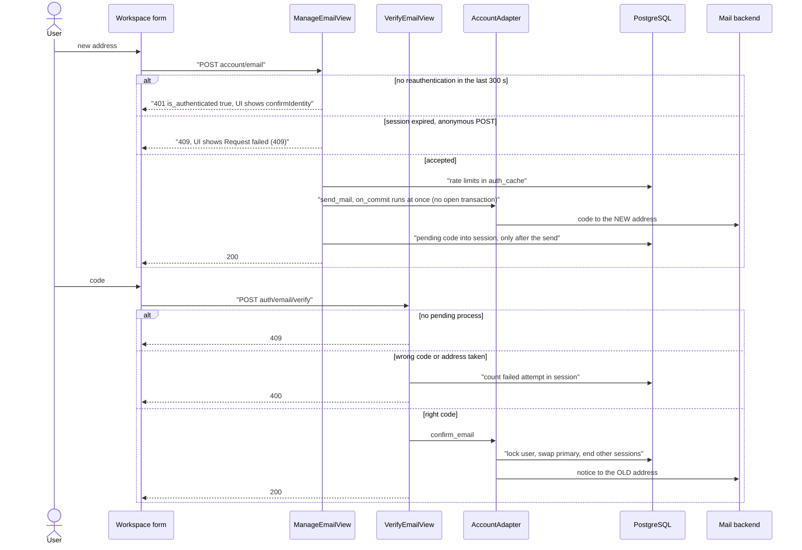

# Change the account email and verify it by code

A signed-in user opens "Change email" in account settings, submits a new address and enters the code mailed to it. Nothing reaches `account_emailaddress` until the code is accepted: the pending change lives only in the user's session. On success the new address becomes the single primary verified address, `auth_user.email` follows it, the old address is mailed a notice and every other session of the user is ended. No worker or command takes part; mail is sent inside the request.

## Entry points

- Screen: `web/src/components/dashboard.tsx` `Workspace`, profile view, two `ActionForm`s in `details.account-disclosure` (send code, verify code), enabled for every role because the profile view sets `WorkspaceAccess` to true.
- `POST /api/auth/browser/v1/account/email` -> allauth `ManageEmailView`, mounted by `include("allauth.headless.urls")` in `src/pyracast/urls.py`. GET, PUT, PATCH and DELETE are routed too; the web uses only POST.
- `POST /api/auth/browser/v1/auth/email/verify` -> allauth `VerifyEmailView`, wrapped in `require_POST` in `src/pyracast/urls.py` (shared with `company-signup`).

## Sequence

## Data

| Table | R/W | What |
| --- | --- | --- |
| `django_session` | R/W | Pending process `account_email_verification_code` (email, code, time, failed attempts); reauthentication record; the user's other sessions are deleted at confirmation |
| `account_emailaddress` | R/W | Duplicate checks; at confirmation the new row is inserted primary and verified, old rows are demoted then deleted |
| `auth_user` | R/W | Row locked `FOR UPDATE`; `email` rewritten at confirmation |
| `usersessions_usersession` | R/W | Rows of all other sessions of the user are deleted (`UserSession.end`) |
| `pyracast_authentication_cache` (`auth_cache` database) | R/W | Counters for `manage_email` and `confirm_email` |

## Authorization

- Session cookie plus CSRF header, enforced by `CsrfViewMiddleware` before the view (403 HTML, shown as "Request failed (403)"). `ManageEmailView.dispatch` answers 401 to anonymous non-POST calls and 409 to an anonymous POST without a signup verification stage.
- Reauthentication: `raise_if_reauthentication_required` inside allauth `add_email`, configured by `ACCOUNT_REAUTHENTICATION_REQUIRED` and `ACCOUNT_REAUTHENTICATION_TIMEOUT` (300 s) in `src/pyracast/settings.py`; login does not count. Applies to POST, PATCH and DELETE of a stored address; not to GET, PUT, DELETE of the pending address (it aborts the process) or verify.
- The code is valid only in the session that requested it (`EmailVerificationProcess.resume`); another browser gets 409.
- No role check: any signed-in user, staff included, may change the email.
- Uniqueness: partial unique constraint `unique_verified_email`, mapped to `email_taken` by `AccountAdapter.confirm_email`.

## Failure paths

| Condition | Result |
| --- | --- |
| Malformed address or already on this account | 400 with `errors[].param=email`, shown on the field |
| Address belongs to another account | 200 (enumeration prevention) and a code is mailed to it; at verify 400 `email_taken` only if the other account holds it verified, otherwise the change succeeds |
| No reauthentication in the last 300 s | 401 `is_authenticated=true`; UI shows `confirmIdentity`, no inline reauthentication form |
| Session expired while sending | 409 (anonymous POST); UI shows "Request failed (409)"; the `sessionExpired` branch is not reached |
| Any send to the same address (by any user) within 1 minute, more than 10 email requests a minute, or a session request running for 5 s | 429 (`session_busy` for the latter); UI shows "Request failed (429)" |
| Verify without pending process, after 600 s, after abort or with an expired session | 409; UI shows "Request failed (409)" |
| Wrong code | 400 `incorrect_code`; the third failure deletes the pending process |
| Address verified elsewhere meanwhile | 400 `email_taken` (the pre-check keeps the code but counts an attempt; a race at confirmation consumes it) |
| Mail backend error on the code or the old-address notice | Contained and logged by the account mail adapter (`account-mail-notifications`); the request answers as on success |

## Rules and invariants

- Lock order at confirmation: session advisory lock (whole request) -> `auth_user` row (`AccountAdapter.confirm_email`) -> `account_emailaddress` writes. Concurrent confirmations of one user serialize; the constraint admits one owner across users.
- `ACCOUNT_CHANGE_EMAIL=True`: confirmation replaces the old address; mail is deferred with `transaction.on_commit`, so a rolled-back confirmation sends no notice.
- Code policy: 600 s lifetime, 3 attempts, one send per target address per minute across all users (`ACCOUNT_RATE_LIMITS["confirm_email"]` overrides allauth's 10 s default). A new POST replaces the pending process and its code. A pending address cannot sign in or recover (`email_identity`).

## Tests

- `tests/test_auth_lifecycle.py`: reauthentication and initiating-session rule, notice to the old address after an HTTP change (recipient only, not content), pending address unusable for login and recovery, concurrent confirmations admit one owner. `tests/test_account_email_confirmation.py`: saved reminder recipients kept through the endpoints, user-row lock order, integrity errors not swallowed. `tests/test_session_serialization.py` exercises this flow only in `test_ordinary_api_response_cannot_restore_stale_code_attempts`; its CSRF, safe-method and expired-session tests use signup or reset. `tests/test_account_session_revocation.py` sends `email_changed` directly; `tests/test_notifications.py` changes `auth_user.email` with an update, not through the flow.
- Playwright (`web/tests/account-security.spec.ts`, `two-factor-settings.spec.ts`, `workspace-roles.spec.ts`) only mocks the endpoints and never submits the send form. Gaps: send-form errors (409, 429) not tested end to end; no test of the 3-minute limit or the notice mail's content; PUT, PATCH, DELETE untested.
