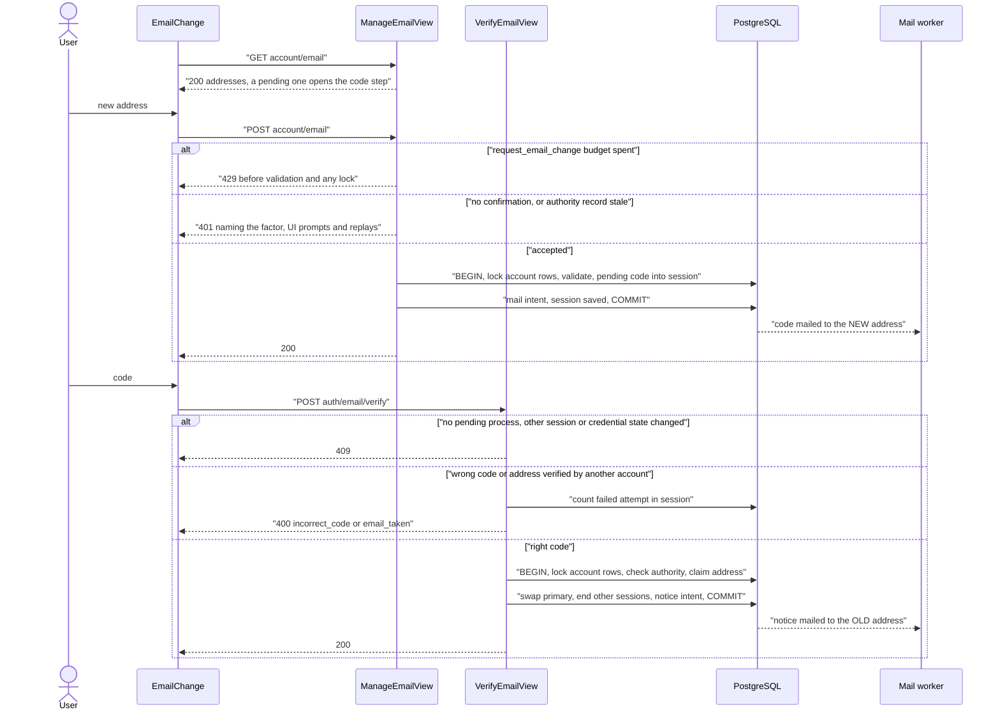

# Change the account email and verify it by code

A signed-in user opens "Change email" in account settings, submits a new address and enters the code mailed to it. Nothing reaches `account_emailaddress` until the code is accepted: the pending change lives only in the user's session. On success the new address becomes the single primary verified address, `auth_user.email` follows it, the old address is mailed a notice and every other session of the user is ended. Mail is stored as an intent in the request's transaction and sent by the notification worker; no command takes part.

## Entry points

- Screen: `web/src/features/account/email-change.tsx` `EmailChange`, mounted by `account-settings.tsx` `AccountSettings` on `/app/account/` for every signed-in role. It seeds its step from `GET account/email` (a pending address shows the code step), asks the shared prompt on a 401 and resumes the request (`step-up-reauthentication`), and offers resend and "Use another address" (DELETE of the pending address).
- `GET|POST|DELETE /api/auth/browser/v1/account/email` -> `pyracast.accounts.headless.ManageEmailView`, routed in `accounts/auth_urls.py`; PUT and PATCH answer 405 `method_not_allowed`. POST starts a change, DELETE removes an address or aborts the pending one.
- `POST .../auth/email/verify` -> `headless.VerifyEmailView` and `POST .../auth/email/verify/resend` -> `headless.ResendEmailVerificationCodeView`; both are shared with `company-signup`.

## Sequence

## Data

| Table | R/W | What |
| --- | --- | --- |
| `django_session` | R/W | Pending process `account_email_verification_code` (email, code, time, failed attempts) stamped with the account's credential state; the authority record; the user's other sessions are deleted at confirmation |
| `account_emailaddress` | R/W | Duplicate checks; at confirmation the new row is inserted primary and verified, old rows are demoted then deleted; DELETE removes a stored secondary |
| `auth_user` | R/W | Locked with the account's other rows; `email` rewritten at confirmation |
| `usersessions_usersession` | R/W | Rows of all other sessions of the user are deleted |
| `pyracast_authentication_cache` (`auth_cache` database) | R/W | Counters for `request_email_change` and `confirm_email` |
| `notifications_outboundmail` | W | The code mail and the notice to the old address |

## Authorization

- Session cookie plus CSRF header, enforced by `CsrfViewMiddleware` before the view (403 `csrf_failed`). Anonymous GET and DELETE answer 401; an anonymous POST without a sign-up verification stage answers 409.
- Confirmation (300 s, strongest factor only; login does not count): `authorize_credential_write` runs first in the POST's `handle_input`, in `credential_write` for DELETE (the pending address too) and when a signed-in session completes its own change at `auth/email/verify`; it answers the step-up 401 when the session's authority record differs from the locked credential state and 400 `session_ended` when the session is gone. The code stays pending through a confirmation. A sign-up code of another account completes by its own stamp.
- The code is valid only in the session that requested it (`EmailVerificationProcess.resume`); another browser gets 409.
- No role check: any signed-in user, staff included, may change the email.
- Uniqueness: partial unique constraint `unique_verified_email`, mapped to `email_taken` by `AccountAdapter.confirm_email`.

## Failure paths

| Condition | Result |
| --- | --- |
| Malformed address, longer than 254 characters (`inputs.AddEmailInput`) or already on this account | 400 with `fields.email`, shown on the field |
| Address belongs to another account | 200 (enumeration prevention) and a code is mailed to it; at verify 400 `email_taken` only if the other account holds it verified, otherwise the change succeeds |
| No confirmation, or the account's credentials changed since the session's last | 401 naming the strongest factor; the shared prompt opens and the request resumes once |
| Session expired while sending | 409 (anonymous POST), shown as the conflict message; the session-expired branch is not reached |
| Budget spent (`request_email_change`: 3 per 10 minutes and 10 per day per account, 20 per hour per IP; `confirm_email`: one code per address per minute and six per hour), or the session's lock busy for 5 s | 429 (`session_busy` for the lock, one client retry); a spent `request_email_change` budget answers before input validation and any lock |
| Verify or resend without pending process, after 600 s, after abort, from another session, after the account's credentials changed, or for an address already verified on this account | 409; the UI shows the expired-code notice and restarts from the address |
| Wrong code | 400 `incorrect_code`; the third failure deletes the pending process |
| Fourth resend, or a resend within a minute of the last code | 409, or 429 |
| Session ended meanwhile (send, resend or verify) | 400 `session_ended`; no code is queued and no line written. A session row that cannot be locked in time answers 503 `busy` |
| Mail cannot be delivered | The worker retries the stored intent; the request answers as on success (`account-mail-notifications`) |

## Rules and invariants

- Lock order: session advisory lock (whole request), then the account's rows (`processes.account_state(lock=True)`: addresses, identities, user, authenticators), then the session row, then `account_emailaddress` writes (`AccountAdapter.confirm_email` locks the user row). Concurrent confirmations of one user serialize; the constraint admits one owner across users.
- A pending change rests on the account's credential state as read under lock when it started and ends on any change of it, rechecked at confirmation. The request locks the account's rows before it validates the new address, so a change started meanwhile waits and then ends the code. Starting the change saves the session before the commit that stores the code mail; a refused change saves none.
- `ACCOUNT_CHANGE_EMAIL=True`: confirmation replaces the old address; the notice and the `sessions_revoked` line (reason `email_changed`) leave with the commit, so a rolled-back confirmation sends none. `email_change_requested` is written when a code is sent for a change and `email_changed` when it completes.
- Code policy: 600 s lifetime, 3 attempts, up to three resends (each invalidates the older code), one code per target address per minute and six per hour across all users (`ACCOUNT_RATE_LIMITS["confirm_email"]` replaces allauth's 10 s default). A new POST replaces the pending process and its code. A pending address cannot sign in or recover.

## Tests

- `tests/test_auth_lifecycle.py` (reauthentication and initiating-session rule, notice to the old address, pending address unusable for login and recovery, concurrent confirmations admit one owner), `tests/test_account_email_confirmation.py` (saved reminder recipients kept, user-row lock order, integrity errors not swallowed), `tests/test_account_endpoints.py` (routed methods, per-account limit), `tests/test_stale_account_processes.py` and `tests/test_pending_process_authority.py` (a change ends with the account's state), `tests/test_session_authority.py` (authority check on address writes), `tests/test_session_serialization.py` (resend cap and limit), `tests/test_account_mail_content.py` (every address-change mail trigger through its view), `tests/test_account_session_revocation.py` (`email_changed` sent by hand).
- Playwright `web/tests/account-security.spec.ts` (mocked API): shared prompt, resume, reload with a pending change, resend and expired code, "Use another address".
