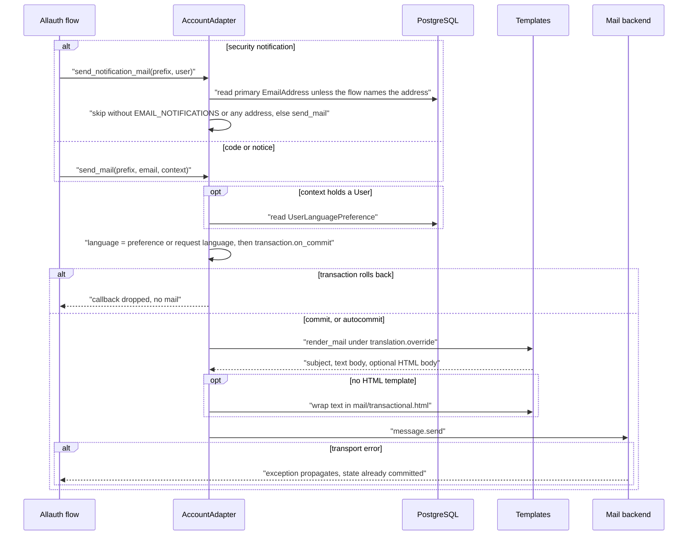

# Account mails: codes, security notifications and anti-enumeration notices

Every mail django-allauth sends about an account goes through one adapter: verification, reset and reauthentication codes, security notifications and the notices that replace a code when the address is unknown or already registered. Other flows trigger it from inside their headless requests; the adapter pins a language, waits for the surrounding transaction to commit, renders the template and sends synchronously through the default mailer. There is no queue, worker or retry. Actors: any account holder or anonymous requester; no command, script or job.

## Entry points

- `pyracast.accounts.adapters.AccountAdapter.send_mail` (language, deferral) and `render_mail` (code timeout variable, HTML shell). Wired by `ACCOUNT_ADAPTER`; behaviour gated by `ACCOUNT_EMAIL_NOTIFICATIONS`, `ACCOUNT_PREVENT_ENUMERATION`, `ACCOUNT_REAUTHENTICATION_METHODS` and the `*_BY_CODE_*` settings in `src/pyracast/settings.py`.
- Code mails, project templates on the shell `mail/base.html` plus `mail/code.html`: `account/email/email_confirmation_message.{txt,html}` and `email_confirmation_signup_message.html` (includes the former) for signup, unverified login, `auth/email/verify/resend` and `account/email` (add or change); `password_reset_code_message.{txt,html}` for `auth/password/request`; `login_code_message.{txt,html}` and `login_code_subject.txt` ("Confirm your identity") for `auth/reauthenticate/code/request`, called by `web/src/components/security-reauthentication.tsx`. The verification resend button is in `web/src/components/auth.tsx`.
- Security notifications, stock allauth templates (rendered with the project `account/email/base_message.txt`): `password_changed`, `password_set`, `password_reset`, `email_changed`, `email_deleted`, `mfa/email/{totp_activated,totp_deactivated,recovery_codes_generated}`, `socialaccount/email/{account_connected,account_disconnected}`. Triggers: the password, email, TOTP, recovery-code and provider-link endpoints (see the flows `password-change`, `password-reset`, `account-email-change`, `two-factor-management`, `linked-accounts`).
- Anti-enumeration notices, stock `unknown_account` (reset request for an address without an eligible account) and `account_already_exists` (signup with a registered address).
- Unreachable: `password_reset_key_*` (reset by code is on), the link branch of `email_confirmation_message.*` and with it `mail/action_link.html` for account mails, and the stock WebAuthn and `email_confirm` templates. Login by code is off, but the `login_code` templates are live for reauthentication.

## Sequence

## Data

| Table | R/W | What |
|---|---|---|
| `accounts_userlanguagepreference` | R | Saved language, read once per mail when the context carries a user. Written by signup, `/api/session/language/` and the admin language switch. |
| `account_emailaddress` | R | Notification recipient: primary address, else `auth_user.email`; `email_changed` names the old address itself. Verification and rotation writes belong to other flows. |
| `django_session` | none here | Code, attempts and `resend_count` are written by the triggering flow before the mail is built. |
| external `MAILERS["default"]` | W | SMTP or Gmail API (console only with `PYRACAST_DEBUG=1`), 15 s timeout. |

## Authorization

- The adapter authenticates nothing. The triggering view and allauth flow enforce CSRF, session, reauthentication and rate limits: project `reset_password` 5/h/ip and 3/h/key, `confirm_email` 1/3m/key; allauth default `reauthenticate` 10/m/user for the reauthentication code.
- The recipient is chosen by the flow: the primary address for notifications, the old address for `email_changed`, the typed address for verification codes and notices, and for reauthentication codes one of the user's own verified addresses (allauth input validation).
- Anti-enumeration is allauth policy: unknown or registered addresses get a notice mail and the same HTTP answer as a real account. Resend sends no notices. No database constraint is involved.
- Deployment check `accounts.E001` (`pyracast.accounts.checks`) refuses production without SMTP host or full Gmail credentials (with sender equal to `DEFAULT_FROM_EMAIL`) and a non-localhost sender.

## Failure paths

| Condition | Result |
|---|---|
| Transaction rolls back | Mail never sent |
| `EMAIL_NOTIFICATIONS` off, or no primary address and no `user.email` | Notification silently skipped |
| Verification resend within 3 minutes of the previous mail, or a fourth resend | 429, or 409; the UI shows "The verification session has expired" for both |
| Client IP unparsable when a notification is built | `PermissionDenied`, 403, after the account change is saved; no mail |
| SMTP or Gmail error during send | Exception escapes the adapter, nothing catches it; the request fails (assumed 500, not exercised by a test) after the change is committed |
| Mail error in password change or set | Hash saved and session logged out, but no `password_changed`/`password_set` signal, so no audit event |
| Unknown or registered address | Same response as success; the notice mail goes out |

## Rules and invariants

- Language is fixed when `send_mail` is called: the saved preference when the context carries a `User`, else the request language (`RequestLanguage`). The `user` key is present only in confirmation mails; notifications, reset and reauthentication codes use the request language, which equals the preference only for authenticated requests.
- `render_mail` always adds `code_timeout_minutes`: email verification timeout (600 s) for `email_confirmation*`, `LOGIN_BY_CODE_TIMEOUT` (allauth default 180 s, so "3 minutes") for `login_code`, otherwise the reset timeout (600 s). Only the three code templates print it.
- Text-only mails (all stock ones) get an HTML part from `mail/transactional.html`. Its heading is the full subject, and the body is the text part including the leading "Pyracast" line.
- Subjects come from the subject templates prefixed with `[<request host>] ` because `ACCOUNT_EMAIL_SUBJECT_PREFIX` is unset and `django.contrib.sites` is not installed. Only `unknown_account` and `account_already_exists` carry links (`HEADLESS_FRONTEND_URLS` on `PYRACAST_PUBLIC_ORIGIN`).
- In password change and set, allauth logs the session out, sends the notification and only then emits the `password_changed` or `password_set` signal (audit event). Reset emits its signal before the mail.

## Tests

- `tests/test_transactional_mail.py`: HTML plus text parity, expiry minutes per code kind (including `login_code`) and HTML escaping for the notification templates, all by direct `render_mail` with hand-made context and `ACCOUNT_EMAIL_SUBJECT_PREFIX` overridden.
- `tests/test_language.py`: `test_authentication_mail_pins_language_until_transaction_commit` (direct `send_mail` with a `user`), `test_signup_copies_only_explicit_language`; `tests/test_session_serialization.py`: `test_verification_resend_is_throttled_capped_and_invalidates_older_codes`.
- `tests/test_auth_lifecycle.py`, `tests/test_company_registration.py`: mailed codes in the reset, signup and email-change flows through the real views; `test_email_change_requires_reauthentication_and_initiating_session_verification` also asserts a mail to the old address; `tests/test_social_accounts.py`: `test_last_enabled_provider_cannot_be_removed` uses a mailed reauthentication code through the real views.
- `web/tests/auth-registration.spec.ts`, `web/tests/account-security.spec.ts`: UI only, with mocked responses; no real mail.
- Gaps: no integrated test that a password, TOTP or provider change produces its notification, none for `unknown_account` or `account_already_exists` content, none for the reset-code language of a user with a saved preference, none for a failing mail backend, and none for the production subject prefix.
