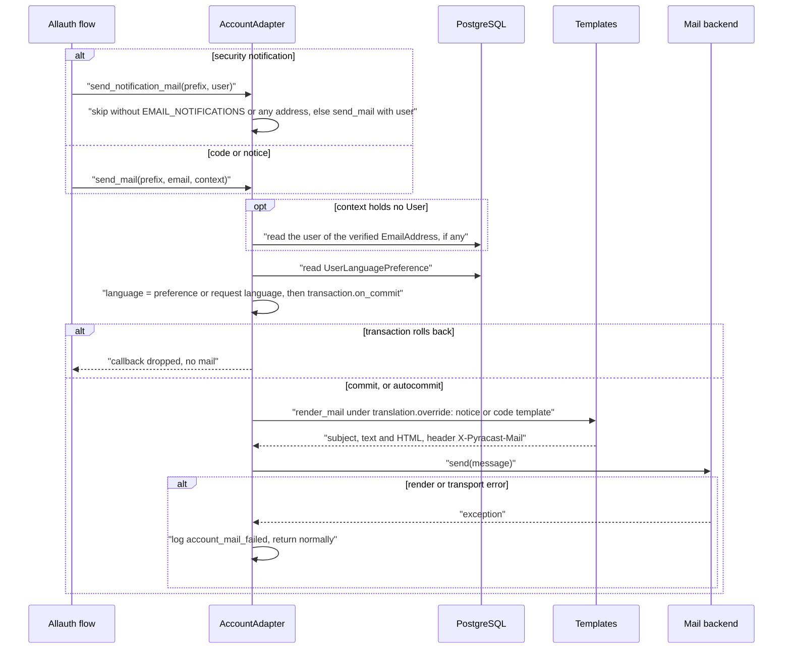

# Account mails: codes, security notifications and anti-enumeration notices

Every mail django-allauth sends about an account goes through one adapter: verification, reset and reauthentication codes, security notifications and the notices that replace a code when the address is unknown or already registered. Other flows trigger it from inside their headless requests; the adapter pins the recipient's language, waits for the surrounding transaction to commit, renders product templates and sends synchronously through the default mailer. A send that raises is logged and contained, so the triggering request completes as on success. There is no queue, worker or retry. Actors: any account holder or anonymous requester; no command, script or job.

## Entry points

- `pyracast.accounts.adapters.AccountAdapter`: `send_mail` (language, deferral), `send_notification_mail` (adds the `user` to the context), `render_mail` (marker header, code timeout, notices). Wired by `ACCOUNT_ADAPTER`; behaviour gated by `ACCOUNT_EMAIL_NOTIFICATIONS`, `ACCOUNT_PREVENT_ENUMERATION`, `ACCOUNT_REAUTHENTICATION_METHODS` and the `*_BY_CODE_*` settings in `src/pyracast/settings.py`.
- Code mails, project templates on the shell `mail/base.html` plus `mail/code.html` and `account/email/code_expiry.txt`: `email_confirmation{,_signup}` for signup, unverified login, `auth/email/verify/resend` and `account/email` (add or change); `password_reset_code` for `auth/password/request`; `login_code` for `auth/reauthenticate/code/request` (`web/src/components/security-reauthentication.tsx`). Each has a product subject template.
- Notices, `pyracast.accounts.account_mail.NOTICES` rendered by `render_notice` into `mail/notice.{txt,html}`: security notices for password, email, two-factor, recovery-code and sign-in provider changes; anti-enumeration notices `unknown_account` (reset request for an address without an eligible account) and `account_already_exists` (signup with a registered address). Triggers: the password, email, TOTP, recovery-code, provider-link, reset and signup endpoints (flows `password-change`, `password-reset`, `account-email-change`, `two-factor-management`, `linked-accounts`).

## Sequence

## Data

| Table | R/W | What |
|---|---|---|
| `accounts_userlanguagepreference` | R | Saved language of the recipient. Written by signup, `/api/session/language/` and the admin language switch. |
| `account_emailaddress` | R | Notification recipient (primary address, else `auth_user.email`; `email_changed` names the old address); the verified address finds the account when the context names no user. |
| `django_session` | none here | Code, attempts and `resend_count` are written by the triggering flow before the mail is built. |
| external `MAILERS["default"]` | W | SMTP or Gmail API (console only with `PYRACAST_DEBUG=1`), 15 s timeout (flow `email-transport`). |

## Authorization

- The adapter authenticates nothing. The triggering view and allauth flow enforce CSRF, session, reauthentication and rate limits: project `reset_password` 5/h/ip and 3/h/key, `confirm_email` 1/1m/key and 6/h/key; allauth default `reauthenticate` 10/m/user for the reauthentication code.
- The recipient is chosen by the flow: the primary address for notifications, the old address for `email_changed`, the typed address for verification codes and notices, and for reauthentication codes one of the user's own verified addresses (allauth input validation).
- Anti-enumeration is allauth policy: unknown or registered addresses get a notice mail and the same HTTP answer as a real account. Resend sends no notices.
- Deployment check `accounts.E001` refuses production mail that cannot deliver (flow `email-transport`).

## Failure paths

| Condition | Result |
|---|---|
| Transaction rolls back | Mail never sent |
| `EMAIL_NOTIFICATIONS` off, or no primary address and no `user.email` | Notification silently skipped |
| Verification resend within 1 minute of the previous mail, or a fourth resend or no pending code | 429, or 409; the UI asks the user to wait a minute (429) or to sign in again for a new code (409) and disables the button for 60 s after each send |
| Client IP unparsable when a notification is built | `PermissionDenied`, 403, after the account change is saved; no mail |
| SMTP or Gmail error (or a rendering error) during send | Caught inside the deferred send: one ERROR line `account_mail_failed template=<prefix> user_id=<id or None> error_type=<class> error_code=<MailFailure or None>` on `pyracast.accounts.adapters`, without the exception text or traceback (both can carry the address). `user_id` is `None` when the context names no user and no verified address matches. The request answers as on success; the committed change and any code in the session stay; a resend or new request is the retry |
| Mail error in password change or set | Hash saved, session logged out, `password_changed`/`password_set` signal and audit event emitted as on success |
| Unknown or registered address | Same response as success; the notice mail goes out |

## Rules and invariants

- Language is fixed when `send_mail` is called: the saved preference of the context user, else of the account owning the verified address, else the request language.
- Every account mail carries `X-Pyracast-Mail: <template prefix>`; subjects have no prefix (`ACCOUNT_EMAIL_SUBJECT_PREFIX` is empty).
- Code mails state the expiry from the flow's setting in whole minutes (verification and reset 600 s, reauthentication `ACCOUNT_LOGIN_BY_CODE_TIMEOUT` 180 s), pluralized per language. Link-mode templates do not exist: verification and reset run by code.
- Security notices show the time in UTC, a device label (browser and system, never the raw user agent), the IP address and a link to secure the account on `PYRACAST_PUBLIC_ORIGIN/app/`. `unknown_account` links to signup and `account_already_exists` to password reset (`HEADLESS_FRONTEND_URLS`).
- In password change and set, allauth logs the session out, sends the notification and only then emits the `password_changed` or `password_set` signal (audit event). Reset emits its signal before the mail.

## Tests

- `tests/test_account_mail_content.py`: one test per trigger through the real headless views (signup, taken address, reset code, unknown address, password change and reset completion, reauthentication code, provider connect and disconnect, recovery codes) asserting recipient, language, subject, marker header and the security-notice details; direct rendering of the remaining notices and the device label.
- `tests/test_transactional_mail.py`: HTML and text parity of the code mails, expiry per configured flow, invitation escaping.
- `tests/test_language.py`, `tests/test_auth_lifecycle.py`, `tests/test_company_registration.py`, `tests/test_social_accounts.py`, `tests/test_session_serialization.py`: codes and language through the real flows.
- `tests/test_account_mail_failures.py`, `tests/test_mail_outcomes.py`: failing mailers through the real views and one `account_mail_failed` line without address, code or traceback.
- Gaps: browser tests mock the API; no real inbox.
