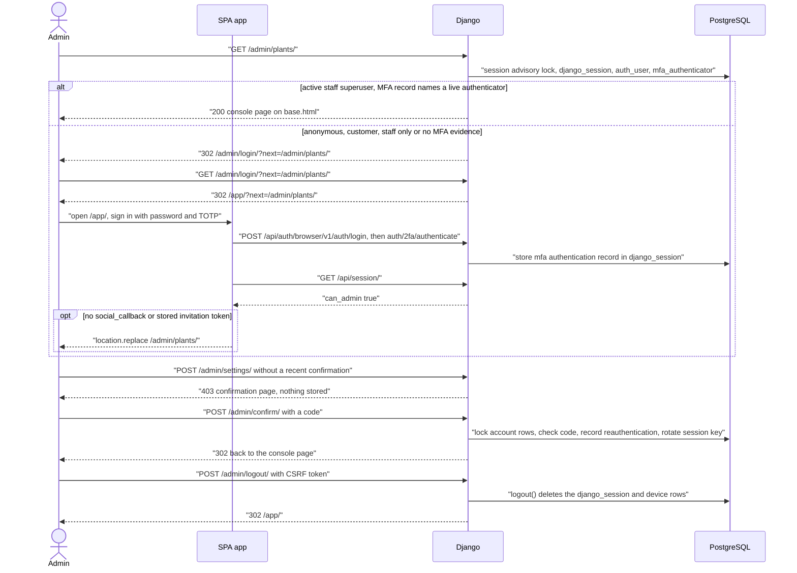

# Platform console access: MFA gate, SPA hand-off, confirmation, shared shell and logout

A platform administrator reaches `/admin/` either through the SPA hand-off (`can_admin` in the session projection) or by opening a console URL directly. Django admits the request only for an active staff superuser whose session holds TOTP or recovery-code evidence for a live authenticator; everyone else is bounced to the SPA. Every console request, reading included, needs a sign-in or confirmation by the authenticator within the last hour, and every write a confirmation within 300 s. The outcome is a server-rendered console page inside one shared shell, or a redirect to `/app/`.

## Entry points

- `GET|POST /admin/login/` - `pyracast.platform_admin.site.PlatformAdminSite.login` (`never_cache`, outside the gate). Actor: anyone. The return address `next` is kept only when `navigation.console_path` accepts it (same origin, under `/admin/`, no unsafe segments), else `/admin/`. A permitted administrator goes to it; an anonymous visitor to `/app/?next=<it>`; a signed-in account without console access to `/app/`, with an `authorization_denied` line (`platform_admin_required`, view `admin/login/`).
- Every other console route (workspace pages, record browser, `jsi18n/`) is built by `PlatformAdminSite.admin_view`: Django's gate (`has_permission` = `authorization.has_platform_admin_session`), then `confirmed` (the proof window of the method), then `failures.contained`.
- `GET /admin/` - `PlatformAdminSite.landing`: follows once a console path a provider sign-in stored in the session (`CONSOLE_RETURN`, checked again with `console_path`), else renders the overview.
- `GET|POST /admin/confirm/` - `pyracast.platform_admin.access.confirm`: asks for an authenticator or recovery code and returns to `next` (console paths only).
- `POST /admin/logout/` - `access.logout` (`auth.logout`, then `/app/`); outside the gate.
- `POST /admin/language/` - `access.language` (shell switcher; stores the account preference, returns to `next`).
- `GET /admin/password_change/` - `RedirectView` to `/app/account/`.
- SPA: `web/src/features/session/entry.tsx` `Entry` (at `/app/`, for `can_admin` it does `window.location.replace` to the checked `next` or `/admin/`) and the `Administration` link in `web/src/features/workspace/workspace-shell.tsx`.
- Shell: `src/pyracast/regions/templates/admin/workspace/base.html`, `admin-workspace.css`, `admin-workspace.js`. The rail draws the brand kit's mark (decorative, fills from `.brand-mark-sun` and `.brand-mark-bar`) beside "Pyracast console", which also names the site header, site title, index title, page titles, eyebrow and the rail navigation; the rail link to `/app/w/` reads "Pyracast app". `admin-workspace.css` declares every console colour once in its one `:root` (the brand families under the web names and values, the `--teal-*` accent and `--success`, `--success-soft`, `--success-line` for positive badges, completed steps and default notices); rules and console templates write no colour literal.
- Operator: `pyracast bootstrap_admin` creates the administrator and its TOTP factor (`platform-admin-bootstrap`).

## Sequence

## Data

| Table | R/W | What |
| --- | --- | --- |
| `django_session` | R/W | Session and allauth `account_authentication_methods` records (MFA evidence and its `reauthenticated` marks); a confirmation rotates the key; `logout()` deletes the row. |
| `usersessions_usersession` | R/W | Device record (ip, user agent, `last_seen_at`), rotated by a confirmation; logout deletes the session's row. |
| `auth_user`, `account_emailaddress`, `socialaccount_socialaccount` | R | Role flags are read live per request. A confirmation and the language switch lock the account (`lock_account`). |
| `mfa_authenticator` | R/W | Evidence counts only while its authenticator id still exists for the same user; a spent recovery code is marked used. |
| `accounts_userlanguagepreference` | R/W | `POST /admin/language/` upserts it. |

## Authorization

- Console gate: `has_platform_admin_session` runs on every `admin_view` request, `confirm/` included. Role flags and the authenticator row are read live, so demotion or factor removal applies on the next click.
- MFA evidence (`security.has_mfa_evidence`): an active user and a session record bound to this user with method `mfa`, type `totp` or `recovery_codes`, whose id names a current authenticator of the user.
- Console proof: every GET, HEAD or OPTIONS console request needs `has_mfa_evidence(within=CONSOLE_PROOF)`: a sign-in or reauthentication by an enrolled authenticator within `PYRACAST_CONSOLE_PROOF_SECONDS` (1 h). Without it the 403 confirmation page asks for a code and returns to the requested path.
- Confirmation: every console request that is not GET, HEAD or OPTIONS, language switch included, needs `has_mfa_evidence(within=CONFIRMATION)`: a reauthentication by an enrolled authenticator within `ACCOUNT_REAUTHENTICATION_TIMEOUT` (300 s); a sign-in never counts. A refused write leads with "Nothing was saved" and returns to the page of its Referer. A change of the administrator's credential state ends confirmations given before it. Only sign-out and `confirm/` are exempt. The code is checked under the account's locks (`processes.confirmation`).
- Console writes of business data take no account locks: one that passed its check before a credential change committed completes, and the next request is refused.
- Login side: `AuthenticationBackend` and `SocialAccountAdapter` refuse staff or superusers without TOTP.
- SPA: `SessionUserOutput.get_can_admin` uses the same predicate and only steers navigation; domain operations the console calls re-check `require_platform_admin` (active staff superuser, no MFA). `/admin/login/` and `get_can_admin` must keep equal rules, or `/admin/` and `/app/` would redirect to each other.
- CSRF: `CsrfViewMiddleware` rejects a POST without token with 403 before the gate runs, `/admin/login/` and `/admin/logout/` included.

## Failure paths

| Condition | Result |
| --- | --- |
| Anonymous, customer, staff without superuser, superuser without MFA evidence, inactive | 302 `/admin/login/?next=<path>`, then 302 `/app/?next=<path>` (anonymous) or `/app/` (signed in without access); POST bodies discarded |
| Read on any gated route without a proof by the authenticator in the last hour | 403 confirmation page; the code returns to the requested path |
| Unsafe method on any gated route without recent confirmation | 403 confirmation page (HTML, also for scripts), nothing stored |
| `confirm/` with a wrong code | 400, the form again; a valid code answers 302 to `next`; other methods 405 |
| Logout or language via GET | 405 (logout for any identity; language after the gate) |
| Language outside `en`, `tr` | 400 |
| Idle over 30 days, age over 90 days or session markers missing | `SessionLifetime` records `session_expired` and calls `logout()`; the request is anonymous (first row) |
| Same session holds the advisory lock over 5 s | 503 HTML page with `Retry-After: 1`; a write is never replayed |
| Retryable database conflict or timeout on an unsafe request | Redirect to the referring console page with a retry notice (503 JSON when `Accept: application/json`); other database errors stay 500 |
| Admin signs in with a stored invitation token or a provider return | Invitation screen or account page, no hand-off |

## Rules and invariants

- The console has no login form. `?next=` is validated twice (`console_path` server side, `consoleDestination` in `entry.tsx`).
- The session lasts 30 days idle and 90 days in all (`session-and-csrf`); the console accepts its authenticator proof for one hour.
- `SessionRequestSerialization` takes a PostgreSQL advisory lock per well-formed session cookie, so requests of one session run one at a time.
- The stock model routes stay behind the same gate on Django templates (`admin-record-browser`).

## Tests

- `tests/test_console_stylesheet.py` (colours only from the `:root` tokens, no second `:root`, no repeated or relocated property, no colour in a template, every read property declared, the kit's colours), `tests/test_console_navigation.py` (also the rail mark against `web/tests/support/brand-artwork.json`), `tests/test_provider_console_return.py`, `tests/test_console_step_up.py` (stale evidence refused for every route and unsafe method, confirmation, language needs confirmation and sign-out does not, the one-hour proof of console pages), `tests/test_console_failures.py`, `tests/test_admin_workspace.py`.
- Playwright: `web/tests/auth-registration.spec.ts`, `web/integration/admin-csp.spec.ts` (live credentials).
- Gaps: browser coverage of the `social_callback` and invitation exemptions of `Entry`, and of console behaviour after session expiry.
