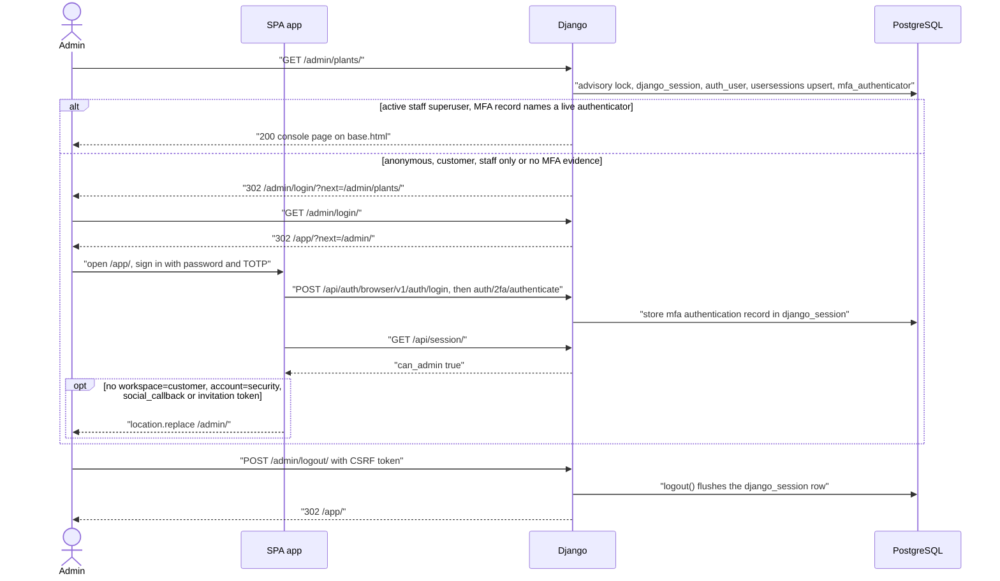

# Platform console access: MFA gate, SPA hand-off, shared shell and logout

A platform administrator reaches `/admin/` either through the SPA hand-off (`can_admin` in the session projection) or by opening a console URL directly. Django admits the request only for an active staff superuser whose session holds TOTP or recovery-code evidence for a live authenticator; everyone else is bounced to the SPA. The outcome is a server-rendered console page inside one shared shell, or a redirect to `/app/`.

## Entry points

- `/admin/login/` (any method) - `pyracast.admin.PlatformAdminSite.login`. Actor: anyone. Not wrapped by `admin_view`, and the override drops the `never_cache` of Django's `login`. Permitted admin goes to `admin:index`, all others to `/app/?next=/admin/`; body and `next` are ignored, but a POST still needs a CSRF token (`CsrfViewMiddleware`).
- Every other console route (workspace pages, stock model admins, `jsi18n/`, `autocomplete/`, the catch-all) is wrapped by `AdminSite.admin_view`, which calls `PlatformAdminSite.has_permission` (Django's active and staff, plus superuser and `pyracast.accounts.security.has_verified_mfa`).
- `POST /admin/logout/` - `PlatformAdminSite.workspace_logout` (`logout()` then `/app/`); replaces Django's logout in `get_urls`.
- `GET|POST /admin/password_change/` - `RedirectView` to `/app/?account=security`; there is no admin password form.
- `POST /admin/language/` - `PlatformAdminSite.language` (shell switcher, writes the account preference).
- `web/src/components/dashboard.tsx` `DashboardView` (`enterAdministration`, `window.location.replace("/admin/")`) and the sidebar `Administration` link when `can_admin`.
- Shell: `src/pyracast/regions/templates/admin/workspace/base.html` (extended by the workspace pages, the historical import page and the plant setup page), `admin-workspace.css`, `admin-workspace.js`.
- Operator: `pyracast provision_admin_mfa` creates the TOTP factor without which no admin can sign in (`platform-admin-bootstrap`).

## Sequence

## Data

| Table | R/W | What |
| --- | --- | --- |
| `django_session` | R/W | Session and allauth `account_authentication_methods` records (MFA evidence). `SessionLifetime` refreshes `last_activity_at` at most once a minute; `logout()` deletes the row. |
| `auth_user` | R | `is_active`, `is_staff`, `is_superuser` read live per request. The language switch locks the row (`select_for_update`). |
| `usersessions_usersession` | R/W | allauth `UserSessionsMiddleware` upserts ip, user agent and `last_seen_at` on every authenticated request; console logout leaves the row in place. |
| `mfa_authenticator` | R | Evidence counts only while its authenticator id still exists for the same user. |
| `accounts_userlanguagepreference` | R/W | `RequestLanguage` middleware reads the preference on every authenticated request; `POST /admin/language/` upserts it. |

## Authorization

- Console gate: `has_permission` runs on every `admin_view` request, shell endpoints included, and again inside `each_context`. Role flags and the authenticator row are read live, so demotion or factor removal applies on the next click.
- MFA evidence: `has_verified_mfa` needs an active user and a session record (bound to this user id) with method `mfa`, type `totp` or `recovery_codes`, whose id names a current authenticator of this user. It exists only after a completed MFA login or MFA reauthentication.
- Login side: `AccountAdapter.authenticate` and `SocialAccountAdapter` refuse staff or superusers without TOTP; `MFAAdapter.can_delete_authenticator`, `ManageTOTPView` and `PrivilegedAuthenticatorEnrollment` block removing or self-enrolling an admin factor.
- SPA: `SessionUserOutput.get_can_admin` only steers navigation. `pyracast.api.views.PlatformAdmin` repeats the rule for `/api/platform/` without `is_staff`; operations re-check only `require_admin` (active superuser, no MFA).
- CSRF: `CsrfViewMiddleware` (and `csrf_protect` inside `admin_view`) rejects a POST without token with 403 before the gate runs, `/admin/login/` included.

## Failure paths

| Condition | Result |
| --- | --- |
| Anonymous, customer, staff without superuser, superuser without MFA evidence, inactive | 302 `/admin/login/?next=...` then 302 `/app/?next=/admin/`; POST bodies discarded |
| Same, but the target is `/admin/logout/` | 302 `admin:index`; session is not cleared |
| Logout or language via GET | 405 for a permitted admin; anyone else gets the gate redirect (first row) |
| POST without CSRF token | 403 |
| Language outside `en`, `tr` | 400 empty body |
| Language `next` missing, not same-host or wrong scheme | Falls back to `/admin/` |
| Idle over 30 min, age over 12 h or session markers missing | `SessionLifetime` calls `logout()`, request is anonymous (first row) |
| Same session holds the advisory lock over 5 s | 429 JSON `session_busy`, `Retry-After: 1`, also on HTML pages |
| Admin signs in with a stored invitation token | `AcceptInvitation` screen, no hand-off |

## Rules and invariants

- The console has no login form. `?next=` is emitted but no frontend code reads it; the post-login hop works only through `can_admin`. The hand-off opt-out (`workspace=customer`, `account=security`) lives in the URL for one page load; nothing persists it.
- MFA proof lives and dies with the session (30 min idle, 12 h absolute). There is no separate admin timeout or step-up. Every `logout()` emits the `logout` security log event.
- `SessionRequestSerialization` takes a PostgreSQL advisory lock per well-formed session cookie, so console requests of one session run one at a time.
- 18 stock model admins stay mounted behind the same gate on Django templates, not the shell; `RegionAdmin` and `RegionLocationChangeRequestAdmin` keep state-changing changelist actions (approve, reject, suspend). `password_change/done/` also survives.
- `login` and `get_can_admin` must keep equal rules; if they diverged, `/admin/` and `/app/` would redirect to each other (no loop guard).

## Tests

- `tests/test_admin_workspace.py`: `test_workspace_requires_live_verified_platform_administrator`, `test_workspace_logout_returns_to_shared_sign_in_and_requires_csrf`; `tests/test_account_security.py`: `test_admin_has_no_independent_password_entry_point`, `test_mfa_evidence_is_bound_to_current_user_and_live_authenticator`. `tests/test_admin_mfa_bootstrap.py`: CSP, login and password_change redirects, `/api/platform/` rejection. `tests/test_session.py` (`can_admin` tracks live role and MFA), `tests/test_session_serialization.py` (real TOTP login opens `/admin/`), `tests/test_language.py`, `tests/test_admin_language_controls.py`.
- Playwright: `web/tests/auth-registration.spec.ts`, `web/tests/responsive.spec.ts`, `web/integration/admin-csp.spec.ts` (live credentials: real login, navigation, setup-form script, language, mobile-menu sign-out).
- Gaps: logout by a non-permitted user, `password_change/done/`, `social_callback` and invitation exemptions of `enterAdministration`, console behaviour after session expiry, `/admin/login/` caching headers.
