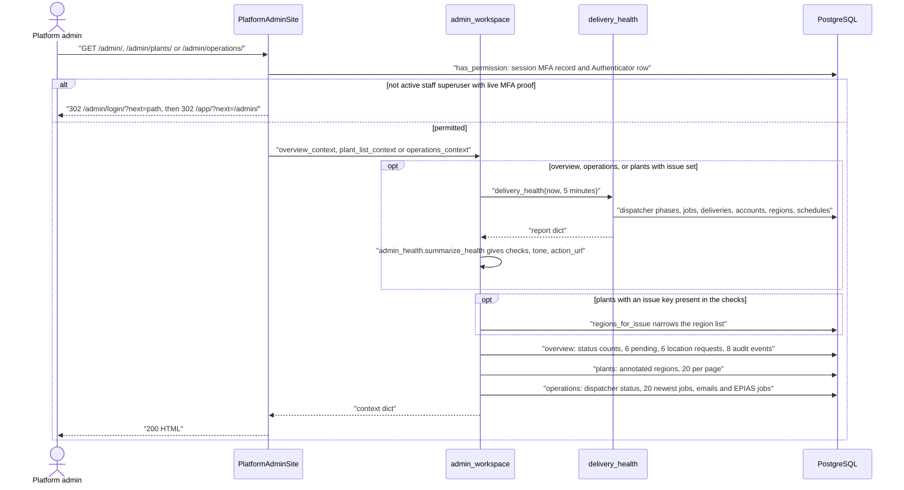

# Console overview, plant list and operations health

A platform administrator (active superuser with live TOTP or recovery-code proof) opens the server-rendered console at `/admin/` to see plant counts by review status, the location-change queue, recent audit activity, a health summary, a searchable plant list, dispatcher phase status and the latest collection, email and EPİAŞ jobs. The pages write no domain record and make no provider, mail or broker call; only shared middleware touches session rows. Fixing what the pages show happens elsewhere (`plant-approval`, `provider-credential-recovery`, `dispatcher-cycle`).

## Entry points

- `GET /admin/` -> `pyracast.admin.PlatformAdminSite.index` -> `pyracast.admin_workspace.overview_context`, template `admin/workspace/overview.html`.
- `GET /admin/plants/?q=&status=&page=&issue=` -> `PlatformAdminSite.plants` -> `plant_list_context`, template `plants.html`.
- `GET /admin/operations/?issue=` -> `PlatformAdminSite.operations` -> `operations_context` (which calls `recent_work_context`), template `operations.html`.
- Shared builders: `pyracast.admin_health.summarize_health` (report to `HealthSummary`), `pyracast.admin_health_queries` (`regions_for_issue`, `collection_jobs_for_issue`, `notification_deliveries_for_issue`, `metering_jobs_for_issue`), `pyracast.forecasts.monitoring.delivery_health`, also used by command `check_delivery_health`; its dispatcher input is written by `record_dispatch_phase` in `forecasts/management/commands/dispatch.py`. Templates live in `pyracast/regions/templates/admin/workspace/` (`health.html` is included by overview and operations). No SPA screen or `/api/` endpoint is involved.

## Sequence

## Data

| Table | R/W | What |
| --- | --- | --- |
| `regions_region` | R | Status counts, review queue (oldest pending first, 6), plant list; soft-deleted regions excluded |
| `connections_sitebinding`, `connections_provideraccount` | R | Newest binding of the current region revision gives the connection badge; `approved_binding` drives health counters and filters |
| `forecasts_forecastsnapshot`, `forecasts_forecastresult`, `forecasts_collectionjob` | R | Last saved forecast: newest `forecast` snapshot of the approved binding with a succeeded job and a result; job table |
| `forecasts_dispatcherstatus`, `forecasts_collectionschedule` | R | Per-phase attempt, success and error class name; disabled collection removes a region from stale and unvalidated checks |
| `notifications_notificationdelivery`, `notifications_reminderschedule` | R | Delivery rows and counters; saved recipients re-validated in Python for the invalid-recipient check |
| `metering_epiascollectionjob` | R | EPİAŞ job table and counters; only deleted plants are excluded, not deleted regions |
| `regions_regionlocationchangerequest`, `regions_auditevent` | R | Pending location-change count and queue (6); last 8 events of undeleted regions (provider-account events and events of trashed regions are excluded) |
| `plants_plant`, `accounts_tenant`, `accounts_membership`, `account_emailaddress`, `auth_user` | R | Display name (first undeleted plant, else region name), company, plant search, recipient resolution, actor username |
| `django_session`, `usersessions_usersession`, `mfa_authenticator` | R/W (authenticator R) | Session MFA record and gate; `SessionLifetime` refreshes `last_activity_at` (at most once a minute) and allauth tracks session activity |

## Authorization

- View only: every route is wrapped by `AdminSite.admin_view` (`csrf_protect`, `never_cache`), which calls `PlatformAdminSite.has_permission`: active staff (stock), `is_superuser`, and `has_verified_mfa` (session authentication record of method `mfa`, type `totp` or `recovery_codes`, whose id still exists as an `Authenticator` of this user). It is re-evaluated on every request.
- No operation or database check exists because no domain record is written. There is no tenant scoping: all companies, plant names and recipient addresses are visible by design. `PlatformAdminSite.login` sends every denied visitor to `/app/?next=/admin/`; sign-in, MFA step and the enrollment gate belong to `admin-console-access`.

## Failure paths

| Condition | Result |
| --- | --- |
| Anonymous, member, staff without superuser, inactive, no live MFA proof, or session expired or idle (`SessionLifetime` logs out) | 302 to `/admin/login/?next=...` then 302 to `/app/?next=/admin/`; deep link and query string are lost |
| POST to any of the three pages | Without a CSRF token 403 from `CsrfViewMiddleware`; with one, denied visitors get the 302 above and permitted ones the page with 200 (no method guard, unlike `settings`, `tenants`, `decision`) |
| `status` not a review status, `page` invalid, `q` over 200 characters or `issue` over 80 | Status ignored, `Paginator.get_page` gives page 1 for non-numbers and the last page when out of range, long values truncated silently |
| `issue` unknown or its check count is 0 (also `dispatch` while all phases are healthy) | Ignored: no banner, unfiltered page |
| Plants `issue` is a job or dispatcher key (for example `failed_collections`, `dispatch`) | Banner shown, list unfiltered because `regions_for_issue` falls through to all regions |
| Operations `issue` is a plant-targeted key (for example `provider_cooldowns`) | Banner and health checks shown, all four sections hidden |
| Database unavailable | Unhandled 500, nothing renders partially |
| Reminder recipients saved as a non-list or with non-string entries | Counted as invalid recipients (`TypeError` caught), no 500 |
| Dispatcher row missing, or `record_dispatch_phase` itself failed | Phase shown as "Never" or with old timestamps and counted as needing attention |

## Rules and invariants

- `delivery_health(now, 5 minutes)` is one report for the overview, operations, the plants filter and the CLI; the admin hard-codes the 5-minute lag, the CLI accepts `--max-lag-minutes`, and the issue filters default to 5 minutes independently.
- Windows: failed, missed, unavailable, partial and mail-authentication outcomes look back 24 hours by scheduled time (`scheduled_slot` or `scheduled_for`); overdue and interrupted work has no lower bound. An active region (approved, enabled account, collection not disabled) is stale when its newest saved forecast `collected_at` is older than 26 hours or missing. A phase is unhealthy when it never succeeded, succeeded before `now - lag`, or carries `last_error`.
- Summary tone precedence is action, then delay, then review. A `dispatch` check is inserted first when any phase is unhealthy. `saved_forecast_notifications` is reported but never counted as a problem.
- Counts and lists differ in unit for account checks: `provider_cooldowns` and `blocked_provider_credentials` count provider accounts, the filtered plant list shows every affected region. `invalid_reminder_recipients` counts current schedules (one per region by a partial unique constraint).
- Connection badge precedence: Not configured, Needs attention, Provider delay, Needs validation, Healthy. It describes the newest binding of the current revision and is independent of approval status and freshness. Uncertain mail reads "Acceptance unknown", `sent` reads "Accepted by email service". No page offers retry, requeue or resend. Tables show 20 rows, newest by `created_at` (collections) or `scheduled_for` (emails, EPİAŞ), not the most severe.

## Tests

- `tests/test_admin_workspace.py`: access matrix across identities (GET and CSRF-exempt test-client POST), GET pages without provider or mail I/O, status counts, connection badges, operations rows and dispatch phases, oldest-pending queue, active plant name fallback.
- `tests/test_admin_health.py` (checks and tone), `tests/test_admin_health_queries.py` (filters match counter boundaries), `tests/test_admin_health_views.py` (filtered views, labels, `dispatch` on operations), `tests/test_delivery_health.py` (report, phases, query budget, CLI), `tests/test_language.py` (Turkish headings of the three pages, translated audit labels and unknown-action fallback), `tests/test_account_security.py` and `tests/test_admin_mfa_bootstrap.py` (login redirect).
- Playwright `web/integration/admin-csp.spec.ts`: MFA sign-in, overview, link into a filtered operations view, plants search, axe, CSP and 320 px width.
- Gaps: plant-targeted `issue` on operations, job-targeted `issue` on plants, permitted POST to the three pages, provider-account and trashed-region exclusion from recent activity, Turkish rendering of connection and job status labels, and any browser check of the overview counts.
