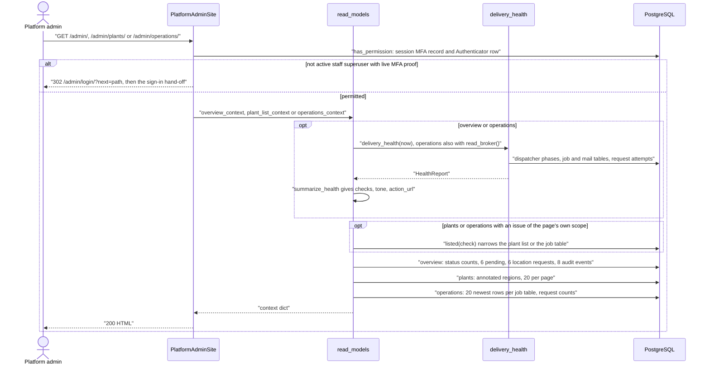

# Console overview, plant list and operations health

A platform administrator (active superuser with live TOTP or recovery-code proof) opens the server-rendered console at `/admin/` to see plant counts by review status, the location-change queue, recent audit activity, a health summary, a searchable plant list, dispatcher, queue and provider-request status, and the latest collection, email, EPİAŞ and calibration jobs. The pages write no domain record and make no provider or mail call; Operations reads the message broker's queue state, and shared middleware touches session rows. Fixing what the pages show happens elsewhere (`plant-approval`, `provider-credential-recovery`, `dispatcher-cycle`).

## Entry points

- `GET /admin/` -> `pyracast.platform_admin.site.PlatformAdminSite.landing` -> `index` -> `pyracast.platform_admin.read_models.overview_context`, template `admin/workspace/overview.html`.
- `GET /admin/plants/?q=&status=&page=&issue=&location_change=` -> `pyracast.platform_admin.pages.plants` -> `plant_list_context`, template `plants.html`.
- `GET /admin/operations/?issue=` -> `pages.operations` -> `operations_context` (which calls `recent_work_context`), template `operations.html`.
- Builders: `pyracast.orchestration.delivery_health` (`CHECKS`, `delivery_health`, `listed`, `read_broker`; also used by command `check_delivery_health`, whose dispatcher input is written by `record_dispatch_phase` in `orchestration/dispatcher.py`) and `pyracast.platform_admin.health` (`PRESENTATION`, `summarize_health`). Templates live in `pyracast/regions/templates/admin/workspace/` (`health.html` is included by overview and operations). No SPA screen or `/api/` endpoint is involved.
- The same shell also holds the workspace pages, plant review and settings (`admin-workspace-management`, `plant-approval`, `platform-settings`).

## Sequence

## Data

| Table | R/W | What |
| --- | --- | --- |
| `regions_region` | R | Status counts, review queue (oldest pending first, 6), plant list; trashed regions excluded |
| `connections_sitebinding`, `connections_provideraccount` | R | The binding of the current region revision gives the connection badge; `approved_binding` drives health counters and filters |
| `forecasts_forecastsnapshot`, `forecasts_forecastresult`, `forecasts_collectionjob`, `forecasts_requestattempt` | R | Last saved forecast: newest `forecast` snapshot of the approved binding with a succeeded job and a result; job table; provider requests per binding and UTC day (last 7 days) |
| `forecasts_dispatcherstatus`, `forecasts_collectionschedule` | R | Per-phase attempt, success, error, duration and published count; disabled collection removes a region from stale and unvalidated checks |
| `notifications_notificationdelivery`, `notifications_deliveryrecipient`, `notifications_reminderschedule`, `notifications_reminderrecipient`, `notifications_outboundmail` | R | Delivery rows and counters; recipients from the delivery's rows; saved recipients and workspace members re-validated for the invalid-recipient check; account and invitation mail counters |
| `metering_epiascollectionjob`, `plants_calibrationrun` | R | EPİAŞ and calibration job tables and counters; rows of trashed plant locations excluded |
| `regions_regionlocationchangerequest`, `regions_auditevent` | R | Pending location-change count and queue (6); last 8 events of live plants and of provider accounts |
| `plants_plant`, `accounts_tenant`, `auth_user` | R | Display name (first plant, else region name), company, plant search, actor username |
| `django_session`, `usersessions_usersession`, `mfa_authenticator` | R/W (authenticator R) | Session MFA record and gate; `SessionLifetime` refreshes the activity marker (at most once a minute) |

The message broker is read on Operations only (queue message, consumer and dead-letter counts).

## Authorization

- View only: every route is wrapped by `PlatformAdminSite.admin_view`, whose gate `has_permission` is `has_platform_admin_session` (active staff superuser plus session MFA evidence for a live authenticator), re-evaluated on every request. The three pages answer GET and HEAD only (`require_safe`); a POST first needs the console confirmation (`admin-console-access`) and then answers 405.
- No operation or database check exists because no domain record is written. There is no tenant scoping: all companies, plant names and recipient addresses are visible by design. Sign-in and confirmation belong to `admin-console-access`.

## Failure paths

| Condition | Result |
|---|---|
| Anonymous, member, staff without superuser, inactive, no live MFA proof, or session expired or idle (`SessionLifetime` logs out) | 302 to `/admin/login/?next=...`, then the hand-off back to the requested console path after sign-in |
| POST to any of the three pages | Without a CSRF token 403; a denied visitor gets the 302 above; a permitted administrator without a recent confirmation the 403 confirmation page, otherwise 405 |
| `status` not a review status, `page` invalid, `q` over 200 characters or `issue` over 80 | Status ignored, `Paginator.get_page` gives page 1 for non-numbers and the last page when out of range, long values truncated silently |
| `issue` unknown, or the key of another page's scope (plants take `plants` checks, operations take `collections`, `deliveries`, `metering`, `calibrations` checks) | Ignored: no banner, unfiltered page |
| `issue` is a check of the page's own scope with count 0 | Banner at zero and an empty filtered list or table |
| `issue=dispatch` on operations while all phases are healthy | Ignored |
| Database unavailable | Unhandled 500, nothing renders partially |
| Broker does not answer or a work queue is undeclared | Operations shows a "Message broker not answering" or "Missing message queues" check and "Not declared" instead of counts; the page still renders |
| Dispatcher row missing, or `record_dispatch_phase` itself failed | Phase shown as "Never" or with old timestamps and counted as needing attention |

## Rules and invariants

- One `HealthReport` feeds the overview, operations, the plant filters and the CLI. The console uses the dispatcher heartbeat lag (5 minutes, `DISPATCH_LAG`); the CLI accepts `--max-lag-minutes`. The plant list reads only the filtered check (`listed`), not the whole report; its banner count is the number of listed plants.
- Windows: failed, missed, paused, unavailable, partial and mail-authentication outcomes look back 24 hours by `scheduled_for` (outbound mail by `finished_at`, calibrations by `completed_at`); overdue and interrupted work has no lower bound. An active region (approved, enabled account, collection not disabled) is stale when its newest saved forecast `collected_at` is older than 26 hours or missing. A phase is unhealthy when it never succeeded, succeeded before `now - lag`, or carries `last_error`.
- Summary tone precedence is action, then delay, then review. Checks that are not alarms (`saved_forecast_notifications`, `queued_calibrations`, `running_calibrations`) are never listed; `paused_notifications` does not affect `healthy` but appears as a "review" check linking to the paused deliveries. Broker, missing-queue and `dispatch` checks come first, in that order, when present. Mail checks link to the outbound mail list of the record browser.
- Counts and lists differ in unit for account checks: `provider_cooldowns` and `blocked_provider_credentials` count provider accounts, the filtered plant list shows every affected region. `invalid_reminder_recipients` counts current schedules. The plant list says why each plant is listed; Operations says "Showing N of M" for a filtered section.
- Connection badge precedence: Not configured, Needs attention, Provider delay, Needs validation, Healthy. It describes the binding of the current revision and is independent of approval status and freshness. Uncertain mail reads "Acceptance unknown", `sent` reads "Accepted by email service". No page offers retry, requeue or resend. Tables show 20 rows, newest by `created_at` (collections, calibrations) or `scheduled_for` (emails, EPİAŞ), not the most severe. Status and error labels come from the translated model vocabularies.
- The overview counts approved, pending and suspended plants, plants needing attention and pending location changes (linked to `plants/?location_change=pending`).

## Tests

- `tests/test_admin_workspace.py`: access matrix across identities, GET pages without provider or mail I/O, status counts, connection badges, operations rows and dispatch phases, oldest-pending queue, plant name fallback.
- `tests/test_admin_health.py` (checks, tone, links), `tests/test_admin_health_queries.py` (filters match counter boundaries), `tests/test_admin_health_views.py` (filtered views, labels), `tests/test_admin_health_console.py` (own checks only, empty filtered list, "Showing N of M", workers panel, undeclared queues, calibrations, check time), `tests/test_delivery_health.py` (report, phases, query budget, CLI), `tests/test_operation_labels.py`, `tests/test_language.py`, `tests/test_admin_console_wording.py`.
- Playwright `web/integration/admin-csp.spec.ts`: MFA sign-in, overview, link into a filtered operations view, plants search, axe, CSP and 320 px width.
- Gaps: provider-account events on the overview, a permitted POST to the three pages, and any browser check of the overview counts.
