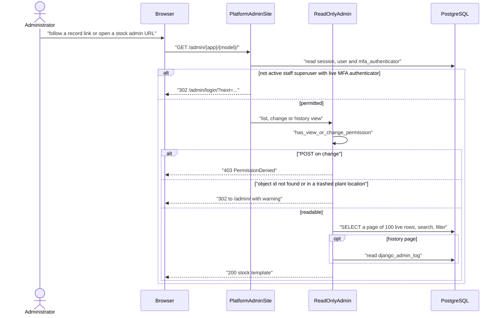

# Browse platform records in the read-only console lists

A platform administrator who follows a record link in the console, or types a stock Django admin URL under `/admin/{app}/{model}/`, gets read-only lists, detail pages and history pages for 20 platform models. `ReadOnlyAdmin` refuses add, change and delete and mounts only the list, change (view) and history routes. The outcome is a server-rendered page. No application operation, queue job or provider call is involved.

## Entry points

- Model routes from `pyracast.platform_admin.site.site`, mounted by `src/pyracast/urls.py` at `admin/`: `{app}/{model}/` (list), `{id}/change/` (detail, read-only) and `{id}/history/`. Actor: platform administrator (active staff superuser with MFA evidence). Production Traefik routes the whole `/admin` prefix; dev-only `web/next.config.ts` rewrites `/admin/:path*/` (trailing slash only) to Django.
- Links into the lists: the overview's "View all" (audit events), each plant page's "Records" row (`records.region_records`: audit trail, plant events, collection jobs, request attempts, "Forecast email history" and provider bindings, filtered by `?region=<id>`), and the mail health checks (`platform_admin.health.action_url`: outbound emails, `?status__exact=uncertain` for unknown outcomes). The record pages use the product names: "Technical details" with Panel capacity (MWp), Inverter capacity (MW AC), Grid export limit (MW), Meter point, Mounting, Panel tilt (°), Panel azimuth (°) and Technical details revision; Workspace administrator and Previous workspace administrator; the mail kinds "Plant not approved" and "Workspace administrator role received" or "moved away"; the mail outcomes Preparing, Will retry, Sending, Sent, Not sent, Not known whether sent and Skipped; a waiting location change "In review".
- 20 registrations in `pyracast.platform_admin.records` `ADMINS`, applied by `register_records`: Tenant, Region, RegionLocationChangeRequest, AuditEvent, PlantEvent, Plant, PlantConfiguration, ProductionObservation, CalibrationRun, CalibrationActivation, SiteBinding, CollectionJob, RequestAttempt, ForecastResult, NotificationDelivery, NotificationSettings, DispatcherStatus, OutboundMail, WorkspaceAdminChange and WorkspaceMemberRemoval. Most declare curated columns, filters, ordering and search (for example deliveries by recipient key and plant name); Tenant, ForecastResult and the plant data models use the plain `ReadOnlyAdmin`.
- Stock `AdminSite` views that stay routed: `{app}/` (`app_index`), `jsi18n/`, `r/{ct}/{obj}/` and the final `catch_all_view`. `PlatformAdminSite.get_urls` replaces `index`, `logout` and `password_change` and drops `autocomplete/` and `password_change/done/`.
- Editing flows (recipient limit, plant setup, approval, location review) live in their own console pages (`platform-settings`, `provider-connection-setup`, `plant-approval`, `change-request-review`), not here.

## Sequence

## Data

| Table | R/W | What |
|---|---|---|
| accounts_tenant, accounts_workspaceadminchange, accounts_workspacememberremoval | R | Workspace rows and the two workspace ledgers |
| connections_sitebinding, forecasts_collectionjob, forecasts_forecastresult, forecasts_requestattempt, forecasts_dispatcherstatus, regions_auditevent, regions_region, regions_regionlocationchangerequest | R | List and detail rows; detail pages also load the rows behind displayed foreign keys |
| plants_plant, plants_plantconfiguration, plants_productionobservation, plants_calibrationrun, plants_calibrationactivation, plants_plantevent | R | Same |
| notifications_notificationdelivery, notifications_deliveryrecipient, notifications_notificationsettings, notifications_outboundmail | R | Delivery list and detail defer `prepared_message` and show the listed `fields` only (no lease) and the recipient addresses; outbound mail shows kind, recipient, status, attempts, error and timestamps, never the sealed code or context |
| django_admin_log | R | History pages. Written by workspace creation and rename (`Tenant`) and by recipient-limit changes (`NotificationSettings`), so only those histories hold entries |
| django_session, usersessions_usersession | R/W | Per-request session and MFA evidence; `SessionLifetime` refreshes the activity marker |
| auth_user, mfa_authenticator | R | Role flags and evidence for the site gate |

## Authorization

- Site gate (every route except `login/`, including `catch_all_view`, `app_index` and `r/`): `PlatformAdminSite.has_permission` = `has_platform_admin_session` (active staff superuser, session MFA record of type `totp` or `recovery_codes` bound to a live authenticator of that user). A failure redirects to the login hand-off. Every request also needs a proof by the authenticator within the last hour and an unsafe one a recent confirmation, else the 403 confirmation page (`admin-console-access`).
- Model gate: `ReadOnlyAdmin` returns False for add, change and delete; the routes for add, delete and the `{id}/` redirect do not exist (404), and a POST to `change/` raises `PermissionDenied`. No registration offers an action (`get_actions` is empty) or an editable column. View permission stays stock, which a superuser always has.
- Rows: `get_queryset` applies `LIVE_ROWS`, so every model tied to a plant location leaves out the rows of a trashed location in its list, count, change and history views; rows whose link is empty, such as an account-level request attempt or audit event, stay. Otherwise there is no object-level or tenant scoping: a platform administrator sees every tenant's rows, including delivery recipient addresses. The `ProviderAccount` model (encrypted key) is deliberately unregistered.

## Failure paths

| Condition | Result |
|---|---|
| Anonymous, inactive, non-staff, non-superuser, no MFA evidence, or session past its idle or absolute lifetime | 302 to `/admin/login/?next=...`, then the hand-off (`/app/?next=<path>`) |
| POST to `change/` | 403 |
| `add/`, `{id}/`, `{id}/delete/`, `autocomplete/`, `password_change/done/`, a Region `setup/` alias | 404 (unrouted, answered by the catch-all) |
| Unknown object id on change or history, or an object of a trashed plant location | 302 to `/admin/` with a stock "doesn't exist" warning |
| Unknown path under `/admin/` | 404, or 301 when the path plus a slash resolves |
| Invalid list filter value or unknown local field | 302 to the list with `?e=1`; if `e=1` is already present, the stock "Database error" page |
| Relational filter not in `list_filter`, or disallowed `_to_field` | 400 (`SuspiciousOperation`) |
| `r/{ct}/{obj}/` | 404 for every model (none defines `get_absolute_url`) |
| `?region=` that is not the id of a live location | The plant location filter is not offered and filters nothing |
| Concurrent request on the same session | 503 HTML page with `Retry-After: 1` (`SessionRequestSerialization`) |

## Rules and invariants

- Only `pyracast.platform_admin.site` is mounted. `django.contrib.admin` runs as `SimpleAdminConfig`, so nothing is autodiscovered and the default admin site stays empty: users, emails, MFA factors and sessions cannot be browsed.
- Lists use stock paging (100 rows). The audit, plant event, plant, binding, job, attempt and delivery lists skip the full result count; the audit and delivery lists join what they display, so their query count does not grow with the rows.
- History pages hold entries only for `Tenant` and `NotificationSettings`; `AuditEvent` and `PlantEvent` are the real trail for plants. The two workspace ledgers name their change in one sentence (`__str__`).
- The plant location filter (`region_filter`) offers only the one live location the link names.

## Tests

- `tests/test_record_browser.py`: each curated list opens, plant page links filtered to the plant, a link naming no live location filters nothing, constant query count of the audit list, ledger row names.
- `tests/test_console_records.py`: every model with a `LIVE_ROWS` entry leaves out the records of a trashed plant location while account-level attempts and provider-account events stay; change and history of a trashed region redirect to `/admin/`.
- `tests/test_routed_surface.py` `test_console_offers_no_bulk_or_raw_write_actions`: no actions, POST on `change/` 403, add, delete, `{id}/`, `setup/`, `autocomplete/` and `password_change/done/` 404, default admin site empty.
- `tests/test_notification_admin.py` (recipient search, read-only settings page), `tests/test_admin_workspace.py::test_delivery_admin_displays_shared_schedule_without_edit_permission`, `tests/test_public_data.py::test_provider_accounts_are_not_registered_in_admin`, `tests/test_admin_health.py` (mail checks link to the outbound mail list), `tests/test_api.py` (`test_fixture_workflow_and_freshness`, `test_mfa_and_admin_read_only_boundaries`), `tests/test_account_security.py` (`test_mfa_evidence_is_bound_to_current_user_and_live_authenticator`).
- Gaps: no HTTP test of a history page of a live row, `app_index`, `r/` or the catch-all, and detail pages are fetched only for Region, NotificationDelivery and NotificationSettings. No Playwright test for these pages.
