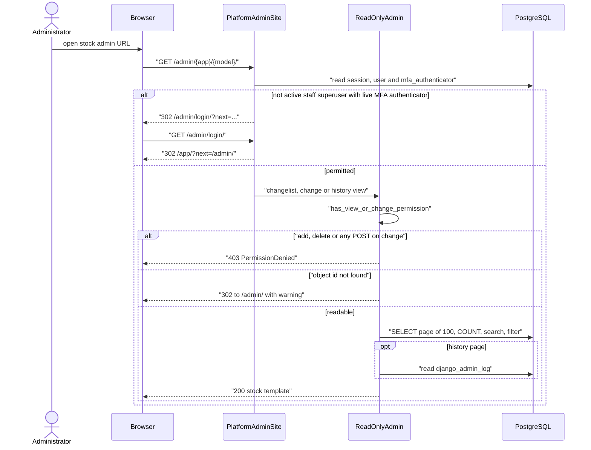

# Browse platform records in the stock Django admin

A platform administrator who types or follows a stock Django admin URL under `/admin/{app}/{model}/` gets read-only changelists, detail pages and history pages for 17 platform models. Nothing in the workspace navigation links to them, and `ReadOnlyAdmin` refuses add, change and delete. The outcome is a server-rendered page (or JSON for `autocomplete/`). No application operation, queue job or provider call is involved.

## Entry points

- Stock model routes from `pyracast.admin.site`, mounted by `src/pyracast/urls.py` at `admin/`: `{app}/{model}/` (changelist), `{id}/change/`, `{id}/history/`, `{id}/` (302 to change), `add/`, `{id}/delete/`. Actor: platform administrator (active staff superuser with verified MFA). No component links here (`admin/workspace/base.html` navigates only to workspace views); dev-only `web/next.config.ts` rewrites `/admin/:path*/` (trailing slash only) to Django, and production Traefik routes the whole `/admin` prefix.
- 17 read-only registrations in `src/pyracast/admin.py`: a bottom loop registers plain `ReadOnlyAdmin` for Tenant, SiteBinding, CollectionJob, ForecastResult, RequestAttempt, AuditEvent, Plant, PlantConfiguration, ProductionObservation, CalibrationRun, CalibrationActivation, PlantForecast and PlantEvent. `NotificationDeliveryAdmin`, `DispatcherStatusAdmin`, `RegionAdmin` and `RegionLocationChangeRequestAdmin` subclass it. Only the Region and delivery admins declare `search_fields`.
- Stock `AdminSite` views: `{app}/` (`app_index`), `jsi18n/`, `autocomplete/`, `r/{ct}/{obj}/`, `password_change/done/` and the final `catch_all_view`. `PlatformAdminSite.get_urls` replaces `password_change/` and `logout/`, and `index` renders the workspace overview.
- `NotificationSettingsAdmin` (editable), the `RegionAdmin` setup view and the Region and location-change actions share the site but belong to `platform-settings`, `provider-connection-setup`, `plant-approval` and `change-request-review`.
## Sequence

## Data

| Table | R/W | What |
|---|---|---|
| accounts_tenant, connections_sitebinding, forecasts_collectionjob, forecasts_forecastresult, forecasts_requestattempt, forecasts_dispatcherstatus, regions_auditevent, regions_region, regions_regionlocationchangerequest | R | Changelist and detail rows, every column; detail pages also load the rows behind displayed foreign keys |
| plants_plant, plants_plantconfiguration, plants_productionobservation, plants_calibrationrun, plants_calibrationactivation, plants_plantforecast, plants_plantevent | R | Same |
| notifications_notificationdelivery, notifications_reminderschedule, forecasts_forecastsnapshot | R | Delivery detail limited to the listed `fields` (`lease_token`, `lease_expires_at`, `prepared_message`, `recipient_memberships`, `revoked_recipients`, `grouped`, `language` hidden); schedule and snapshot are joined for search and display |
| django_admin_log | R | Stock history page. Written only by `NotificationSettings` saves and by `admin_workspace.WorkspaceSettingsForm.apply` |
| django_session, usersessions_usersession | R/W | Per-request session and MFA evidence; `SessionLifetime` refreshes `last_activity_at` and `UserSessionsMiddleware` records activity |
| auth_user, mfa_authenticator | R | Role flags for the site gate; `has_verified_mfa` only checks that the session's authenticator still exists |

## Authorization

- Site gate (every route except `login/`, including `catch_all_view`, `app_index`, `autocomplete/` and `r/`): `PlatformAdminSite.has_permission` requires active staff, superuser and `has_verified_mfa` (a session MFA record of type `totp` or `recovery_codes` bound to a live authenticator row of the same active user). Stock `admin_view` turns a failure into a login redirect, and `PlatformAdminSite.login` sends everyone to `/app/`.
- Model gate: `ReadOnlyAdmin` returns False for add, change and delete. Django views raise `PermissionDenied` for `add/`, `delete/` and any POST to `change/` (the Region and location-change actions are changelist-only). View permission stays stock, which a superuser always has.
- Object-level and database: none. A platform administrator sees every tenant's row, including soft-deleted regions and plants. The `ProviderAccount` model (encrypted key) is deliberately unregistered.
- Mutating actions on Region and location-change changelists use `permissions=["view"]`, so `ReadOnlyAdmin` does not stop them.

## Failure paths

| Condition | Result |
|---|---|
| Anonymous, inactive, non-staff, non-superuser, no verified MFA, or session past its idle or absolute lifetime | 302 to `/admin/login/?next=...`, then 302 to `/app/?next=/admin/` (the original path is dropped) |
| GET or POST `add/` or `{id}/delete/` (even for an unknown id), or any POST to `change/` | 403 |
| Unknown object id on change or history | 302 to `/admin/` (workspace overview) with a stock "doesn't exist" warning |
| Unknown path under `/admin/` | 404, or 301 when the path plus a slash resolves |
| Invalid changelist filter value or unknown local field | 302 to the changelist with `?e=1`; if `e=1` is already present, the stock "Database error" page |
| Relational filter not in `list_filter`, or disallowed `_to_field` | 400 (`SuspiciousOperation`) |
| `autocomplete/` without valid `app_label`, `model_name`, `field_name` for a foreign key to a registered model | 403; 404 when the target admin has no `search_fields` |
| `r/{ct}/{obj}/` | 404 for every model (none defines `get_absolute_url`) |
| Concurrent request on the same session | 429 JSON `session_busy` from `SessionRequestSerialization` |

## Rules and invariants

- Only `pyracast.admin.site` is mounted. The default `django.contrib.admin.site` holds 8 auth, allauth, socialaccount, mfa and usersessions registrations that have no URL, so users, emails, MFA factors and sessions cannot be browsed.
- No model defines `__str__`, so the 13 plain `ReadOnlyAdmin` rows show as `Model object (pk)` with no search or filter. Only the Region, location-change, delivery and dispatcher admins declare columns.
- `autocomplete/` returns Region rows (searchable by name and tenant name) for any foreign key to Region, such as `plants.Plant.region`, although no admin declares `autocomplete_fields`.
- History pages are empty for all 17 read-only models: nothing writes `django_admin_log` for them. `AuditEvent` is the real trail. Changelists use stock paging (100 rows, full `COUNT`) and select every column, including JSON payloads.

## Tests

- `tests/test_api.py`: `test_fixture_workflow_and_freshness` gets 200 for `/admin/regions/region/`; `test_mfa_and_admin_mutation_boundaries` checks the `ReadOnlyAdmin` permission methods and anonymous site permission; `test_admin_login_requires_password_and_totp` checks the MFA gate on `/admin/`.
- `tests/test_account_security.py`: `test_mfa_evidence_is_bound_to_current_user_and_live_authenticator` pins `has_verified_mfa`; `test_admin_has_no_independent_password_entry_point` pins the login redirect.
- `tests/test_admin_workspace.py::test_workspace_requires_live_verified_platform_administrator` covers anonymous, member, staff, unverified and inactive identities for workspace URLs only, not model routes; `test_delivery_admin_displays_shared_schedule_without_edit_permission` pins `has_change_permission` False on a detail page.
- `tests/test_admin_setup.py` and `tests/test_region_editing.py` fetch the Region and location-change changelists and detail pages; `tests/test_public_data.py::test_provider_accounts_are_not_registered_in_admin` pins the unregistered account model.
- Gaps: no HTTP test of 403 for `add/`, `delete/` or POST `change/` on a `ReadOnlyAdmin` model, history, `app_index`, `autocomplete/`, the catch-all, or the 17 registrations. No Playwright test for stock pages.
