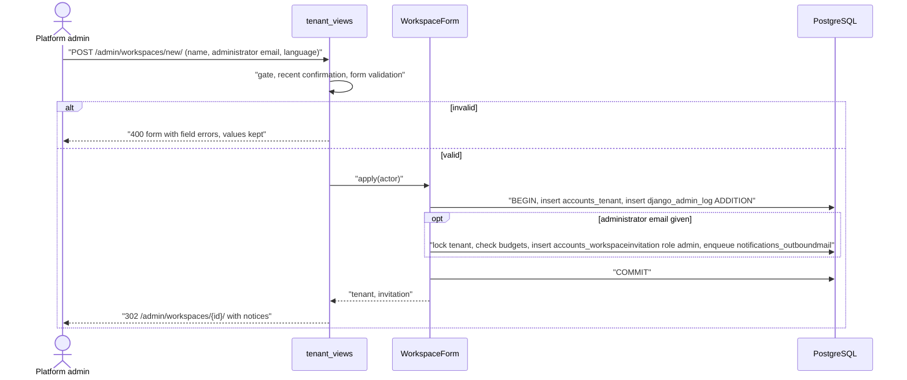

# Create and manage workspaces from the console

A platform administrator creates a workspace for a customer, optionally inviting its first administrator, then finds it by name or member address, renames it, invites members, resends or revokes invitations and removes viewers. Plants are added from the workspace page (`site-onboarding`) and the administrator is changed on its own route (`workspace-admin-reassignment`). The console creates no user: people join by accepting an invitation (`invitation-acceptance`).

## Entry points

All routes live in `PlatformAdminSite.get_urls` (`pyracast.platform_admin.site`), views in `pyracast.platform_admin.tenant_views`, forms and read models in `pyracast.platform_admin.tenants`. Actor: platform administrator; unsafe requests need a recent confirmation (`admin-console-access`).

- `GET /admin/workspaces/?q=&needs_administrator=1&page=` -> `workspaces` -> `tenant_list_context`: 20 per page, query matches the workspace name or a member's address, filter for workspaces without an active administrator; shows administrator state (name, invitation pending, none), member and plant counts.
- `GET|POST /admin/workspaces/new/` -> `new_workspace` -> `WorkspaceForm.apply`: name, optional administrator address, invitation language.
- `GET /admin/workspaces/{id}/` -> `workspace` -> `workspace_context`: read-only page with Plants, Members, Invitations and Settings sections; every change is its own route and returns to the section it came from.
- `GET|POST .../name/` -> `workspace_name` -> `WorkspaceRenameForm.apply`.
- `GET|POST .../invitations/new/` -> `new_invitation` -> `InvitationForm.apply` -> `accounts.invitations.invite_workspace_member(platform=True)`; `POST .../invitations/{i}/reissue/` and `.../revocation/` -> `invitation_reissue`, `invitation_revocation` -> `reissue_workspace_invitation`, `revoke_workspace_invitation`.
- `GET|POST .../members/{user}/removal/` -> `member_removal` (confirmation page) -> `accounts.operations.remove_workspace_member(platform=True)`.
- Elsewhere: `.../administrator/` (`workspace-admin-reassignment`), `.../plants/new/` (`site-onboarding`).
- Labels: roles read "Workspace administrator" and "Member"; invitation delivery reads Sending, Sent, Not sent or Not known whether sent; the actions read "Withdraw" and "Remove from workspace"; an empty workspace list says only "No workspaces yet."
- Templates: `tenants.html`, `workspace_new.html`, `tenant.html`, `workspace_name.html`, `invitation_new.html`, `member_removal.html` in `pyracast/regions/templates/admin/workspace/`.

## Sequence

## Data

| Table | R/W | What |
|---|---|---|
| `accounts_tenant` | R/W | Insert on creation; rename updates `name` under `FOR UPDATE` |
| `django_admin_log` | W | `ADDITION` "Created." and `CHANGE` "Renamed from A to B."; shown on the workspace's history page in the record browser |
| `accounts_membership`, `auth_user`, `account_emailaddress` | R/W | Member list and search; removal deletes the membership, after locking the member's account rows |
| `accounts_workspaceinvitation` | R/W | Pending list (open and not expired); new invitation supersedes an open one for the same address (and the open administrator invitation for an administrator invitation); revocation closes one |
| `notifications_outboundmail` | W | The invitation mail intent; the notification worker mails it later and `delivery_status` follows |
| `accounts_workspacememberremoval` | W | One row per removal, naming actor and removed user |
| `notifications_reminderrecipient` and ties | W | Removal drops the member's addresses from the workspace's reminder recipients |
| `regions_region`, `plants_plant`, `connections_sitebinding` | R | Plant rows on the workspace page (same summary as the plant list) |

## Authorization

- Console gate and confirmation as in `admin-console-access`; then each operation calls `authorize_workspace_admin(platform=True)`, which requires a platform administrator and locks the tenant row, with no membership. Creation and rename call `require_platform_admin` themselves. `/api/tenants/` routes never pass `platform`.
- An administrator invitation needs platform authority and a workspace without administrator; the invitation form offers the role only then and defaults to it until one is invited.
- Everything is visible across companies by design; there is no tenant scoping.

## Failure paths

| Condition | Result |
|---|---|
| Not a platform administrator, no MFA evidence | 302 login hand-off |
| Unsafe request without recent confirmation | 403 confirmation page, nothing stored |
| Unknown workspace, or an invitation of another workspace | 404 |
| Invalid form (blank name, invalid or over 254 character address) | 400, same page with field errors and values kept |
| Rename from a stale page | 400 with a reload hint; renaming to the current name (also a double submit) reports "is already the workspace name" |
| Invitation refused (address already a member, rate limit, administrator already present) | 400 form error with the refusal text, values kept |
| Resend or revoke of an invitation that was accepted | Redirect to Invitations with an error notice; revoking one already closed reports "already closed" |
| Remove the administrator, or the signed-in account's own membership | 400 on the removal page with the reason |
| Remove a user who is no longer a member | 404, or an info notice when this workspace removed that account (a double submit) |
| Row lock contention or timeout on a write | Redirect back with a retry notice (`failures.contained`); nothing saved |

## Rules and invariants

- A workspace name need not be unique. Creation and its invitation commit or roll back together; the response only says the invitation "is being sent", and the Invitations list shows its delivery state (Sending, Sent, Not sent, Delivery unknown).
- One open invitation per address and one open administrator invitation per workspace (partial unique indexes); a new or resent one revokes the older as superseded. Invitation budgets (per workspace, address and sender) are shared with the API (`rate-limiting`).
- Removal also revokes pending invitations to the member's addresses and writes `workspace_member_removed`; the account itself remains.
- The console never changes an account's credentials.

## Tests

- `tests/test_admin_workspace_management.py`: access and method guards, list and administrator states, creation with and without invitation, shared names, field errors, stale rename, invitation form roles and refusals, delivery state, resend and revoke, member removal and double submits, section order, Turkish pages. `tests/test_admin_tenants.py` (list search, filters), `tests/test_console_actions.py` (each action stores its change and redirects), `tests/test_workspace_admin_invitations.py` (administrator invitations).
- Playwright: `web/integration/admin-workspaces.spec.ts` (create a workspace, add a plant, manage members), `web/tests/admin-workspace-submit.spec.ts`.
- Gaps: confirmation-needed behaviour on each route in the browser.
