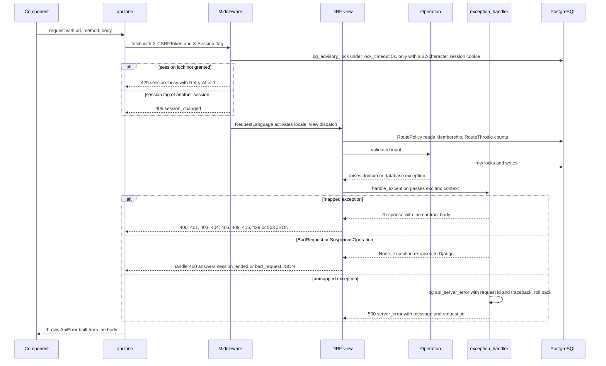

# API response contract: errors, conflicts and pagination

Every failure under `/api/` answers one JSON body `{code, message, fields?, retry_after?, request_id?}`: `code` a closed vocabulary (`pyracast.errors.ErrorCode`), `message` localized under the request language, `fields` the localized text per input path, `retry_after` seconds also sent as `Retry-After`, `request_id` the reference to the server log of a 5xx. A refusal may add its own keys: a stale outage or plant write adds `current` (the record it lost to, through `api.errors.current_on_conflict`), and `location_already_exists` from `POST sites/` or `POST location-change-requests/` adds the holding location's `region_id` (schema `LocationRefusal`, declared per operation). List endpoints answer DRF page-number pages of 50. One DRF exception handler (`pyracast.api.errors`) renders the failures of views; project error handlers render those outside DRF (middleware refusals, unknown paths, interrupted sessions, unhandled errors in allauth views); `PrivateAPIResponses` completes framework refusals and allauth's answers; the web client maps every body to one `ApiError`. Anything the application cannot answer is answered by the gateway's notice service in the same shape.

## Entry points

- `pyracast.api.errors`: `ApiError` (status, code, message, fields, retry after, request id, details), `exception_handler` (set as `REST_FRAMEWORK["EXCEPTION_HANDLER"]`), `api_error` (the one mapping from exception to `ApiError`, used by every renderer), `error_json`, `with_error_contract`, `refuse_in_place`, `log_server_error`. Domain raise sites use `DomainError`, `ConflictError`, `BusyError` and `ForbiddenError` from `pyracast.errors`, each carrying an `ErrorCode`, a catalogued message, an optional field and details; `tests/test_error_raise_sites.py` scans that no error is raised or answered outside this contract.
- `handler400`, `handler403`, `handler404` and `handler500` in `src/pyracast/urls.py` point to `pyracast.api.error_pages`, as does `CSRF_FAILURE_VIEW` (`csrf_failure`); `server_error` runs inside Django's `except` block and logs the current exception with a new request id.
- `pyracast.api.middleware.PrivateAPIResponses`: `private, no-store` on every `/api/` response, the contract body for a body-less 405 or 400 and for a JSON error body that lacks `code` and `message` (allauth), and the audit line of an `/api/auth/` 429. `SessionRequestSerialization` (`session_busy`) and `SessionTagCheck` (`session_changed`) answer through `error_json`. `pyracast.api.permissions.RoutePolicy` and `pyracast.api.throttling.RouteThrottle` refuse through the same handler.
- `pyracast.maintenance` (the gateway's notice service): 503 `maintenance` with `retry_after: 60` while the application is unreachable, and 413 `request_too_large` for a body over the gateway's limit.
- `pyracast.errors.retryable_database_code`: the lock, deadlock and statement-timeout mapping shared by the API handler and the console (`pyracast.platform_admin.failures.contained`). List views call `paginate_queryset` by hand: tenants, trashed regions, location change requests, sites, plants, calibrations, outages and the change-request inbox.
- Web: `web/src/lib/api/errors.ts` (`ApiError`, `errorFromResponse`, `displayMessage`), `lib/api/lane.ts` (`send`, `prepared`), `lib/auth-api.ts` `authRequest`, `fetchList` in `lib/api/query.ts`, `useErrorMessage` and `ActionForm` in `web/src/ui/form.tsx`; catalog `Errors` in `web/messages/{en,tr}/core.json`.

## Sequence

## Data

| Table | R/W | What |
| --- | --- | --- |
| `accounts_membership` | R | `RoutePolicy` checks membership and role per request |
| PostgreSQL advisory lock | R/W | Per session key, held for the whole request by `serialize_session` (no table) |
| `pyracast.security` log | W | `authorization_denied` or `csrf_refused` for a 403 to a signed-in caller (once a minute per actor, view and code), `authentication_request_throttled` for any 429 under `/api/auth/`, `invalid_proxy_headers` with the proxy peer address (log lines, no table) |
| `pyracast.api` log | W | `api_server_error` and `api_request_timeout` at ERROR with request id, method, path, view and traceback; `api_object_not_found` at WARNING with the model name |

## Authorization

- Access comes from `RoutePolicy` (`docs/flows/tenant-authorization.md`): `not_authenticated` 401 with `WWW-Authenticate: Session`, `membership_required`, `workspace_admin_required`, `admin_edits_directly`, `platform_admin_required`, `csrf_failed`, and `permission_denied` for a route without a policy; a method the route does not list is 405. Rows under a tenant come from tenant-scoped querysets, so missing and foreign rows both end in 404.

## Failure paths

| Condition | Result |
| --- | --- |
| Django or DRF `ValidationError` (serializers, operations, forms) | 400 `invalid_request`; `message` joins the general errors, `fields` keys each input path (list items by index) |
| `DomainError` | its status (400 unless set) and own code (for example `plant_edit_blocked` with the block's reason); `field` adds `fields`; `ConflictError` is 409 (`idempotency_key_reused`, `pending_request_limit`, `request_already_closed`, `request_conflict`, `review_context_changed`, `production_revision_changed`, `incident_revision_changed` and `plant_parameters_changed` with `current`, `region_revision_changed`, `workspace_admin_changed`, `configuration_changed`, ...) |
| `ForbiddenError`; any other `PermissionDenied` | 403 with its code; 403 `permission_denied` |
| DRF `NotAuthenticated`, `AuthenticationFailed` | 401 `not_authenticated`, `WWW-Authenticate` header |
| `ObjectDoesNotExist` (model name logged at WARNING), `Http404`, invalid `?page`, unknown `/api/` path | 404 `not_found` |
| Method, `Accept` or media type refused | 405 `method_not_allowed` (keeps `Allow`), 406 `not_acceptable`, 415 `unsupported_media_type`; a JSON `null` body is `invalid_request` "Send the request body as a JSON object." |
| DRF `ParseError`; allauth's body-less 400 for malformed or non-object JSON | 400 `bad_request` |
| `SessionInterrupted` (session lock lost, session deleted concurrently); other `BadRequest` or `SuspiciousOperation` (for example `TooManyFieldsSent`), also inside a DRF view | `exception_handler` leaves them to Django; `handler400`: 400 `session_ended` / `bad_request`; `SuspiciousOperation` is logged on `django.security` |
| DRF `Throttled` (route throttle) | 429 `throttled` with `Retry-After` |
| Session advisory lock not granted in 5 s | 429 `session_busy`, `Retry-After: 1` |
| Invitation budget | 429 `invitation_rate_limited` with the real `retry_after` |
| `RequestDeferredError` without / with `available_at`; `QuotaExceededError`; `ProviderError` | 503 `provider_authentication_failed` / 429 `provider_throttled` with `Retry-After`; 429 `quota_exhausted`; 503 `provider_unavailable` (502 is the gateway's) |
| Lock wait over `lock_timeout` 5 s (`LockNotAvailable`) / deadlock / statement canceled (`QueryCanceled`, including `statement_timeout` 60 s) | 503 `busy`, `Retry-After: 1` / 503 `database_conflict`, `Retry-After: 1` / 503 `request_timeout` with `request_id`, logged at ERROR with traceback |
| Anything else in a DRF view (`DataError`, other database errors, programming errors) | 500 `server_error` with `request_id`; `api_server_error` logged with the traceback; DRF `set_rollback` |
| Unhandled exception outside DRF under `/api/` (allauth views, middleware) | `handler500`: the same 500 body with the request id it logs as `api_server_error` (path escaped); Django also logs `django.request` at ERROR |
| `PermissionDenied` in middleware (`TrustedProxyHeaders` refusing unverifiable proxy headers) | `handler403`: 403 `invalid_proxy_headers` or `permission_denied`, JSON under `/api/`, HTML elsewhere |
| Missing or stale CSRF token | 403 `csrf_failed` on `/api/` (a navigation to the provider redirect or callback returns to the social callback with `error=expired_form`); the HTML failure page elsewhere |
| allauth failure (400 and above, including 401 and 409 answers) | keeps `status`, `errors`, `data`, `meta` and adds `code` from the status (400 `invalid_request`, 401 `not_authenticated`, 403 `permission_denied`, 404 `not_found`, 409 `conflict`, 410 `session_ended`, 429 `throttled`, 5xx `server_error` with `request_id`), `message` (allauth's first error, else the code's text) and `fields` from `errors[].param` |
| Application stopped; body over the gateway's limit | gateway: 503 `maintenance` with `retry_after` 60 and `Retry-After: 60`; 413 `request_too_large` |
| Lock, deadlock or statement timeout in a console write | back to the form's page (validated Referer, else `/admin/`) with a retry message and a `console_write_not_saved` warning; with `Accept: application/json` 503 `{"message": ...}` and `Retry-After: 1`; a busy session answers `/admin/` with the HTML page, not `session_busy` |

## Rules and invariants

- Every code has a catalogued English message and a distinct Turkish one (`MESSAGES`); the handler translates under `RequestLanguage` and never carries stack or database text. Tracebacks go only to the log, so database `DETAIL` text can reach the log. Customer bodies pass `CustomerJSONRenderer` (`public_source_data`): private keys are dropped and provider names in technical strings are rewritten or become `null`.
- `with_error_contract` adds the missing keys to a JSON error body of at most 64 KiB and keeps its own keys; a rewritten body drops `ETag`, `Content-Encoding` and `Content-MD5` and resets `Content-Length`. `refuse_in_place` keeps `Allow`, `Vary`, `Content-Language` and cookies.
- `lock_timeout=5s` and `statement_timeout=60s` are connection options (`background/deadlines.py`, `DATABASES`); the web client retries a `session_busy` answer once and reads no other `Retry-After`. Approving a request that no longer matches the plant answers 409 `request_conflict` (`_validate`).
- `page_size_query_param` is unset: size is fixed at 50 and an out-of-range `?page` is 404 `not_found`. `fetchList` follows `next` until null, rejects repeated or non-`/api/` links and re-runs on its poll interval; the inbox pages by number.
- Client mapping: `errorFromResponse` turns a contract body into an `ApiError` (status, known code, fields, `retryAfter`, `requestId`, body) carrying the server message, with "Reference: id" appended for a `request_id`; any other body becomes `Errors.request` with the status. `displayMessage` shows only an `ApiError`'s message and a generic text for anything else; `ActionForm` places `fields` beside the inputs. `authRequest` returns a 401 (and a 404 for GET of the TOTP authenticator) as a result instead of throwing. The client's code set is compile-checked against the generated vocabulary.

## Tests

- pytest: `tests/test_error_contract.py` (every code answered as one localized body, field placement, CSRF forms, busy console and API navigation, malformed JSON, replaced framework refusals, every route and error, allauth failures, OpenAPI export), `tests/test_api_error_values.py` (rewritten bodies and headers), `tests/test_error_pages.py` (JSON 400, 403, 404 and 500 outside DRF, escaped log path, proxy refusal), `tests/test_api_contention.py` (real lock timeout and statement timeout to 503, deadlock, unclassified database error to a logged 500), `tests/test_domain_error_codes.py`, `tests/test_workspace_http_failures.py`, `tests/test_api.py` (`test_stable_errors`, `test_unknown_error_answers_json_with_reference_and_logs_traceback`), `tests/test_api_localization.py`, `tests/test_maintenance_notice.py` (gateway bodies), `tests/test_error_raise_sites.py`.
- Playwright: `web/tests/api-errors.spec.ts` and `transport.spec.ts` (contract bodies, busy retry, unconfirmed changes), `change-requests.spec.ts` (503, 409, 500 with its reference), `workspace.spec.ts` and `plant-onboarding.spec.ts` (multi-page `next`), `auth-registration.spec.ts` (sign-in 500 with its reference, `session_ended`), `epias-production.spec.ts` and `outages.spec.ts` (409 banners).
