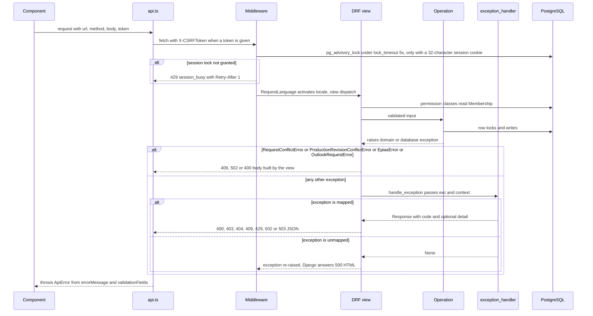

# API response contract: errors, conflicts and pagination

Every DRF view under `/api/` answers failures with a machine `code` plus optional `detail`, rendered as JSON except by `GET /api/schema/` (spectacular renderers: YAML unless JSON is requested), and list endpoints as DRF page-number pages of 50. One DRF exception handler maps domain exceptions to codes; four views and one middleware build their own failure bodies; the web client turns bodies into one translated message plus per-field errors. Allauth (`/api/auth/browser/v1/`) keeps its own `{status, data, errors}` envelope, read by a separate client function. Middleware-level `PermissionDenied` and unmapped exceptions leave the JSON contract (Django HTML 403/500).

## Entry points

- `pyracast.api.errors.exception_handler`, set as `REST_FRAMEWORK["EXCEPTION_HANDLER"]` in `src/pyracast/settings.py`; the same module holds `VALIDATION_DETAILS` (14 server-side message keys).
- View-built bodies: `RequestView.handle_exception` in `src/pyracast/change_requests/api.py` (409 `RequestConflictError`), `ProductionChangesView.post` in `src/pyracast/plants/api.py` (409 `production_revision_conflict`), `EpiasConnectionView.put` in `src/pyracast/plants/epias_api.py` (502 `epias_unavailable`), `ForecastView.get` in `src/pyracast/api/views.py` (400 `OutlookRequestError`).
- `SessionRequestSerialization` in `src/pyracast/accounts/session_lock.py` (429 `session_busy`, outside DRF) and `PrivateAPIResponses` in `src/pyracast/api/middleware.py` (no-store headers, auth 429 audit). `PageNumberPagination` with `PAGE_SIZE` 50 (`DEFAULT_PAGINATION_CLASS`), used by 11 list views that call `paginate_queryset` by hand: tenants, regions, location changes, sites, plants, production observations, calibrations, incidents, change-request inbox, two trash lists.
- Web: `request`, `errorMessage`, `validationFields`, `ApiError` in `web/src/lib/api.ts`; `authRequest`, `AuthResponseError` in `web/src/lib/auth-api.ts`; `useCollection`, `useResource`, `ActionForm` in `web/src/components/ui.tsx`; catalog `Errors` in `web/messages/{en,tr}/core.json`.

## Sequence

## Data

| Table | R/W | What |
| --- | --- | --- |
| `Membership` | R | `WorkspaceWritePermission` and `WorkspaceMemberWritePermission` check role or membership per request |
| PostgreSQL advisory lock | R/W | Per session key, held for the whole request by `serialize_session` (no table) |
| `pyracast.security` log | W | `authentication_request_throttled` for any 429 under `/api/auth/` (a log line, no table) |

## Authorization

- Default classes `IsAuthenticated` and `WorkspaceWritePermission` (admin role for non-safe methods under `tenant_id`) in `REST_FRAMEWORK`; `PlatformAdmin` (active superuser with verified MFA) guards the `/api/platform/` views.
- Operations raise Django `PermissionDenied`; DRF answers 403 `http_403` with the raised text. `SessionAuthentication` has no authenticate header, so anonymous callers also get 403, not 401; a CSRF failure is 403 `CSRF Failed: <reason>`. Rows under a tenant come from tenant-scoped querysets, so missing and foreign rows both end in 404.

## Failure paths

| Condition | Result |
| --- | --- |
| Lock wait over `lock_timeout` 5 s inside a view (`OperationalError` caused by `LockNotAvailable`) | 503 `workspace_busy`, `Retry-After: 1` |
| Session advisory lock not granted in 5 s | 429 `session_busy`, English `detail`, `Retry-After: 1`; under `/api/auth/` also logged as `authentication_request_throttled` |
| `ObjectDoesNotExist` / `Http404` from `get_object_or_404` / invalid `?page` | 404 `not_found` / 404 `http_404`, `detail.detail` "No Plant matches the given query." / 404 `http_404`, `detail.detail` "Invalid page." |
| Django `ValidationError` from operations / DRF `ValidationError` (serializers, four workspace views that re-wrap Django errors) | 400 `invalid_request`, `VALIDATION_DETAILS` localized / 400 `http_400`; `detail` is a list or per-field dict |
| `OutlookRequestError` on the regional forecast | 400 `date_out_of_range` or `completed_day_required` (no `detail`) |
| `RequestDeferredError` without / with `available_at`; `QuotaExceededError`; `ProviderError` (platform validate endpoint only) | 503 `provider_authentication_failed` / 429 `provider_throttled` with `Retry-After` seconds; 429 `quota_exhausted`; 502 `provider_unavailable` |
| `EpiasError` on EPIAS connect | 502 `epias_unavailable`, English `detail` |
| `RequestConflictError` | 409 `idempotency_key_reused`, `pending_request_limit`, `request_already_closed`, `review_context_changed` or `request_conflict`, each with localized `detail` |
| `ProductionRevisionConflictError` on direct production write / incident `RevisionConflict` (`APIException`) | 409 `production_revision_conflict` / 409 `http_409`, `detail.detail` "Incident revision changed." |
| Other DRF exceptions (403, 405, invitation `Throttled(wait=60)`, parse errors) | `http_<status>`, `detail.detail` text; `Throttled` adds `Retry-After` |
| `PermissionDenied` raised in middleware (`TrustedProxyHeaders`, `PrivilegedAuthenticatorEnrollment`) | Django HTML 403, outside DRF; the client shows `Errors.request` |
| Anything else (`DataError`, `QueryCanceled`, deadlock, `ProductionRevisionConflictError` on change-request submission) | handler returns `None`: 500 HTML |

## Rules and invariants

- Client mapping in `errorMessage`: every non-`code` entry is rendered (`detail` and `non_field_errors` bare, other keys as `key: message`); a code-shaped string is looked up in `Errors.codes.*` and dropped if unknown; `code` is looked up only when nothing else yields text. `validationFields` keeps dict `detail` entries except `detail` and `non_field_errors`. An empty, non-JSON or unknown-code failure becomes `Errors.request` with the status.
- Handler bodies never carry stack or database text (`test_stable_errors` asserts a provider secret stays out). Customer error bodies pass through `public_source_data`: private keys are dropped and `code`/`detail` strings that mention Solcast are rewritten. English server text reaches the client from `session_busy`, `epias_unavailable`, untranslated `PermissionDenied` texts (`Tenant membership required.`) and the model name in `http_404`; other details are `gettext`-localized under `RequestLanguage`.
- `lock_timeout=5s` and `statement_timeout=60s` are connection options in `DATABASES`; only the lock timeout is classified. `Retry-After` is sent but the web client never reads it. Approving a stale request maps `ValidationError`, `RevisionConflict` and `ProductionRevisionConflictError` to 409 `request_conflict` (`_validate`).
- `page_size_query_param` is unset: size is fixed at 50 and an out-of-range `?page` is 404 `http_404`. `useCollection` follows `next` until null, rejects repeated or non-`/api/` links and re-runs on its poll interval; the inbox pages by number.
- The client serializes `/api/session/*` calls (one GET in flight, mutations queued), mirroring the server session lock. `authRequest` returns 401 (and 404 for GET of the TOTP authenticator) as results instead of throwing.

## Tests

- pytest: `tests/test_api.py` (`test_stable_errors`, `test_unknown_error_is_not_hidden`), `tests/test_api_contention.py` (real lock timeout to 503, deadlock stays unmapped), `tests/test_api_localization.py` (`http_400` vs `invalid_request`), `tests/test_collection_resilience.py` (deferral statuses), `tests/test_change_request_contracts.py`, `tests/test_incidents.py` and `tests/test_production_changes.py` (409), `tests/test_epias_api.py` (502), `tests/test_session_serialization.py` (429 status and header), `tests/test_security_audit.py` (`session_busy` logged as auth throttle), `tests/test_change_requests.py` (pages, `not_found`).
- Playwright: `web/tests/change-requests.spec.ts` (503, 409), `workspace.spec.ts` and `plant-onboarding.spec.ts` (multi-page `next`), `auth-registration.spec.ts` (non-JSON 403 to generic text), `epias-production.spec.ts` and `outages.spec.ts` (409 banners). Gaps: no unit test of `errorMessage` or `validationFields` (mocks use a flat `{"detail":...}` the server never sends); no test of `http_404`, `production_revision_conflict` or `session_busy` bodies; stale production submission (500) untested; `PAGE_SIZE` 50 not asserted.
