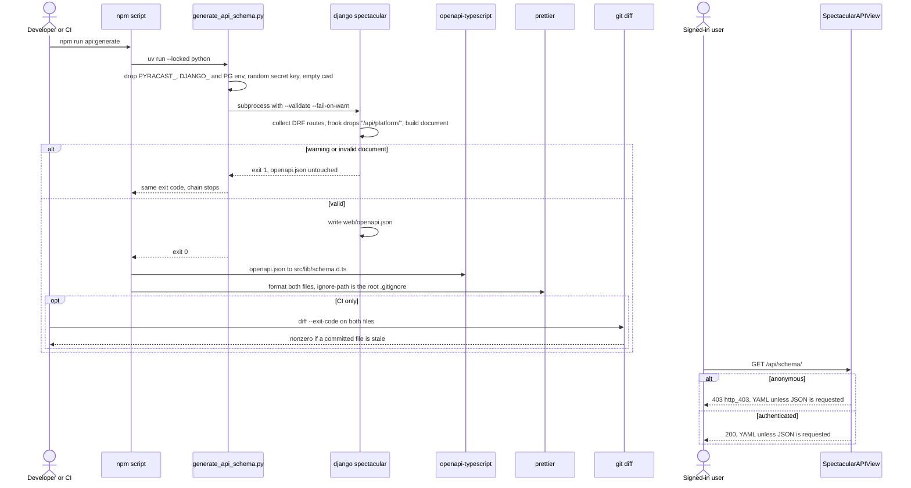

# OpenAPI schema and generated client types

A developer runs `npm run api:generate` after an API change. It renders the customer-only OpenAPI document with drf-spectacular into `web/openapi.json`, then turns it into `web/src/lib/schema.d.ts`, the types the frontend imports. CI repeats the run and fails if either committed file differs. A document built the same way, but in the request language, is also served to any signed-in user at `GET /api/schema/`.

## Entry points

- `web/package.json` script `api:generate`: the developer and CI command. It chains the generator script, `openapi-typescript` and `prettier --write`.
- `scripts/generate_api_schema.py` `main`: runs `python -m django spectacular` in a subprocess with `--validate --fail-on-warn --format=openapi-json`; optional `--output`, default `web/openapi.json`.
- `GET /api/schema/` in `src/pyracast/urls.py`: `SpectacularAPIView` with `permission_classes=[IsAuthenticated]`. Actor: any authenticated user.
- `src/pyracast/api/schema.py` `customer_endpoints`: spectacular preprocessing hook registered in `SPECTACULAR_SETTINGS` (`src/pyracast/settings.py`).
- Consumers of `components` from the generated module: `web/src/lib/api.ts` (aliases such as `Session`, `Region`, `Plant`), eleven components, two Playwright specs and one Playwright support file.
- CI step "Verify API schema and generated types" in `.github/workflows/ci.yml` (shared `web-steps` anchor, so it runs in `web_ubuntu` and `web_windows`).

## Sequence

## Data

- Generation reads no table: an in-process `spectacular` run with an unreachable `PGHOST` left both connections unopened. Stripping `PG*` only makes the child fall back to `127.0.0.1:5432`. Files written: `web/openapi.json` and `web/src/lib/schema.d.ts`.
- Endpoint: middleware reads the session and user (`docs/flows/session-and-csrf.md`), reads `UserLanguagePreference` to pick the language (`docs/flows/i18n-and-language.md`) and may refresh the session's `last_activity_at`.

## Authorization

- Endpoint: only `IsAuthenticated`, set on the view in `src/pyracast/urls.py`; it replaces spectacular's `SERVE_PERMISSIONS` default `AllowAny`. `SessionAuthentication` is inherited from DRF settings. There is no tenant, role or staff check, and `WorkspaceWritePermission` is not applied. The document is built with spectacular's default `SERVE_PUBLIC=True`, so it is not filtered per user.
- Operator exposure is removed at generation time: `customer_endpoints` drops every route starting with `/api/platform/`, and their serializer components disappear with them. Access to those routes is enforced by their own `PlatformAdmin` permission (`src/pyracast/api/views.py`).

## Failure paths

| Condition | Result |
| --- | --- |
| Anonymous `GET /api/schema/` | 403 with data `{"code": "http_403", "detail": ...}` from `src/pyracast/api/errors.py`, rendered by the negotiated spectacular renderer: YAML unless JSON is requested; SessionAuthentication has no challenge header |
| No `?format=json` and no JSON `Accept` header | 200 YAML (file name "Pyracast API.yaml"), not JSON |
| Request language Turkish (preference, cookie, `Accept-Language` or `?lang=tr`) | Served document differs from the committed English one (DRF pagination descriptions are translated) |
| Spectacular warning (unannotated view, enum name clash) or invalid OpenAPI | `SchemaGenerationError` or `SchemaValidationError`, exit 1, `web/openapi.json` not rewritten, `schema.d.ts` not regenerated |
| `openapi-typescript` or `prettier` fails after spectacular succeeded | New `openapi.json` beside the old `schema.d.ts`; CI diff fails |
| Committed `web/openapi.json` stale | CI diff fails; `tests/test_api_schema_generation.py` fails on content drift (it compares parsed JSON, not bytes) |
| Committed `schema.d.ts` stale | CI diff fails only |
| Generated type no longer matches component use | `npm run typecheck` (`tsc`) fails |
| Local `.env`, `PYRACAST_*`, `DJANGO_*` or `PG*` set | Ignored: stripped from the child environment and the child runs in an empty temporary directory, so `load_environment` finds no `.env` |

## Rules and invariants

- The committed document must be byte-identical on Windows and Ubuntu. The generator therefore uses production defaults (cookie name `__Host-pyracast-sessionid`, `DEBUG` off) and `.gitattributes` forces LF. Only `PYRACAST_`, `DJANGO_` and `PG` prefixed variables are stripped.
- `--fail-on-warn` makes spectacular warnings a quality gate. Every new view needs an explicit serializer or `@extend_schema`, and a new enum that collides with another needs an entry in `ENUM_NAME_OVERRIDES`.
- Platform routes must stay under `/api/platform/`: the exclusion is a path-prefix check, not a per-view flag. `SERVE_INCLUDE_SCHEMA: False` keeps `/api/schema/` itself out of the document. `/api/session/` and `/api/session/language/` carry `@extend_schema(auth=[])`: documented as unauthenticated.
- `web/.prettierignore` lists both generated files, so `format:check` never inspects them. `api:generate` formats them explicitly with `--ignore-path ../.gitignore`.
- The schema only covers DRF views. Allauth headless routes under `/api/auth/`, OAuth callbacks, health and admin are absent, and `web/src/lib/auth-api.ts` types them by hand. Only 200, 201, 202 and 204 responses are documented. Error bodies (`code`, `detail`, field errors from `src/pyracast/api/errors.py`) are not typed by the schema. The frontend uses only `components["schemas"]`; the generated `paths` and `operations` interfaces are unused, so URLs passed to `request<T>` are not checked against the contract.

## Tests

- `tests/test_api_schema_generation.py`: the script run with hostile environment variables and a stray `.env` must equal the committed `web/openapi.json` and carry the production cookie name; the `spectacular` command output follows `SESSION_COOKIE_NAME`.
- `tests/test_public_schema.py`: the authenticated endpoint has no `/api/platform/` path, no "solcast" text, no `AccountInput` component; `call_command("spectacular", validate=True, fail_on_warn=True)` succeeds and contains a region path. `tests/test_plant_api.py` `test_openapi_has_distinct_forecast_and_status_components` pins distinct forecast components and the `CalibrationStatusEnum` override.
- `tests/test_api.py` `test_fixture_workflow_and_freshness` (authenticated 200, `/api/platform/accounts/` absent) and `tests/test_session.py` `test_session_schema_exposes_only_projection` (200, `/api/session/` documents GET but not PATCH).
- The CI step and `npm run typecheck` catch drift of both files and type breakage. Gaps: no test for the anonymous 403, the YAML default, the language-dependent document, or `customer_endpoints` in isolation. `scripts/check.py` runs no npm step, so a stale `schema.d.ts` is found only by CI.
