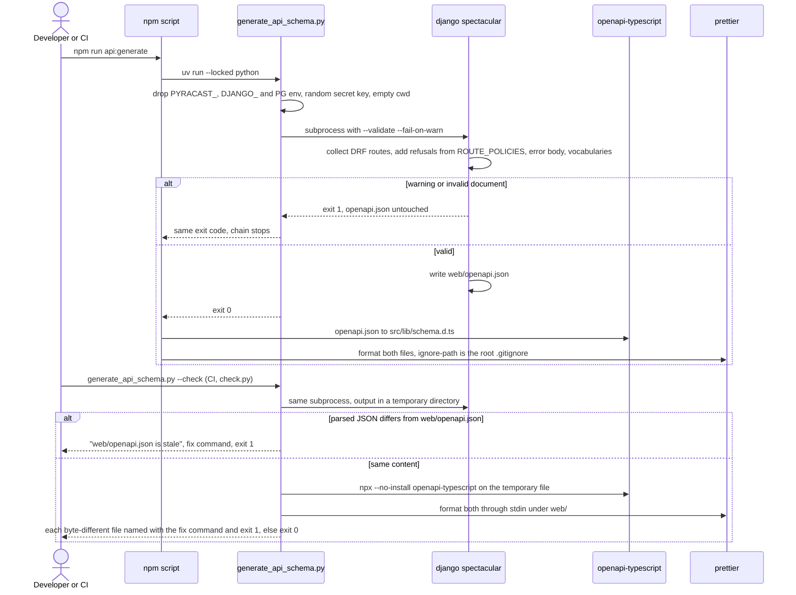

# OpenAPI schema and generated client types

A developer runs `npm run api:generate` after an API change. It renders the customer OpenAPI document with drf-spectacular into `web/openapi.json`, then turns it into `web/src/lib/schema.d.ts`, the types the frontend imports. `generate_api_schema.py --check`, run by CI and by `scripts/check.py` when `web/node_modules` exists, generates the document into a temporary directory, formats both files without writing to `web/`, and fails if either committed file differs. No route serves the document.

## Entry points

- `web/package.json` script `api:generate`: the developer command. It chains the generator script, `openapi-typescript` and `prettier --write`.
- `scripts/generate_api_schema.py` `main`: runs `python -m django spectacular` in a subprocess with `--validate --fail-on-warn --format=openapi-json`; optional `--output`, default `web/openapi.json`. `--check` writes nothing in `web/`: it generates into a temporary directory, compares parsed JSON first, then runs `npx --no-install openapi-typescript` and prettier (`--stdin-filepath` under `web/`, `--ignore-path ../.gitignore`) and compares both files byte for byte.
- `src/pyracast/api/schema.py` through `SPECTACULAR_SETTINGS` in `src/pyracast/settings.py`: `AutoSchema` (default schema class) adds the refusal responses of each operation from its method, parameters and `ROUTE_POLICIES` entry (400, 401, 403, 404, 415, 429, each the shared `Error` body); the postprocessing hooks `error_components` (the `Error` component and a `default` response per operation) and `stored_vocabularies`; `ENUM_NAME_OVERRIDES` names `ErrorCode` and every stored vocabulary (`TextChoices` by dotted path, for example `WorkspaceRoleEnum`, `RegionStatusEnum`, `AuditActionEnum`).
- Consumers: `web/src/lib/api/client.ts` derives the typed `api` verbs, path and query parameters and list paths from the generated `paths`; `web/src/lib/api/errors.ts` types `ErrorCode` and the error body; `web/src/lib/api.ts` aliases `components["schemas"]` (`Region`, `Plant`, ...) for the screens, and specs and support files import the same types.
- CI step "Verify API schema and generated types" in `.github/workflows/ci.yml` runs `generate_api_schema.py --check` (shared `web-steps` anchor, so it runs in `web_ubuntu` and `web_windows`); `scripts/check.py` runs the same command as its API schema stage.

## Sequence

## Data

- Generation reads no table: an in-process `spectacular` run with an unreachable `PGHOST` left both connections unopened. Stripping `PG*` only makes the child fall back to `127.0.0.1:5432`. Files written: `web/openapi.json` and `web/src/lib/schema.d.ts`.

## Authorization

- None at runtime: the document is a build artifact. Every operation in it is a customer route; the platform administrator works only through `/admin/`, so no operator-only operation exists, and `test_api_routes_equal_the_product_surface` pins the routed API. Each operation's documented 401, 403 and 429 follow its `ROUTE_POLICIES` entry (`docs/flows/tenant-authorization.md`).
- A stored vocabulary that is not published stays out of the customer document; the document holds no provider name (`test_customer_schema_fields_are_an_allowlist` pins every field and parameter name).

## Failure paths

| Condition | Result |
| --- | --- |
| Spectacular warning (unannotated view, enum name clash, route missing from `ROUTE_POLICIES`) or invalid OpenAPI | Generation error, exit 1, `web/openapi.json` not rewritten, `schema.d.ts` not regenerated |
| `openapi-typescript` or `prettier` fails after spectacular succeeded | `api:generate`: new `openapi.json` beside the old `schema.d.ts`, so `--check` fails. `--check`: the tool's stderr and exit code; `npx` missing gives exit 1 |
| Committed `web/openapi.json` stale, missing or not valid JSON | `--check` names it and prints `npm --prefix web run api:generate`, exit 1, before Node runs; `tests/test_api_schema_generation.py` fails on content drift (it compares parsed JSON, not bytes) |
| Committed `schema.d.ts` stale or missing, or a generated file not prettier-formatted | `--check` names the file, exit 1 (needs `web/node_modules`) |
| Generated type no longer matches component use | `npm run typecheck` (`tsc`) fails |
| Local `.env`, `PYRACAST_*`, `DJANGO_*` or `PG*` set | Ignored: stripped from the child environment and the child runs in an empty temporary directory, so `load_environment` finds no `.env` |

## Rules and invariants

- The committed document must be byte-identical on Windows and Ubuntu. The generator therefore uses production defaults (cookie name `__Host-pyracast-sessionid`, `DEBUG` off) and `.gitattributes` forces LF. Only `PYRACAST_`, `DJANGO_` and `PG` prefixed variables are stripped.
- `--fail-on-warn` makes spectacular warnings a quality gate. Every new view needs an explicit serializer or `@extend_schema` and a `ROUTE_POLICIES` entry (`AutoSchema` reads it for every operation), and a new enum that collides with another needs an entry in `ENUM_NAME_OVERRIDES`. The `stored_vocabularies` hook publishes every `TextChoices` named there, even when no customer endpoint uses it; operator-only vocabularies such as the provider stay unnamed.
- Failure bodies are typed: `Error` (`code`, `message`, `fields`, `retry_after`, `request_id`) with `ErrorCode` as its vocabulary, `IncidentConflict` (with the `current` outage) for a stale outage write or proposal, and a `default` response on every operation. Successful responses are 200, 201, 202 and 204.
- Forecast `result`, `regional_irradiance`, `outage_scenario` and `production_diagnostic` have schema-only typed components: the runtime value passes through unchanged.
- `/api/session/` and `/api/session/language/` carry `@extend_schema(auth=[])`: documented as unauthenticated.
- `web/.prettierignore` lists both generated files, so `format:check` never inspects them. `api:generate` and `--check` format them explicitly with `--ignore-path ../.gitignore`.
- The schema only covers DRF views. Allauth headless routes under `/api/auth/`, OAuth callbacks, health and admin are absent, and `web/src/lib/auth-api.ts` types them by hand. The client's URLs are checked against `paths`; `tsconfig.json` enables `noUncheckedIndexedAccess`.

## Tests

- `tests/test_api_schema_generation.py`: the script run with hostile environment variables and a stray `.env` must equal the committed `web/openapi.json` and carry the production cookie name; the `spectacular` command output follows `SESSION_COOKIE_NAME`; `--check` against a stale, missing or unparsable `openapi.json` or a stale or missing `schema.d.ts` exits 1 with the fix command, and its Node branches (current and stale types, formatting drift, missing `npx`, failing tool) run against fakes.
- `tests/test_public_schema.py`: `call_command("spectacular", validate=True, fail_on_warn=True)` succeeds, contains a region path, no `/api/platform/` path and no "solcast" text. `tests/test_customer_confidentiality.py` `test_customer_schema_fields_are_an_allowlist`. `tests/test_route_policy.py` `test_operations_document_the_refusals_their_policy_allows`; `tests/test_error_contract.py` `test_error_vocabulary_and_body_are_exported_to_openapi`; `tests/test_api_error_values.py` (the shared error body on every operation); `tests/test_vocabularies.py` (stored vocabularies exported by name and equal in both generated files); `tests/test_plant_api.py` `test_openapi_has_distinct_forecast_and_status_components`.
- `tests/test_session.py` `test_session_schema_exposes_only_projection` (`/api/session/` documents GET but not PATCH).
- `--check` (CI and `check.py`) and `npm run typecheck` catch drift of both files and type breakage. Gaps: no pytest runs the real Node tools of `--check`, which run only where `web/node_modules` exists.
