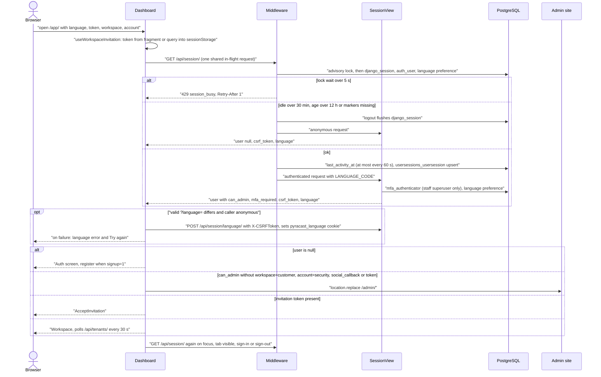

# Open the app: session bootstrap and routing

A browser opens `/app/` (bookmark, public site, account or notification mail, administration link or redirect, social-provider return). The page fetches the session projection from `GET /api/session/` and shows one screen: loading or error, sign-in/sign-up, invitation acceptance, a hand-off to `/admin/` for MFA-verified platform administrators, or the customer workspace. The choice is made in the browser from the session, the URL and `sessionStorage`; the server only reports who the caller is.

## Entry points

- `GET /api/session/` - `pyracast.api.session.SessionView` (`AllowAny`, `never_cache`). Actor: anyone, anonymous or signed in.
- `POST /api/session/language/` - `SessionLanguageView` (`csrf_protect`); used here only for the `?language=` hand-off, owned by `i18n-and-language`. The client sends it only for an anonymous caller whose session language differs, and removes `?language=` from the URL once resolved.
- `web/src/app/app/page.tsx` `AppPage` (dynamic via `connection()`) and `web/src/app/invitations/accept/page.tsx` `InvitationPage` (inside `Suspense`) both render `web/src/components/dashboard.tsx` `Dashboard` (session fetch, language hand-off) and `DashboardView` (routing, focus refresh).
- `web/src/app/page.tsx` `Page` redirects `/` to `/app/` with the full query when `social_callback`, `account`, `workspace`, `token` or `next` is present. Inbound links: invitation mail `/app/#token=`; `HEADLESS_FRONTEND_URLS` (`/app/`, `/app/?signup=1`, `/app/?social_callback=1`); social connect return `/app/?social_callback=1`; `PlatformAdminSite.login` `/app/?next=/admin/`; admin menu `?workspace=customer` and `?account=security`; admin logout `/app/`; public site `?language=`.

## Sequence

## Data

| Table | R/W | What |
| --- | --- | --- |
| `django_session` | R, W | Session load; `SessionLifetime` rewrites `last_activity_at` at most every 60 s; `logout` flushes an expired session |
| `auth_user` | R | User, `is_staff`, `is_superuser` for `can_admin` and `mfa_required` |
| `mfa_authenticator` | R | `has_verified_mfa`, only for staff superusers: a live TOTP or recovery-code row named in the session's authentication records |
| `accounts_userlanguagepreference` | R | `RequestLanguage` and `language_preference`; not written here (the hand-off POST is sent only for anonymous callers) |
| `usersessions_usersession` | R/W | allauth `UserSessionsMiddleware` (`USERSESSIONS_TRACK_ACTIVITY`): get-or-create reads the existing row, whose old values feed `session_client_changed`, then `last_seen_at`, IP, user agent update on every authenticated request, unthrottled |

## Authorization

- `SessionView` is public by design: it returns `user: null` instead of 401/403 and exposes only the `SessionUserOutput` projection. Routing to workspace, invitation or admin is client-side and carries no authority; tenant endpoints enforce membership.
- `can_admin` is recomputed per request (staff and superuser and `has_verified_mfa`). It only steers navigation; `PlatformAdminSite.has_permission` and `PlatformAdmin` re-check on every administration or API request.
- CSRF: the GET issues a masked token (`get_token`); the cookie is HttpOnly and never read by the browser. `SessionLanguageView` is wrapped in `csrf_protect`. Responses under `/api/` are `private, no-store` (`PrivateAPIResponses`).

## Failure paths

| Condition | Result |
| --- | --- |
| Session fetch fails (network, 4xx/5xx, 429 `session_busy` with an English-only detail) | Card with the error and "Try again" (`retry` bumps `version`) |
| Language hand-off POST fails | `Language.failed` notice with retry; sign-in stays hidden until it succeeds |
| Session idle 30 min, older than 12 h or lacking lifetime markers | Server logs out; the next session fetch returns `user: null` and the Auth screen shows |
| Focus refresh fails, or server-side logout while the workspace stays focused | Focus errors are ignored; the `/api/tenants/` poll gets 403 `http_403` and shows `tenants.error`; the screen changes only after a successful refresh or a reload |

## Rules and invariants

- One `GET /api/session/` runs at a time and `/api/session/*` mutations queue behind it (`request`), so Strict Mode and focus events share one CSRF handshake.
- Administrators land in `/admin/` by default; `workspace=customer` and `account=security` opt out for that page load only, nothing persists the choice. A staff or superuser without verified MFA gets `can_admin: false` and the customer workspace. `?next=` is carried by redirects but no frontend code reads it; the admin return after sign-in works only through the default `can_admin` redirect.
- A signed-in `social_callback` with the `pyracast.socialConnect` marker or an `error` goes to `?account=security`; otherwise `social_callback` and `error_process` are stripped.
- The invitation token is read from the fragment, then the query, stored in `sessionStorage` and stripped from the URL. It survives sign-out and account switching until accepted or dismissed (`clearWorkspaceInvitation`); it is ignored when `account=security` is present, and a blocked `sessionStorage` keeps it for the current load only.
- Session limits are enforced server-side (`SessionLifetime`); the 30 s tenant poll counts as activity. Every request carrying a well-formed session cookie (32 lowercase alphanumerics, existing or not) waits up to 5 s for a PostgreSQL advisory lock and holds it for the whole request, this one included.

## Tests

- pytest: `tests/test_session.py` (projection, `can_admin`, `mfa_required`, cache headers), `tests/test_language.py` (language resolution, CSRF), `tests/test_session_serialization.py` (lock, 429), `tests/test_account_security.py` (lifetime markers, activity refresh).
- Playwright: `web/tests/workspace.spec.ts` (one CSRF handshake, error with retry), `web/tests/localization.spec.ts` (language hand-off), `web/tests/auth-registration.spec.ts` (admin redirect, `workspace=customer`), `web/tests/workspace-roles.spec.ts` (invitation token), `web/tests/social-auth.spec.ts`, `web/tests/public-site.spec.ts` (`social_callback`, `/` redirect). Gaps: no test for a focus refresh that turns a workspace into the sign-in screen, the `can_admin` flip on refresh, `session_busy` in the browser, the `loadingWorkspaces` and `openingAdmin` states, or the tenant-poll 403 after logout.
