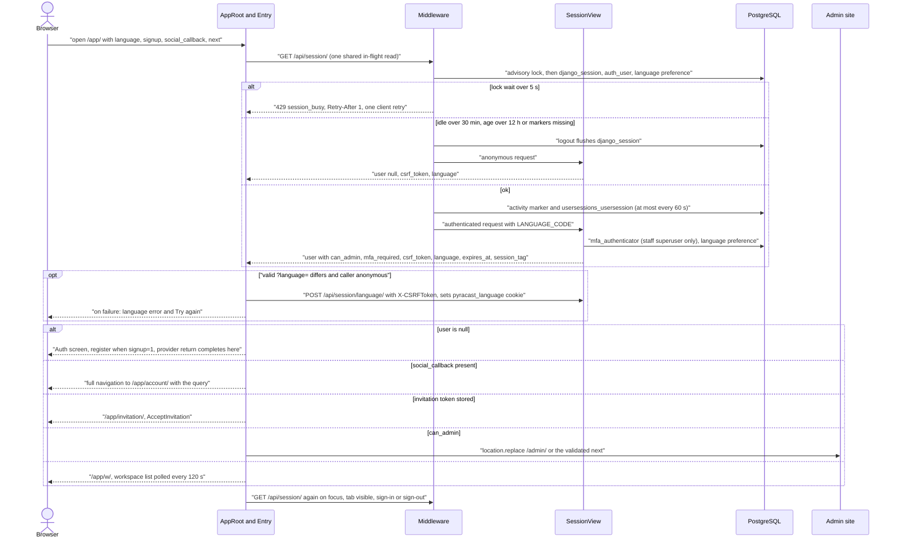

# Open the app: session bootstrap and routing

A browser opens `/app/` (bookmark, public site, account or notification mail, administration link or redirect, social-provider return). The page fetches the session projection from `GET /api/session/` and shows one screen: loading or error, sign-in/sign-up, or, once signed in, a resolved destination: the account page for a provider return, invitation acceptance, a hand-off to `/admin/` for MFA-verified platform administrators, or the customer workspace. The choice is made in the browser from the session, the URL and `sessionStorage`; the server only reports who the caller is.

## Entry points

- `GET /api/session/` - `pyracast.api.session.SessionView` (a public route of `RoutePolicy`, `never_cache`). Actor: anyone, anonymous or signed in.
- `POST /api/session/language/` - `SessionLanguageView` (`csrf_protect`); used here only for the `?language=` hand-off, owned by `i18n-and-language`. The client sends it only for an anonymous caller whose session language differs, and removes `?language=` from the URL once resolved.
- `web/src/app/app/layout.tsx` `AppLayout` (dynamic via `connection()`) mounts `web/src/features/session/app-root.tsx` `AppRoot` around every `/app/` screen: session bootstrap, language hand-off, the session language's catalog (`i18n-and-language`), focus refresh and the retry card. `app/app/page.tsx` `AppPage` renders `features/session/entry.tsx` `Entry`, which signs in or resolves the destination; the destinations (`/app/account/`, `/app/invitation/`, `/app/w/`, `/app/w/<tenant>/...`) are separate pages under `RequireUser` (`features/session/require-user.tsx`).
- Inbound links: `HEADLESS_FRONTEND_URLS` (`/app/`, `/app/?signup=1`); provider return `/app/?social_callback=1` (`social_callback_url`); invitation mail `/app/invitation/#token=`; `PlatformAdminSite.login` `/app/?next=<console path>`; administration menu `/app/w/` and `/app/account/`; admin logout `/app/`; notification mail `/app/w/<tenant>/...`; public site `/app/?language=` and `?signup=1`.

## Sequence

## Data

| Table | R/W | What |
| --- | --- | --- |
| `django_session` | R, W | Session load; `SessionLifetime` rewrites `last_activity_at` at most every 60 s; a session without a tag gets one at its first read; `logout` flushes an expired session |
| `auth_user` | R | User, `is_staff`, `is_superuser` for `can_admin` and `mfa_required`; `has_usable_password` |
| `mfa_authenticator` | R | `has_mfa_evidence`, only for staff superusers: a live TOTP or recovery-code row named in the session's authentication records, of any age |
| `accounts_userlanguagepreference` | R | `RequestLanguage` and `language_preference`; not written here (the hand-off POST is sent only for anonymous callers) |
| `usersessions_usersession` | R/W | `record_activity` upserts the device row when the activity marker is refreshed (every 60 s) or the session has no device marker yet; `revoke_other_sessions` finds sessions through these rows |

## Authorization

- `SessionView` is public by design: it returns `user: null` instead of 401/403 and exposes only the `SessionUserOutput` projection. Routing to workspace, invitation or admin is client-side and carries no authority; tenant endpoints enforce membership.
- `can_admin` is recomputed per request (`has_platform_admin_session`: active staff and superuser with MFA evidence). It only steers navigation; `PlatformAdminSite.has_permission` re-checks on every console request.
- CSRF: the GET issues a masked token (`get_token`); the cookie is HttpOnly and never read by the browser. `SessionLanguageView` is wrapped in `csrf_protect`. Responses under `/api/` are `private, no-store` (`PrivateAPIResponses`).
- `SessionTagCheck` refuses any request except the session read that carries an `X-Session-Tag` other than the one the session holds: 409 `session_changed`, before any view runs. The tag is an observation, never a credential.

## Failure paths

| Condition | Result |
| --- | --- |
| Session fetch fails (network, 4xx/5xx, or 429 `session_busy` after its one retry) | Card with the error, localized from the answer's `code` and `message`, and "Try again" (`retry` reads again) |
| Language hand-off POST fails | `Language.failed` notice with retry; sign-in stays hidden and focus reads wait until it succeeds |
| Session idle 30 min, older than 12 h or lacking lifetime markers | Server logs out; the next session read returns `user: null` and the Auth screen shows |
| Server-side logout or another tab's sign-out while a screen is open | The next request answers 401 `not_authenticated` or 400 `session_ended` and the client reads the session; a tab that observes another tab's tag hides its screens until a read adopts the session the browser holds, and a failed read offers the first-read retry |
| Focus refresh fails | Ignored; the screen stays |
| Session busy at the `/admin/` hand-off | 503 no-store page with `Retry-After: 1` that reloads once |

## Rules and invariants

- Destination order for a signed-in `/app/`: a provider return (`social_callback`, with or without `error`) goes to `/app/account/` with its query, where `LinkedAccounts` consumes it; else a stored invitation goes to `/app/invitation/`; else an administrator to `/admin/`; else `/app/w/`. `?next=` counts only for an administrator, only without surrounding space, backslash or unprintable character, and only when it resolves to a same-origin `/admin/` path (else `/admin/`); the server validates the same address (`console_path`) when a provider sign-in carries it. `appQuery` in `web/src/lib/routes.ts` is the one parser of `signup`, `language` and the provider return (`social_callback`, `error`); `addressWithout` strips them from the address.
- An administrator reaches the customer workspace through `/app/w/` or `/app/account/` directly; nothing persists a choice. A staff or superuser without MFA evidence gets `can_admin: false` and the customer workspace.
- The invitation token is read from the fragment of `/app/invitation/`, stored in `sessionStorage` (`pyracast.workspaceInvitation`) and stripped from the URL. It survives sign-out and account switching until accepted or dismissed (`clearWorkspaceInvitation`); a blocked `sessionStorage` keeps it for the current load only. No other entry address carries it: `/app/#token=`, `?token=`, `?account=`, `?workspace=` and `/invitations/accept/` are gone.
- One `GET /api/session/` is shared while no session change was sent and no other tab observed another tag; requests to `/api/session/` and `/api/auth/` run one after another, so Strict Mode and focus events share one CSRF handshake. The client retries a `session_busy` answer once after `min(retry_after, 2)` seconds.
- Session limits are enforced server-side (`SessionLifetime`): idle 30 min, absolute 12 h; the workspace list poll (120 s) counts as activity, and the shell warns five minutes before `expires_at`. Every request carrying a well-formed session cookie (32 lowercase alphanumerics, existing or not) waits up to 5 s for a PostgreSQL advisory lock and holds it for the whole request, this one included.

## Tests

- pytest: `tests/test_session.py` (projection, `can_admin`, `mfa_required`, cache headers), `tests/test_session_tag.py` (tag, refusal of another session's request), `tests/test_language.py` (language resolution, CSRF), `tests/test_session_serialization.py` (lock, 429 `session_busy`), `tests/test_session_lifecycle.py` (limits, activity written once a minute), `tests/test_account_security.py` (invalid markers, `expires_at`), `tests/test_console_failures.py` (busy page of the console).
- Playwright: `web/tests/workspace.spec.ts` (one CSRF handshake), `web/tests/localization.spec.ts` (language hand-off, focus reads), `web/tests/auth-registration.spec.ts` (administrator hand-off, `next` validation), `web/tests/app-routes.spec.ts` (addresses, no legacy entry path, invitation token), `web/tests/session-tabs.spec.ts` and `web/tests/session-tag.spec.ts` (cross-tab sessions), `web/tests/social-auth.spec.ts` (provider return to the account page), `web/tests/transport.spec.ts` (`session_busy` retry).
