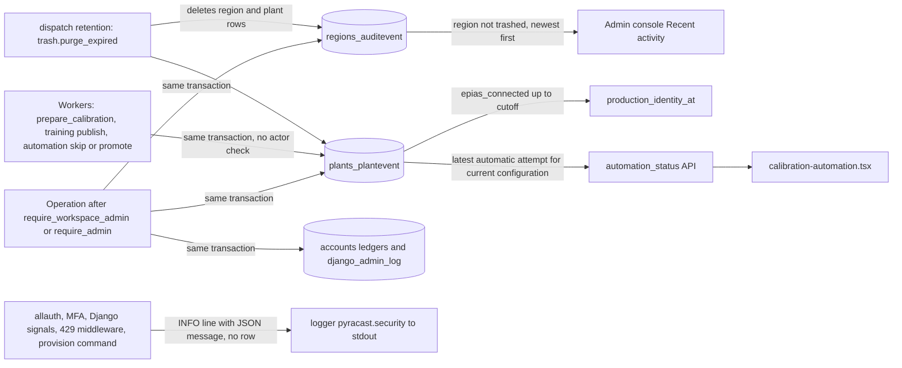

# Audit trail: region, plant, security and administration events

Most mutating operations append their own record in the same transaction as their effect. Region and provider-account actions go to `AuditEvent`, plant activity (including worker decisions) to `PlantEvent`, workspace role changes to two write-only ledgers, the recipient-limit setting to Django's `LogEntry`, and authentication events only to a log line. Platform administrators read region events in the operations console; two business rules read `PlantEvent` as data, and one of them reaches customers.

## Entry points

- Console readers: `pyracast.admin_workspace` `recent_activity_context` feeds the Overview (`GET /admin/`, `PlatformAdminSite.index` -> `overview_context`, `limit=8`) and the plant review page (`GET /admin/plants/{id}/`, `RegionAdmin.setup` -> `review_context`, default five rows) through `regions/templates/admin/workspace/overview.html` and `admin/regions/region/setup.html`.
- Customer reader: `GET|PATCH /api/tenants/{t}/regions/{r}/plants/{p}/calibration/automation/` -> `plants.api.CalibrationAutomationView` -> `automation_status`, whose `last_attempt` comes from `PlantEvent` and is rendered by `web/src/components/calibration-automation.tsx`. `production_identity_at` (reads `PlantEvent`) gates customer forecasts in `plants.current_forecast`, `plants.forecast_archive` and `notifications.report_data`.
- `AuditEvent` writers: `regions.operations` (`update_region`, `request_location_change`, `review_location_change`, `configure_binding`, `approve_region`, `transition_region`), `plants.operations` `_rename` (`region_renamed`), `connections.operations` (`create_account`, `rotate_secret`, `validate_binding`), `connections.recovery` `clear_provider_cooldown`, `forecasts.schedule` `configure_schedule`, `forecasts.historical_import` `import_historical_reference`, `forecasts.capacity_normalization` `normalize_reference_capacity`, `trash` (`trash_region`, `restore_region`).
- `PlantEvent` writers: `plants.operations` (`_save_configuration`, `_save_plant_parameters` (submission), `_rename` (`plant_renamed`), `import_observations`, `request_calibration`, `_activate`), `plants.production_changes` `change_production`, `plants.automation` (`update_automation`, `_skip`), `metering.operations` (`connect_epias`, `disconnect_epias`), `trash` (`trash_plant`, `restore_plant`); worker writers `plants.preparation` `prepare_calibration` and `plants.training` `_publish`.
- Ledgers: `accounts.operations` `remove_workspace_member` (`WorkspaceMemberRemoval`) and `reassign_workspace_admin` (`WorkspaceAdminChange`). Settings edit: `WorkspaceSettingsForm.apply` writes a Django `LogEntry`.
- Security log: `pyracast.accounts.audit` `connect_security_events` (called from `AccountsConfig.ready`) maps 16 allauth, MFA and Django auth signals to `record_security_event`; `accounts.social` connects the two social-account signals at import; `api.middleware` `PrivateAPIResponses` logs `authentication_request_throttled` on 429 under `/api/auth/`; command `provision_admin_mfa` logs `admin_mfa_provisioned`.
- Purge: `dispatch` command retention phase -> `trash.purge_expired` deletes events of expired regions and plants.

## Sequence

## Data

| Table | R/W | What |
|---|---|---|
| `regions_auditevent` | W by sixteen operations, R by console and admin browser | actor, `region` xor `provider_account` (check `audit_exactly_one_target`), `action`, `revision`, `created_at`. Region events carry the region revision, account events the credential revision |
| `plants_plantevent` | W by plant operations and workers, R by two rules and admin browser; D by purge | plant, nullable actor (null for system decisions), `action`, JSON `details`, `created_at` |
| `accounts_workspaceadminchange` | W only | tenant, actor, new and previous administrator |
| `accounts_workspacememberremoval` | W only | tenant, actor, removed user |
| `django_admin_log` | W by `WorkspaceSettingsForm.apply` and Django admin change forms | recipient-limit change message |

## Authorization

- Writers inherit the authorization of the operation they belong to. `require_workspace_admin` runs inside the transaction and locks the tenant. `require_admin` is an in-memory `is_active` and `is_superuser` check, usually called before the transaction opens (`connect_epias` and `disconnect_epias` repeat it on a locked user row). Audit code adds no check of its own.
- Worker writers (`prepare_calibration`, `training._publish`, automation `_skip` and automatic `_activate`) run without an actor check; automation instead re-checks that the enabling administrator is still an active workspace administrator (`_authorized`).
- Console reading: `PlatformAdminSite.has_permission` (superuser plus verified MFA). `AuditEvent` and `PlantEvent` are also registered as `ReadOnlyAdmin` (no add, change or delete). The ledgers are not registered anywhere.
- Customer reading of `last_attempt` requires workspace membership (`ScopedView.plant_queryset` -> `require_member`) and a non-trashed region and plant.
- Rows cannot be removed by cascade: every FK is `PROTECT`. Only `trash._purge_region` and `_purge_plant` delete events explicitly.

## Failure paths

| Condition | Result |
|---|---|
| Operation raises after the event insert | Whole transaction rolls back, no event (pinned for cooldown recovery, member removal and the settings `LogEntry`) |
| Idempotent repeat (same name, schedule, pending request, review decision, approval, settings value, import file, existing account, already trashed or restored, nothing to normalize, no cooldown) | Returns early, no new event |
| `transition_region` from the Django bulk actions, or `validate_binding`, repeated | A new event every call; the console decision form rejects a repeat by status |
| Provider error during `validate_binding` | Attempt marked failed, binding health `error`, error re-raised, no event |
| Client IP missing or invalid in a signal | `client_ip` is null, login continues (`ValueError`, `PermissionDenied` suppressed) |
| Unknown `action` in console | Label falls back to the humanized action string |
| Security log level above INFO or stdout dropped | Events vanish, there is no database copy |

## Rules and invariants

- Events are not an independent log: they exist only when the effect committed. Workspace operations take the tenant lock, then region, then plant or provider account, before inserting them; platform operations lock the region or account directly, and only location approval and administrator reassignment also lock the tenant.
- `PlantEvent` is data, not only history. `production_identity_at` takes the latest `epias_connected` event not after the cutoff and fails closed if it is missing or malformed. `automation_status` reads the last `calibration_automatic_skipped` or `calibration_automatically_activated` event matching `details.configuration_id`. Deleting or editing these rows changes forecast eligibility and what customers see. Migration `metering/0007` also stores archived meter-basis declarations as `legacy_epias_meter_basis_archived` events and restores from them on reverse.
- Console visibility is narrower than storage: only region-targeted events of non-trashed regions are shown, so a region's `region_trashed` row appears only after restore. Provider-account events, the ledgers and all `PlantEvent` rows other than automatic calibration attempts are never shown outside the admin record browser.
- Purge deletes a region's `AuditEvent` rows and a plant's `PlantEvent` rows, and writes no tombstone. Provider-account events survive.
- Security events carry only event name, user id and normalized client IP, never credentials or email; the formatter prefixes time, level and logger name. Receivers use `dispatch_uid`, so repeated connection does not duplicate lines.

## Tests

- `tests/test_security_audit.py`: single log line, no secrets, no log injection, throttling event. `tests/test_social_accounts.py` (social connect and disconnect lines), `tests/test_account_security.py` (throttling line).
- `AuditEvent` rows per action: `test_region_editing.py`, `test_domain.py`, `test_provider_identity.py`, `test_provider_recovery.py`, `test_account_rotation.py`, `test_collection_schedule.py`, `test_historical_reference_import.py`, `test_capacity_normalization_boundaries.py`, `test_trash_operations.py` (including purge).
- Console rendering and Turkish labels: `tests/test_language.py` (`test_admin_audit_activity_translates_known_events_and_keeps_unknown_fallback`), `tests/test_admin_workspace.py` (decision events, location-change label, settings `LogEntry` and its rollback).
- `PlantEvent` as data: `tests/test_historical_production_identity.py`, `tests/test_calibration_automation.py` (including `last_attempt` and endpoint scoping), `tests/test_epias_authorization.py`, `tests/test_metering.py`; `web/tests/calibrations.spec.ts` renders a mocked `last_attempt`.
- Ledgers: `tests/test_workspace_member_removal.py` (written and rolled back, never read through any product path).
- Gaps: no Playwright coverage of console activity; only `login_failed`, `login_succeeded` and `email_verified` are asserted by name among the 16 mapped events; `admin_mfa_provisioned` is unpinned; console labels for `approved`, `rejected`, `suspended` and `binding_configured` are unpinned, and console tests insert rows by hand.
