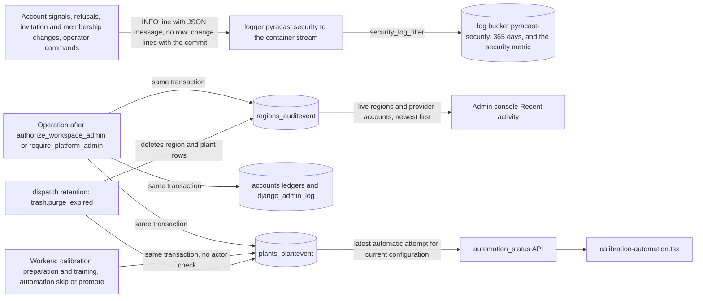

# Audit trail: region, plant, security and administration events

Most mutating operations append their own record in the same transaction as their effect. Region and provider-account actions go to `AuditEvent`, plant activity (including worker decisions) to `PlantEvent`, workspace role changes to two ledgers, console workspace changes and the recipient-limit setting to Django's `LogEntry`, and authentication and refusal events only to a log line. Platform administrators read region and provider-account events in the operations console; one business rule reads `PlantEvent` as data and reaches customers.

## Entry points

- Console readers: `pyracast.platform_admin.read_models.recent_activity_context` feeds the Overview (`GET /admin/`, `PlatformAdminSite.index` -> `overview_context`, `limit=8`, region and provider-account events) and the plant review page (`GET /admin/plants/{id}/`, `plant_review.plant` -> `review_context`, default five rows, that plant's events) through `regions/templates/admin/workspace/overview.html` and `admin/regions/region/setup.html`.
- Customer reader: `GET|PATCH /api/tenants/{t}/regions/{r}/plants/{p}/calibration/automation/` -> `plants.api.CalibrationAutomationView` -> `automation_status`, whose `last_attempt` and `disabled_cause` come from `PlantEvent` and are rendered by `web/src/features/calibration/calibration-automation.tsx`. `plants.automation._undecided_candidate` reads the same events to decide whether a ready calibration still awaits its automatic promotion.
- `AuditEvent` writers, only through `regions.audit.record_audit` (`AuditAction`, details declared per action): `regions.operations` (`submit_region`: `region_created`, listed in the console as "Plant submitted", `request_location_change`, `_move`, `reject_location_change`, `withdraw_location_change`, `_start_revision`, `configure_binding`), `plants.approval` (`approve_region`, `decide_review`, `resubmit_region`), `plants.operations._rename` (`region_renamed`), `forecasts.validation.validate_binding`, `connections.operations` (`create_account`, `replace_api_key`), `connections.recovery.clear_provider_cooldown`, `forecasts.schedule.configure_schedule`, `notifications.operations.configure_reminders`, `forecasts.historical_import.archive_reference` (the console upload and the `import_historical_reference` command), `forecasts.capacity_normalization.normalize_reference_capacity`, `trash` (`trash_region`, `restore_region`). `regions.review.set_review_status` is the only writer of the review status.
- `PlantEvent` writers, only through `plants.events.record_plant_event`: `plants.operations` (`_save_configuration`, `_save_plant_parameters`, `_rename`), `plants.production_changes` (`change_production`, `import_observations`), `plants.activation.record_activation`, `plants.automation_state.set_automation_state`, `plants.calibration_runs` (`create_run`, `finish_run`), `plants.automation.record_automatic_skip`, `metering.operations` (`connect_epias`, `disconnect_epias`). Worker writers: `plants.preparation`, `plants.training` and `plants.automation` through those functions.
- Ledgers: `accounts.operations.remove_workspace_member` (`WorkspaceMemberRemoval`), `reassign_workspace_admin` and the acceptance of an administrator invitation (`accounts.invitations.accept_workspace_invitation`, actor the issuer) (`WorkspaceAdminChange`). `LogEntry`: `platform_admin.tenants` (console workspace creation and rename) and `notifications.operations.set_recipient_limit`.
- Security log: `pyracast.accounts.audit` owns the `SecurityEvent` vocabulary; `connect_security_events` (called from `AccountsConfig.ready`) maps the Django auth, allauth account, MFA and social signals in `SIGNAL_EVENTS`, and every other writer (`login_locked`, signed-in refusals in `api.errors` and `api.error_pages`, session expiry and revocation, invitation and membership changes, the `bootstrap_admin`, `reset_mfa` and `erase_account` commands, throttles) passes a `SecurityEvent` member. The `pyracast.security` logger writes to the file named by `PYRACAST_SECURITY_LOG_PATH` (`/proc/1/fd/1` in `deploy/compose.yaml`, so a `docker compose exec` command's lines reach the container log stream too), else stdout. In `infra/terraform/monitoring.tf`, `local.security_log_filter` selects them for the sink into the log bucket `pyracast-security` (kept 365 days; `_Default` keeps its own copy 30 days) and for the log-based metric by event with its alert policies.
- Log lines: `pyracast.log_lines` (`LineFormatter`, `LineHandler`, `LineFileHandler`, `configure` as `LOGGING_CONFIG` in `pyracast.settings`) writes every application record, of `pyracast` and of every other logger through the root handler, and captured warnings, to stderr; stdout carries what a command prints and the security lines.
- Purge: `dispatch` command retention phase -> `trash.purge_expired` deletes events of expired regions and plants.

## Sequence

## Data

| Table | R/W | What |
| --- | --- | --- |
| `regions_auditevent` | W by the writers above, R by console and admin browser | actor, `region` xor `provider_account` (`auditevent_target_chk`), `action` (`AuditAction`, `auditevent_action_chk`), `revision`, `details` declared per action, `created_at`. Region events carry the region revision, account events the credential revision |
| `plants_plantevent` | W by plant operations and workers, R by the automation rules and admin browser; D by purge | plant, nullable actor (null for system decisions), `action` (`PlantEventAction`, `plantevent_action_chk`), declared JSON `details`, `created_at` |
| `accounts_workspaceadminchange` | W; R in the admin browser | tenant, actor, new and nullable previous administrator |
| `accounts_workspacememberremoval` | W; R in the admin browser and the workspace page | tenant, actor, removed user |
| `django_admin_log` | W by `platform_admin.tenants` and `set_recipient_limit` | "Created.", "Renamed from A to B." and the recipient-limit change message |

## Authorization

- Writers inherit the authorization of the operation they belong to. `tenant_membership` and `authorize_workspace_admin` run inside the transaction and lock the tenant. `require_platform_admin` is an in-memory active, staff and superuser check, usually called before the transaction opens (`connect_epias` and `disconnect_epias` repeat it on a locked user row). Audit code adds no check of its own.
- Worker writers (`prepare_calibration`, training, automation `record_automatic_skip` and automatic activation) run without an actor check; automation instead re-checks that the enabling administrator is still an active workspace administrator (`_authorized`).
- Console reading: `PlatformAdminSite.has_permission` (`has_platform_admin_session`). `AuditEvent`, `PlantEvent` and both ledgers are also registered as `ReadOnlyAdmin` (no add, change or delete).
- Customer reading of `last_attempt` requires workspace membership (the route policy and `ScopedView.plant_queryset`) and a non-trashed region and plant.
- Rows cannot be removed by cascade: every FK is `PROTECT`. Only `trash._purge_region` and `_purge_plant` delete events explicitly.

## Failure paths

| Condition | Result |
| --- | --- |
| Operation raises after the event insert | Whole transaction rolls back, no event |
| Idempotent repeat (same name, schedule, pending request, review decision, approval, settings value, import file, existing account, already trashed or restored, nothing to normalize, no cooldown) | Returns early, no new event |
| `validate_binding` repeated | A new event every call |
| Provider error during `validate_binding` | Attempt marked failed, binding health `error` when the error refuses the binding, `connection_validation_failed` event with the error code and status, error re-raised |
| Undeclared action or detail for `AuditEvent`, `PlantEvent` or a security line | `ValueError` before the insert; a security line is dropped and reported as `security_line_failed` (event, error type) on the application log while the request continues; an unknown action is also refused by the database |
| Client IP missing or invalid in a signal | `client_ip` is null, login continues |
| Security log level above INFO or stdout dropped | Events vanish, there is no database copy |
| A record's message cannot be formatted | One line `DATE TIME LEVEL LOGGER unformattable_record error_type=TYPE origin=PATH:LINE` instead of a traceback |

## Rules and invariants

- Events are not an independent log: they exist only when the effect committed. Operations that check a workspace role take the tenant lock, then region, then plant or provider account, before inserting them; platform operations on one record (review decisions, approval, bindings, provider accounts) lock that record directly.
- `PlantEvent` is data, not only history. `automation_status` reads the last `calibration_automatic_skipped` or `calibration_automatically_activated` event whose `details.configuration_id` is the current configuration, and the latest `calibration_automation_disabled` cause; `_undecided_candidate` counts events of a run, three `promotion_failed` skips deciding it. Deleting or editing these rows changes what customers see and which calibration is promoted.
- Console visibility is narrower than storage: only events of non-trashed regions and, on the Overview, of provider accounts are shown, so a region's `region_trashed` row appears only after restore. The ledgers, `LogEntry` rows and all `PlantEvent` rows are never shown outside the admin record browser. Each action shows its enumeration label once.
- Purge deletes a region's `AuditEvent` rows and a plant's `PlantEvent` rows with chunked raw deletes and writes no tombstone. Provider-account events survive.
- Account erasure (flow `account-erasure`) deletes no event, ledger or `LogEntry` row: they keep pointing at the anonymized account. `erase_account --execute` writes one `account_erased` line naming only `target_id` when the erasure commits; a dry run writes none.
- A security line carries `event`, `user_id`, `client_ip` and only the details its event declares (`subject`, a keyed hash of an address, `tenant_id`, `target_id`, `reason`, `view`, `method`, `authenticator_type`, `provider`, `scope`, `count`), never an address, name, token, code or password; the formatter prefixes time, level and logger name. The sink and the metric count a line only from the containers `api`, `worker`, `notifications`, `dispatcher` and `migrate` (`jsonPayload.container.name`, numbered or `run-<id>`) and only when it starts `DATE TIME,ms LEVEL pyracast.security `.
- Every record starts one line at column 0 and indents its further lines (a traceback included) by four spaces. Every physical line is at most 4096 bytes with its line break (cut between UTF-8 characters) and is written and flushed by its own write call; line handlers on one stream share one lock, so lines of concurrent writers alternate whole. A line that reports a change (`CHANGE_EVENTS`) written inside a transaction leaves with its commit, so a rolled-back transaction or savepoint writes none; refusals, failed attempts and throttles are written at once. A signed-in refusal line is written at most once a minute per actor, view and code. Receivers use `dispatch_uid`, so repeated connection does not duplicate lines.

## Tests

- `tests/test_security_signals.py` (vocabulary, line schema, one redacted line per signal, undeclared details, commit-bound lines, refusal throttle), `tests/test_security_inventory.py` (each required event written once by its flow, redacted), `tests/test_security_audit.py` (throttling event), `tests/test_social_refusal_audit.py`, `tests/test_account_security.py`, `tests/test_social_accounts.py`.
- Log lines: `tests/test_log_lines.py` (indented continuation lines, bounded write calls, shared streams, unformattable records), `tests/test_container_log_lines.py` (a security line counts once, from an application container; records sharing a pipe or longer than a Docker line start no other entry; the health report read from stdout), with `tests/test_log_filters.py` checking the Logging filter evaluator those tests use.
- `tests/test_audit_details.py` (declared details per action, rows written only by their trail writer), `AuditEvent` rows per action: `test_region_editing.py`, `test_domain.py`, `test_provider_identity.py`, `test_provider_recovery.py`, `test_account_rotation.py`, `test_collection_schedule.py`, `test_historical_reference_import.py`, `test_capacity_normalization_boundaries.py`, `test_trash_operations.py` (including purge), `test_validation_audit.py`, `test_reminder_revision.py`.
- Console rendering and labels: `tests/test_language.py` (`test_admin_audit_activity_shows_each_action_label_translated_once`), `tests/test_admin_workspace.py` and `tests/test_admin_workspace_management.py` (`LogEntry`), `tests/test_review_transitions.py` (decision events).
- `PlantEvent` as data: `tests/test_calibration_automation.py` (including `last_attempt` and endpoint scoping), `tests/test_epias_authorization.py`, `tests/test_metering.py`; `web/tests/calibrations.spec.ts` renders a mocked `last_attempt`.
- Ledgers: `tests/test_workspace_member_removal.py`, `tests/test_workspace_ledger_constraints.py`, `tests/test_invitation_acceptance.py` and `tests/test_workspace_admin_invitations.py` (administrator acceptance).
- Gaps: no Playwright coverage of console activity; console tests insert some rows by hand.
