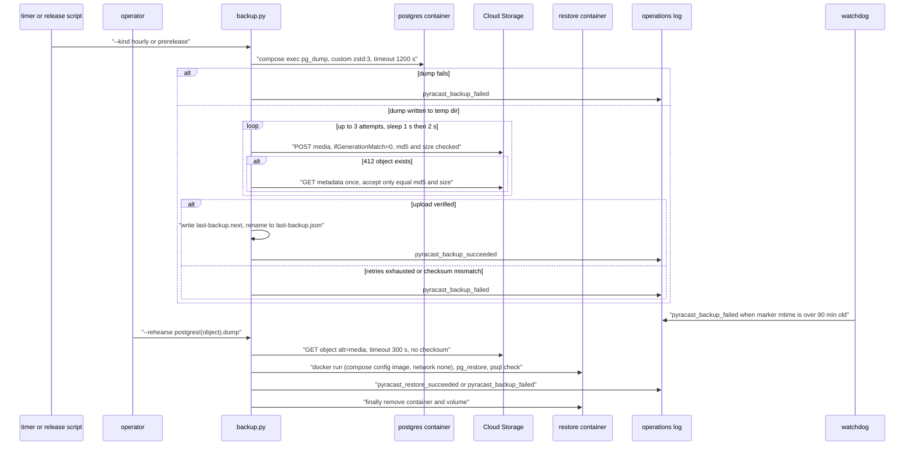

# Hourly and pre-release database backups and restore rehearsal

A systemd timer on the production VM, and the release script before every migration, run `deploy/backup.py` to dump the `pyracast` PostgreSQL database, upload it to a private Cloud Storage bucket with a checksum check, and record a last-backup marker that the watchdog reads. An operator can run the same script with `--rehearse OBJECT` to restore a chosen object into a throwaway container and run three schema checks. Failures, including a failed rehearsal, are logged as `pyracast_backup_failed` and page the operator. Nothing in the web or API layers is involved, and no automatic restore of production exists.

## Entry points

- Timer: `pyracast-backup.timer` (`OnCalendar=hourly`, `RandomizedDelaySec=300`, `Persistent=true`) starts `pyracast-backup.service` (`infra/terraform/templates/startup.sh.tftpl`, `TimeoutStartSec=2400`). The unit runs `deploy/backup.py /etc/pyracast/host.json` under `flock --nonblock --conflict-exit-code 0` on `/run/lock/pyracast-release.lock`, only when `/opt/pyracast/current/deploy/backup.py` exists and `release-blocked` does not.
- Release: `deploy/install-release.sh` runs `backup.py ... --release-dir "$release" --kind prerelease` after draining the old release and before `up -d postgres` and `migrate`. It already holds the same lock and the `release-blocked` marker. On a first deployment the database was bootstrapped just before, so the dump holds an empty schema.
- Operator: `python3 /opt/pyracast/current/deploy/backup.py /etc/pyracast/host.json --rehearse postgres/<object>.dump` as root on the VM (`deploy/backup.py` `main`, `rehearse_restore`, `restore_archive`). It takes no lock, ignores `release-blocked` and is not scheduled.
- Reuse: `deploy/smoke.sh` (CI and release workflows) runs its own `pg_dump` and calls `restore_archive`. `deploy/watchdog.py` imports `compose_command` and reads the marker. `backup_bucket` comes from `infra/terraform/main.tf` (`google_storage_bucket.backup`) via `/etc/pyracast/host.json`.

## Sequence

## Data

| Table | R/W | What |
| --- | --- | --- |
| all tables of database `pyracast` | R | `pg_dump` as `postgres` reads every table under one snapshot while the application may still write (hourly) or after drain (prerelease). Roles and tablespaces are not dumped. The dump (and a rehearsal download) lands in a `pyracast-backup-*` temporary directory on the boot disk, removed on exit. |
| `postgres/YYYY/MM/DD/<stamp>-<kind>-<uuid>.dump` in the bucket | W, R | Immutable object, deleted by a 7-day lifecycle rule with soft delete disabled. The rehearsal reads one. |
| `/var/lib/pyracast/last-backup.json` | W, R | `object` and `completed_at`. The watchdog reads only the file mtime, falling back to the mtime of `release.env` when the marker is missing. |
| Cloud Logging `pyracast-operations` | W | `pyracast_backup_succeeded`, `pyracast_restore_succeeded`, `pyracast_backup_failed` (from `backup.py` and the watchdog). |
| `django_migrations`, `forecasts_collectionjob`, `notifications_notificationdelivery` | W, R | Only in the disposable restored database: `pg_restore` writes all tables, then non-empty migrations and two tables must exist. |

## Authorization

- Host: the script runs as root through systemd or the root-only release script (`EUID` check). `host.json` is mode 0600, so the operator needs root: OS Login admin and the port-22 IAP tunnel on the VM (`google_compute_instance_iam_member.ssh_admin`, `ssh_tunnel`).
- Bucket: the runtime service account has only `roles/storage.objectCreator` and `objectViewer` on it (`infra/terraform/iam.tf`), so it can neither overwrite nor delete objects; the bucket enforces uniform access and public access prevention. The token comes from the metadata server (`deploy/operations_log.py` `access_token`). Input: the bucket name and the rehearsal object must match fixed patterns (`main`, `rehearse_restore`). Docker runs with argument lists, no shell. The restore container has no network, `no-new-privileges`, and PID and memory limits.

## Failure paths

| Condition | Result |
| --- | --- |
| `pg_dump` fails, times out, or the compose call fails | Exception, `pyracast_backup_failed`, exit 1, nothing uploaded and no marker. A release stops here with the application drained and `release-blocked` set. |
| Upload transport error, any HTTP error but 412, checksum or size mismatch, malformed response | Three attempts with 1 s and 2 s sleeps, then the original error or `ValueError`, the failure event and exit 1. `RuntimeError` and `TypeError` are not retried. |
| 412 on upload | Object metadata is fetched once, without retry. Equal md5 and size count as success, otherwise `ValueError`; a committed object with a wrong checksum therefore fails on the second attempt. |
| Lock held by release, watchdog or planned stop; `release-blocked` exists or `current` is missing | The hourly unit exits 0 (lock) or systemd skips it (conditions), without a backup or an event. |
| Unit exceeds `TimeoutStartSec=2400` | systemd terminates it; the Python failure handler does not run, so only the watchdog's staleness check reports it (by reading). |
| Marker older than 90 minutes | Watchdog reports `pyracast_backup_failed` with reason `last_verified_backup_older_than_90_minutes`, but only while `pyracast.service` is active, the release is not blocked and earlier supervision steps did not raise. |
| Invalid bucket or object name, unreadable host config or missing `backup_bucket` | `ValueError`, `OSError` or `KeyError`, same failure event and exit 1. Invalid command-line arguments exit 2 through `argparse` without an event. |
| Rehearsal download fails (missing or expired object, transport error) | No retry, failure event, exit 1, no container started. |
| Restore database not ready after 60 probes, `pg_restore` error or 1200 s timeout, or schema check raises | Exception, failure event. Container and volume are removed in `finally`. |

## Rules and invariants

- Release, watchdog, `pyracast.service` stop and the backup timer share `pyracast-release.lock`; the backup unit and the watchdog skip when it is held, the release waits up to 300 s.
- Objects are written with `ifGenerationMatch=0` and a fresh uuid, so no backup can overwrite another. Success means the bucket returned the md5 and size of the local file; only then is the marker replaced atomically, from either kind, so a prerelease dump also satisfies the 90-minute check.
- Restore uses `--exit-on-error --single-transaction --no-owner --no-acl` into the image taken from `compose config`, so the rehearsal runs the same PostgreSQL build as the current release.
- Every `pyracast_backup_failed` entry (dump, upload, staleness or rehearsal) matches the `backup` log-based alert policy (`infra/terraform/monitoring.tf`), which emails the operator at most once per hour.
- The recovery point is one hour while hourly backups succeed. There is no WAL archiving; retention is seven days and expired objects cannot be recovered.

## Tests

- `tests/test_deployment_backup.py`: upload checksum, retry budget (transport errors retried, programming errors not) and 412 recovery, failed dump publishes nothing, restore cleanup and network isolation, wait for the TCP server instead of the init socket, redacted logging. `tests/test_deployment_helpers.py`: Python 3.12 syntax and `--help` without dependencies.
- `deploy/test-release.sh` (CI, `backup.py` stubbed): backup position in the release order, backup only under `release-blocked` and before support changes, `backup` and `first-backup` failure modes, SIGKILL during backup. `deploy/smoke.sh` (CI and release, `set -e`) runs a real `pg_dump` and `restore_archive`, including the schema check SQL on a complete schema. Gaps: `main`, `rehearse_restore`, `create_backup` success (marker, event), a negative test that an incomplete restored schema is rejected, the lock skip and the watchdog threshold have no test. No Playwright coverage applies.
