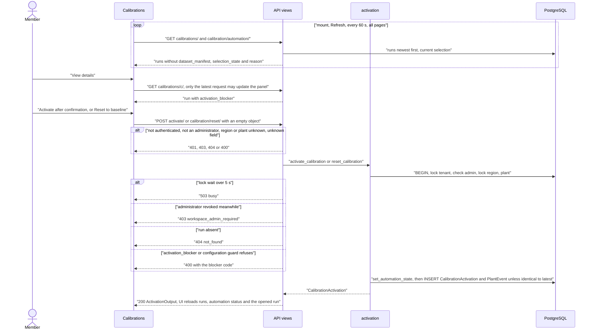

# Review calibration runs, activate one or reset to baseline

Any workspace member opens a plant's Calibration tab, sees the calibration in force, lists the plant's calibration runs and reads one run's evaluation. A workspace administrator activates a `ready` run of the current configuration or resets to the factor-1 baseline; each effective choice appends a `CalibrationActivation` row that forecast composition reads at query time. Activating also switches automatic calibration on for the activating administrator and resetting switches it off. The `activate_calibration` command calls the same two operations. No job is enqueued and no provider is called.

## Entry points

- Screen: `web/src/features/calibration/calibrations.tsx` `Calibrations`, mounted by `features/plant/plant-workspace.tsx` `PlantWorkspace` only when the plant has a current configuration (keyed by its id). It renders `CalibrationAutomationPanel` (`calibration-automation` flow), `CalibrationSelection` (the calibration in force, who selected it, Reset to baseline), `CalibrationRunList` and `CalibrationRunDetail` (evaluation, blocker, activation, new request).
- `GET .../plants/{p}/calibrations/` -> `pyracast.plants.api.CalibrationsView.get` (its `POST` is `calibration-run`); `GET .../calibrations/{c}/` -> `CalibrationView.get`. `POST .../calibrations/{c}/activate/` -> `ActivateView.post`; `POST .../plants/{p}/calibration/reset/` -> `ResetView.post`. Both take `{}` (`EmptyInput` rejects unknown fields).
- Operations `pyracast.plants.activation.activate_calibration` and `reset_calibration`; `activation_blocker` is the one policy that manual activation, automatic promotion (`pyracast.plants.automation`) and the run read model share, and `record_activation` writes the row. Command `activate_calibration --username U --plant-id P (--calibration-id C | --baseline)` calls the operations as the named user.

## Sequence

## Data

| Table | R/W | What |
| --- | --- | --- |
| `plants_calibrationrun` | R | Listing, detail and the activation guards (status, factor, `result`, `dataset_manifest`, pins, `comparison_activation`) |
| `plants_calibrationactivation` | R/W | Latest row per (plant, configuration) is read; one row appended per effective change (null `calibration` = baseline, null `actor` = system) |
| `plants_plantevent` | W | `calibration_activated` or `calibration_reset`, plus `calibration_automation_enabled` or `_disabled` (with `cause` `manual_activation` or `reset`) when automation changes |
| `plants_plant` | R/W | Row lock; `automatic_calibration_enabled`, `_enabled_by`, `next_calibration_check_at` |
| `plants_plantconfiguration`, `connections_*`, `regions_region`, `accounts_tenant`, `accounts_membership`, `auth_user` | R | Currentness checks, tenant and region locks, next-check timezone, membership and active administrator checks |
| `metering_epias*`, `incidents_plantincident`, `incidents_incidentrevision` | R | Production-source identity and outage-history recheck |

## Authorization

- Reads: `RoutePolicy` (`api/permissions.py`) admits active workspace members (403 `membership_required` otherwise, also for inactive users); `ScopedView.plant_queryset` scopes region by tenant and plant by region, both non-deleted (404). Runs of every configuration of the plant are listed.
- Writes: session authentication and CSRF (`X-CSRFToken` sent by `request`; 403 `csrf_failed`), then `RoutePolicy` admits only active workspace administrators (403 `workspace_admin_required`). The view resolves region and plant through `scope()` before validating the body. `tenant_membership(role=ADMIN, lock=True)` repeats the check in the operation after locking the tenant row, so a concurrent demotion cannot slip through; platform superusers without an admin membership are refused. The command skips HTTP and relies on that check. The UI hides Reset and Activate unless `useCanManageWorkspace` (tenant role `admin`), a convenience only.

## Failure paths

| Condition | Result |
| --- | --- |
| Anonymous | 401 `not_authenticated` with `WWW-Authenticate: Session` |
| Missing CSRF | 403 `csrf_failed` |
| Not a member or inactive user; viewer on a POST; admin demoted after the route policy | 403 `membership_required`; 403 `workspace_admin_required` |
| Unknown region or plant, unknown run on `GET calibrations/{c}/`, run absent or of another plant on activate; location trashed meanwhile | 404 `not_found` |
| Unknown field (a non-object body also fails) | 400 `invalid_request`, "Unknown fields are not accepted." |
| No current configuration | 400 `configuration_unavailable` |
| Configuration or binding no longer current; run of an older configuration | 400 `configuration_changed`, "The plant configuration is no longer current." |
| Production source, outage history or incumbent activation changed since the run | 400 `production_source_changed`, `outage_history_changed` or `incumbent_changed` ("request a new calibration" or "request a new comparison") |
| Run not `ready`, binding or transfer mismatch, not held-out, older policy, forecast-based manifest | 400 `calibration_not_activatable`, "Only a completed, held-out evaluated calibration can be activated." |
| Lock wait over 5 s (`lock_timeout`) | 503 `busy`, `Retry-After: 1` |
| Command lookup, access or guard failure | `CommandError` "Calibration <id> not found.", "User <name> may not change plant <id>.", "Activation refused: <code>." or "Workspace busy; retry." |
| UI request fails | `Notice` with the message `request` derives from the body; the list stays |

## Rules and invariants

- Lock order is tenant, region, plant, as in `set_calibration_automation`; the automation change shares the transaction and rolls back with any later guard failure. A run may only replace the activation that was latest for its configuration when it was requested (`comparison_activation_id`). Any later activation or reset makes every other ready run permanently non-activatable (`incumbent_changed`). Manual activation skips the automatic promotion thresholds (30 matched days, 1% margin, holdout age); only `activation_blocker` applies.
- `activation_blocker` checks in order: configuration current and the run's own, production-source identity, outage history, the latest activation already being this run (no blocker), incumbent, `_activatable`. A transfer family counts as the same for any tracker geometry version of a tracking plant. The run read model shows the same blocker, so the screen explains each one and offers a new request for the run's window only when `request_calibration` would accept it.
- Re-activating the latest run or repeating a reset returns the existing activation row (200) but still runs `set_automation_state`, so it can re-enable automation or reassign `_enabled_by`; re-activation also re-runs the identity and outage checks first. A first reset with no history still writes a baseline row. Activation is per configuration: a revised configuration runs at factor 1 until one of its own runs is activated.
- The screen states factor, first training day and the automation effect before an activation is confirmed. Reset is offered only while the configuration is current and a calibration is in force or automation is on. After an action both CSV downloads read "Working…" until the reloads of the runs and the opened run have answered, so an export never holds the selection states from before the action.
- Effect is not only prospective. `calibration_at` takes the newest activation with `created_at <= as_of` and drops the run if `_fits` or the outage check fails; its callers also drop it when production identity changed. Past-day estimated actuals without `as_of` use `calibration_for_day` at the current time over the newest 60 activations (a baseline row ends the search), so a new activation re-scores completed days from its first training day onward and a reset returns them to factor 1; with an explicit `as_of` those estimates stay uncalibrated. Saved `ForecastIssuance` rows keep their factor.

## Tests

- `tests/test_calibration_activation_policy.py` (blocker in the detail equals the refusal, previous-configuration runs, baseline selection, command refusals and busy workspace); `tests/test_plant_api.py` `test_calibration_pending_forecast_and_csrf` (400 chain, 200 activate and reset); `tests/test_plant_operations.py` (older policy, changed incumbent, forecast manifest, concurrent candidates, configless plant); `tests/test_plant_commands.py`; `tests/test_incident_calibration.py`; `tests/test_route_policy.py` and `tests/test_workspace_authorization.py` (roles on both POSTs, operation refusals); `tests/test_calibration_automation.py` (activation enables, reset disables); `tests/test_error_contract.py` (blocker codes).
- Playwright `web/tests/calibrations.spec.ts` (confirmation, selection note, blocked runs and requests, exports after an action, refused reset) and `workspace-roles.spec.ts`, both against `mockApi`. Gaps: no real-backend browser test; no HTTP test for 503 on activation.
