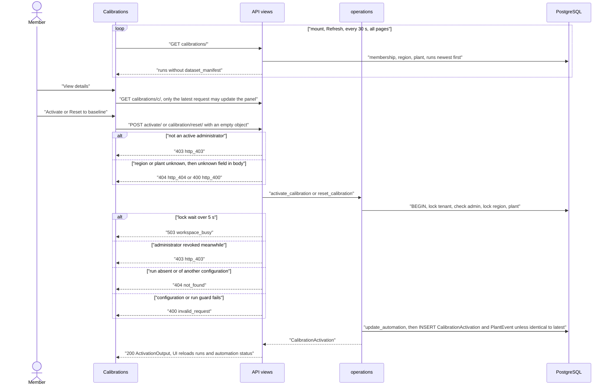

# Review calibration runs, activate one or reset to baseline

Any workspace member opens a plant's Calibration tab, lists its calibration runs and reads one run's evaluation. A workspace administrator activates a `ready` run of the current configuration or resets to the factor-1 baseline; each effective choice appends a `CalibrationActivation` row that forecast composition reads at query time. Activating also switches automatic calibration on for the activating administrator and resetting switches it off. The `activate_calibration` command calls the same two operations. No job is enqueued and no provider is called.

## Entry points

- Screen: `web/src/components/calibrations.tsx` `Calibrations`, mounted by `plant-workspace.tsx` `PlantWorkspace` only when the plant has a current configuration (keyed by its id); `Calibrations` itself renders `CalibrationAutomationPanel` (`calibration-automation` flow) above the run list.
- `GET .../plants/{p}/calibrations/` -> `pyracast.plants.api.CalibrationsView.get` (its `POST` is `calibration-run`); `GET .../calibrations/{c}/` -> `CalibrationView.get`. `POST .../calibrations/{c}/activate/` -> `ActivateView.post`; `POST .../plants/{p}/calibration/reset/` -> `ResetView.post`. Both take `{}` (`EmptyInput` rejects unknown fields).
- Operations `pyracast.plants.operations.activate_calibration` and `reset_calibration`; automatic promotion in `pyracast.plants.automation` reuses `_activate` and `_validate_activation`. Command `activate_calibration --username U --plant-id P (--calibration-id C | --baseline)` calls them as the named user.

## Sequence

## Data

| Table | R/W | What |
| --- | --- | --- |
| `plants_calibrationrun` | R | Listing, detail and the activation guards (status, factor, `result`, `dataset_manifest`, pins, `comparison_activation`) |
| `plants_calibrationactivation` | R/W | Latest row per (plant, configuration) is read; one row appended per effective change (null `calibration` = baseline, null `actor` = system) |
| `plants_plantevent` | W | `calibration_activated` or `calibration_reset`, plus `calibration_automation_enabled` or `_disabled` when automation changes |
| `plants_plant` | R/W | Row lock; `automatic_calibration_enabled`, `_enabled_by`, `next_calibration_check_at` |
| `plants_plantconfiguration`, `connections_*`, `regions_region`, `accounts_tenant`, `accounts_membership`, `auth_user` | R | Currentness checks, tenant and region locks, next-check timezone, membership and active administrator checks |
| `metering_epias*`, `incidents_plantincident`, `incidents_incidentrevision` | R | Production-source identity and outage-history recheck |

## Authorization

- Reads: `ScopedView.plant_queryset` calls `require_member` (403, also for inactive users) and scopes region by tenant and plant by region, both non-deleted (404). Runs of every configuration of the plant are listed.
- Writes: `WorkspaceWritePermission` (default permission class) admits only active workspace administrators on non-safe methods, after `SessionAuthentication` and CSRF (`X-CSRFToken` sent by `request`). The view then resolves region and plant through `scope()` before validating the body. `require_workspace_admin` repeats the check in the operation after locking the tenant row, so a concurrent demotion cannot slip through; platform superusers without an admin membership are refused. The command skips HTTP and relies on `require_workspace_admin`. The UI hides Reset and Activate unless `useCanManageWorkspace` (tenant role `admin`), a convenience only.

## Failure paths

| Condition | Result |
| --- | --- |
| Anonymous, not a member, viewer or inactive user on a POST, admin demoted after the permission check | 403 `http_403` |
| Unknown region or plant, unknown run on `GET calibrations/{c}/` | 404 `http_404` |
| Run absent, of another plant or of an older configuration on activate; plant trashed meanwhile | 404 `not_found` |
| Unknown field (a non-object body also gives `http_400`) | 400 `http_400`, "Unknown fields are not accepted." |
| No current configuration; configuration or binding no longer current | 400 `invalid_request`, "Plant configuration is unavailable. Complete setup and wait for administrator approval." or "The plant configuration is no longer current." |
| Production source, outage history or incumbent activation changed since the run | 400 `invalid_request`, "request a new calibration" or "request a new comparison" |
| Run not `ready`, binding or transfer mismatch, not held-out, older policy, forecast-based manifest | 400 `invalid_request`, "Only a completed, held-out evaluated calibration can be activated." |
| Lock wait over 5 s (`lock_timeout`) | 503 `workspace_busy`, `Retry-After: 1` |
| Command lookup, access or guard failure | `CommandError` "Activation failed: invalid input, access, or record."; a lock timeout escapes as `OperationalError` |
| UI request fails | `Notice` with the message `request` derives from the body; the list stays |

## Rules and invariants

- Lock order is tenant, region, plant, as in `set_calibration_automation`; the automation toggle shares the transaction and rolls back with any later guard failure. A run may only replace the activation that was latest for its configuration when it was requested (`comparison_activation_id`). Any later activation or reset makes every other ready run permanently non-activatable. Manual activation skips the automatic promotion thresholds (30 matched days, 1% margin, holdout age); only `_validate_activation` applies.
- Re-activating the latest run or repeating a reset returns the existing activation row (200) but still runs `update_automation`, so it can re-enable automation or reassign `_enabled_by`; re-activation also re-runs the identity and outage checks first. A first reset with no history still writes a baseline row. Activation is per configuration: a revised configuration runs at factor 1 until one of its own runs is activated.
- Effect is not only prospective. `calibration_at` takes the newest activation with `created_at <= as_of` and drops the run if `_usable` fails (status, timestamps, transfer, outage history); its callers also drop it when production identity changed. Past-day estimated actuals without `as_of` use `calibration_for_day` at the current time over the newest 60 activations (a baseline row ends the search), so a new activation re-scores completed days from its first training day onward and a reset returns them to factor 1; with an explicit `as_of` those estimates stay uncalibrated. Saved `ForecastIssuance` rows keep their factor.

## Tests

- `tests/test_plant_api.py` `test_calibration_pending_forecast_and_csrf` (400 chain, 200 activate and reset; its CSRF check targets the plant PUT, not these endpoints); `tests/test_plant_operations.py` (older policy, changed incumbent, forecast manifest, replay, configless plant, two-thread race); `tests/test_plant_commands.py`; `tests/test_incident_calibration.py`; `tests/test_workspace_authorization.py` (viewer 403 on both POSTs; viewer, outsider, platform, demoted, inactive refused in the operation); `tests/test_calibration_automation.py` (activation enables, reset disables).
- Playwright `web/tests/calibrations.spec.ts` and `workspace-roles.spec.ts`, both against `mockApi`. Gaps: no real-backend browser test; no HTTP test for 404 on an older-configuration run or 503 on activation; nothing pins what the UI offers for a run whose incumbent changed.
