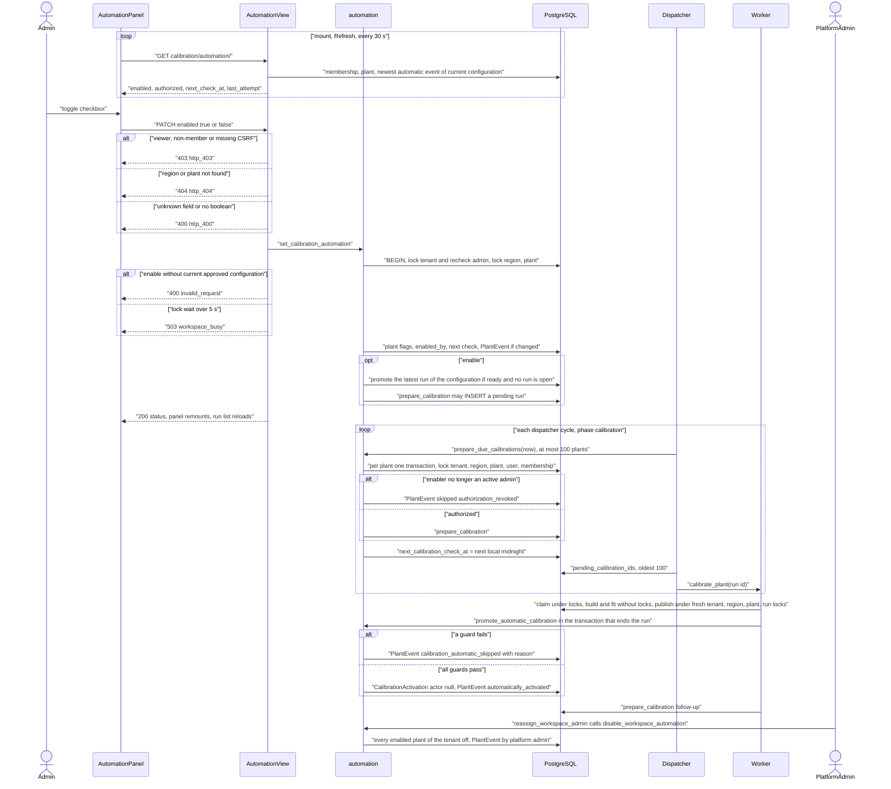

# Automatic calibration: toggle, daily check and promotion

A workspace administrator switches automatic calibration on or off per plant on the Calibration tab; enabling records that administrator as the authorizer, schedules a daily check at the next local midnight and immediately tries the latest run of the current configuration (only if it is `ready` and no run is open) and a new preparation. The dispatcher's `calibration` phase prepares a run for every due plant once per local day, and after every terminal fit the worker calls `promote_automatic_calibration`, which either appends a system `CalibrationActivation` or records a skip reason that the panel shows. Moving the workspace administrator role to another member switches automation off for the whole workspace.

## Entry points

- Screen: `web/src/components/calibration-automation.tsx` `CalibrationAutomationPanel` (checkbox, next check, last result), mounted by `calibrations.tsx` `Calibrations`, which `plant-workspace.tsx` renders only for a plant with a configuration.
- `GET|PATCH /api/tenants/{t}/regions/{r}/plants/{p}/calibration/automation/` -> `pyracast.plants.api.CalibrationAutomationView`; PATCH body `{"enabled": bool}` (`CalibrationAutomationInput`) -> operation `pyracast.plants.automation.set_calibration_automation` (state change in `update_automation`); both methods return `CalibrationAutomationOutput` from `automation.automation_status`.
- Dispatcher phase `calibration`: `pyracast.forecasts.management.commands.dispatch` -> `pyracast.plants.runtime.dispatch_calibrations` -> `automation.prepare_due_calibrations`, then `training.pending_calibration_ids` and actor `calibrate_plant` (queue `calibration`, `max_retries=0`).
- Worker: `runtime.deliver_calibration` -> `training.run_calibration`; `training._prepare_followup` (from `_claim` and `_fail` when the run ends there, and from `_publish`) -> `automation.promote_automatic_calibration`, then `prepare_calibration`.
- Platform admin page `admin:workspace_tenant` (`/admin/workspaces/{t}/`, `pyracast.admin` `tenant`, `admin_tenants.WorkspaceAdministratorForm`) -> `accounts.operations.reassign_workspace_admin` -> `automation.disable_workspace_automation` when the administrator actually changes; the page warns when a non-trashed enabled plant exists.
- Side doors: `plants.operations.activate_calibration` turns automation on (no promotion or preparation), `reset_calibration` and `_save_configuration` (any configuration revision, no automation event) turn it off.

## Sequence

## Data

| Table | R/W | What |
| --- | --- | --- |
| `plants_plant` | R/W | Row lock; `automatic_calibration_enabled`, `automatic_calibration_enabled_by` (PROTECT FK to user), `next_calibration_check_at` (indexed due slot, null counts as due); read by the admin page warning |
| `plants_calibrationrun` | R/W | Latest run of the current configuration and pending/running check on enable; `status`, `factor`, `result`, `assessment`, `dataset_manifest`, window and holdout dates for the guards; `prepare_calibration` inserts pending runs |
| `plants_calibrationactivation` | R/W | Latest activation per configuration and the run's `comparison_activation` (incumbent checks); automatic promotion appends a row with null `actor` |
| `plants_plantevent` | R/W | Writes `calibration_automation_enabled/disabled`, `calibration_automatic_skipped` (reason, origin, `enabled_by_id`), `calibration_automatically_activated` and, from `prepare_calibration`, `calibration_scheduled`; GET reads the newest skip or automatic activation |
| `accounts_membership`, `auth_user`, `accounts_tenant`, `regions_region` | R | Enabler authorization (user and membership locked `FOR UPDATE` in every promotion and in the scan), lock order, soft-deletion checks |
| `plants_plantconfiguration`, `connections_sitebinding`, `connections_provideraccount` | R | `configuration_is_current` and `binding_is_current` |
| Production, EPIAS snapshot and connection (`metering_epiasconnection`) and incident tables | R | Read by `prepare_calibration` and `_validate_activation` (see `calibration-run`) |

## Authorization

- GET: DRF `IsAuthenticated`, then `ScopedView.plant_queryset` calls `require_member` (403) and scopes region to tenant and plant to region, both non-deleted (404). Any member, including viewers, may read the status.
- PATCH: `WorkspaceWritePermission` admits only active workspace administrators of the URL tenant (a platform superuser without that membership is refused); `SessionAuthentication` enforces CSRF. `set_calibration_automation` repeats the check with `require_workspace_admin` after locking the tenant row. The UI disables the checkbox for viewers (`useCanManageWorkspace`), a convenience only.
- Promotion and daily preparation are authorized by the stored enabler, not by the caller: `_authorized` requires that user to be active and an `admin` member of the plant's tenant, with row locks on the user and membership in every promotion (worker and enabling PATCH) and in the scan, so a concurrent deactivation or demotion is seen. The GET status evaluates the same rule without locks.
- `disable_workspace_automation` requires an active platform superuser (`require_admin`); it is reached only through `reassign_workspace_admin`, whose admin page also requires staff status, superuser and verified MFA (`PlatformAdminSite.has_permission`).

## Failure paths

| Condition | Result |
| --- | --- |
| Anonymous, missing CSRF, viewer or outsider on PATCH, non-member GET; admin demoted between permission class and operation | 403 `http_403` (the last with "Workspace administrator required.") |
| Region or plant absent, trashed or of another tenant | 404 `http_404` from `get_object_or_404`; 404 `not_found` only if the row disappears between the view lookup and the operation |
| Unknown field, missing or unparseable `enabled` | 400 `http_400` (DRF serializer error, checked after the 403 and 404 cases) |
| Enable with no configuration, region not approved, binding or account not current | 400 `invalid_request` "Automatic calibration requires the current approved configuration." (no translation) |
| Lock wait over 5 s (`lock_timeout`) | 503 `workspace_busy`, `Retry-After: 1` |
| PATCH fails in the UI; a status GET (poll) fails | Error `Notice`, the checkbox keeps the last server state; an error `Notice` replaces checkbox and status until a later poll succeeds |
| Enabler inactive, demoted or removed | Daily `calibration_automatic_skipped` `authorization_revoked`; panel notice "Authorization unavailable. Calibration is paused."; slot still advances |
| Run superseded or failed at claim, rejected or insufficient fit, fit failed on the last attempt | Skip `configuration_changed` or `candidate_<status>` |
| Production source, outage history or incumbent changed, or the run is not an activatable held-out fit | Skip whose reason is the `_validate_activation` gettext sentence (English in the worker, request language on PATCH); the panel has no key for it and prints it through `unknown_reason` |
| Policy guard fails | Skip `insufficient_automatic_evaluation`, `insufficient_current_source_validation`, `stale_automatic_evaluation`, `derating_suspected`, `awaiting_new_holdout_days`, `invalid_incumbent_comparison`, `incumbent_improvement_below_margin` |
| Any exception in the daily scan | Phase logs `dispatch_phase_failed` and stores the error type in `forecasts_dispatcherstatus`; that plant's slot rolls back (plants handled earlier stay committed); no pending run is sent in that cycle |
| `ValueError`, `TypeError`, `KeyError` or `ArithmeticError` from promotion or follow-up during publish | Publish rolls back; run returns to `pending`, or on the last attempt `_fail` ends it `failed` `invalid_calibration_data` and repeats promotion and follow-up; if those raise, `_fail` rolls back as well and the run stays `running` until its lease expires (see `calibration-run`) |
| Admin page: stale `expected_admin_id` or a choice that is not an active member | Form error with HTTP 400; roles and automation unchanged (re-selecting the current administrator changes nothing either) |

## Rules and invariants

- Lock order everywhere: tenant, region, plant, then (worker) calibration run and provider account, then user and membership. `disable_workspace_automation` locks the tenant, all its regions and the enabled plants (trashed ones included) in primary-key order.
- `update_automation` is a no-op without an event when the state and enabler are unchanged, but every enabling PATCH still re-runs promotion and preparation, so a failing guard appends another skip event each time.
- Enabling stores the acting administrator; only that user can keep authorizing. Reassignment, reset and configuration revision clear the flag, enabler and slot; deactivating the enabler leaves automation on but paused.
- The due slot is the start of the next local day in the region timezone; a null slot is due at once. Missed days collapse into one check; concurrent dispatchers advance a slot once because each plant is rechecked after locking. Trashed plants and regions are skipped but keep their flags.
- Nothing is enqueued by the toggle or the scan; after the scan the dispatcher sends the 100 oldest pending or lease-expired runs in the same cycle (default poll 60 s).
- Promotion order: enabled (otherwise silent, no event), authorized, configuration current, run `ready`, `_validate_activation`, then `_promotion_reason`. Thresholds: `evaluated` assessment, integer `valid_days` >= 30, exactly seven distinct holdout dates inside the window and before today (binding timezone), current-source validation eligible and equal to the stored copy, latest holdout at most 7 and earliest at most 14 days old; against an incumbent calibration (not the baseline) no suspected derating (except identity recovery to factor 1) and seven holdout dates after the incumbent's last holdout date (or its `window_end`); always both `interval_mae_mw` and `daily_mae_mwh` at least 1% below `result.incumbent`.
- `promote_automatic_calibration` has no transaction of its own; callers must hold the plant lock inside `transaction.atomic`.
- Automatic activations carry `actor=None`, `origin: automatic` and `enabled_by_id`; promoting the already active run returns the existing row without an event. The status shows only events of the current configuration; an activation event reports reason `accepted`.

## Tests

- `tests/test_calibration_automation.py`: enable before a fit and disable without reset (HTTP), reset and revision, thresholds and malformed results, holdout freshness and new-holdout guard, stale incumbent sentence and `configuration_changed`, revoked enabler (inactive, demoted, removed), reassignment and returning administrator, endpoint tenant scoping, two-thread daily scan, scan recheck after disable, trash and purge, terminal failures.
- `tests/test_workspace_authorization.py` (viewer PATCH 403; operation refuses viewer, outsider, platform superuser, demoted and inactive actors); `tests/test_workspaces.py`, `tests/test_admin_tenants.py` (reassignment rules and admin page); `tests/test_calibration_identity_recovery.py`, `tests/test_calibration_source_validation.py`, `tests/test_production_diagnostics.py` (promotion inputs); `tests/test_calibration_runtime.py` (phase sends pending runs), `tests/test_dispatch_resilience.py` (phase isolation).
- Playwright `web/tests/calibrations.spec.ts` (toggle, reload after activate and reset, stale response) and `workspace-roles.spec.ts` (viewer checkbox disabled), against `mockApi`.
- Gaps: no test that a raising plant in `prepare_due_calibrations` blocks the scan and the send of pending runs; the `_validate_activation` skip reason is pinned only by an English substring; no HTTP test of the 400 and 503 answers of this endpoint; no test of the admin page automation warning; no browser test of a failed PATCH, a failed poll or the paused notice; no real-backend browser test.
