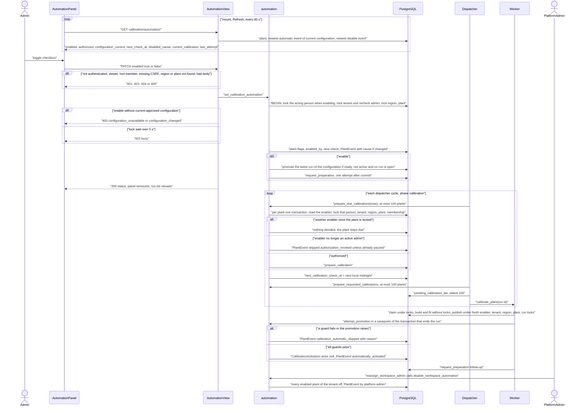

# Automatic calibration: toggle, daily check and promotion

A workspace administrator switches automatic calibration on or off per plant on the Calibration tab; enabling records that administrator as the authorizer, schedules a daily check at the next local midnight, immediately tries the latest run of the current configuration (only if it is `ready`, not already active and no run is open) and records a preparation request. The dispatcher's `calibration` phase prepares a run for every due plant once per local day, and after every terminal run the worker calls `attempt_promotion`, which either appends a system `CalibrationActivation` or records a skip reason that the panel shows. Moving the workspace administrator role to another member switches automation off for the whole workspace.

## Entry points

- Screen: `web/src/features/calibration/calibration-automation.tsx` `CalibrationAutomationPanel` (checkbox "Automatic calibration enabled", next check in device time, why automation is off, a paused notice, last result), mounted by `calibrations.tsx` `Calibrations`, which `features/plant/plant-workspace.tsx` renders only for a plant with a configuration. `Calibrations` reads the status once for the panel and the selection card.
- `GET|PATCH /api/tenants/{t}/regions/{r}/plants/{p}/calibration/automation/` -> `pyracast.plants.api.CalibrationAutomationView`; PATCH body `{"enabled": bool}` (`CalibrationAutomationInput`) -> operation `pyracast.plants.automation.set_calibration_automation`; both methods return `CalibrationAutomationOutput` from `automation.automation_status` (`enabled`, `authorized`, `configuration_id`, `configuration_current`, `next_check_at`, `disabled_cause`, `current_calibration`, `last_attempt`).
- Dispatcher phase `calibration`: `pyracast.orchestration.dispatcher` -> `pyracast.plants.runtime.dispatch_calibrations` -> `automation.prepare_due_calibrations` and `preparation.prepare_requested_calibrations`, then `training.pending_calibration_ids` and actor `calibrate_plant` (queue `calibration`, `max_retries=0`).
- Worker: `runtime.deliver_calibration` -> `training.run_calibration`; `training._follow_up` (from `_claim` and `_fail` when the run ends there, and from `_publish`) -> `automation.attempt_promotion` -> `promote_automatic_calibration`, then `request_preparation`. A request whose preparation creates no run calls `automation.promote_undecided_candidate`.
- Platform admin page `admin:workspace_tenant_administrator` (`/admin/workspaces/{t}/administrator/`, `pyracast.platform_admin.tenant_views.workspace_administrator`, `tenants.WorkspaceAdministratorForm`) -> `accounts.operations.reassign_workspace_admin` -> `automation.disable_workspace_automation` when the administrator actually changes; the page lists the plants whose automation would stop, those of trashed locations included (`reassignment_impact`).
- Side doors: `set_automation_state` (`plants/automation_state.py`) is the only writer of the automation fields. `activation.activate_calibration` turns automation on (cause `manual_activation`, no promotion or preparation); `reset_calibration` (`reset`) and `operations._save_configuration` (`configuration_revised`, any configuration revision) turn it off.

## Sequence

## Data

| Table | R/W | What |
| --- | --- | --- |
| `plants_plant` | R/W | Row lock; `automatic_calibration_enabled`, `automatic_calibration_enabled_by` (PROTECT FK to user), `next_calibration_check_at` (indexed due slot), `calibration_preparation_due_at`; `plant_automation_chk` stores all three automation fields or none; read by the admin page warning |
| `plants_calibrationrun` | R/W | Latest run of the current configuration and open runs on enable; `status`, `factor`, `result`, `assessment`, `dataset_manifest`, window and holdout dates for the guards; `prepare_calibration` inserts pending runs |
| `plants_calibrationactivation` | R/W | Latest activation per configuration and the run's `comparison_activation` (incumbent checks); automatic promotion appends a row with null `actor` |
| `plants_plantevent` | R/W | Writes `calibration_automation_enabled/disabled` (`cause`: `toggle`, `manual_activation`, `reset`, `configuration_revised`, `workspace_disabled`), `calibration_automatic_skipped` (reason, origin, `enabled_by_id`), `calibration_automatically_activated` and, from `prepare_calibration`, `calibration_scheduled`; GET reads the newest skip or automatic activation and the newest disable event |
| `accounts_membership`, `auth_user`, `accounts_tenant`, `regions_region` | R | Enabler authorization (the person locked `FOR NO KEY UPDATE`, active accounts only, before the tenant; the membership `FOR UPDATE OF` itself under the tenant), lock order, soft-deletion checks |
| `plants_plantconfiguration`, `connections_sitebinding`, `connections_provideraccount` | R | `configuration_is_current` and `binding_is_current` |
| Production, EPIAS snapshot and connection (`metering_epiasconnection`) and incident tables | R | Read by `prepare_calibration` and `activation_blocker` (see `calibration-run`) |

## Authorization

- GET: `RoutePolicy` (`api/permissions.py`) admits any active member, including viewers (403 `membership_required` otherwise); `ScopedView.plant_queryset` scopes region to tenant and plant to region, both non-deleted (404).
- PATCH: session authentication enforces CSRF, then `RoutePolicy` admits only active workspace administrators of the URL tenant (a platform superuser without that membership is refused). `set_calibration_automation` repeats the check with `tenant_membership(role=ADMIN, lock=True)` after locking the tenant row. The UI disables the checkbox for viewers (`useCanManageWorkspace`), a convenience only.
- Promotion and daily preparation are authorized by the stored enabler, not by the caller: `_authorized` requires that user to be active and an `admin` member of the plant's tenant; where a transaction decides on it, the person and the membership are locked first (lock order below), so a concurrent deactivation or demotion is seen; disabling locks no person. The GET status evaluates the same rule without locks.
- `disable_workspace_automation` requires an active platform superuser (`require_platform_admin`); it is reached only through `reassign_workspace_admin`, whose console page requires `has_platform_admin_session` (staff, superuser and verified MFA).

## Failure paths

| Condition | Result |
| --- | --- |
| Anonymous | 401 `not_authenticated` with `WWW-Authenticate: Session` |
| Missing CSRF | 403 `csrf_failed` |
| Non-member (GET or PATCH); viewer on PATCH; admin demoted between route policy and operation | 403 `membership_required`; 403 `workspace_admin_required` |
| Region absent, trashed or of another tenant; plant absent | 404 `not_found` |
| Unknown field, missing or unparseable `enabled` | 400 `invalid_request` (checked after the 403 and 404 cases) |
| Enable with no configuration; region not approved, binding or account not current | 400 `configuration_unavailable`; 400 `configuration_changed` (disabling needs neither) |
| Lock wait over 5 s (`lock_timeout`) | 503 `busy`, `Retry-After: 1` |
| PATCH fails in the UI; the first status GET fails; a later poll fails | Error `Notice`, the checkbox keeps the last server state; an error `Notice` without checkbox and status; a refresh-failed alert with Retry (`RefreshFailed`) above the unchanged checkbox and status |
| Enabler inactive, demoted or removed | `calibration_automatic_skipped` `authorization_revoked`: the scan records it once per pause, a promotion once per run; panel notice "Authorization unavailable. Calibration is paused."; slot still advances |
| Run superseded or failed at claim, rejected or insufficient fit, fit failed on the last attempt | Skip `configuration_changed` or `candidate_<status>` |
| Configuration, production source, outage history or incumbent changed, or the run is not an activatable held-out fit | Skip whose reason is the `activation_blocker` code (`configuration_changed`, `production_source_changed`, `outage_history_changed`, `incumbent_changed`, `calibration_not_activatable`) |
| Policy guard fails | Skip `insufficient_automatic_evaluation`, `insufficient_current_source_validation`, `stale_automatic_evaluation`, `derating_suspected`, `awaiting_new_holdout_days`, `invalid_incumbent_comparison`, `incumbent_improvement_below_margin` |
| A plant's daily check raises | Logged `calibration_due_check_failed item=plant:<id>`; that plant's transaction rolls back, its slot advances to the next local day and skip `preparation_failed` is recorded (only while automation is still on); other plants and the publication of pending runs go on; the phase stores `items_failed:<n>` in `forecasts_dispatcherstatus` |
| Promotion raises (any exception) | Rolled back to its savepoint, logged `calibration_promotion_failed`, skip `promotion_failed` recorded; the terminal status stays. The request keeps retrying every hour and stops after three `promotion_failed` skips |
| Console page: stale `expected_admin_id` or a choice that is not an active member | Form error with HTTP 400; roles and automation unchanged (re-selecting the current administrator changes nothing either) |

## Rules and invariants

- Lock order ([decision record](../ARCHITECTURE.md#tenancy-and-authorization)): the person first, `FOR NO KEY UPDATE` and only while active: enabling locks the acting administrator; the due check, the requested preparation and the run's claim, publication and failure read the plant's enabler without a lock and then lock it; disabling locks no person. Then tenant, region, plant and (worker) calibration run, the provider account only at run publication. The membership (`FOR UPDATE OF` the membership) is locked under the tenant only when the authorization rule is evaluated for an active enabler. When the plant has another enabler once it is locked, the round decides nothing: the due check and the requested preparation leave the plant as due as it is for the next dispatcher cycle, and a run transition completes its state and leaves the promotion to the preparation it requests. `disable_workspace_automation` locks the tenant, all its regions and the enabled plants (those of trashed locations included) in primary-key order.
- `set_automation_state` is a no-op without an event when the state and enabler are unchanged. An enabling PATCH still tries promotion when the latest ready run is not the active one and no run is open, so a failing guard appends another skip event each time; enabling does not re-evaluate the run that is already active.
- Enabling stores the acting administrator; only that user can keep authorizing. Reassignment, reset and configuration revision clear the flag, enabler and slot and record a disable event with its `cause` (the panel shows it); deactivating the enabler leaves automation on but paused.
- The due slot is the start of the next local day in the region timezone; only a plant with a slot at or before `now` is due. Missed days collapse into one check; concurrent dispatchers advance a slot once because each plant is rechecked after locking. Plants of a trashed location are skipped but keep their flags.
- The toggle and the scan enqueue nothing themselves; preparation requests are attempted after commit and by the phase, and after the scan the dispatcher sends the 100 oldest pending or lease-expired runs in the same cycle (default poll 30 s).
- Promotion order: enabled (otherwise silent, no event), authorized, configuration current, run `ready`, `activation_blocker`, then `_promotion_reason`. Thresholds: `evaluated` assessment, integer `valid_days` >= 30, exactly seven distinct holdout dates inside the window and before today (binding timezone), current-source validation eligible, equal to the stored copy and inside the window, latest holdout at most 7 and earliest at most 14 days old; against an incumbent calibration (not the baseline) no suspected derating (except identity recovery to factor 1) and seven holdout dates after the incumbent's last holdout date (or its `window_end`); always both `interval_mae_mw` and `daily_mae_mwh` at least 1% below `result.incumbent`.
- `promote_automatic_calibration` has no transaction of its own; callers hold the plant lock inside `transaction.atomic` (`attempt_promotion` adds the savepoint).
- Automatic activations carry `actor=None`, `origin: automatic` and `enabled_by_id`; promoting the already active run returns the existing row without an event. The status shows only events of the current configuration; an activation event reports reason `accepted`.

## Tests

- `tests/test_calibration_automation.py`: enable before a fit and disable without reset (HTTP), reset and revision, thresholds and malformed results, holdout freshness and new-holdout guard, stale incumbent and `configuration_changed`, revoked enabler (inactive, demoted, removed), reassignment and returning administrator, endpoint tenant scoping, two-thread daily scan, scan recheck after disable, trash and purge, terminal failures.
- `tests/test_lock_order.py` (the person before the workspace in every automation transaction); `tests/test_calibration_activation_policy.py` (blocker codes as skip reasons, one `authorization_revoked` per pause, re-enabling does not re-evaluate the active run, status beside the selection); `tests/test_calibration_requests.py` (failed promotion retried, stops after three); `tests/test_calibration_lifecycle.py` (configuration revision disables with its cause); `tests/test_calibration_invariants.py` (`plant_automation_chk`, one writer); `tests/test_dispatch_isolation.py` (a failing due check backs off one plant, others published, `items_failed:1`).
- `tests/test_route_policy.py`, `tests/test_workspace_authorization.py` (roles on PATCH, operation refusals); `tests/test_workspaces.py`, `tests/test_admin_tenants.py` (reassignment rules and console page); `tests/test_reassignment_impact.py` (the page's list of plants that stop); `tests/test_calibration_identity_recovery.py`, `tests/test_calibration_source_validation.py`, `tests/test_production_diagnostics.py` (promotion inputs); `tests/test_calibration_runtime.py` (phase sends pending runs), `tests/test_dispatch_resilience.py` (phase isolation).
- Playwright `web/tests/calibrations.spec.ts` (toggle before a fit, reload after activate and reset, stale response) and `workspace-roles.spec.ts` (viewer without write controls), against `mockApi`.
- Gaps: no HTTP test of the 400 answer of this endpoint; no browser test of a failed PATCH, a failed poll or the paused notice; no real-backend browser test.
