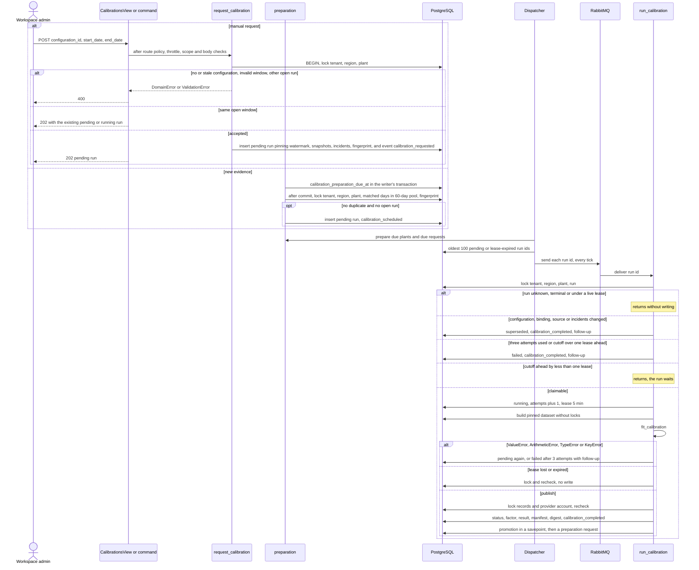

# Prepare or request a calibration run and fit it in a worker

New evidence (production writes, EPİAŞ and estimated-actual acquisitions, historical restores, incident revisions, automation, finished runs) records a durable preparation request on the plant; `prepare_calibration` then creates a pending `CalibrationRun` pinned to its inputs. A workspace administrator can also request one by API or command. The dispatcher's `calibration` phase prepares due plants and requests, then publishes up to 100 pending or lease-expired runs per tick; the `calibrate_plant` actor claims a five-minute lease, rebuilds the pinned dataset, fits one factor and stores `ready`, `rejected`, `insufficient`, `failed` or `superseded`. Manual activation is the separate flow `calibration-activation`; automatic promotion runs in a savepoint of the worker's terminal transaction.

## Entry points

- Screen: `Calibrations` (`web/src/features/calibration/calibrations.tsx`) polls `GET .../calibrations/` every 60 s and shows each run's status and selection state. A blocked run's detail offers "request a new calibration" for the same window only when `requestState` (`calibration/model.ts`) predicts that `request_calibration` accepts it.
- `POST /api/tenants/{t}/regions/{r}/plants/{p}/calibrations/` -> `CalibrationsView.post` (`src/pyracast/plants/api.py`) with `CalibrationInput` (`plants/serializers.py`) -> `request_calibration` (`plants/operations.py`); 202 `CalibrationOutput`.
- Command `calibrate_plant --username --plant-id --configuration-id --start-date --end-date [--run]` (`plants/management/commands/calibrate_plant.py`): same operation; `--run` calls `run_calibration` in-process, without RabbitMQ.
- `request_preparation` (`plants/preparation.py`) callers: `change_production` and `import_observations` (`plants/production_changes.py`), EPİAŞ job end unless superseded (`metering/jobs.py`), a succeeded estimated-actuals collection (`PlantPublication.actuals_published` in `plants/publication.py`), a restored estimated-actuals snapshot (`request_region_preparation`, `forecasts/snapshot_restore.py`), `incidents_changed` (`plants/preparation.py`, from `incidents/operations.py`), `set_calibration_automation` (`plants/automation.py`, flow `calibration-automation`) and `_follow_up` (`plants/training.py`). Each sets `plants_plant.calibration_preparation_due_at` in the caller's transaction and attempts preparation after commit.
- Dispatcher phase `calibration` (`orchestration/dispatcher.py`, third of five) -> `dispatch_calibrations` (`plants/runtime.py`): `prepare_due_calibrations` (flow `calibration-automation`), `prepare_requested_calibrations` (up to 100 due plants without an open run), then `pending_calibration_ids` (oldest 100, live plants and regions only) and `actor.send` for each id.
- Actor `calibrate_plant` (`orchestration/kinds.py` `CALIBRATION`, queue `calibration`, `max_retries=0`, time limit 210 s below the 5-minute lease from `background/deadlines.py`) -> `deliver_calibration` -> `run_calibration`; consumed by `worker` (default queues `default calibration epias`, as in `deploy/compose.yaml`).
- Operator counts: queued, running, overdue, interrupted and failed runs in `orchestration/delivery_health.py` (flow `delivery-health-check`).

## Sequence

## Data

| Table | R/W | What |
| --- | --- | --- |
| `plants_calibrationrun` | R/W | Pending row pins window, `cutoff_at`, `observation_id_cutoff`, production and reference snapshot ids, `incident_revision_ids`, `input_sha256`, `comparison_activation`; worker writes lease, `attempts`, `status`, `assessment`, `factor`, `result`, `dataset_manifest`, `dataset_sha256`, `last_error`, `completed_at` |
| `plants_plant` | R/W | `calibration_preparation_due_at` (the durable request); the due check of `calibration-automation` writes `next_calibration_check_at` in the same phase |
| `accounts_tenant`, `regions_region` | R | Row locks; `binding_is_current` reads region status, revision and approved binding |
| `accounts_membership`, `auth_user` | R | Administrator role for API, command and operation; `requested_by` of automatic runs |
| `plants_plantconfiguration`, `connections_sitebinding`, `connections_provideraccount` | R | Current configuration, timezone, capacities, account state; account row locked at publication |
| `plants_productionobservation` | R | Manual heads up to the watermark and cutoff |
| `metering_epiasconnection`, `metering_epiassnapshot`, `metering_epiascollectionjob` | R | Provider production and its identity |
| `forecasts_forecastsnapshot`, `forecasts_collectionjob`, `forecasts_historicalreferenceimport`, `forecasts_referencecapacitynormalization` | R | Archived estimated actuals pinned per day and their provenance |
| `incidents_incidentrevision` | R | Latest revisions overlapping the window, joined through `incidents_plantincident` |
| `plants_calibrationactivation` | R | Incumbent pinned at creation; automatic promotion writes here (flow `calibration-automation`) |
| `plants_plantevent` | W | `calibration_requested`, `calibration_scheduled`; `calibration_completed` for every ending (publication, claim, failure, supersede) with `status`, `reason` and `dataset_sha256`; promotion adds its own events |
| `forecasts_dispatcherstatus` | W | Outcome of the `calibration` phase per tick |

## Authorization

- View, in order: session authentication with CSRF (`csrf_failed`); `RoutePolicy` (`api/permissions.py`: active member, else `membership_required`; administrator, else `workspace_admin_required`); the `calibration` throttle (20 an hour per user); `ScopedView.scope` (404 for a region outside the tenant or in the trash, or a plant outside the region); only then the body.
- Operation: `tenant_membership(role=ADMIN, lock=True)` locks the tenant row and rechecks the role inside the `request_calibration` transaction. The command resolves `--username` and relies on this check alone.
- System: preparation and worker check no actor. Automatic runs record `requested_by` as the recorder of the latest observation or the EPİAŞ connector. The due check prepares only while the administrator who enabled automation is still an active admin, and promotion rechecks that under lock (flow `calibration-automation`).
- Database: partial unique `calibrationrun_plant_uniq` (one open run per plant); checks `calibrationrun_window_chk`, `calibrationrun_factor_chk`, `calibrationrun_status_chk`, `calibrationrun_lease_chk` (a lease only with `running`), `calibrationrun_completed_at_chk` (every terminal run has `completed_at`), `calibrationrun_assessment_chk`, `calibrationrun_last_error_chk`.
- The renderer projects the `reference_import` and `capacity_normalization` subtrees of a run's manifest to allowlists (`api/public.py`).

## Failure paths

| Condition | Result |
| --- | --- |
| Anonymous | 401 `not_authenticated` with `WWW-Authenticate: Session` |
| Missing CSRF | 403 `csrf_failed` |
| Non-member; viewer; admin role lost before the tenant lock | 403 `membership_required`; 403 `workspace_admin_required` |
| More than 20 requests an hour | 429 `throttled` with `Retry-After` |
| Region missing, foreign or in the trash, plant missing or foreign, also between the view check and the operation lock | 404 `not_found` |
| Body fails `CalibrationInput` (missing or unknown field, bad date, id below 1) | 400 `invalid_request` with field errors |
| No configuration; configuration or binding not current | 400 `configuration_unavailable`; 400 `configuration_changed` |
| `configuration_id` not current; not 7 to 90 days or end not before local today | 400 `invalid_request` "Calibration requires the current configuration."; "Use 7 to 90 completed local days." |
| Another pending or running run with a different window | 400 `invalid_request` "A calibration is already pending." (same configuration and window: 202 with that run, whatever its open status) |
| Lock wait over 5 s (`lock_timeout`) | 503 `busy`, `Retry-After: 1` |
| Command refusal | `CommandError` "Calibration refused: <code>." for a domain refusal or "Calibration refused: <message>" for a validation one; no right on the plant: "User <name> may not change plant <id>."; lock timeout: "Workspace busy; retry."; `--run` ending with the run still open: "held by another worker or waits for its cutoff" |
| `prepare_due_calibrations` or `prepare_requested_calibrations` fails for a plant | Logged `calibration_due_check_failed` or `calibration_preparation_failed item=plant:<id>`; the plant backs off (next local day with skip `preparation_failed`, or one hour for a request); other plants and the id publication go on; the phase is stored as `items_failed:<n>` in `forecasts_dispatcherstatus` |
| `pending_calibration_ids` or `actor.send` raises | Phase logged `dispatch_phase_failed` and stored with the error type; other phases continue |
| Queue holds 1000 or more messages | Nothing is published this tick (`publication_skipped`); ids stay in the database |
| Duplicate delivery (run unknown, terminal or under a live lease); lease expired or taken over before publication | Nothing written; a lease lost at publication or failure logs `calibration_lease_lost run=<id>`; an expired `running` run is resent by a later dispatch |
| Configuration, binding, source identity or incidents changed | `superseded` at claim or publication, event reason `configuration_changed`, `binding_changed`, `production_source_changed` or `outage_history_changed` |
| Three attempts already used when claimed, or `cutoff_at` more than one lease after worker time | `failed`, `attempt_limit` or `invalid_cutoff`; logged as `calibration_run_failed run=<id> reason=<code>` |
| `cutoff_at` after worker time by less than one lease | Run stays pending and is claimed once the cutoff has passed |
| Build, fit or publication raises `ValueError`, `ArithmeticError`, `TypeError`, `KeyError` | `calibration_attempt_failed run=<id> attempt=<n> error_type=<class> origin=<module>:<line>:<function>` is logged without the exception message; `pending` with `invalid_calibration_data`; `failed` on attempt 3 with the same follow-up |
| Promotion or preparation raises in the follow-up | The terminal status stays; a promotion failure is logged and recorded as skip `promotion_failed`; a preparation failure keeps the request, retried after one hour |
| Fewer than 7 matched days or too little training support; fit misses acceptance guards | `insufficient`; `rejected` with `result.reasons` |
| Other exception in the worker, such as a lock timeout | Actor raises, no Dramatiq retry; a pending run is resent next tick, a claimed run after its lease expires |

## Rules and invariants

- Lock order is tenant, region, plant, run, then provider account at publication; `prepare_calibration` takes region and plant, `_prepare_requested` tenant first. Every writer of a run (creators, worker, bulk supersede, `incidents_changed`) holds the plant lock; creators check for an open run and the partial unique index backs it.
- Automatic preparation skips when a run is open, or when a run of the same configuration and incident set, whose window covers the matched days and whose comparison activation is the current one (or which is the active run), has the same `input_sha256` and either failed with `invalid_calibration_data`, failed less than a day ago, or ran under `POLICY_VERSION`. Its window is the matched days inside 60 local days ending on the latest measured day before local today. Manual requests take 7 to 90 completed local days, skip the fingerprint check and are deduplicated only against an identical open window.
- A request is settled once preparation creates a run or the promotion of the latest ready run is decided (flow `calibration-automation`); a raising promotion keeps the request for a retry after one hour.
- A tracking plant is fitted under `tracking.DEFAULT_MODEL`, recorded in `result.transfer_model`, and compared only with an incumbent fitted under the same transfer model (otherwise as uncalibrated).
- Lease 5 minutes, at most 3 attempts counted at claim, including leases lost without an error. The dispatcher marks nothing as sent, so each tick it resends every run without a live lease (oldest 100); duplicate deliveries end at claim.
- Dataset build and fitting run outside any transaction and call no provider; each finished fit logs `calibration_fit_completed run=<id> seconds=<n>` (timing stays out of `result`); publication adds elapsed lock wait to `now` and rechecks lease token, expiry, configuration, binding, source identity and incidents.
- Each terminal transition made by the worker (`_claim`, `_publish`, `_fail` on the last attempt) calls `_follow_up` in the same transaction: automatic promotion in a savepoint, then a preparation request that is attempted after commit.
- Configuration revisions (`_save_configuration`) and trashing (`_cancel_calibrations` in `pyracast/trash.py`) supersede open runs in bulk without follow-up; incident revisions supersede only runs whose incident set changed, then request preparation. Fitting policy (`regularized-huber-v7`, holdout split, acceptance guards) is in `docs/IRRADIANCE.md`.

## Tests

- Operation and worker: `tests/test_plant_operations.py` (`test_calibration_request_bounds_dedup_and_validation`), `tests/test_calibration_lifecycle.py` (supersede reasons, attempt limit, cutoff wait, retry after a day, concurrent claim, command refusals), `tests/test_calibration_requests.py` (durable requests, follow-up failures, promotion retries), `tests/test_calibration_preparation.py` (deduplication, 60-day pool, concurrent preparation), `tests/test_plant_training.py` (lease recovery, revalidation, bounded retries, concurrent delivery), `tests/test_calibration_invariants.py` (database checks), `tests/test_training_window.py`, `tests/test_incident_calibration.py`, `tests/test_settlement_calibration.py`, `tests/test_provisional_calibration.py`, `tests/test_archived_actual_calibration.py`, `tests/test_reference_cohorts.py`, `tests/test_calibration_identity_recovery.py`, `tests/test_calibration_source_validation.py`.
- Runtime: `tests/test_calibration_runtime.py` (double dispatch completes once on a `StubBroker`; live RabbitMQ only with `PYRACAST_LIVE_QUEUE=1`), `tests/test_dispatch_isolation.py` (a failing plant is backed off, others published), `tests/test_dispatch_resilience.py`, `tests/test_trash_boundaries.py` (a plant of a trashed location prepares nothing, purged run id is ignored).
- Boundaries: `tests/test_route_policy.py` (roles and throttle of the POST), `tests/test_plant_api.py` (`test_calibration_pending_forecast_and_csrf`), `tests/test_workspace_authorization.py`, `tests/test_plant_commands.py`, `tests/test_error_contract.py` (codes). Playwright: `web/tests/calibrations.spec.ts` covers listing, requests and activation with a mocked API.
- Gaps: no HTTP test of the 400 messages of this POST; no test of a raising follow-up at a claim-time transition.
