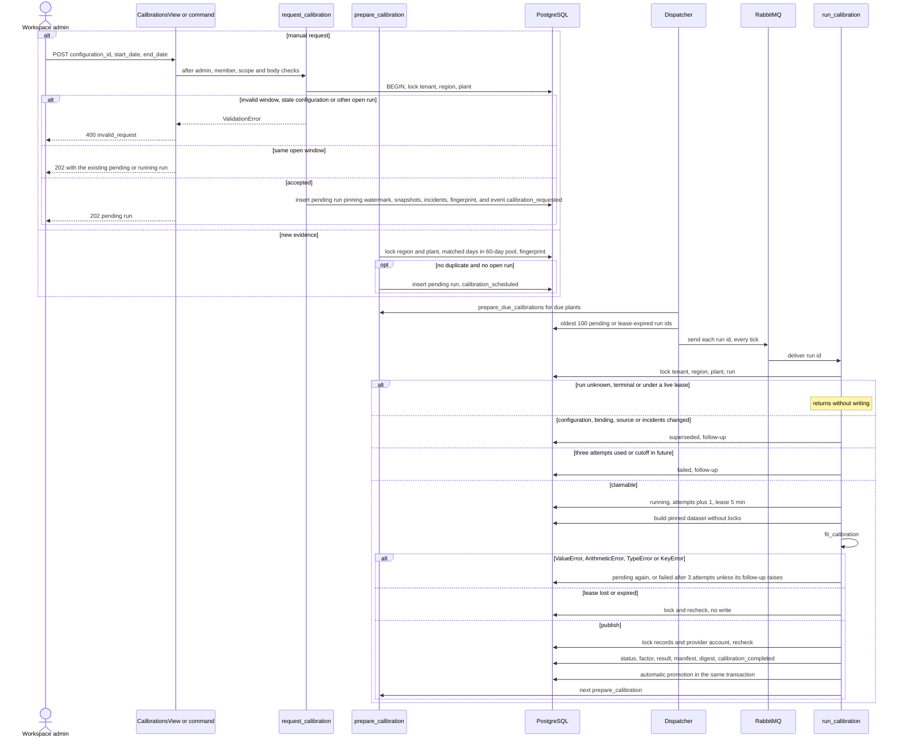

# Prepare or request a calibration run and fit it in a worker

New evidence (production writes, EPİAŞ and estimated-actual acquisitions, historical imports, incident revisions, automation checks, finished runs) makes `prepare_calibration` create a pending `CalibrationRun` pinned to its inputs; a workspace administrator can also request one by API or command. The dispatcher's `calibration` phase first runs the due automation checks, then publishes up to 100 pending or lease-expired runs per tick, and the `calibrate_plant` actor claims a five-minute lease, rebuilds the pinned dataset, fits one factor and stores `ready`, `rejected`, `insufficient`, `failed` or `superseded`. Manual activation is the separate flow `calibration-activation`; automatic promotion runs inside the worker's terminal transaction.

## Entry points

- Screen: none creates a run. `Calibrations` (`web/src/components/calibrations.tsx`) polls `GET .../calibrations/` every 30 s and shows each run's status through `Common.statuses`; it posts only activate and reset.
- `POST /api/tenants/{t}/regions/{r}/plants/{p}/calibrations/` -> `CalibrationsView.post` (`src/pyracast/plants/api.py`) with `CalibrationInput` (`plants/serializers.py`) -> `request_calibration` (`plants/operations.py`); 202 `CalibrationOutput`. No caller in `web/`.
- Command `calibrate_plant --username --plant-id --configuration-id --start-date --end-date [--run]` (`plants/management/commands/calibrate_plant.py`): same operation; `--run` calls `run_calibration` in-process, without RabbitMQ.
- `prepare_calibration` (`plants/preparation.py`) callers: `import_observations` (`plants/operations.py`), `change_production` (`plants/production_changes.py`), EPİAŞ `_publish` unless the job was superseded (`metering/jobs.py`), `publish` of a succeeded `estimated_actuals` job (`forecasts/jobs.py`), `_prepare_region_calibrations` after the import commits (`forecasts/historical_import.py`), `incidents_changed` (`plants/incident_policy.py`), `set_calibration_automation` and `prepare_due_calibrations` (`plants/automation.py`, flow `calibration-automation`), and `_prepare_followup` (`plants/training.py`).
- Dispatcher phase `calibration` (`forecasts/management/commands/dispatch.py`, third of five) -> `dispatch_calibrations` (`plants/runtime.py`): `prepare_due_calibrations`, then `pending_calibration_ids` (oldest 100, live plants and regions only) and `actor.send` for each id.
- Actor `calibrate_plant`, queue `calibration`, `max_retries=0` (`make_calibration_actor`) -> `deliver_calibration` -> `run_calibration`; consumed by `worker` (default queues `default calibration epias`, as in `deploy/compose.yaml`).

## Sequence

## Data

| Table | R/W | What |
| --- | --- | --- |
| `plants_calibrationrun` | R/W | Pending row pins window, `cutoff_at`, `observation_id_cutoff`, production and reference snapshot ids, `incident_revision_ids`, `input_fingerprint`, `comparison_activation`; worker writes lease, `attempts`, `status`, `assessment`, `factor`, `result`, `dataset_manifest`, `dataset_sha256`, `last_error`, `completed_at` |
| `accounts_tenant`, `regions_region`, `plants_plant` | R | Row locks; `binding_is_current` reads region status, revision and approved binding. The due check of `calibration-automation` writes `plants_plant.next_calibration_check_at` in the same phase |
| `accounts_membership`, `auth_user` | R | Administrator role for API, command and operation; `requested_by` of automatic runs |
| `plants_plantconfiguration`, `connections_sitebinding`, `connections_provideraccount` | R | Current configuration, timezone, capacities, account state; account row locked at publication |
| `plants_productionobservation` | R | Manual heads up to the watermark and cutoff |
| `metering_epiasconnection`, `metering_epiassnapshot`, `metering_epiascollectionjob` | R | Provider production and its identity |
| `forecasts_forecastsnapshot`, `forecasts_collectionjob`, `forecasts_historicalreferenceimport`, `forecasts_referencecapacitynormalization` | R | Archived estimated actuals pinned per day and their provenance |
| `incidents_incidentrevision` | R | Latest revisions overlapping the window, joined through `incidents_plantincident` |
| `plants_calibrationactivation` | R | Incumbent pinned at creation; automatic promotion writes here (flow `calibration-automation`) |
| `plants_plantevent` | W | `calibration_requested`, `calibration_scheduled`; `calibration_completed` only from publication, not for runs ended at claim or by `_fail`; promotion adds its own events |
| `forecasts_dispatcherstatus` | W | Outcome of the `calibration` phase per tick |

## Authorization

- View, in order: REST defaults `IsAuthenticated` and `WorkspaceWritePermission` (active member with role admin for unsafe methods), session authentication with CSRF; `ScopedView.scope` then runs `require_member` and returns 404 for a region or plant outside the tenant or in the trash; only then is the body validated.
- Operation: `require_workspace_admin` locks the tenant row and rechecks the admin role inside the `request_calibration` transaction. The command resolves `--username` and relies on this check alone.
- System: preparation and worker check no actor. Automatic runs record `requested_by` as the recorder of the latest observation or the EPİAŞ connector. The due check prepares only while the administrator who enabled automation is still an active admin, and promotion rechecks that under lock (flow `calibration-automation`).
- Database: partial unique `plant_one_pending_calibration`; checks `calibration_window_valid`, `calibration_factor_finite`, `calibration_status_valid`.

## Failure paths

| Condition | Result |
| --- | --- |
| Anonymous, missing CSRF, viewer or non-member; admin role lost before the tenant lock | 403 `http_403` |
| Region or plant missing, foreign or trashed | 404 `http_404` from the view; 404 `not_found` if it is trashed between the view check and the operation lock |
| Body fails `CalibrationInput` (missing or unknown field, bad date, id below 1) | 400 `http_400` with field errors |
| No current configuration; binding not current | 400 `invalid_request` with the `configuration_unavailable` sentence from `VALIDATION_DETAILS`; "The plant configuration is no longer current." |
| `configuration_id` not current; not 7 to 90 days or end not before local today | 400 "Calibration requires the current configuration."; "Use 7 to 90 completed local days." |
| Another pending or running run with a different window | 400 "A calibration is already pending." (same window: 202 with that run, whatever its open status) |
| Lock wait over 5 s (`lock_timeout`) | 503 `workspace_busy`, `Retry-After: 1` |
| Command: `ValueError`, `ObjectDoesNotExist`, `PermissionDenied` or `ValidationError` | `CommandError` "Calibration failed: invalid input, access, or record."; any other exception, such as a lock timeout, is not caught |
| `prepare_due_calibrations`, the id query or `actor.send` raises | `dispatch_calibrations` stops, remaining ids are not sent this tick; phase logged as `dispatch_phase_failed` and stored in `forecasts_dispatcherstatus`; other phases continue |
| Duplicate delivery (run unknown, terminal or under a live lease); lease expired or taken over before publication | Nothing written; a lease lost at publication or failure logs `calibration_lease_lost run=<id>`; an expired `running` run is resent by a later dispatch |
| Configuration, binding, source identity or incidents changed | `superseded` at claim or publication |
| Three attempts already used when claimed, or `cutoff_at` after worker time | `failed`, `attempt_limit` or `invalid_cutoff`; logged as `calibration_run_failed run=<id> reason=<code>` |
| Build, fit or publication (including follow-up) raises `ValueError`, `ArithmeticError`, `TypeError`, `KeyError` | `calibration_attempt_failed run=<id> attempt=<n> error_type=<class> origin=<module>:<line>:<function>` is logged without the exception message; `pending` with `invalid_calibration_data`; `failed` on attempt 3, unless the follow-up run by `_fail` raises: that rolls back too, the error escapes the actor and the run stays `running` until its lease expires; the next claim then ends it `failed` `attempt_limit`, with the same follow-up |
| Fewer than 7 matched days or too little training support; fit misses acceptance guards | `insufficient`; `rejected` with `result.reasons` |
| Other exception in the worker, such as a lock timeout | Actor raises, no Dramatiq retry; a pending run is resent next tick, a claimed run after its lease expires |

## Rules and invariants

- Lock order is tenant, region, plant, run, then provider account at publication; `prepare_calibration` itself takes region and plant. Every writer of a run (creators, worker, bulk supersede, `incidents_changed`) holds the plant lock; creators check for an open run and the partial unique index backs it.
- Automatic preparation skips when a run is open, or when a run for the same configuration, comparison activation (or the active run itself) and incident set, on `POLICY_VERSION` or failed, covers the matched days with the same fingerprint. Its window is the matched days inside 60 local days ending on the latest measured day before local today. Manual requests take 7 to 90 completed local days, skip the fingerprint check and are deduplicated only against an identical open window.
- Lease 5 minutes, at most 3 attempts counted at claim, including leases lost without an error. The dispatcher marks nothing as sent, so each tick it resends every run without a live lease (oldest 100); duplicate deliveries end at claim.
- Dataset build and fitting run outside any transaction and call no provider; each finished fit logs `calibration_fit_completed run=<id> seconds=<n>` (timing stays out of `result`); publication adds elapsed lock wait to `now` and rechecks lease token, expiry, configuration, binding, source identity and incidents.
- Each terminal transition made by the worker (`_claim`, `_publish`, `_fail` on the last attempt) runs `_prepare_followup` in the same transaction: automatic promotion, then the next `prepare_calibration`. An exception there rolls back the transition and the stored result.
- Configuration revisions (`_save_configuration`) and trashing (`_cancel_calibrations` in `pyracast/trash.py`) supersede open runs in bulk without follow-up; incident revisions supersede only runs whose incident set changed, then prepare again. Fitting policy (`regularized-huber-v7`, holdout split, acceptance guards) is in `docs/IRRADIANCE.md`.

## Tests

- Operation and worker: `tests/test_plant_operations.py` (`test_calibration_request_bounds_dedup_and_validation`), `tests/test_calibration_preparation.py` (deduplication, 60-day pool, follow-up, concurrent preparation), `tests/test_plant_training.py` (lease recovery, revalidation, bounded retries, concurrent delivery), `tests/test_incident_calibration.py`, `tests/test_settlement_calibration.py`, `tests/test_provisional_calibration.py`, `tests/test_archived_actual_calibration.py`, `tests/test_reference_cohorts.py`, `tests/test_calibration_identity_recovery.py`, `tests/test_calibration_source_validation.py`.
- Runtime: `tests/test_calibration_runtime.py` (double dispatch completes once on a `StubBroker`; live RabbitMQ only with `PYRACAST_LIVE_QUEUE=1`), `tests/test_runtime.py` and `tests/test_dispatch_resilience.py` (phase and queue wiring with `dispatch_calibrations` mocked), `tests/test_trash_boundaries.py` (trashed plant prepares nothing, purged run id is ignored).
- Boundaries: `tests/test_plant_api.py` (`test_calibration_pending_forecast_and_csrf`: the 202 only), `tests/test_workspace_authorization.py` (viewer 403 on the POST, operation denied), `tests/test_plant_commands.py` (bad date, pending, `--run`). Playwright: `web/tests/calibrations.spec.ts` covers listing and activation with a mocked API; no UI creates a run.
- Gaps: no HTTP test for the 400 messages, 503 or CSRF on this POST; the operation test asserts only the exception type; no test that a failing follow-up or promotion discards a finished fit or a claim-time transition; no test of `last_error` for `invalid_cutoff` or `attempt_limit`; no test that a failing due check suppresses publication.
