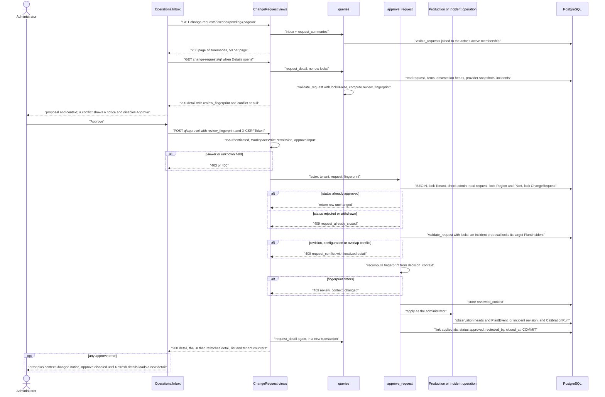

# Administrator reviews the change-request inbox

The workspace administrator opens the Inbox, lists pending, decided or own change requests and opens one to compare the member's proposal with its review context: for production the current effective and provider values of each interval, for an outage the incident revision the proposal was based on. Approval revalidates the request under locks, requires the review fingerprint returned with the detail and applies the change through the same production or incident operation used for direct edits; rejection requires a reason. Members see only their own requests on the same screen (withdraw and mark-seen belong to `change-request-submission`).

## Entry points

- `web/src/components/dashboard.tsx` `Workspace` (under the exported `Dashboard`) shows the Inbox nav item to every member with a badge of `pending_review_count` (admin only) plus `unread_outcome_count` from `GET /api/tenants/` (`pyracast.api.views.TenantsView`, polled every 30 s) and renders `web/src/components/operational-inbox.tsx` `OperationalInbox` inside the `ChangeRequestUpdates` context that re-fetches those counters after each action.
- `OperationalInbox` -> `InboxPage` -> `RequestDetail` (with `ProductionProposal`, `IncidentProposal`). Admins pick scope `pending`, `history` or `mine`; members are forced to `mine`. The inbox remounts when the tenant or the role changes.
- `GET /api/tenants/{t}/change-requests/?scope=&page=` -> `pyracast.change_requests.api.InboxView` (`queries.inbox`, `queries.request_summaries`), polled every 30 s. The optional `plant_id` filter is sent only by `OwnPendingRequests` (`change-request-submission`).
- `GET /api/tenants/{t}/change-requests/{q}/` -> `DetailView` (`queries.request_detail`), fetched when Details opens and on "Refresh details"; not polled.
- `POST .../{q}/approve/ {review_fingerprint}` -> `ApproveView` (`operations.approve_request`). Actor: workspace administrator.
- `POST .../{q}/reject/ {reason}` -> `RejectView` (`operations.reject_request`). Actor: workspace administrator.
- No command, script or Dramatiq job. Approval can insert a pending `CalibrationRun` that the dispatcher's `calibration` phase (`pyracast.plants.runtime.dispatch_calibrations`) later sends to the `calibrate_plant` actor.

## Sequence

Rejection takes the Tenant, Region, Plant and ChangeRequest locks and the same status checks, stores `reviewed_context`, then closes with `decision_reason`; it does not validate the proposal or the fingerprint.

## Data

| Table | R/W | What |
| --- | --- | --- |
| `accounts_tenant` | R (lock on decisions) | Row lock serializes the decision with administrator transfers |
| `accounts_membership`, `auth_user` | R | Actor role and `is_active`; proposer and reviewer names; whether the proposer is still a member (`former_member`) |
| `regions_region`, `plants_plant` | R (lock on decisions) | Scope, trash state, `current_configuration` |
| `plants_plantconfiguration`, `connections_sitebinding`, `connections_provideraccount` | R | Production: pinned configuration must still be current (the plant's current one, binding approved for the region revision, provider account enabled and authorized); binding timezone. Outage create or update: pinned id must equal the plant's current configuration, or the declared one of an ended target; resolve and cancel check no configuration, binding or provider |
| `change_requests_changerequest` | R/W | Status, `reviewed_by`, `closed_at`, `decision_reason`, `outcome_seen_at`, `reviewed_context` |
| `change_requests_productionchangeitem` | R/W | Proposed intervals; `applied_observation` set on approval |
| `change_requests_incidentchange` | R/W | Proposed incident action and values; `applied_revision` set on approval |
| `plants_productionobservation` | R/W | Current heads for context; approval supersedes heads and inserts new revisions |
| `metering_epiasconnection`, `metering_epiassnapshot`, `metering_epiascollectionjob` | R | Snapshots of the enabled connection give `automatic` and `provider_intervals` |
| `incidents_plantincident`, `incidents_incidentrevision` | R/W | Target, baseline revision (`before`) and overlapping incidents; outage overlay on production values; approval saves the incident and a revision |
| `plants_plantevent` | W | `production_changed` on production approval, `calibration_scheduled` when a run is created |
| `plants_calibrationrun` | R/W | Pending or running runs superseded when incidents change; new pending run prepared (`prepare_calibration` also reads `plants_calibrationactivation` and forecast reference data, see `calibration-automation`) |

## Authorization

- Session authentication for every endpoint (`settings.REST_FRAMEWORK`); DRF enforces CSRF on the POSTs of a signed-in session.
- Approve and reject inherit the default `pyracast.api.permissions.WorkspaceWritePermission` (active admin membership, checked before the body is validated); GETs pass it as safe methods.
- Operations re-check: `pyracast.accounts.operations.require_workspace_admin` under the tenant lock for decisions (again inside `change_production`, `save_incident`, `finish_incident`); `workspace_membership` for reads.
- Row scope in `operations.visible_requests`: the request's plant must belong to the tenant, plant and region not trashed, and the joined membership must be the actor's active one; admins see every request, others only rows where both `proposed_by` and `proposer_membership_id` match the current membership, so a rejoined user does not regain old requests.
- `inbox`, `request_detail` and `request_summaries` re-filter by ownership for non-admins. Platform staff status grants nothing here.

## Failure paths

| Condition | Result |
| --- | --- |
| Not signed in, or POST without a valid CSRF token | 403 `http_403` |
| Not a member of the tenant (GET) | 403 `http_403` "Tenant membership required." (not translated) |
| Viewer, non-member or platform staff posts approve or reject | 403 `http_403` "Workspace administrator required." |
| Request in another tenant, another member's request, trashed plant or region | 404 `not_found` |
| `page` past the last page or not a number | 404 `http_404` "Invalid page."; the pager stays, so Previous works |
| Unknown query or body field, bad `scope`, `plant_id` below 1, missing or over-long `review_fingerprint`, blank or over-long reject reason | 400 `http_400` |
| Same decision repeated | 200 with the existing outcome; the fingerprint is not rechecked and a new rejection reason is ignored |
| Opposite decision or withdrawn request | 409 `request_already_closed` |
| Production head or incident revision changed, configuration no longer current, overlap, target incident cancelled, resolve of an already ended incident (update and cancel of an ended incident are allowed) | 409 `request_conflict` with localized detail; request stays pending |
| Review values or heads changed since the detail was read | 409 `review_context_changed` |
| Lock wait over `lock_timeout` 5 s | 503 `workspace_busy`, `Retry-After: 1` |
| Access lost or plant trashed between the commit and the response re-read | 403 or 404 although the decision is committed |
| Pending request currently invalid (detail read) | 200 with `conflict.code = request_conflict`; Approve disabled |

## Rules and invariants

- Lock order for decisions: Tenant, Region, Plant, ChangeRequest; approving an update, resolve or cancel proposal then locks the target `PlantIncident`. Inner operations re-acquire the same locks re-entrantly. A failed approval rolls back everything, including the stored `reviewed_context`.
- Fingerprint is `"v1:" + sha256` of canonical JSON (`preparation.digest`) over `review_context`: request id, payload hash, plant's current configuration id, and either per-interval bounds, `current`, `automatic`, `provider_intervals`, `warnings` plus the ids of overlapping current observation heads, or `(id, revision)` of the target incident and, for create and update, of every overlapping non-cancelled incident. Provider snapshot ids are excluded, so an unchanged reacquisition keeps the fingerprint.
- Decisions are idempotent per outcome. Status moves only from `pending` to `approved` or `rejected` (here) or `withdrawn` (proposer); the check constraint `change_request_review_state` pins which fields each status may set.
- `reviewed_context` (version 1) freezes the decision-time view; approved and rejected production details are rendered from it, not from live data (pending and withdrawn ones are computed live).
- Approval runs as the administrator: new observations and incident revisions record the admin, while the request keeps the proposer. Unchanged production values reuse the existing head as `applied_observation`. When the deciding admin is also the proposer, `outcome_seen_at` is set at close, so no unread badge appears.
- The detail never takes row locks; its conflict check can be stale by the time Approve is pressed, which the locked revalidation and fingerprint check catch.

## Tests

- `tests/test_change_requests.py`: review values and frozen approval, revert proposals, half-hour provider evidence, fingerprint stability, derived conflicts, rollback on failed approval, inbox filter validation, ownership recheck.
- `tests/test_change_request_boundaries.py`: role and tenant isolation, opposite decisions, rejoined proposer, admin transfer, deactivated user, tenant badge counters, cross-tenant ids for every endpoint.
- `tests/test_change_request_concurrency.py`: real PostgreSQL threads for concurrent approvals, lock winners, direct writes versus waiting approval, member removal and admin transfer versus waiting approval, provider publication versus waiting review and versus an unlocked detail read.
- `tests/test_change_request_contracts.py`: localized conflict detail, approve and reject over HTTP with a repeated rejection and the `history` and `plant_id` filters, compiled Turkish text, frozen rejected history, query count. Its reason-limit and anonymous-actor tests exercise submission, not review.
- Playwright `web/tests/change-requests.spec.ts` (mocked API): mobile review where a 409 approve blocks until Refresh details, paging and required rejection reason, role changes clearing controls, last-page navigation including the 404 page.
- Gaps: no Playwright test against the real backend (`web/integration` does not cover the inbox); the 503 `workspace_busy` mapping is pinned only generically in `tests/test_api_contention.py`, not through these views; no UI test distinguishing a 503 `workspace_busy` approve error from a stale context; no test for the `ObjectDoesNotExist` branch of the detail conflict text; no backend test posts a blank or over-long rejection reason or a missing fingerprint.
