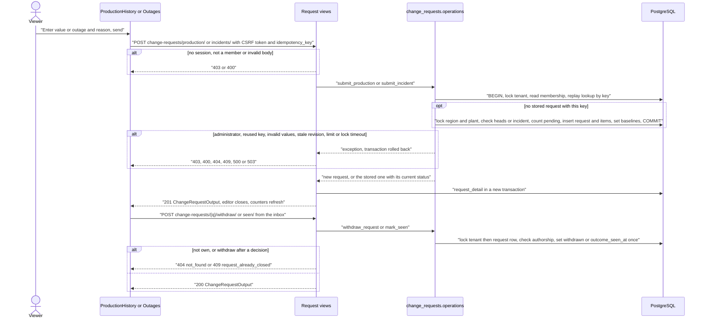

# Viewer proposes a production or outage change and follows its outcome

A workspace viewer cannot write production or outage data directly. Instead the viewer posts an idempotent change request (one production correction, or an outage create, update, resolve or cancel) with a reason. It stays `pending` and changes no calculation input until an administrator decides (`change-request-review`). The viewer sees pending requests per plant, can withdraw one, and marks an approved or rejected outcome as seen to clear the unread counter.

## Entry points

- `web/src/components/production-history.tsx` `ProductionHistory.save`, viewer branch (role from `useCanManageWorkspace`, rows gated by `can_propose` and `can_propose_revert`), one interval per request; `web/src/components/outages.tsx` `Outages.propose` (create, update, resolve, cancel) and `ProposalReason`.
- `web/src/components/change-request-updates.tsx` `useProposalKey` (one `crypto.randomUUID()` per payload JSON), the `ChangeRequestUpdates` context that `dashboard.tsx` fills with a callback bumping its `/api/tenants/` refetch, and `useChangeRequestUpdates`, through which `ProductionHistory`, `Outages` and `RequestDetail` call that callback after a successful submit, withdraw or seen; `web/src/components/operational-inbox.tsx` `OwnPendingRequests` (per-plant count on the Production and Outages tabs, 30 s poll) and `RequestDetail` (Withdraw, Mark as read; viewers only get scope `mine`).
- `POST /api/tenants/{t}/regions/{r}/plants/{p}/change-requests/production/` -> `pyracast.change_requests.api.ProductionRequestsView`; `.../incidents/` -> `IncidentRequestsView` (routed in `pyracast.plants.urls`). Operations `submit_production`, `submit_incident`. `POST /api/tenants/{t}/change-requests/{q}/withdraw/` -> `WithdrawView`; `.../seen/` -> `SeenView` (`pyracast.change_requests.urls`; `withdraw_request`, `mark_seen`). Actor: viewer. No command, job, email or external call.

## Sequence

## Data

| Table | R/W | What |
| --- | --- | --- |
| `change_requests_changerequest` | R/W | Insert `pending` row with `proposer_membership_id`, `idempotency_key`, `payload_sha256`; withdraw and seen update it; replay, limit count and visibility read it |
| `change_requests_productionchangeitem` | R/W | One row per interval (normalized MWh, pinned `expected_head`), then baseline columns updated |
| `change_requests_incidentchange` | R/W | One row: action, target incident, `expected_revision`, proposed values or `ends_at`; read back by `request_detail` for the response and its pending validation |
| `accounts_tenant`, `regions_region`, `plants_plant` | R (`FOR UPDATE`) | Locked in that order by `workspace_membership(lock=True)`, `lock_production_configuration` or `lock_incident_plant` |
| `accounts_membership` | R | Role, active user; its pk is the proposer identity |
| `plants_plantconfiguration`, `connections_sitebinding`, `connections_provideraccount` | R | Production only: configuration must be current (plant current, binding approved, provider account enabled and authorized). Outages pin the plant's current configuration (create, update of an open incident) or keep the incident's declared one (update of an ended incident, resolve, cancel), with no binding or provider check |
| `plants_productionobservation`, `metering_epiasconnection`, `metering_epiassnapshot`, `incidents_plantincident`, `incidents_incidentrevision` | R | Heads, provider and effective values for baseline and response; incident target locked and overlap-checked |

## Authorization

- Authentication: `SessionAuthentication` with CSRF plus `IsAuthenticated` (`REST_FRAMEWORK` in `settings.py`). View: `WorkspaceMemberWritePermission` replaces the default admin-only `WorkspaceWritePermission` and admits any active member of `tenant_id`, administrators included.
- Operation: `require_workspace_member` locks the tenant and rejects every role except viewer; the only block on administrators, run after serializer validation. Withdraw and seen use `workspace_membership(lock=True)` (any role), `visible_requests`, then both `proposed_by_id` and `proposer_membership_id` must match, else 404 (also for administrators).
- Database: unique `(proposer_membership_id, idempotency_key)`, `change_request_review_state` and item check constraints. `proposer_membership_id` is a plain integer, not a foreign key.

## Failure paths

| Condition | Result |
| --- | --- |
| No session, wrong CSRF token, non-member | 403 `http_403` |
| Workspace administrator submits a valid body | 403 `http_403` "Workspace members submit requests; administrators edit directly." |
| Unknown field, bad type, blank or over-500 reason (trimmed), over 100 intervals | 400 `http_400` with field errors |
| Operation rules (interval not completed or aligned, overlap, over 31 local days, production configuration or binding not current, revert without manual value, incident fields) | 400 `invalid_request` |
| Region, plant, configuration or incident missing, trashed or elsewhere; request not own or plant trashed | 404 `not_found` |
| Same key with another payload / 20 pending on this plant / withdraw after a decision | 409 `idempotency_key_reused` / `pending_request_limit` / `request_already_closed` |
| Stale incident `expected_revision` | 409 `http_409` |
| Stale production `expected_revision_id` | 409 `production_revision_conflict` with localized `detail`; no request row is stored |
| Lock wait over 5 s | 503 `workspace_busy`, `Retry-After: 1` |

## Rules and invariants

- Lock order Tenant, Region, Plant; withdraw and seen lock Tenant then the request row. The replay lookup precedes the plant lock, the pending count follows it. Idempotency scope is membership plus key across plants. The production digest hashes plant, region, configuration, unit, changes and stripped reason; the incident digest hashes plant, region, action, incident, expected revision, values, `ends_at` and reason. Any stored request, even a terminal one, replays as 201 with its current status. The browser keeps one key per payload JSON and resets it on success, on production cancel and when an outage create, update or resolve form opens.
- Production requests take 1 to 100 intervals (direct writes 2,000), follow the direct-write interval and head-revision rules, store energy as MWh and pin each target head. At most 20 pending per membership and plant. Production reason required (1 to 500), outage reason optional.
- Authority follows the membership row id: a removed and re-invited viewer loses old requests; an administrator transfer keeps the id, so a promoted author can still withdraw.
- `unread` means own, approved or rejected, `outcome_seen_at` empty; GET never marks it, `seen` on a pending or withdrawn request is a 200 no-op, and a withdrawn request cannot carry `outcome_seen_at` (check constraint).

## Tests

- `tests/test_change_request_boundaries.py` (API submit and withdraw, seen receipt, replay, removed proposer, tenant isolation, operation-level admin refusal), `tests/test_change_request_concurrency.py` (shared key, last pending slot, membership removed while waiting), `tests/test_change_request_contracts.py` (reason and interval limits, incident fields, incident replay, admin cannot withdraw or mark another's request, withdraw retry, anonymous permission), `tests/test_change_requests.py` (invalid numbers, pending requests absent from measurements, capability flags, trash and purge, calculation isolation).
- `web/tests/change-requests.spec.ts`: viewer production proposals with 503 retry and stable key at 320 px, outage proposal envelopes, withdraw and mark-read in Turkish; every API call is mocked with `page.route`.
- Gaps: no test for the HTTP mapping of administrator refusal, `idempotency_key_reused`, `pending_request_limit`, `request_already_closed` or a stale incident revision; no Playwright run against the real backend.
