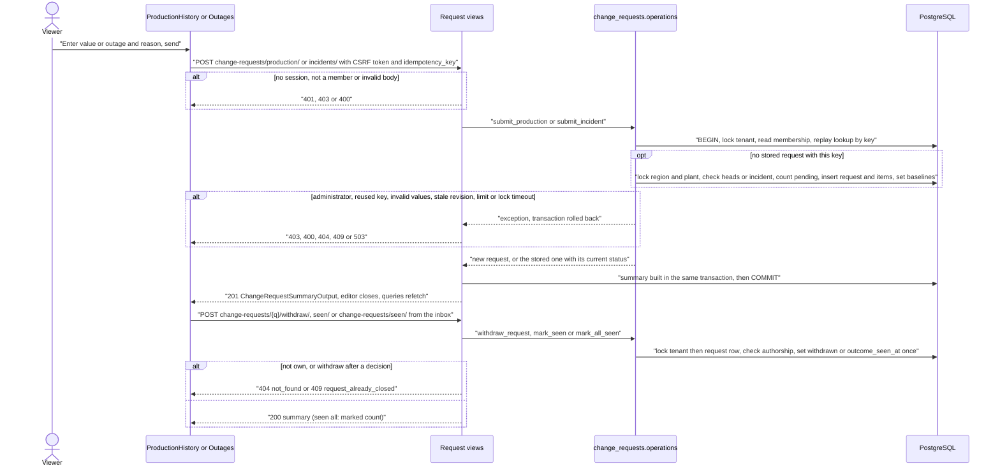

# Viewer proposes a production or outage change and follows its outcome

A workspace viewer cannot write production or outage data directly. Instead the viewer posts an idempotent change request (one production correction, or an outage create, update, resolve or cancel) with a reason. It stays `pending` and changes no calculation input until an administrator decides (`change-request-review`). The viewer sees pending requests per plant, can withdraw one, and marks an approved or rejected outcome as seen, one by one or all at once, to clear the unread counter.

## Entry points

- `web/src/features/production/production-history.tsx` `ProductionHistory.save`, viewer branch (role from `useCanManageWorkspace`; each row says through `can_propose`, `can_propose_revert` and `proposal_unavailable_reason` whether it can be proposed, and a member sees one notice when nothing on the day can), one interval per request, form `features/production/history/interval-editor.tsx` `IntervalEditor`. `web/src/features/plant/outages.tsx` `Outages` with `features/plant/outage/model.ts` `submitOutageChange` (create, update, resolve, cancel).
- `web/src/lib/idempotency.ts` `useProposalKey`: one `crypto.randomUUID()` per payload JSON. After a submit the callers refetch the workspace queries (`useRefresh().workspace`), which includes the tenant counters. `web/src/features/inbox/operational-inbox.tsx` `OwnPendingRequests` (per-plant notice on the Production and Outages tabs, polled every 120 s), `RequestDetail` (Withdraw, Mark as read) and the Mark all read button (viewers only get scope `mine`).
- `POST /api/tenants/{t}/regions/{r}/plants/{p}/change-requests/production/` -> `pyracast.change_requests.api.ProductionRequestsView`; `.../incidents/` -> `IncidentRequestsView` (routed in `pyracast.plants.urls`). Operations `submit_production`, `submit_incident`. `POST /api/tenants/{t}/change-requests/{q}/withdraw/` -> `WithdrawView`; `.../{q}/seen/` -> `SeenView`; `.../change-requests/seen/` -> `SeenAllView` (`pyracast.change_requests.urls`; `withdraw_request`, `mark_seen`, `mark_all_seen`). All are member routes of the route policy. Actor: viewer. No command, job, email or external call.

## Sequence

## Data

| Table | R/W | What |
| --- | --- | --- |
| `change_requests_changerequest` | R/W | Insert `pending` row with `proposer_membership_id`, `idempotency_key`, `payload_sha256`; withdraw and seen update it; replay, limit count, visibility and counters read it |
| `change_requests_productionchangeitem` | R/W | One row per interval (normalized MWh, pinned `expected_head`), then baseline columns updated; `baseline_source_kind` is `manual`, `realtime_generation`, `settlement_injection` or empty |
| `change_requests_incidentchange` | R/W | One row: action, target incident, `expected_revision`, proposed values or `ends_at`; read back for the response and its pending validation |
| `accounts_tenant`, `regions_region`, `plants_plant` | R (`FOR UPDATE`) | Locked in that order by `tenant_membership(lock=True)`, `lock_production_configuration` or `lock_incident_plant` |
| `accounts_membership` | R | Role, active user; its pk is the proposer identity |
| `plants_plantconfiguration`, `connections_sitebinding`, `connections_provideraccount` | R | Production only: configuration must be current (plant current, region approved, binding approved for the region revision, provider account enabled and authorized). Outage create pins the plant's current configuration; update pins it unless the proposed values end the outage, then the incident's declared one; resolve and cancel keep the declared one; no binding or provider check |
| `plants_productionobservation`, `metering_epiasconnection`, `metering_epiassnapshot`, `incidents_plantincident`, `incidents_incidentrevision` | R | Heads, provider and effective values for baseline and response; incident target locked and overlap-checked |

## Authorization

- Authentication: `SessionAuthentication` with CSRF plus `RoutePolicy` (`REST_FRAMEWORK` in `settings.py`). Route: `MEMBER` admits any active member of `tenant_id`, administrators included; production proposals are throttled under `production_import` (120 an hour per user), outage proposals under `submission` (30 an hour).
- Operation: `tenant_membership(role=viewer, lock=True)` locks the tenant and rejects every other role with `admin_edits_directly`; it runs after serializer validation, so it is the only block on administrators. Withdraw, seen and seen-all use `tenant_membership(lock=True)` (any role), `visible_requests`, then both `proposed_by_id` and `proposer_membership_id` must match, else 404 (also for administrators).
- Database: unique `changerequest_idempotency_key_uniq` on (`proposer_membership_id`, `idempotency_key`), `changerequest_review_chk`, `changerequest_decision_reason_chk`, `productionchangeitem_*` and `incidentchange_*` checks. `proposer_membership_id` is a plain integer, not a foreign key.

## Failure paths

| Condition | Result |
| --- | --- |
| No session | 401 `not_authenticated` with `WWW-Authenticate: Session` |
| Wrong CSRF token | 403 `csrf_failed` |
| Non-member | 403 `membership_required` |
| Workspace administrator submits a valid body | 403 `admin_edits_directly`, "Workspace members submit requests; administrators edit directly." |
| Unknown field, bad type, blank or over-500 reason (trimmed), no interval or over 100 intervals | 400 `invalid_request` with field errors |
| Operation rules (interval not completed or aligned, overlap, over 31 local days, production configuration or binding not current, revert without manual value, incident fields) | 400 `invalid_request`, or the incident code (`incident_overlap`, `incident_starts_in_future`, `incident_closed`, ...) |
| Region, plant, configuration or incident missing, trashed or elsewhere; request not own or its location trashed | 404 `not_found` |
| Same key with another payload / 20 pending on this plant / withdraw after a decision | 409 `idempotency_key_reused` / `pending_request_limit` / `request_already_closed` |
| Stale incident `expected_revision` | 409 `incident_revision_changed` with the `current` incident |
| Stale production `expected_revision_id` | 409 `production_revision_changed`; no request row is stored |
| Throttle used up | 429 `throttled` |
| Lock wait over 5 s / same session still running | 503 `busy`, `Retry-After: 1` / 429 `session_busy` |

## Rules and invariants

- Lock order Tenant, Region, Plant; withdraw, seen and seen-all lock Tenant then the request row. The replay lookup precedes the plant lock, the pending count follows it. Idempotency scope is membership plus key across plants. The production digest hashes plant, region, configuration, unit, changes and stripped reason; the incident digest hashes plant, region, action, incident, expected revision, values, `ends_at` and reason. Any stored request, even a terminal one, replays as 201 with its current status. The summary is built inside the action's transaction, so a replay after the location was trashed returns the stored summary. The browser keeps one key per payload JSON and resets it on success, on production cancel and when an outage create, update or resolve form opens.
- Production requests take 1 to 100 intervals (direct writes 2,000; the screen sends one), follow the direct-write interval and head-revision rules, store energy as MWh and pin each target head. At most 20 pending per membership and plant (`PENDING_LIMIT` in `change_requests.policy`). Production reason required (1 to 500), outage reason optional.
- Authority follows the membership row id: a removed and re-invited viewer loses old requests; an administrator transfer keeps the id, so a promoted author can still withdraw.
- `unread` means own, approved or rejected, `outcome_seen_at` empty; GET never marks it, `seen` on a pending or withdrawn request is a 200 no-op, seen-all marks only the actor's own unread requests, and a withdrawn request cannot carry `outcome_seen_at` (check constraint).

## Tests

- `tests/test_change_request_boundaries.py` (API submit and withdraw, seen receipt, replay, removed proposer, tenant isolation), `tests/test_change_request_policy.py` (summary answers, replay after trash, a day of intervals inside the quota, visibility and unread rules), `tests/test_change_request_concurrency.py` (shared key, last pending slot, membership removed while waiting), `tests/test_change_request_contracts.py` (reason and interval limits, incident fields, incident replay, administrator cannot withdraw or mark another's request, withdraw retry), `tests/test_change_requests.py` (invalid numbers, stale production revision, pending requests absent from measurements, capability flags, trash and purge, calculation isolation), `tests/test_mark_all_read.py`, `tests/test_change_request_constraints.py`.
- `web/tests/change-requests.spec.ts`: viewer production proposals with 503 retry and stable key at 320 px, outage proposal envelopes, why an interval cannot be proposed, withdraw and mark-read (one and all) in Turkish; every API call is mocked with `page.route`.
- Gaps: no HTTP test of the administrator refusal, `idempotency_key_reused` or `request_already_closed` on these routes (the code mappings are pinned in `tests/test_error_contract.py`), or of a stale incident revision on the proposal route; no Playwright run against the real backend.
