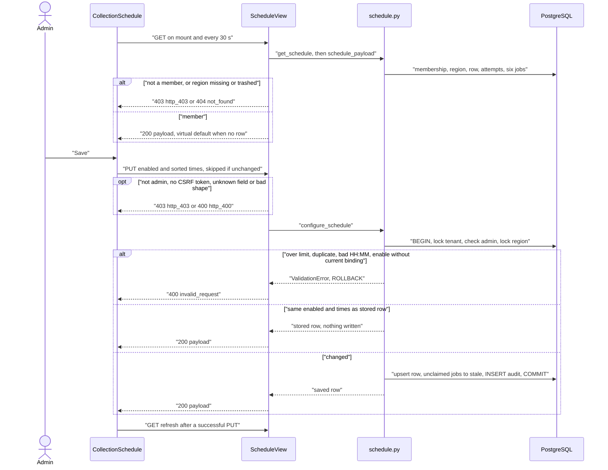

# Configure forecast collection times for a site

Any member of a workspace opens a plant's Settings, Data collection tab, to read the region's forecast times, the shared provider account's UTC budget and the six newest collection jobs. A workspace administrator replaces the enabled flag and the region-local `HH:MM` times. The save cancels unclaimed jobs that no longer match and writes one audit event, and the dispatcher and workers apply the new schedule on their next pass.

## Entry points

- Screen: `web/src/components/collection-schedule.tsx` `CollectionSchedule` (loads on mount, polls every 30 s) and `ScheduleEditor`, mounted by `plant-workspace.tsx` `PlantWorkspace` for `settingsView === "collection"`. The form is `ui.tsx` `ActionForm`, read-only unless the tenant role is `admin`.
- `GET|PUT /api/tenants/{t}/regions/{r}/collection-schedule/` -> `pyracast.forecasts.views.CollectionScheduleView` -> `schedule.get_schedule` or `schedule.configure_schedule`, then `schedule_payload`. GET: any member. PUT: workspace administrator.
- Other users of the row: writers `trash.restore_region` (creates the default, resets `effective_from`) and `trash._purge_region`. Readers `forecasts.scheduler._enqueue_region`, `forecasts.jobs.claim` and `publish` (history retry job), `forecasts.budget.remaining_forecast_requests`, `forecasts.monitoring`, `admin_health_queries`, `notifications.preparation`, `metering.scheduler`, `metering.jobs`. `approve_region` creates no row.

## Sequence

## Data

| Table | R/W | What |
| --- | --- | --- |
| `forecasts_collectionschedule` | R/W | One row per region: `enabled`, sorted `times` (region-local `HH:MM`), `effective_from`. Upserted on save. |
| `forecasts_collectionjob` | R/W | GET lists the six newest jobs of the approved binding (any endpoint, import rows included). A changing PUT sets unclaimed `pending` and `retry` jobs of the region to `stale` and clears leases, except those the stale rule below retains. `running` jobs are untouched; an unchanged save touches no job. |
| `forecasts_requestattempt` | R | GET counts today's attempts of the provider account by outcome (UTC day, shared by all its regions). |
| `regions_region`, `accounts_tenant` | R, lock | PUT locks the tenant row (`require_workspace_admin`), then the region row (`FOR UPDATE OF` self). |
| `connections_sitebinding`, `connections_provideraccount`, `accounts_membership` | R | Approved binding and `daily_quota`, checked by `forecasts.jobs.binding_is_current`. Membership for the member and admin checks. |
| `regions_auditevent` | W | `collection_schedule_updated` (actor, region, revision) only on change. No before or after values. |

## Authorization

- `SessionAuthentication` with CSRF (`request` sends `X-CSRFToken`), 403 when unauthenticated. GET: `get_schedule` calls `require_member` before the region lookup, so outsiders cannot probe region ids. The region lookup filters `tenant_id` and `deleted_at IS NULL`.
- PUT: the default `WorkspaceWritePermission` rejects non-admins with 403 before the body is read. `configure_schedule` repeats the check as `require_workspace_admin` under the tenant row lock, so a concurrent demotion serializes with the save. No superuser bypass. Frontend: editor disabled for non-admins, enable checkbox disabled unless `region.status === "approved"` (UX only).

## Failure paths

| Condition | Result |
| --- | --- |
| Not signed in, outsider, viewer PUT, missing CSRF token, demoted under the lock | 403 `http_403` |
| Region of another tenant, unknown or trashed region | 404 `not_found` |
| Missing `enabled` or `times`, item over 5 chars, over 1440 items, unknown field | 400 `http_400`, detail keyed by field (unknown fields under `non_field_errors`) |
| Duplicate times, or more than `daily_quota - 1` (9 without a binding, ceiling 1440) | 400 `invalid_request`, whole list rejected |
| Time not `HH:MM` (`1:00`, `24:00`) | 400 `invalid_request` "Collection times must use HH:MM." |
| Enable with no times, no approved binding or `binding_is_current` false | 400 `invalid_request` "An approved current region and at least one time are required." |
| Tenant or region lock not free within 5 s (`lock_timeout`) | 503 `workspace_busy`, `Retry-After: 1` |
| Another request of the same session holds the session advisory lock past 5 s | 429 `session_busy`, `Retry-After: 1` |
| Client check fails, or a poll or first load fails | `ActionForm` alert without request, or error notice (last data stays once loaded) |

## Rules and invariants

- Lock order is tenant row, then region row. `claim` and `_enqueue_region` lock only the region, so they serialize with a save. Job rows are read without `FOR UPDATE`, and `jobs.retry` (running to `retry`) locks only the job, so `claim`'s re-check is the authoritative gate.
- The count and duplicate limit is checked first, so it also applies when disabling: after a quota cut, disabling with the old longer list fails. Disabling an unapproved region is accepted.
- Saving the stored `enabled` and `times` is a no-op (no stale marking, no audit). A change sets `effective_from = now`, and readers never create forecasts for earlier slots, so edits do not back-fill (`timing.effective_forecast_schedule`).
- Stale rule when enabled: an unclaimed job survives if its local slot `HH:MM` is in the submitted (untrimmed) `times`, or if it is a nightly history job (not `forecasts`, `target_date` differs from the slot's local date). Others, including the approval-time forecast job, become `stale`. When disabled, every unclaimed job does, nightly history included. `claim` re-checks against the trimmed times. After re-enabling, `_enqueue_region` revives the stale nightly history job inside the open window and the stale forecast job of the latest slot.
- No row means enabled at `PYRACAST_CUTOFF_LOCAL` (16:00), rebuilt separately in `get_schedule`, `effective_forecast_schedule`, `budget` and `restore_region`. Readers cut effective times to `daily_quota - 1`, while GET returns the stored list. One request per day is reserved for history (00:00 to 09:00 local, 30 minute retries, `collection_window`). `remaining_today` is `max(limit - used, 0)`. It ignores the forecast reservation that `budget.remaining_forecast_requests` applies to history requests (`connections.operations`).

## Tests

- `tests/test_collection_schedule.py` (defaults, limits, unchanged save, retained or stale jobs, disable, API, tenant scoping, unknown fields, quota limit), `test_collection_status.py` (payload, UTC reset), `test_workspace_authorization.py` (viewer PUT 403; viewer, outsider, superuser, demoted and inactive callers of `configure_schedule`), `test_trash_api.py` (trashed 404), `test_trash_operations.py` (restore and purge). Save effects through `configure_schedule`: `test_nightly_solcast.py`, `test_collection_calendar_windows.py`, `test_collection_resilience.py`. Readers: `test_collection_review_regressions.py`, `test_metering.py`, `test_metering_nightly.py`, `test_notification_preparation.py`, `test_admin_health_queries.py`, `test_delivery_health.py`.
- Playwright: `web/tests/workspace.spec.ts` "region collection schedule validates and saves distinct local times" and `responsive.spec.ts` (mocked API), `web/integration/workspace.spec.ts` (real stack, run by `tests/test_browser.py`). Gaps: no lock-contention or `workspace_busy` test, no viewer GET or read-only UI test, no unapproved-region form test, no browser test of a server 400. The mock serves `history_local_time: "03:00"` while the backend says `00:00`.
