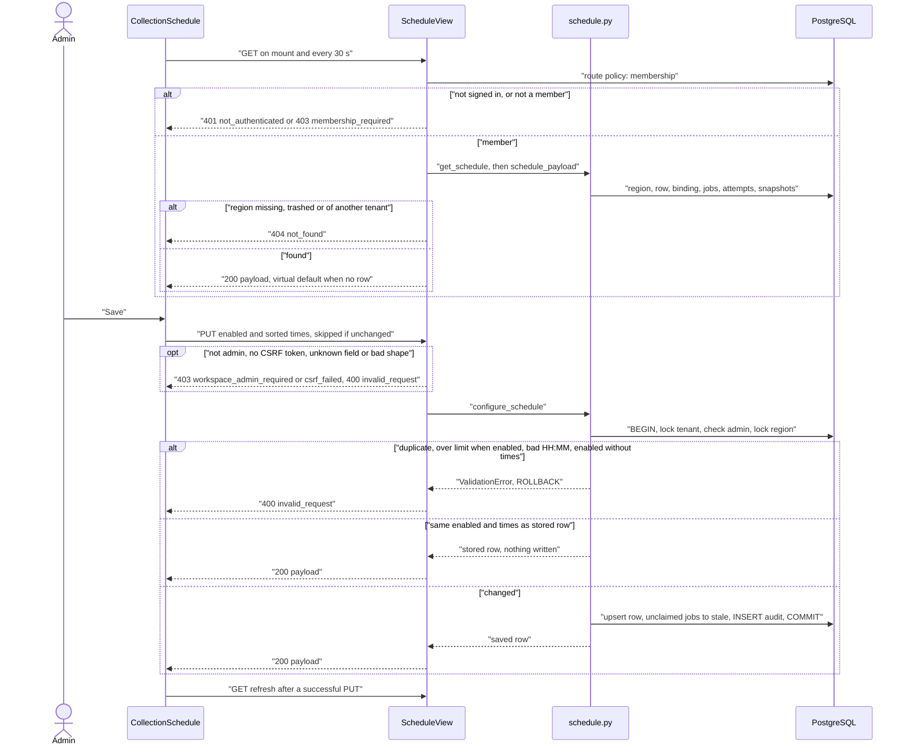

# Configure forecast collection times for a site

Any member of a workspace opens a plant's Settings, "Forecast update times" view (`?view=collection`), to read the region's update times and their update status. A workspace administrator replaces the enabled flag and the region-local `HH:MM` times. The save cancels unclaimed jobs that no longer match and writes one audit event, and the dispatcher and workers apply the new schedule on their next pass.

## Entry points

- Screen: `web/src/features/plant/collection-schedule.tsx` `CollectionSchedule` (a `Resource` that polls every 30 s) and `ScheduleEditor`, mounted by `features/plant/workspace/settings-section.tsx` for the `collection` view; `collection-status.tsx` `CollectionStatus` ("Update status") shows the state, "Last update" (the newest successful forecast or satellite update), "Next planned update" and at most one sentence for `inactive_reason`; the editor holds the times and "Update forecasts automatically". The screen lists no collection jobs, no request count of the UTC day and no daily satellite line. The GET still serves `recent_jobs`, `requests_today`, `effective_from` and the `history_*` fields; no screen reads them (the job log stays in the Pyracast console). The form is `ui/form.tsx` `ActionForm`, read-only unless the tenant role is `admin`.
- `GET|PUT /api/tenants/{t}/regions/{r}/collection-schedule/` -> `pyracast.forecasts.views.CollectionScheduleView` -> `schedule.get_schedule` or `schedule.configure_schedule`, then `schedule_payload`. The route policy (`api/permissions.py`): GET member, PUT workspace administrator.
- Other users of the row: writers `trash.restore_region` (creates the default, resets `effective_from`) and `trash._purge_region`. Readers go through `forecasts.timing.forecast_timing` (scheduler, `jobs.claim`, `quota`, `budget`, `notifications.preparation`) or read the row directly (`jobs.publish` history retry job, `metering.scheduler`, `metering.jobs`). `approve_region` creates no row.

## Sequence

## Data

| Table | R/W | What |
| --- | --- | --- |
| `forecasts_collectionschedule` | R/W | One row per region: `enabled`, sorted `times` (region-local `HH:MM`, shape enforced by `collectionschedule_times_chk`), `effective_from`. Upserted on save. |
| `forecasts_collectionjob` | R/W | GET lists the six newest jobs of the approved binding (any endpoint, import rows included) and finds the next collection. A changing PUT sets unclaimed `pending` and `retry` jobs of the region to `stale` (`schedule_changed`) and clears leases, except those the stale rule below retains. `running` jobs are untouched; an unchanged save touches no job. |
| `forecasts_requestattempt` | R | GET counts the binding's own attempts of the UTC day; the account's counters are not exposed. |
| `forecasts_forecastsnapshot` | R | `last_success_at`: latest `collected_at` of a succeeded native forecast or estimated-actuals job (imports excluded). |
| `regions_region`, `accounts_tenant` | R, lock | PUT locks the tenant row (`tenant_membership(lock=True)`), then the region row (`FOR UPDATE OF` self). |
| `connections_sitebinding`, `connections_provideraccount`, `accounts_membership` | R | Approved binding and `daily_quota` for the time limit and `collection_gate`'s `binding_is_current`; the account's wait for `state`. Membership for the member and admin checks. |
| `regions_auditevent` | W | `collection_schedule_updated` (actor, region, revision) only on change. No before or after values. |

## Authorization

- `SessionAuthentication` with CSRF (`X-CSRFToken`); the route policy `RoutePolicy` runs before the view, so an outsider gets 403 `membership_required` before any region lookup and cannot probe region ids. The region lookup then filters `tenant_id` and `deleted_at IS NULL`.
- PUT: a member who is not an administrator gets 403 `workspace_admin_required` before the body is read. `configure_schedule` repeats the check under the tenant row lock (`tenant_membership(role=ADMIN, lock=True)`), so a concurrent demotion serializes with the save. No superuser bypass. Frontend: editor read-only for non-admins, enable checkbox disabled unless `region.status === "approved"` (UX only).

## Failure paths

| Condition | Result |
| --- | --- |
| Not signed in | 401 `not_authenticated`, `WWW-Authenticate: Session` |
| Outsider, or removed under the lock | 403 `membership_required` |
| Viewer or demoted administrator PUT | 403 `workspace_admin_required` |
| Missing CSRF token | 403 `csrf_failed` |
| Region of another tenant, unknown or trashed region | 404 `not_found` |
| Missing `enabled` or `times`, item over 5 chars, more than 10 items, unknown field | 400 `invalid_request`, field messages keyed by field |
| Duplicate times, or enabled with more than `daily_quota - 1` times (9 without a binding) | 400 `invalid_request`, whole list rejected: "Use each update time once." or "Choose at most {limit} update times." |
| Time not `HH:MM` (`1:00`, `24:00`) | 400 `invalid_request` "Something went wrong. Try again." |
| Enabled with no times | 400 `invalid_request` "Add at least one update time to update forecasts automatically." |
| Tenant or region lock not free within 5 s (`lock_timeout`) | 503 `busy`, `Retry-After: 1` |
| Another request of the same session holds the session advisory lock past 5 s | 429 `session_busy`, `Retry-After: 1` |
| Client check fails, or a poll or first load fails | `ActionForm` alert without request, or error notice (last data stays once loaded) |

## Rules and invariants

- Lock order is tenant row, then region row. `claim` and `_enqueue_region` lock only the region, so they serialize with a save. Job rows are read without `FOR UPDATE`, and `jobs.retry` (running to `retry`) locks only the job, so `claim`'s re-check is the authoritative gate.
- The intent is kept in every approval state: saving an enabled schedule needs no approved binding, and readers gate collection on the binding (`scheduler.collection_gate`). Disabling skips the count limit, so clocks beyond a lowered quota stay stored when disabling.
- Saving the stored `enabled` and `times` is a no-op (no stale marking, no audit). A change sets `effective_from = now`, and readers never create forecasts for earlier slots, so edits do not back-fill (`timing.forecast_timing`).
- Stale rule when enabled: an unclaimed job survives if its local slot `HH:MM` is in the submitted (untrimmed) `times`, or if it is not a forecasts job and its `target_date` differs from the slot's local date (nightly history). Others, including the approval-time forecast job, become `stale`. When disabled, every unclaimed job does, nightly history included. `claim` re-checks against the trimmed times. The scheduler later revives a `schedule_changed` history job inside the open window and the stale forecast job of the latest slot.
- No row means enabled at `PYRACAST_CUTOFF_LOCAL` (16:00), built by `get_schedule`, `forecast_timing` and `restore_region` from `default_times`. Readers cut effective times to `daily_quota - 1` while GET returns the stored list; `max_forecast_times` is that limit. One request per day is reserved for history (00:00 to 09:00 local, 30 minute retries, `collection_window`).
- In the `provider_attention` state the screen reads "Not updating" with "Forecasts are not being updated right now." (`provider_unavailable`) and shows no "Next planned update", since `next_collection_at` is only the scheduler's nominal time; the payload does not say whether the account's key was rejected or a timed wait runs. `quota_too_low` reads "No new forecast data is arriving for this plant. Write to Pyracast: {contact}" while the saved times stay listed.
- `state` and `inactive_reason` come from `schedule.collection_status`, which applies the scheduler's `collection_gate` (`not_approved`, `not_validated`, `binding_not_current`, `schedule_disabled`) and the account's wait (`provider_attention`); a quota of one leaves no forecast time (`quota_too_low`). `next_collection_at` is the earliest moment the scheduler or `claim` acts: a missing, revivable or queued job, a lease that ended, the next forecast slot or the next nightly window start. It follows the scheduler's rules for ended jobs and skips nonexistent local times within `SLOT_SEARCH_DAYS`.

## Tests

- `tests/test_collection_schedule.py` (defaults, limits, unchanged save, retained or stale jobs, disable, API, tenant scoping, unknown fields), `test_collection_schedule_contract.py` (payload fields), `test_collection_status.py` and `test_collection_state.py` (status, next collection, the plant's own requests, member-only reads), `test_collection_timing.py` (daily bound, quota limit), `test_collection_times_migration.py` (stored times repaired), `test_workspace_authorization.py` (viewer PUT 403; viewer, outsider, platform, demoted and inactive callers of `configure_schedule`), `test_route_policy.py`, `test_trash_api.py` (trashed 404), `test_trash_operations.py` (restore and purge). Save effects through `configure_schedule`: `test_nightly_solcast.py`, `test_collection_calendar_windows.py`, `test_collection_resilience.py`. Readers: `test_metering.py`, `test_metering_nightly.py`, `test_notification_preparation.py`, `test_admin_health_queries.py`, `test_delivery_health.py`.
- Playwright: `web/tests/workspace.spec.ts` "region collection schedule validates and saves distinct local times", `collection-status.spec.ts` (no request count, job log or daily satellite line; the neutral sentence for every job row shape) and `responsive.spec.ts` (mocked API), `web/integration/workspace.spec.ts` (real stack, run by `tests/e2e/test_workspace_spec.py`). Gaps: no lock-contention or `busy` test, no viewer GET or read-only UI test, no unapproved-region form test, no browser test of a server 400.
