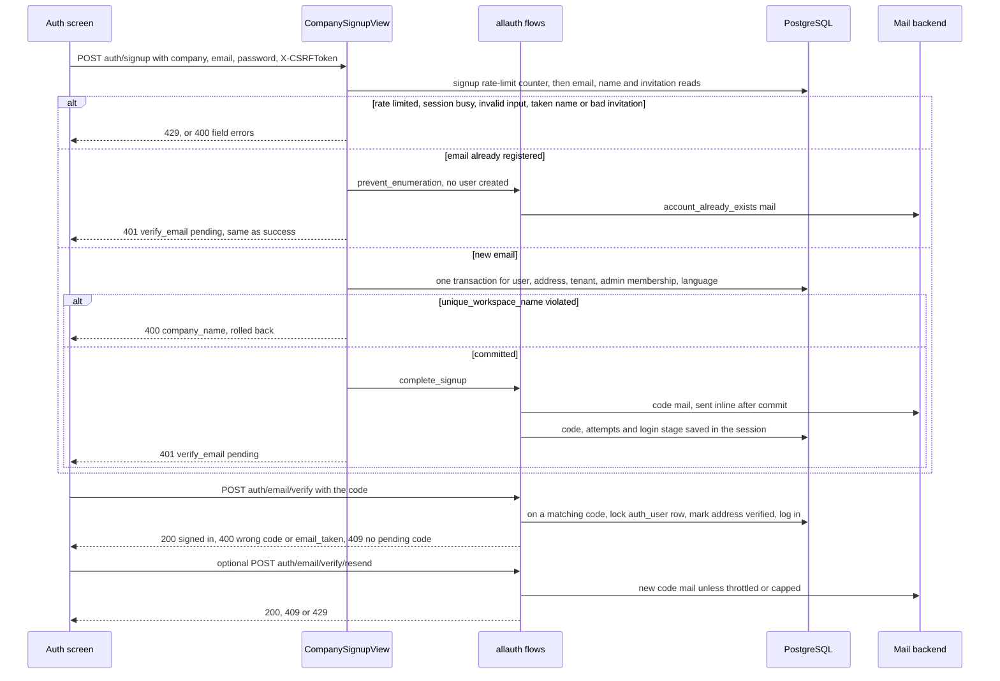

# Company signup and email verification

An anonymous visitor creates a password account and, in the same request, a new workspace (tenant) of which they become the only administrator. Mandatory email ownership follows: a mailed code entered in the same browser session verifies the address and signs the user in. With an invitation token the form creates only the user; the membership comes from `invitation-acceptance`.

## Entry points

- Screen: `web/src/components/auth.tsx` `Auth`, modes `register` then `verify`, opened by `Dashboard` for `/app/?signup=1` (links in `public-site/home-page.tsx`, which also pass `language` for `POST /api/session/language/`, and the allauth `unknown_account` mail). Client: `authRequest` in `web/src/lib/auth-api.ts`, CSRF token from `SessionView`.
- `POST /api/auth/browser/v1/auth/signup` -> `pyracast.accounts.signup.CompanySignupView` (input `CompanySignupInput`), routed before the allauth include; anonymous. `provider/signup` reuses `CompanySignupForm` and `workspace_signup_transaction` (flow `social-sign-in`).
- `POST .../auth/email/verify` -> allauth `VerifyEmailView` wrapped in `require_POST` (`pyracast/urls.py`); `POST .../auth/email/verify/resend` -> allauth `ResendEmailVerificationCodeView` via the `allauth.headless.urls` include.

## Sequence

## Data

| Table | R/W | What |
| --- | --- | --- |
| `auth_user` | R/W | New non-staff user, username generated from the email; row locked while the address is confirmed; `last_login` set on verification |
| `account_emailaddress` | R/W | Primary address inserted unverified, then verified; reads decide `account_already_exists` |
| `accounts_tenant`, `accounts_membership` | R/W | Name pre-check on `lower(trim(name))`, insert tenant and `admin` membership; insert skipped with an invitation token |
| `accounts_userlanguagepreference` | R/W | Written only when the `pyracast_language` cookie is `en` or `tr`; read when mailing |
| `accounts_workspaceinvitation` | R | Token hash, email, unused and unexpired checked; not consumed here |
| `django_session`, `usersessions_usersession`, `pyracast_authentication_cache` | R/W | Code, attempts, resend count and login stage; user session row at the verification login; `signup` and `confirm_email` counters on the `auth_cache` connection |

## Authorization

- Anonymous by design; CSRF is enforced by `CsrfViewMiddleware` before the view; a signed-in session gets 409 (after the rate limit is consumed).
- Rate limits in `ACCOUNT_RATE_LIMITS` (`pyracast/settings.py`): `signup` 5/h/ip, consumed by allauth's decorator on `SignupView.handle` before validation; `confirm_email` 1/3m/key (the email) on every code or anti-enumeration mail. `AccountAdapter.get_client_ip` refuses requests without a determinable IP (403).
- `SessionRequestSerialization` takes an advisory lock per session cookie, so requests that carry one never run in parallel. The database guards `unique_workspace_name`, `one_workspace_admin` and `unique_verified_email`. Sign-in with an unverified address re-enters the code stage (`ACCOUNT_EMAIL_VERIFICATION = "mandatory"`).

## Failure paths

| Condition | Result |
| --- | --- |
| Missing CSRF token / already signed in / body not a JSON object | 403 / 409 / 400 without JSON |
| Sixth signup attempt in an hour from one IP, or session lock held over 5 s | 429, or 429 `session_busy` |
| Bad email, password under 12 characters, common, or over 1024 | 400 `email` or `password` |
| Workspace name blank, over 200, taken, or lost to a concurrent signup | 400 `company_name`, nothing committed |
| Invitation token unknown, expired, used or for another email | 400 non-field "The invitation is invalid or expired." |
| Email already registered | 401 `verify_email`, identical to success; 429 if that address was mailed in the last 3 minutes (derived) |
| Mail backend error after commit | Contained and logged by the account mail adapter (`account-mail-notifications`); 401 `verify_email` as on success, user and workspace stay and the code is pending in the session; the resend (after its 3-minute throttle) delivers a new code |
| Wrong code (third wrong attempt discards the code) / address verified for another account meanwhile | 400 `key` / 400 `email_taken` |
| No pending code in this session, 10 minutes after signup, or attempts used | 409 |
| Resend within 3 minutes of the last mail / after 3 resends / no pending code | 429 / 409 / 409 |

## Rules and invariants

- User, address, tenant, membership and language commit together in `workspace_signup_transaction`; only an `IntegrityError` naming `unique_workspace_name` becomes a field error, others propagate. The form pre-check is a courtesy, the constraint is the guard. Mail goes through `AccountAdapter.send_mail` on commit, in the user's stored language or else the request language, synchronously inside the request.
- Code verification logs the user in when the pending stage belongs to the same user, so `ACCOUNT_LOGIN_ON_EMAIL_CONFIRMATION` has no effect. The process lasts 10 minutes from signup and is not extended by a resend; 3 wrong attempts in total; 3 resends, each replacing the code.
- A race can leave two unverified accounts for one mailbox; the first to prove the mailbox by password reset owns it. Unverified signups keep their tenant and name indefinitely; no job or command removes them.

## Tests

- `tests/test_company_registration.py`: end to end signup, verification and tenant access, no partial rows, duplicate email, rollback, password bounds, attempt limit, concurrent mailbox and workspace races.
- Also `tests/test_session_serialization.py` (resend throttle and cap), `tests/test_language.py` (language copy), `tests/test_workspaces.py` (invited and duplicate-name signup), `tests/test_account_mail_failures.py` (signup with a failing mailer reaches the code stage, then resend and verification); `tests/test_account_email_confirmation.py` covers the shared `confirm_email` lock only through email change.
- `web/tests/auth-registration.spec.ts` and `web/tests/workspace-roles.spec.ts` mock the API; no browser test reaches Django. Untested: the password endpoint's 5/h/ip limit, the 429 on a repeated signup, the resend button.
