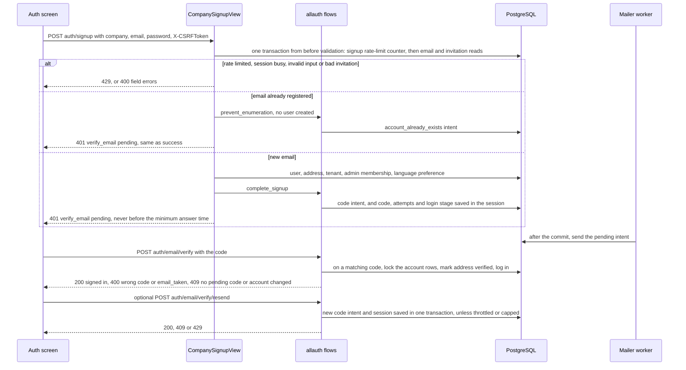

# Company signup and email verification

An anonymous visitor creates a password account and, in the same request, a new workspace (tenant) of which they become the only administrator. Mandatory email ownership follows: a mailed code entered in the same browser session verifies the address and signs the user in. With an invitation token the form creates only the user; the membership comes from `invitation-acceptance`.

## Entry points

- Screen: `web/src/features/auth/auth.tsx` `Auth`, modes `register` then `verify`, opened by `RequireUser` for `/app/?signup=1` (links in `public-site/home-page.tsx`, which also pass `language` for `POST /api/session/language/`, and the allauth `unknown_account` mail). The password field states the 15-character rule, the code stage names the address and "Use a different address" ends the pending sign-up through `DELETE auth/session`. Client: `authRequest` in `web/src/lib/auth-api.ts`, CSRF token from `SessionView`.
- `POST /api/auth/browser/v1/auth/signup` -> `pyracast.accounts.signup.CompanySignupView` (input `CompanySignupInput`, fields of `AccountSignupForm`), routed before the allauth include; anonymous. `provider/signup` reuses `AccountSignupForm` and `register_account` (flow `social-sign-in`).
- `POST .../auth/email/verify` -> `pyracast.accounts.headless.VerifyEmailView` wrapped in `require_POST`; `POST .../auth/email/verify/resend` -> `ResendEmailVerificationCodeView` (both in `accounts/auth_urls.py`).
- The mail is an outbound intent sent by the mailer actor `send_outbound_mail` (`account-mail-notifications`, `email-transport`).

## Sequence

## Data

| Table | R/W | What |
| --- | --- | --- |
| `auth_user` | R/W | New non-staff user, username from the email with a random 16-hex part; rows locked while the account is created and the address is confirmed; `last_login` set on verification |
| `account_emailaddress` | R/W | Primary address inserted unverified, then verified; reads decide `account_already_exists` |
| `accounts_tenant`, `accounts_membership` | W | Tenant (names need not be unique) and `admin` membership via `register_account`; none with an invitation token |
| `accounts_userlanguagepreference` | W | The request language, always; read when mailing |
| `accounts_workspaceinvitation` | R | Token hash, email, unused and unexpired checked; not consumed here |
| `notifications_outboundmail` | W | Code intent (`email_confirmation_signup`, sealed code, expiry 10 minutes) or `account_already_exists` intent, stored in the request's transaction |
| `django_session`, `usersessions_usersession`, `pyracast_authentication_cache` | R/W | Code, attempts, resend count, login stage and their credential-state stamp, saved in the request's transaction; user session row at the verification login; `signup` and `confirm_email` counters on the `auth_cache` connection |

## Authorization

- Anonymous by design; CSRF is enforced by `CsrfViewMiddleware` before the view; a signed-in session with valid input gets 409 (after the rate limit is consumed and the input validated).
- Rate limits in `ACCOUNT_RATE_LIMITS` (`pyracast/settings.py`): `signup` 5/h/ip, consumed by allauth's decorator on `SignupView.handle` before validation; `confirm_email` 1/1m/key and 6/h/key (the email) on every code or anti-enumeration mail. `AccountAdapter.get_client_ip` refuses requests without a determinable IP (403).
- `SessionRequestSerialization` takes an advisory lock per session cookie, so requests that carry one never run in parallel. The database guards `accounts_membership_tenant_administrator_uniq` and allauth's `unique_verified_email`. Sign-in with an unverified address re-enters the code stage (`ACCOUNT_EMAIL_VERIFICATION = "mandatory"`).

## Failure paths

| Condition | Result |
| --- | --- |
| Missing CSRF token / already signed in / body not a JSON object | 403 `csrf_failed` / 409 / 400 `bad_request` |
| Sixth signup attempt in an hour from one IP, or session lock held over 5 s | 429, or 429 `session_busy` with `retry_after` |
| Bad email, password under 15 characters, common, over 1024 or similar to the address | 400 `email` or `password` |
| Workspace name blank, over 200, or holding control, format or separator characters or web or email address text | 400 `company_name`, nothing committed; whitespace is collapsed, a name may repeat |
| Invitation token unknown, expired, used or for another email | 400 non-field "The invitation is invalid or expired." |
| Email already registered | 401 `verify_email`, identical to success; the mail is `account_already_exists` |
| Verification mail allowance of the address spent (1 per minute, 6 per hour), either kind of address | 401 `verify_email` as on success, no mail; one `authentication_request_throttled` line; only the `signup` limit answers 429 |
| Mail cannot be delivered | The request is unaffected: 401 `verify_email` as on success, the intent is retried or ends `failed`; resend (after its 1-minute throttle) stores a new code |
| Wrong code (third wrong attempt discards the code) / address verified for another account meanwhile | 400 `key` / 400 `email_taken` |
| No pending code in this session, 10 minutes after signup, attempts used, or the new account changed meanwhile (deactivated, deleted, password or address changed, for example by a reset elsewhere) | 409; the pending verification is discarded |
| Resend within 1 minute of the last mail / after 3 resends / no pending code or account changed | 429 / 409 / 409, no mail |
| Resend whose session row cannot be locked in time / ended meanwhile | 503 `busy` / 400 `session_ended`, no code queued |

## Rules and invariants

- `starting` opens the request's one transaction before the input is validated; user, address, tenant, membership and language commit together, the code intent is stored in it and the session holding the code is saved before the commit, so a failed save queues no mail. A failure after the user insert rolls everything back. Mail language is the stored preference, the request language at signup.
- Every `POST auth/signup` not refused by a rate limit answers no sooner than `PYRACAST_SIGNUP_MINIMUM_ANSWER_SECONDS` (1 s; 0 in `tests/settings.py`) after it reaches the middleware `SignupMinimumAnswerTime` (outside `SessionRequestSerialization`). The wait runs after the commit, with the session saved and its lock released; a 429 and other methods answer at once. An address with an account hashes the password like a new account.
- Code verification logs the user in when the pending stage belongs to the same user; the pending code and the sign-in step rest on the new account's credential state (`accounts/processes.py`). The process lasts 10 minutes from signup and is not extended by a resend; 3 wrong attempts in total; 3 resends, each replacing the code. Changing the address during the sign-up carries both over.
- A race can leave two unverified accounts for one mailbox; the first to prove the mailbox by password reset owns it. A signup that never signed in and proved no address is removed with its own empty workspace seven days after `date_joined` by the dispatcher's retention phase (`accounts.retention.reclaim_abandoned_signups`).

## Tests

- `tests/test_company_registration.py`: end to end signup, verification and tenant access, no partial rows, duplicate email, rollback, password and name rules, attempt limit, concurrent races, minimum answer time, throttle lines.
- Also `tests/test_session_serialization.py` (resend throttle and cap), `tests/test_stale_account_processes.py` (address verified meanwhile), `tests/test_pending_process_authority.py` (address change during signup), `tests/test_code_mail_session.py` (session saved with the code), `tests/test_authentication_limits.py` (six mails an hour), `tests/test_language.py`, `tests/test_workspaces.py` (invited and duplicate-name signup), `tests/test_account_mail_failures.py` (failing mailer, then resend), `tests/test_account_retention.py` (abandoned signups).
- `web/tests/auth-registration.spec.ts` and `web/tests/workspace-roles.spec.ts` mock the API; no browser test reaches Django. Untested: the password endpoint's 5/h/ip limit through the real middleware and the `email_taken` answer.
