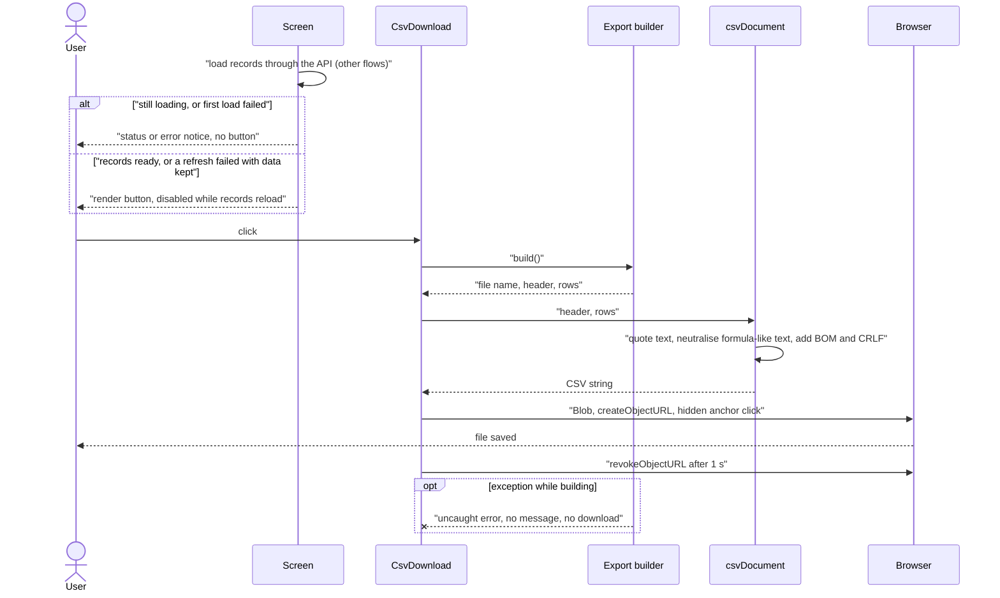

# Download displayed data as CSV

A workspace administrator or viewer presses a download button on a plant screen. The browser builds a UTF-8 CSV from records the screen already loaded and saves it as a file. No request is made and the server never learns that an export happened.

## Entry points

- `web/src/ui/csv-download.tsx` `CsvDownload`: the only button; its click handler calls the export builder it was given (`build`, one per export in `web/src/lib/exports.ts`) and encodes the result with `csvDocument` in `web/src/lib/csv.ts`. No other CSV download exists in `web/src`. The plant that names every export comes from `ui/export-plant.tsx` (`ExportPlant`, provided by `PlantWorkspace`).
- Forecast tab, Generation and Irradiance views: `features/forecast/panel/forecast-summary.tsx` `ForecastSummary` -> `forecastExport` (label "Download CSV", or "Download both scenarios CSV" when the generation forecast carries an outage scenario).
- Production tab, Comparison view: `features/forecast/forecast-performance.tsx` `PerformanceResults` -> `performanceExport`.
- Production tab, Actuals view: `features/production/production-history.tsx` `ProductionHistory` -> `productionExport`, shown once the day has loaded.
- Calibration tab (only when the plant has a current configuration): `features/calibration/calibrations.tsx` `Calibrations` -> `calibrationsExport` (list of all runs) and `calibration-run-detail.tsx` -> `calibrationExport` (one run opened with "View details").
- Outages tab: `features/plant/outages.tsx` `Outages` -> `outagesExport`. Settings tab, Technical details view: `features/plant/workspace/settings-section.tsx` -> `plantExport`, always rendered below the configuration.
- Actors: workspace administrator and viewer alike. No button is gated by `useCanManageWorkspace`.

## Sequence

## Data

| Table | R/W | What |
| --- | --- | --- |
| None | - | The export reads only in-memory React state loaded by other flows. No table, queue or external service is touched. |

## Authorization

- None in this flow. Each screen shows data fetched through tenant-scoped, authenticated endpoints owned by other flows (`forecast-view`, `irradiance-forecast-view`, `forecast-performance`, `production-history`, `calibration-activation`, `outage-management`, and `plant-portfolio` for the plant record); the CSV is a client-side copy of what the user may already see.
- No server-side check or audit entry exists for the export itself.
- Every export is an explicit column list in `lib/exports.ts`: response metadata, provenance, snapshot ids and provider data are not exported.

## Failure paths

| Condition | Result |
| --- | --- |
| Forecast, performance, production, outages or calibration list loading, or its first load failed | Button not rendered; a status line or error notice shows instead |
| A later refresh of the same query fails | Previous data kept with a "Could not refresh" alert; the button stays and exports that data |
| No forecast result for the day | Forecast panel shows an empty state, no button |
| A list reloads after a save or a stale edit (outages), a request (calibration runs), a save (production) | Button disabled and labelled "Working…" until the reload ends |
| No rows | Header line only, no fabricated row |
| Exception in a builder, `csvDocument` or Blob creation | Uncaught error in the synchronous click handler: no message, no file |
| File name part contains a character Windows refuses in file names, or a control character | Each replaced by `-`; `.csv` appended |

## Rules and invariants

- Each builder lists its columns once (`table` in `lib/exports.ts`): header names are the column names, one row per record. Header names are fixed English keys and never translated, so CSV content is independent of language. Units are in the names (`energy_mwh`, `mean_power_mw`, `ghi_wm2`); times are `plantTimestamp` values, ISO 8601 on the plant's wall clock with its UTC offset.
- Plant context: every export except production starts with `plant_id`, `plant_name` and `timezone` (the plant zone); the production file has `timezone` last and names the plant only in its file name. File names are the export kind, the plant name and, where the export has one, the date, range, run or source (`csvFilename`): each part has characters Windows refuses and control characters replaced by `-`, edge spaces, dots and hyphens trimmed, empty parts dropped, the whole cut at 150 characters.
- Numbers are written bare via `String(value)`, so precision and negative values survive; a non-finite number is empty. Booleans are bare. `null` becomes an empty unquoted cell. Strings are always double-quoted with doubled inner quotes; lists such as quality flags and interval sources are joined with `"; "`.
- Formula neutralisation applies only to text: a string whose first character after any white space, control or format characters is `=`, `+`, `-` or `@` gets a leading apostrophe, unless the whole string is a plain signed number such as `-1.5`.
- The file starts with a UTF-8 BOM, uses CRLF line ends and ends with CRLF. The object URL is revoked after one second.
- Forecast CSV uses the full interval list of the loaded result, not the cropped table, and has no synthetic `missing_source_interval` gap rows. Columns after the plant context: `date`, `source_kind`, `starts_at`, `ends_at`, then `mean_power_mw`, `energy_mwh`, `quality_flags` (generation) or `ghi_wm2`, `quality_flags` (irradiance), and `interval_source` when the source kind is `mixed`. With an outage scenario it emits paired `normal_*` and `affected_*` columns per interval. The weather reference, `regional_irradiance` and `production_diagnostic` are not exported.
- Production CSV has one row per interval with an effective value (`history.intervals`, not the cropped table): `starts_at`, `ends_at`, `energy_mwh`, `quality`, `source`, `timezone`; it is the import format.
- Performance CSV has one row per requested day (`comparison`, `date`, `status`, `reason`, `source_kind`, measured, predicted and error energy, `provisional_production`, `calibration_in_sample`). Calibration list CSV has one row per run; the detail CSV adds the cutoff, the activation blocker and the training, holdout and validity counts and errors read from the run result (numbers and booleans only). Outage CSV has one row per outage including cancelled ones. Plant CSV has one row: location, configuration revision, capacities, measurement basis and mounting geometry.

## Tests

- `web/tests/csv.spec.ts`: encoder (BOM, CRLF, quoting, empty missing values, formula characters with plain signed numbers kept, non-finite numbers, header-only output).
- `web/tests/exports.spec.ts`: file names, and every builder (production import columns in plant time and re-import, outages, calibrations, performance, forecast, plant), empty list gives the header only.
- Playwright downloads: `web/tests/workspace.spec.ts` (full safe forecast CSV, performance CSV hidden while loading and its content, calibration details CSV), `forecast-coverage.spec.ts` (outage scenario CSV without provenance, production diagnostic keeps one forecast), `forecast-intervals.spec.ts` (interval sources, both scenarios), `weather-reference.spec.ts` (irradiance CSV), `outages.spec.ts` (both scenarios, the outage export waits for the reloaded list), `calibrations.spec.ts` (exports wait for the reloaded runs), `epias-production.spec.ts` and `production-export.spec.ts` (production CSV, hidden or disabled while the day reloads, header-only empty day).
- Gaps: no test of the plant CSV button, the Turkish button labels, exception handling or very large exports.
