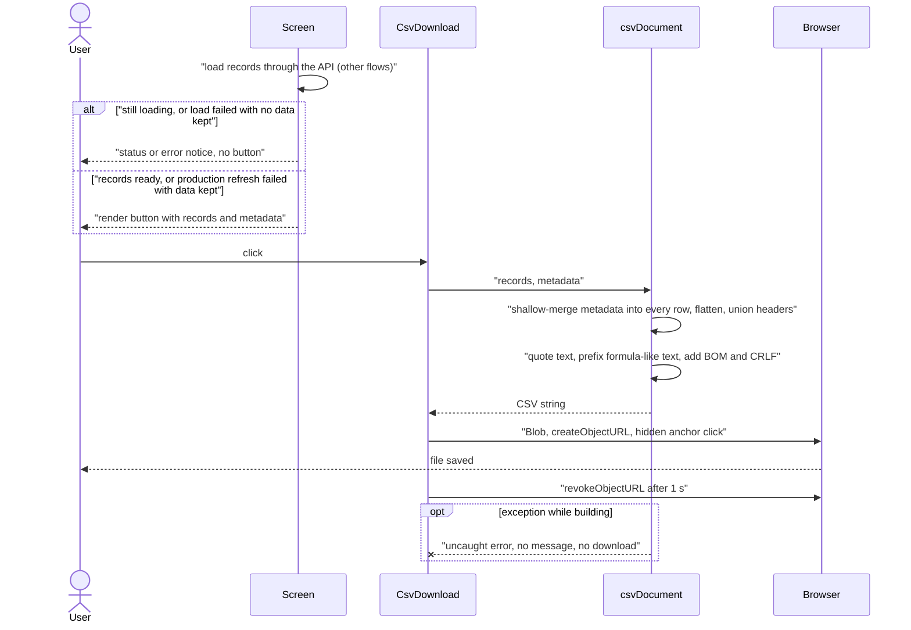

# Download displayed data as CSV

A workspace administrator or viewer presses a download button on a plant screen. The browser builds a UTF-8 CSV from records the screen already loaded and saves it as a file. No request is made and the server never learns that an export happened.

## Entry points

- `web/src/components/csv-download.tsx` `CsvDownload`: the only button; its click handler calls `csvDocument` in `web/src/lib/csv.ts`. No other CSV download exists in `web/src`.
- Forecast tab, Generation and Irradiance views: `forecast-panel.tsx` `ForecastPanel` inside `plant-workspace.tsx` `PlantForecast` (label "Download CSV", or "Download both scenarios CSV" when the generation forecast carries an outage scenario).
- Production tab, Comparison view: `forecast-performance.tsx` `PerformanceResults` (default label from the `CsvDownload` namespace).
- Production tab, Actuals view: `production-history.tsx` `ProductionHistory`, shown only once the day has loaded.
- Calibration tab (only when the plant has a current configuration): `calibrations.tsx` `Calibrations` (list of all runs, and the details of one run opened with "View details").
- Outages tab: `outages.tsx` `Outages`. Settings tab: `plant-workspace.tsx`, inside the Location disclosure, always rendered.
- Actors: workspace administrator and viewer alike. No button is gated by `useCanManageWorkspace`.

## Sequence

## Data

| Table | R/W | What |
| --- | --- | --- |
| None | - | The export reads only in-memory React state loaded by other flows. No table, queue or external service is touched. |

## Authorization

- None in this flow. Each screen shows data fetched through tenant-scoped, authenticated endpoints owned by other flows (`forecast-view`, `irradiance-forecast-view`, `forecast-performance`, `production-history`, `calibration-activation`, `outage-management`, and `plant-portfolio` for the plant record); the CSV is a client-side copy of what the user may already see.
- No server-side check or audit entry exists for the export itself.
- No general allow-list: the forecast metadata and plain forecast rows, performance, calibration, outages and plant CSVs export the API response verbatim apart from fields a call site sets to `undefined`, including ids, revisions and provenance. The production CSV builds rows from named fields only, and outage-scenario forecast rows are an explicit field selection.

## Failure paths

| Condition | Result |
| --- | --- |
| Forecast, performance, production, outages or calibration list loading or failed (production: no ready data kept for the same query) | Button not rendered; a status line or error notice shows instead |
| Production 30 s refresh of the same query fails | Previous data kept with a `refresh_failed` warning; the button stays and exports that data |
| Forecast 30 s refresh fails | `useResource` drops the loaded data, so the forecast button disappears until a refresh succeeds |
| No forecast result for the day | Forecast panel shows an empty state, no button |
| Empty `records` | One row holding only the metadata columns; with no metadata (calibration list) the file is a BOM and two empty lines |
| Exception in `csvDocument` or Blob creation | Uncaught error in the synchronous click handler: no message, no file |
| Filename contains characters outside `[a-zA-Z0-9_.-]` | Each replaced by `-`, then `.csv` appended |

## Rules and invariants

- Every row carries every metadata column (`flatten({ ...metadata, ...row })`). The merge is shallow: a row key equal to a top-level metadata key replaces that whole metadata value, nested fields included.
- Nested objects become dotted columns (`result.provenance.supplier`); arrays are JSON text in one cell. Headers are the union of keys in first-seen order and `undefined` values are dropped, so a field set to `undefined` is how a caller removes a column.
- Numbers and booleans are written bare via `String(value)`, so precision and negative values survive. Strings and JSON text are always double-quoted with doubled inner quotes. `null` and `undefined` become an empty unquoted cell, while an empty string becomes `""`.
- Formula neutralisation applies only to text: a string whose first character after any white space or control characters is `=`, `+`, `-` or `@` gets a leading apostrophe. A numeric string such as `"-1.5"` is therefore altered.
- Headers pass through the same cell encoder. Header names are raw API keys and never translated, so CSV content is independent of language.
- The file starts with a UTF-8 BOM, uses CRLF line ends and ends with CRLF.
- Forecast CSV uses the full interval list, not the cropped table, and omits the synthetic `missing_source_interval` gap rows of the full-day view. With an outage scenario it emits paired `normal_*` and `affected_*` columns per interval.
- Forecast metadata is the whole forecast response with `result.intervals` and `result.weather_reference` removed (and `outage_scenario.result.intervals` when a scenario exists). The generation response also carries `regional_irradiance` and `production_diagnostic`, which are exported unchanged on every row, so the generation CSV still contains `regional_irradiance.weather_reference.*` and an intervals JSON cell; only the irradiance CSV is free of weather reference data.
- Production CSV is built from all of `history.intervals` (not the cropped table) with fixed `unit: MWh` and the plant `timezone`; provider originals are joined with `"; "`.
- Outages CSV metadata `timezone` is the browser's device timezone; the plant timezone is in `plant_timezone`. The plant CSV exports the whole current plant object with the plant timezone.
- The object URL is revoked after one second.

## Tests

- Playwright `web/tests/workspace.spec.ts`: full safe CSV (BOM bytes, quoting, formula prefix, bare negative number, missing values, dotted columns); performance CSV hidden while loading, then filename; performance CSV content; calibration details CSV.
- `forecast-coverage.spec.ts` (gap rows excluded, source snapshot ids, `production_diagnostic` columns, outage scenario CSV), `forecast-intervals.spec.ts` (interval source kinds, 30-minute rows, both scenarios CSV), `weather-reference.spec.ts` (irradiance CSV excludes weather reference), `outages.spec.ts` (both scenarios CSV with incidents), `epias-production.spec.ts` (24-row production CSV, no button while loading or after an error).
- Gaps: no unit test of `csvDocument` alone; no test of the calibration list CSV, the outages list CSV, the plant CSV, the Turkish button labels, the generation CSV's weather reference content, exception handling or very large exports.
