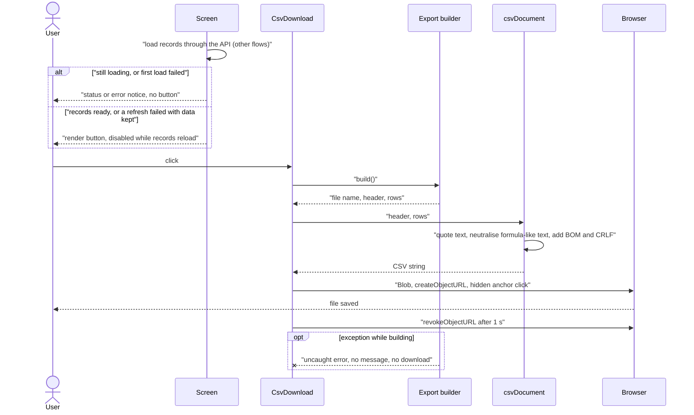

# Download displayed data as CSV

A workspace administrator or viewer presses a download button on a plant screen. The browser builds a UTF-8 CSV from records the screen already loaded and saves it as a file. No request is made and the server never learns that an export happened.

## Entry points

- `web/src/ui/csv-download.tsx` `CsvDownload`: the only button; its click handler calls the export builder it was given (`build`, one per export in `web/src/lib/exports.ts`), resolves the column names and words of the file in the reader's language (`readable` in `web/src/lib/csv.ts`, with `CsvFile.*`, the `Enums` labels and `ForecastPerformance.reasons`) and encodes the result with `csvDocument`. No other CSV download exists in `web/src`. The plant that names every export comes from `ui/export-plant.tsx` (`ExportPlant`, provided by `PlantWorkspace`).
- Forecast tab, Generation and Irradiance views: `features/forecast/panel/forecast-summary.tsx` `ForecastSummary` -> `forecastExport` (label "Download CSV"; the file holds both scenarios when the generation forecast carries an outage scenario).
- Production tab, Comparison view: `features/forecast/forecast-performance.tsx` `PerformanceResults` -> `performanceExport`.
- Production tab, Actuals view: `features/production/production-history.tsx` `ProductionHistory` -> `productionExport`, shown once the day has loaded.
- Calibration tab (only when the plant has a current configuration): `features/calibration/calibrations.tsx` `Calibrations` -> `calibrationsExport` (list of all runs) and `calibration-run-detail.tsx` -> `calibrationExport` (one run opened with "View details").
- Outages tab: `features/plant/outages.tsx` `Outages` -> `outagesExport`. Settings tab, Technical details view: `features/plant/workspace/settings-section.tsx` -> `plantExport`, always rendered below the configuration.
- Actors: workspace administrator and viewer alike. No button is gated by `useCanManageWorkspace`.

## Sequence

## Data

| Table | R/W | What |
| --- | --- | --- |
| None | - | The export reads only in-memory React state loaded by other flows. No table, queue or external service is touched. |

## Authorization

- None in this flow. Each screen shows data fetched through tenant-scoped, authenticated endpoints owned by other flows (`forecast-view`, `irradiance-forecast-view`, `forecast-performance`, `production-history`, `calibration-activation`, `outage-management`, and `plant-portfolio` for the plant record); the CSV is a client-side copy of what the user may already see.
- No server-side check or audit entry exists for the export itself.
- Every export is an explicit column list in `lib/exports.ts`: response metadata, provenance, snapshot ids and provider data are not exported.

## Failure paths

| Condition | Result |
| --- | --- |
| Forecast, performance, production, outages or calibration list loading, or its first load failed | Button not rendered; a status line or error notice shows instead |
| A later refresh of the same query fails | Previous data kept with a "Could not refresh" alert; the button stays and exports that data |
| No forecast result for the day | Forecast panel shows an empty state, no button |
| A list reloads after a save or a stale edit (outages), a request (calibration runs), a save (production) | Button disabled and labelled "Working…" until the reload ends |
| No rows | Header line only, no fabricated row |
| Exception in a builder, `csvDocument` or Blob creation | Uncaught error in the synchronous click handler: no message, no file |
| The dates and kind leave no room for the plant in the 150 characters | `plantFilename` throws (uncaught, no file) instead of cutting the kind |

## Rules and invariants

- Each builder lists its columns once (`table` in `lib/exports.ts`), one row per record. Header names are the screens' column names with their unit, in the language of the screen at download (`CsvFile.columns`); yes/no cells read Yes / No (Evet / Hayır); states and kinds use the screen labels. Numbers keep a dot and no unit; times are `plantTimestamp` values, ISO 8601 on the plant's wall clock with its UTC offset. No file has `plant_id`, an id column or a `timezone` column; every file but production starts with "Plant"; only the technical details file has "Time zone".
- File names come from `plantFilename`: `pyracast-{plant-slug}-{dates}-{kind}.csv`, an ASCII slug of the plant name (`plant` when it has no ASCII letter or digit) shortened so the dates and kind stay within the 150 characters before `.csv`. A forecast file whose answer names the shown saved forecast (`selection.forecast_id` among its options) adds that forecast's fetch time after the day, on the plant's wall clock in ISO basic form (`{date}-20261110T1700-{kind}`), so Automatic, Best forecast and a chosen time name different files when they show different fetches; otherwise, as on a satellite day, it has the day only. Kinds, English / Turkish: `generation` / `uretim`, `irradiance` / `isinim` (forecast), `actual-production` / `gerceklesen-uretim`, `comparison` / `karsilastirma`, `calibrations` / `kalibrasyonlar`, `calibration-{id}` / `kalibrasyon-{id}`, `outages` / `kesintiler`, `technical-details` / `teknik-bilgiler` (`CsvFile.files`).
- Numbers are written bare (`fileNumber` in `lib/format`, `String(value)`), so precision and negative values survive; a non-finite number is empty. `null` becomes an empty unquoted cell. Strings are always double-quoted with doubled inner quotes.
- Formula neutralisation applies only to text. Leading apostrophes are set aside first; if the first character of the rest after any white space, control or format characters is `=`, `+`, `-` or `@` and the rest is not a plain signed number such as `-1.5`, the cell gets a leading apostrophe (`'+meter` is written `''+meter`). So the import removes exactly the one the download added (`unguarded`).
- The file starts with a UTF-8 BOM, uses CRLF line ends and ends with CRLF. The object URL is revoked after one second.
- Forecast CSV uses the full interval list of the loaded result, not the cropped table, and has no synthetic `missing_source_interval` gap rows. Columns: Plant, Data (per row "Forecast" or "Satellite data", Turkish "Tahmin" or "Uydu verisi", also on a day of both kinds), Start, End, then "Forecast (MWh)" ("Energy (MWh)" on a satellite day) and "Average power (MW)"; with an outage "Without outage (MWh)", "With outage (MWh)", "Average power without outage (MW)" and "Average power with outage (MW)"; irradiance "Irradiance (W/m²)". No date, source kind, interval source or quality flags; `regional_irradiance` and `production_diagnostic` are not exported.
- Production CSV has one row per interval with an effective value (`history.intervals`, not the cropped table): Start, End, "Actual (MWh)", Status, Source; it is the import format. Status is the saved status with the screen's label (the entered value's own status, a provider value's own status from `provider_originals[].quality`, "Different statuses" for an hour whose half hours differ): a row saved as Normal reads Normal also while a recorded outage covers it, although the screen shows the outage's status. Source is the saved source text of an entered value and the provider kind's label (UEVM, Real-time (EPİAŞ)) of a provider value.
- Comparison CSV has one row per requested day: Plant, Comparison ("Forecast" or "Satellite data", Turkish "Tahmin" or "Uydu verisi"), Date, Status (Compared / Not compared), Reason (the screen's reason, only for a day not compared), "Actual (MWh)", "Forecast (MWh)" or "Satellite data (MWh)", "Forecast − actual (MWh)" or "Satellite data − actual (MWh)" (Turkish "Uydu verisi (MWh)", "Uydu verisi − gerçekleşen (MWh)"), "Real-time (EPİAŞ)" (Yes when the day rests on EPİAŞ real-time values, the server's `provisional_production`).
- Calibration list: Plant, No., Period start, Period end, Status, In use, Preliminary, "Real-time (EPİAŞ)", Factor; the detail file adds Calibration days, Test days, "Error without calibration (MWh)" and "Error with this calibration (MWh)", and no reason code, selection state, assessment code, blocker, cutoff, times, valid days or interval errors.
- Outages, one row per outage including cancelled ones: Plant, Title, Type, Status, Start, End, the three capacities still in service (MW), Notes.
- Technical details: Plant, "Latitude (°)", "Longitude (°)", Time zone, "Panel capacity (MWp)", "Inverter capacity (MW AC)", "Grid export limit (MW)", Meter point, Mounting, "Panel tilt (°)", "Panel azimuth (°)"; no revision.

## Tests

- `web/tests/csv.spec.ts`: encoder (BOM, CRLF, quoting, empty missing values, formula characters with plain signed numbers kept, non-finite numbers, header-only output).
- `web/tests/exports.spec.ts`: the whole header row of every file in both languages with a data row, the plant file name helper (shortened plant, refused kind), the production round trip in both languages, the technical details file (not through its button), empty list gives the header only.
- Playwright downloads: `web/tests/workspace.spec.ts` (full safe forecast CSV, performance CSV hidden while loading and its content, calibration details CSV), `forecast-coverage.spec.ts` (outage scenario CSV without provenance, production diagnostic keeps one forecast), `forecast-intervals.spec.ts` (interval sources, both scenarios), `outages.spec.ts` (both scenarios, the outage export waits for the reloaded list), `calibrations.spec.ts` (exports wait for the reloaded runs), `epias-production.spec.ts` and `production-export.spec.ts` (production CSV, hidden or disabled while the day reloads, header-only empty day).
- Gaps: no test of the technical details CSV button, the Turkish button labels, exception handling or very large exports.
