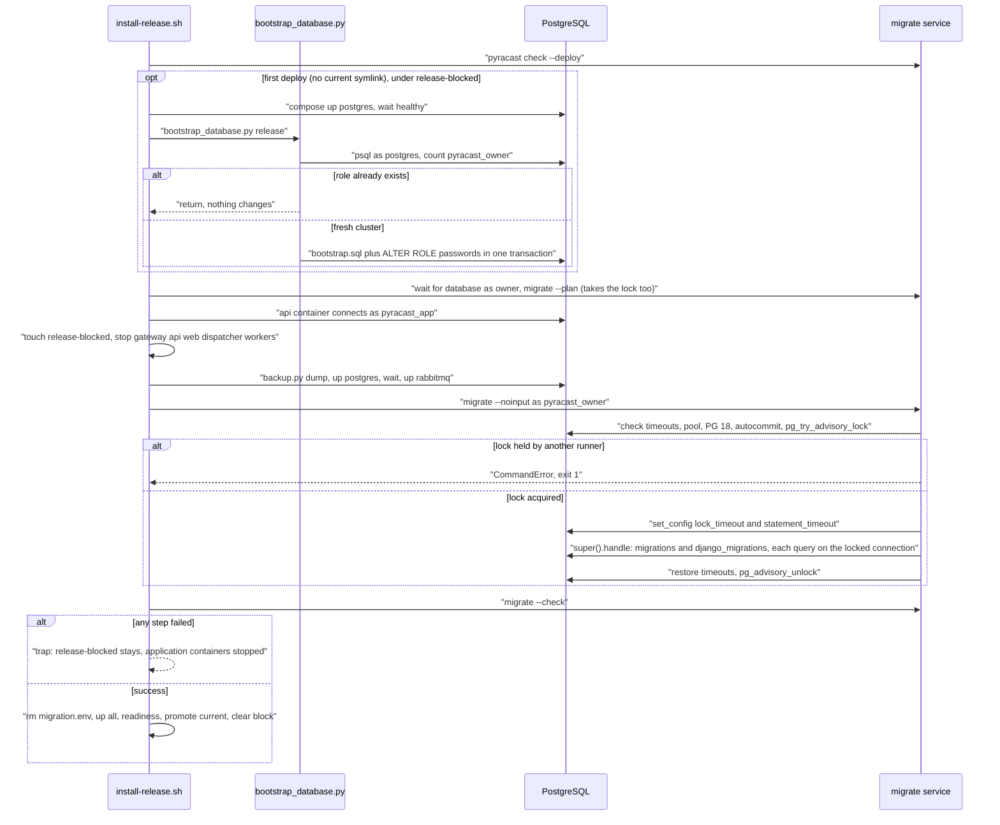

# Database service, role bootstrap and locked schema migrations

The release script (`deploy/install-release.sh`), a developer (`pyracast migrate`, the local launcher), CI and every pytest database build bring the PostgreSQL schema to the state the code expects. On the first production deployment the script also creates the two application roles and the `btree_gist` extension in a fresh cluster. The overridden `migrate` command serializes runners with a session advisory lock and bounds lock and statement waits, so in a release a schema change either completes or leaves the application stopped.

## Entry points

- Command `pyracast migrate` / `python -m django migrate` / `call_command("migrate")` -> `pyracast.accounts.management.commands.migrate.Command`, which replaces Django's command because `pyracast.accounts` is an installed app. `handle` wraps `super().handle` in `migration_session`. Adds `--lock-timeout-seconds` (default 5) and `--statement-timeout-seconds` (default 900); every stock flag (`--plan`, `--check`, `--fake`, `--database`) runs inside the same session.
- `deploy/install-release.sh` (root on the VM, called by `.github/workflows/release.yml`): `check --deploy`, a connection wait and `migrate --plan` through compose service `migrate`, then `migrate` and `migrate --check` after maintenance starts. First-deploy branch (no `/opt/pyracast/current` symlink) runs `deploy/bootstrap_database.py`, whose `initialize_database` feeds `deploy/bootstrap.sql` to `psql`.
- `deploy/compose.yaml`: service `postgres` (image built from `deploy/postgres/Dockerfile`: `postgres:18.7-alpine3.24`, `gosu` removed, user 70:70; read-only, `pg_isready` health check, `POSTGRES_DB: pyracast`, `--data-checksums`, env file `database.env`) and one-shot service `migrate` (profile `release`, `restart: "no"`, command `pyracast migrate --noinput`, env files `runtime.env` then optional `migration.env`).
- `scripts/dev.py` `start`: runs `python -m django migrate --noinput` on every launcher start through `run_setup` (300 s subprocess timeout, output to `.dev/setup.log`). CI runs `migrate --noinput` and `migrate --check` (`.github/workflows/ci.yml`). `deploy/smoke.sh` bootstraps twice and migrates against a disposable PostgreSQL. Django's `create_test_db` calls the same command for each pytest database.

## Sequence

## Data

| Table | R/W | What |
| --- | --- | --- |
| `django_migrations` | R/W | Applied-migration ledger; read for `--plan` and `--check`, written per applied migration |
| every application table | R/W (DDL, data) | Schema changes owned by migrations, plus data migrations (`RunSQL`, `RunPython`) that read and update rows, e.g. `forecasts` 0019 resets `forecasts_collectionjob` attempts after checking `forecasts_requestattempt` and `forecasts_forecastsnapshot`; `accounts` 0005 `prepare_workspaces`. 88 migration files, 5 with `atomic = False` |
| `pg_authid`, `pg_database`, `pg_namespace`, `pg_default_acl`, `pg_extension` | W (bootstrap) | Roles `pyracast_owner`, `pyracast_app`; database ACL; `public` owner and default privileges; `btree_gist` |
| Advisory lock `(0x50595241, 0x4D494752)` | W | Database-scoped session lock; the two-key space is distinct from the one-key locks of `session_lock.py` |

## Authorization

- Role separation is the only authorization: `pyracast_owner` owns schema `public` and is the sole DDL identity; `pyracast_app` has `CONNECT`, schema `USAGE` and default DML and sequence privileges on objects the owner creates (`deploy/bootstrap.sql`). Both are `NOSUPERUSER NOCREATEDB NOCREATEROLE NOREPLICATION`; `PUBLIC` loses database and schema access, and the owner loses database `CREATE` again at the end of bootstrap.
- Credentials: `runtime.env` supplies `pyracast_app`. The migration secret (only `PGUSER` and `PGPASSWORD`, enforced by `prepare_migration` in `deploy/runtime_secrets.py`) is written to `migration.env`, which service `migrate` loads after `runtime.env` so the owner identity wins. `install-release.sh` deletes it after `migrate --check` and, with the input JSON, in its exit trap. `bootstrap_database.py` requires exactly those role names and reaches the `postgres` superuser through `docker compose exec` over the container socket, without a password.
- The command has no permission check: whoever holds the connection settings can run it, including `--fake`. Releases, backups and the watchdog exclude each other through `/run/lock/pyracast-release.lock` (`flock`, 300 s).

## Failure paths

| Condition | Result |
| --- | --- |
| Timeout outside 1..2147483 s, `OPTIONS["pool"]` set (even `{}`), not PostgreSQL or below 18, caller inside a transaction | `CommandError` before any lock is taken |
| Advisory lock already held (also for `--plan` and `--check`) | `CommandError` "Another Pyracast migration is running", exit 1, the same code `--check` uses for unapplied migrations |
| Physical connection replaced mid-run | Next query or the exit check raises `CommandError` "... session lock was lost"; the new connection is closed |
| Lock wait over 5 s or statement over 900 s | PostgreSQL error from Django; that migration's transaction rolls back, non-atomic migrations keep earlier steps |
| Restore or unlock SQL fails, or the connection is unusable | Connection is closed, which releases the lock; any error propagates |
| Bootstrap role-name mismatch, missing env file or `psql` error | `SystemExit` with a fixed message and no stderr; one transaction, so no roles remain |
| Step before maintenance fails (`check --deploy`, connection wait, `--plan`, api connection) on an existing release | Running release untouched; trap restores the previous `runtime.env` and `broker.env` |
| `migrate` or `migrate --check` fails, or readiness fails afterwards | Trap stops gateway, api, web, dispatcher, worker and notifications; `release-blocked` stays, so `pyracast.service`, backup and watchdog units do not start; `current` is not promoted. SIGKILL skips the trap but the marker already exists |

## Rules and invariants

- The lock is a session lock on one physical connection because atomic and non-atomic migrations commit in between. Django pooling is rejected; release runs connect directly to service `postgres`. The 5 s lock timeout fails DDL that would queue behind live traffic; releases stop api, dispatcher and workers first, the local launcher keeps already running roles. Previous session values (normally 5 s lock and 60 s statement from `DATABASES` options) are restored afterwards.
- Bootstrap is idempotent only through the existence of `pyracast_owner`: later edits to `bootstrap.sql` or role passwords never reach an existing cluster (`docs/DEPLOYMENT.md` says database password rotation must also change the SQL role; no script does it). First-deploy order: block marker, postgres up, bootstrap, connection wait, `--plan`, backup, migrate; the backup follows role creation.
- `btree_gist` must exist before `plants` migration 0001 (`BtreeGistExtension`) because the owner has no database `CREATE`; Django then skips the statement.

## Tests

- `tests/test_migration_command.py` (real PostgreSQL): idempotent run including `--plan` and `--check`, lock held across commits with timeouts restored, contention, failed body, SQL failure rollback, failed cleanup, bounded lock wait, invalid timeouts, outer transaction, unsupported server (stub object), lost and replaced connection, pooling rejection. Every pytest database is also built through this command. `tests/test_deployment_helpers.py` (syntax of the host helpers, `--help` without dependencies), `tests/test_deployment_secrets.py` (`prepare_migration`, `prepare_database`).
- `deploy/test-release.sh` (CI, mocked docker, curl, python3, systemctl and flock) pins drain, backup, support and `migrate` ordering, the first-deploy branch, SIGKILL safety and `migration.env` cleanup. `deploy/smoke.sh` (CI and Release) runs real bootstrap twice, `migrate` as owner, and checks the owner has no database `CREATE` and the runtime role cannot create tables.
- Gaps: `initialize_database` runs only in smoke; `test-release.sh` orders neither `--plan`, `--check` nor the bootstrap call; default timeouts 5 and 900 and `--plan`/`--check` under contention are unasserted; the launcher's migrate step is mocked (`tests/test_dev_launcher.py`); no Playwright (no UI).
