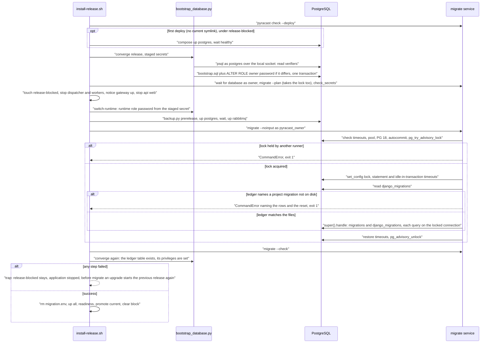

# Database service, role bootstrap and locked schema migrations

The release script (`deploy/install-release.sh`), a developer (`pyracast migrate`, the local launcher), CI and every pytest database build bring the PostgreSQL schema to the state the code expects. In production the script also converges the two application roles, their passwords and the `btree_gist` and `pg_stat_statements` extensions on every release. The overridden `migrate` command serializes runners with a session advisory lock, bounds lock, statement and idle-in-transaction waits and refuses a replaced migration history, so in a release a schema change either completes or leaves the application stopped.

## Entry points

- Command `pyracast migrate` / `python -m django migrate` / `call_command("migrate")` -> `pyracast.accounts.management.commands.migrate.Command`, which replaces Django's command because `pyracast.accounts` is an installed app. `handle` runs `refuse_replaced_history` and then `super().handle` inside `migration_session`. Adds `--lock-timeout-seconds` (default 5), `--statement-timeout-seconds` (default 900) and `--idle-in-transaction-timeout-seconds` (default 0, no bound); every stock flag (`--plan`, `--check`, `--fake`, `--database`) runs inside the same session.
- `deploy/install-release.sh` (root on the VM, started by `.github/workflows/release.yml` through `deploy/release_unit.py`): through compose service `migrate` it runs `check --deploy`, a connection wait, `migrate --plan` and `check_secrets` before maintenance, then `migrate` and `migrate --check` after maintenance starts. `deploy/bootstrap_database.py` has two steps: `converge` (before maintenance and again after `migrate`) feeds `deploy/bootstrap.sql` to `psql` and sets the owner's password; `switch-runtime` sets the runtime role's password once api and web have stopped. A first deployment (no `/opt/pyracast/current` symlink) starts `postgres` first, under the maintenance marker.
- `deploy/compose.yaml`: service `postgres` (image built from `deploy/postgres/Dockerfile`: `postgres:18.7-alpine3.24`, `gosu` removed, `libxml2` from the Alpine v3.24 repository, `pg_hba.conf`, user 70:70; read-only, `pg_isready` health check, `POSTGRES_DB: pyracast`, `--data-checksums`, `shared_preload_libraries=pg_stat_statements`, env file `database.env`) and one-shot service `migrate` (profile `release`, `restart: "no"`, command `pyracast migrate --noinput`, env files `runtime.env` then optional `migration.env`).
- `scripts/dev.py` `start`: runs `python -m django migrate --noinput` on every launcher start through `run_setup` (300 s subprocess timeout, output to `.dev/setup.log`). CI runs `migrate --noinput` and `migrate --check` (`.github/workflows/ci.yml`). `deploy/smoke.sh` converges the roles twice and migrates against a disposable PostgreSQL. Django's `create_test_db` calls the same command for each pytest database.

## Sequence

## Data

| Table | R/W | What |
| --- | --- | --- |
| `django_migrations` | R/W | Applied-migration ledger; read first by the replaced-history check, then for `--plan` and `--check`, written per applied migration, only by the owner |
| every application table | R/W (DDL) | Schema owned by migrations: one `0001_initial` per app (plus `connections` `0002_initial`, which breaks the `regions`/`connections` cycle) and a forward chain per app; a few forward migrations repair or copy rows (for example `metering` 0005 copies one revision per stored `epias_connected` event and prints written and skipped counts; `connections` 0005 fingerprints the stored provider API keys, stops before any change without `PYRACAST_SECRET_KEY` and prints the accounts left without a fingerprint). Objects models cannot declare come from `src/pyracast/schema_objects.py`: `RunSQL` for the composite foreign keys and the row triggers with their functions, `CreateExtension` for `btree_gist` in `accounts` 0001. `src/pyracast/migration_history.py` `HISTORY` lists the applied project migrations in chain order; `src/pyracast/schema_catalog.json` records the catalog of the schema they build |
| `pg_authid`, `pg_database`, `pg_namespace`, `pg_default_acl`, `pg_extension` | W (bootstrap) | Roles `pyracast_owner`, `pyracast_app` and their SCRAM verifiers; database ACL; `public` owner and default privileges; `btree_gist`; `pg_stat_statements` with its view and functions withheld from `PUBLIC`; the runtime role's write privileges on `django_migrations` revoked |
| Advisory lock `(0x50595241, 0x4D494752)` | W | Database-scoped session lock; its two-key space is distinct from the other advisory locks |

## Authorization

- Role separation is the only authorization: `pyracast_owner` owns schema `public` and is the sole DDL identity and the only writer of the ledger; `pyracast_app` has `CONNECT`, schema `USAGE` and default DML and sequence privileges on objects the owner creates (`deploy/bootstrap.sql`). Both are `NOSUPERUSER NOCREATEDB NOCREATEROLE NOREPLICATION`; `PUBLIC` loses database and schema access, and neither role has database `CREATE`.
- Credentials: the release's staged `runtime.env` supplies `pyracast_app`. The migration secret (only `PGUSER` and `PGPASSWORD`, enforced by `migration_files` in `deploy/runtime_secrets.py`) is staged as `migration.env`, which service `migrate` loads after `runtime.env` so the owner identity wins. `install-release.sh` deletes it after the second `converge` and, with the input JSON, in its exit trap. `bootstrap_database.py` requires exactly those role names and reaches the `postgres` superuser through `docker compose exec` over the container socket; `deploy/postgres/pg_hba.conf` trusts the superuser only on the local socket and requires SCRAM over TCP for the two roles.
- The command has no permission check: whoever holds the connection settings can run it, including `--fake`. Releases, backups, the watchdog and the reset tool exclude each other through `/var/lib/pyracast/release.lock` (`flock`, 300 s in the installer).

## Failure paths

| Condition | Result |
| --- | --- |
| Timeout outside 1..2147483 s (idle bound 0..2147483), `OPTIONS["pool"]` set (even `{}`), not PostgreSQL or below 18, caller inside a transaction | `CommandError` before any lock is taken |
| Advisory lock already held (also for `--plan` and `--check`) | `CommandError` "Another Pyracast migration is running", exit 1, the same code `--check` uses for unapplied migrations |
| Physical connection replaced mid-run | Next query or the exit check raises `CommandError` "... session lock was lost"; the new connection is closed |
| Lock wait over 5 s or statement over 900 s | PostgreSQL error from Django; that migration's transaction rolls back, non-atomic migrations keep earlier steps |
| Restore or unlock SQL fails, or the connection is unusable | Connection is closed, which releases the lock; any error propagates |
| Bootstrap role-name mismatch, missing env file or `psql` error | `SystemExit` "Database provisioning failed; inspect database state and secret configuration." and no stderr; one transaction, so nothing is half applied |
| Ledger names a `pyracast.*` migration that is not on disk, in any mode | `CommandError` naming the rows and `deploy/reset_database.py`, before any signal, ledger write or DDL; in a release the `--plan` step fails before maintenance |
| Step before maintenance fails (`check --deploy`, metadata probe, `converge`, connection wait, `--plan`, `check_secrets`) on an existing release | Running release and its staged secrets untouched; the new release directory stays until pruned. On a first deploy the marker exists from the PostgreSQL start onward (`converge` to `check_secrets`), so those failures take the maintenance path |
| A step after maintenance began fails (drain, role switch, backup, `migrate`, `migrate --check`, readiness) | Trap stops the application (the gateway shows the maintenance notice unless the previous release's recovery helper refuses to run beside it) and keeps `release-blocked`, so `pyracast.service` does not start; `current` is not promoted. A failure before `migrate` of an upgrade that began without the marker starts the previous release again. SIGKILL skips the trap but the marker already exists |

## Rules and invariants

- The lock is a session lock on one physical connection because atomic and non-atomic migrations commit in between. Django pooling is rejected; release runs connect directly to service `postgres`. The 5 s lock timeout fails DDL that would queue behind live traffic; releases stop api, dispatcher and workers first, the local launcher keeps already running roles. The previous session values (runtime sessions carry 5 s lock, 60 s statement and 120 s idle-in-transaction timeouts from `DATABASES` options, and `CONN_HEALTH_CHECKS`) are restored afterwards.
- `bootstrap.sql` converges: every statement is idempotent, so the script applies it on every release (and the reset helper and the restore rehearsal apply it too). Verifiers are computed client-side (SCRAM-SHA-256, SASLprep like PostgreSQL) and a role's password is set only when its stored verifier does not verify; the `psql` session disables statement logging so no verifier reaches the server log. The owner's password converges in preflight because the serving release does not use it; the runtime role's changes only in `switch-runtime`, after api and web stopped. First-deploy order: block marker, postgres up, converge, connection wait, `--plan`, `check_secrets`, role switch, backup, migrate; the backup follows role creation.
- `btree_gist` must exist before `accounts` migration 0001 (its `CreateExtension`, ahead of the GiST exclusion constraints of `plants` and `incidents`) because the owner has no database `CREATE`; Django then skips the statement.
- `pyracast.schema_catalog.read_catalog` reads the schema in one statement, as any role: tables, columns with their position, every constraint (the NOT NULL constraints included) with the state of its internal triggers, indexes, sequences with their owning column, triggers with their state, functions with their definition, extensions with their version (not `pg_stat_statements`, which `bootstrap.sql` provisions) and comments, without extension members, owners or privileges. An object of a kind the application never creates (a view, a type, another schema, a policy, a rule, extended statistics and the others the module lists) is a difference. `scripts/write_schema_catalog.py` writes the snapshot from a throwaway database built the way pytest builds its own; a schema change rewrites it in the same change.
- A database restored from `pg_dump` stores 60 CHECK constraints and 6 partial-index predicates in another parsed form (an `IN` list comes back as per-element casts), so its catalog differs from a migrated one although both dump the same text. Compare a restored database only with another restored one.
- The replaced-history check is permanent: Django ignores ledger rows without a file, so a database built from replaced migration files, or restored from an archive taken before the reset, would pass as migrated. Rows of other apps (Django, allauth) are not checked.

## Tests

- `tests/test_migration_command.py` (real PostgreSQL): the initial migration per app, every file on disk once in `HISTORY`, each depending on the one before it and each app ending at its last entry, the replaced-history refusal in every mode, rows of other apps ignored, idempotent run including `--plan` and `--check`, lock held across commits with timeouts restored, contention, failed body, SQL failure and cleanup, bounded lock wait, invalid timeouts, outer transaction, unsupported server (stub object), lost and replaced connection, pooling rejection, the idle-in-transaction bound. Every pytest database is also built through this command. `tests/test_schema_catalog.py` compares the built catalog with `src/pyracast/schema_objects.py` (composite foreign keys, triggers with their function source, extensions) and requires every foreign key to be validated and initially deferred. `tests/test_schema_snapshot.py`: the migrated test database serializes byte for byte to `src/pyracast/schema_catalog.json`; one rolled-back case per kind of change (default, type, moved column, NOT NULL, renamed or redefined constraint, deferrability, a disabled key trigger, index, sequence, trigger, function body, table, storage, row security, extension, comment and each kind that must stay absent) shows the comparison names exactly that object; an unread or unknown category is a difference. `tests/test_deployment_bootstrap.py` (real PostgreSQL for the SQL; a stubbed `psql` for the steps): idempotent convergence, ledger writes refused to the runtime role, SCRAM verifiers equal to PostgreSQL's, passwords changed only when they differ and never logged, `switch-runtime`, role-name refusal. `tests/test_deployment_helpers.py` (syntax of the host helpers, `--help` without dependencies), `tests/test_deployment_secrets.py` (migration and database key sets).
- `deploy/test-release.sh` (CI, mocked docker, curl, python3, systemctl and flock) pins drain, role switch, backup and `migrate` ordering including both `converge` calls, `migrate --check`, the first-deploy branch, SIGKILL safety and `migration.env` cleanup; modes `plan` and `check-secrets` pin that a refused `migrate --plan` or `check_secrets` ends the release before the marker, any stop and the backup. `deploy/smoke.sh` (CI) runs the real `converge` twice, `switch-runtime` and a password rotation, `migrate` as owner, and checks the owner has no database `CREATE`, the runtime role cannot create tables or write the ledger, and no verifier reaches the database log.
- Gaps: default timeouts 5 and 900 and `--plan`/`--check` under contention are unasserted; the launcher's migrate step is mocked (`tests/test_dev_launcher.py`); no Playwright (no UI).
