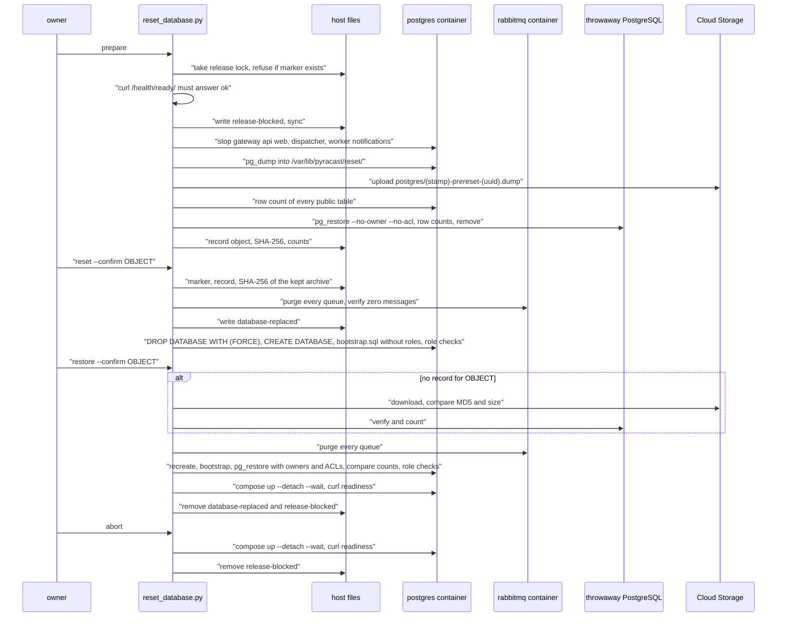

# Database reset and restore

The owner runs `deploy/reset_database.py` as root on the production VM to take the site down with a verified pre-reset archive (`prepare`), to bring the previous release back (`abort`), to replace the database with an empty, provisioned one (`reset`), or to bring the database back from a verified archive and start the previous release (`restore`). It is the procedure of the one-time production reset and the recovery of a release that fails after maintenance began. Each destructive step refuses unless the step before it verifiably succeeded. Nothing in the web or API layers is involved.

## Entry points

- Operator: `python3 /opt/pyracast/current/deploy/reset_database.py /etc/pyracast/host.json {prepare | abort | reset --confirm OBJECT | restore --confirm OBJECT}` (`deploy/reset_database.py` `main`). `host.json` supplies `backup_bucket` and `runtime_secret_version` (`load_host`); the release directory is `/opt/pyracast/current`.
- Reuse: `compose_command` and `upload_backup` from `deploy/backup.py`, `access_token` from `deploy/operations_log.py`; `deploy/runtime_secrets.py` when the host restarted during maintenance.
- Smoke: `deploy/smoke.sh` runs `main` through a driver that replaces only the bucket upload and the public readiness probe.

## Sequence

## Data

| Table | R/W | What |
| --- | --- | --- |
| all tables of database `pyracast` | R, W | `prepare` dumps and counts them; `reset` drops the database; `restore` recreates it from the archive with owners and privileges and compares each table's row count with the record |
| database-level grants, schema `public`, `btree_gist`, default privileges | W | The database part of `deploy/bootstrap.sql`, applied by `reset` and `restore`; roles and their memberships belong to the cluster and survive the drop |
| `postgres/<stamp>-prereset-<uuid>.dump` in the backup bucket | W, R | Uploaded by `prepare`; `restore` downloads an object it has no record for |
| `/var/lib/pyracast/reset/<object>.dump` and `<object>.json` | W, R | The kept archive and its record: object name, SHA-256, row count per table |
| `/var/lib/pyracast/reset/database-replaced` | W, R | Holds the object name from just before `DROP DATABASE` until a `restore` passed its checks; `prepare` removes it |
| `/var/lib/pyracast/release-blocked` | W, R | Written and synced by `prepare`; removed by `abort` and `restore` after readiness |
| RabbitMQ queues | W | Purged by `reset` and `restore`, dead-letter queues included |

## Authorization

- Host: root on the VM (OS Login admin through the IAP tunnel); `host.json` is mode 0600. The tool calls Docker, curl, `sync` and `systemctl` with argument lists, never a shell.
- Bucket: the VM's service account token from the metadata server; it can create and read objects, never overwrite or delete them. The object name must match `postgres/....dump`.
- Destructive steps need `--confirm` naming the recorded archive, the marker, and no running application container.

## Failure paths

| Condition | Result |
| --- | --- |
| Release lock held | "Refused: Another release, backup or watchdog operation holds the release lock...", exit 2 |
| `prepare` with the marker present or the site not ready | Refused before anything is written |
| `prepare` fails after the marker (stop, dump, upload, counts differ, throwaway restore) | Exit 1; the site stays down; the message names `abort`; no record is written, so `reset` refuses that object |
| `abort` after `reset` replaced the database | Refused, naming the `restore` command for the recorded object |
| `abort` or `restore` readiness fails | Exit 1, marker kept; the same command can be run again |
| `reset` or `restore` with no marker, an application container running, an unknown or malformed object, a missing or changed archive, or missing roles | Refused before any purge or drop |
| A queue keeps messages after the purge | Exit 1 before the drop |
| Downloaded object differs from the bucket's MD5 or size | Refused, partial file removed, nothing dropped |
| Restored row counts differ from the record | Exit 1 with the differing tables; marker kept, release not started; `restore` can be run again |

## Rules and invariants

- Stop order equals the installer's: gateway, api, web (100 s), dispatcher (660 s), worker and notifications (660 s). PostgreSQL and RabbitMQ stay up.
- An archive is used only when its record exists and its file still has the recorded SHA-256; a record is written only after a throwaway restore succeeded (and, in `prepare`, matched the live row counts).
- Queues are purged before every drop: primary keys restart at 1, so a leftover message would address an unrelated row.
- The throwaway restore uses the PostgreSQL image of the current release, no network, and is removed in `finally`. The live restore keeps owners and ACLs.
- `restore` starts the release `/opt/pyracast/current` points to; the tool never changes that link or the installer.

## Tests

- `tests/test_deployment_reset.py` with a fake `subprocess`: stop order and marker before the stops, upload and kept archive, every refusal before a destructive call, count mismatch, lock, verification cleanup and readiness wait, queue purge and drop order, bootstrap without role statements, restore with owners, download checksum, host restart, the command line's exit codes and next steps. `tests/test_deployment_helpers.py`: Python 3.12 syntax and `--help` without dependencies.
- `deploy/smoke.sh` (CI and Release): `prepare` then `abort` serves again; `prepare`, `reset`, a pre-release dump of the empty database, `migrate` from zero under the restricted owner and a start; the stop of a failed release, then `restore`: row counts, table owners, the runtime role's missing DDL right and a stored password are back and the site is ready.
- Gaps: the real bucket upload and download, the production readiness probe and the release lock on the VM run first on the host. No Playwright coverage applies.
