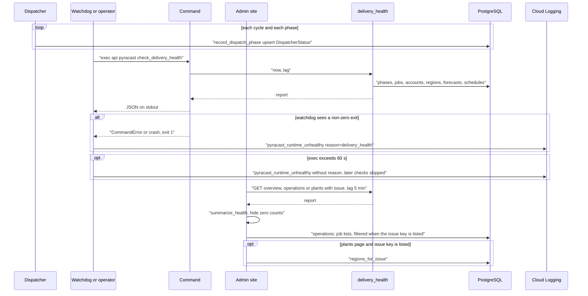

# Collection and delivery health report

The host watchdog (60 s after each run ends), an operator running `pyracast check_delivery_health`, and a platform administrator opening the console Overview, Operations or filtered Plants pages all call the same function, `delivery_health`. It reads dispatcher progress and the state of collection, email and EPIAS jobs, provider accounts, regions and reminder schedules and returns one flat report with `healthy` true only when every counter except the informational `saved_forecast_notifications` and `paused_notifications` is zero and every dispatcher phase succeeded within the allowed lag. The command prints the report as JSON and exits non-zero when unhealthy; the console renders the same counters as grouped health checks.

## Entry points

- Command `check_delivery_health [--max-lag-minutes N]` (`pyracast.forecasts.management.commands.check_delivery_health`, `Command.handle`). Default lag 5, values below 1 are rejected.
- Watchdog `deploy/watchdog.py` `supervise` (systemd `pyracast-watchdog.timer`): runs `docker compose exec -T api pyracast check_delivery_health` with a 60 s timeout, only when no `release-blocked` marker exists, the release lock is free and `pyracast.service` is active; it runs after the restart step, which is skipped when nothing failed and raises when containers do not recover (then no health check runs).
- Console `GET /admin/` (`PlatformAdminSite.index`, `overview_context`), `GET /admin/operations/?issue=<key>` (`PlatformAdminSite.operations`, `operations_context`), `GET /admin/plants/?issue=<key>` (`PlatformAdminSite.plants`, `plant_list_context`, report computed only when `issue` is non-empty). The console always uses a fixed 5 minute lag.
- Producer of the phase rows: `pyracast dispatch --loop` (`dispatch.Command.handle`, every 30 s in Compose) via `record_dispatch_phase`. No customer frontend (`web/`) screen is involved.

## Sequence

## Data

| Table | R/W | What |
| --- | --- | --- |
| `forecasts_dispatcherstatus` | R (W by dispatcher) | One row per phase: attempted, succeeded, last error code; `duration_ms` and `published` are written but not read |
| `forecasts_collectionjob`, `metering_epiascollectionjob` | R | Waiting, running or last-24h failed jobs of non-deleted regions (collection) or plants (EPIAS) |
| `notifications_notificationdelivery` | R | Waiting, sending or last-24h deliveries, including prepared message kind |
| `notifications_reminderschedule`, `accounts_membership`, `account_emailaddress`, `auth_user` | R | Enabled current schedules of approved regions; recipients resolved and validated in Python, membership and address reads per schedule when needed |
| `connections_provideraccount` | R | Cooldown and authentication-failed revision of enabled accounts used by approved regions |
| `regions_region`, `connections_sitebinding`, `forecasts_collectionschedule` | R | Approved regions on enabled accounts, validated credential revision, collection switch |
| `forecasts_forecastsnapshot`, `forecasts_forecastresult` | R | Newest succeeded (job status) published forecast per binding |

## Authorization

- Command and watchdog: no application check. Access is shell or Docker access on the host.
- Console views: `PlatformAdminSite.has_permission` requires an active staff superuser (Django's `is_active` and `is_staff` check plus `is_superuser`) with verified MFA (`has_verified_mfa`); each route is wrapped in `admin_view` (index through Django's own wrap). Others are redirected via the admin login to `/app/?next=/admin/`.
- The report holds `checked_at`, counts and phase names only, no error codes, tenant data, addresses or keys (key and invalid address absence pinned by tests). The Operations page adds phase error codes (exception class names), company and plant names and recipient addresses for the administrator.

## Failure paths

| Condition | Result |
| --- | --- |
| Any non-informational counter above zero or any phase missing, failed or older than the lag | JSON printed, `CommandError` "Collection or notification delivery needs attention.", exit 1 |
| `--max-lag-minutes` below 1 | `CommandError` before any query |
| Database unreachable | Unhandled exception, exit 1, no JSON (watchdog sees it as unhealthy); console page fails with a server error |
| Command still running after 60 s | `TimeoutExpired` in `main`, event `pyracast_runtime_unhealthy` without reason, exit 1, backup-age and capacity checks skipped |
| Non-zero exit inside watchdog | Event `pyracast_runtime_unhealthy` with `reason=delivery_health`, output discarded, run continues |
| `?issue=` key unknown or its count is zero (summary omits zero counts) | Page renders unfiltered, no filter chip |
| Operations `?issue=` for a plant-scoped key | Every job and dispatch section is hidden (section derived from the link fragment) |

## Rules and invariants

- Unhealthy phase: no row, `succeeded_at` null or older than `now - lag`, or non-empty `last_error`. A failed run keeps the earlier `succeeded_at`; a failed status write leaves the row to go stale.
- Waiting work is `pending` or `retry` with `available_at` (EPIAS: `next_attempt_at`) older than the lag. Interrupted is `running` or `sending` with an expired or null lease. `awaiting_publication` EPIAS jobs count as neither.
- Failed, uncertain and unavailable outcomes and delivery-shaped counters look back 24 hours by scheduled time. A later success does not clear them.
- Cooldowns, credential blocks and unvalidated credentials make the CLI unhealthy even though the console classes cooldowns as "delay" and failed or missed outcomes as "review". Only `saved_forecast_notifications` and `paused_notifications` (last-24h `skipped` deliveries with `recipient_limit_exceeded`, `no_recipients` or `invalid_recipient`) are informational and never affect `healthy`, so a customer's own over-limit or empty recipient list does not page the operator; the console still lists paused deliveries as "review". A stored invalid address also keeps raising `invalid_reminder_recipients`, which does affect `healthy`.
- A region is stale when it is approved, on an enabled account, not switched off by its schedule, and its newest succeeded published forecast is missing or older than 26 hours. Collection and email rows of soft-deleted regions and EPIAS rows of soft-deleted plants are excluded.
- `admin_health_queries` repeats the predicates of `delivery_health`; parity is test-pinned, not shared in code. Cooldown and blocked-credential counters count provider accounts while their links list every affected region. Calibration runs are not monitored; the calibration phase only proves the dispatch step ran.

## Tests

- `tests/test_delivery_health.py`: phases, counters, leases, credential rotation, recipients, paused deliveries kept out of `healthy` and `missed_notifications`, command JSON and exit, query budget of 8. `tests/test_dispatch_recovery.py`: the dispatcher writes phase rows.
- `tests/test_admin_health.py` (summary and categories), `tests/test_admin_health_queries.py` (each issue filter equals its counter, 24 h boundary), `tests/test_admin_health_views.py` (filtered pages, dispatch section), `tests/test_admin_workspace.py` (non-admins redirected, no provider or email I/O on GET), `tests/test_language.py` (Overview and Operations render in Turkish). `tests/test_deployment_watchdog.py` only asserts the command is issued and that a zero exit emits no event. Playwright: `web/integration/admin-csp.spec.ts` (filtered Operations page under CSP).
- Gaps: no test that a non-zero exit or timeout produces the watchdog event, no query budget with several schedules or memberships, no test for `--max-lag-minutes` changing a result.
