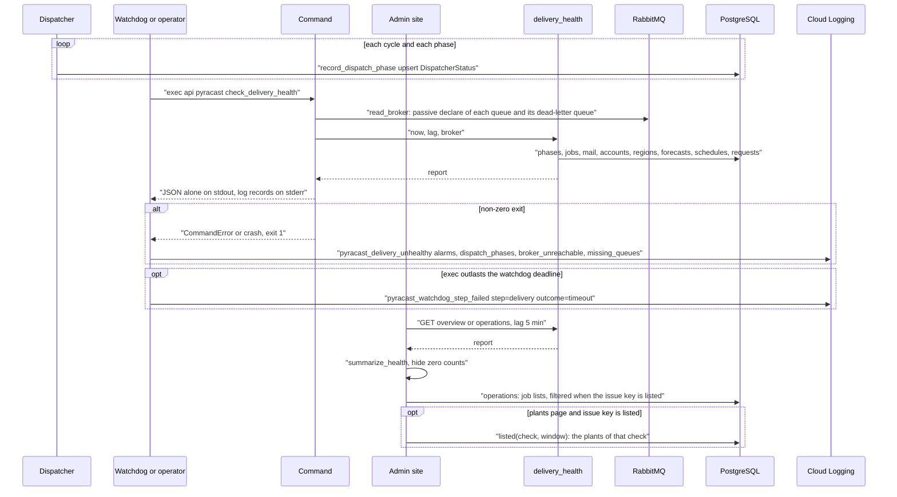

# Collection and delivery health report

The host watchdog (at most every five minutes), an operator running `pyracast check_delivery_health`, and a platform administrator opening the console Overview, Operations or filtered Plants pages all read the same typed report, `orchestration.delivery_health.HealthReport`. It reads dispatcher progress and the state of collection, reminder, outbound mail, EPIAS and calibration jobs, provider accounts, regions and reminder schedules, plus the broker queues, and has `healthy` true only when every alarm counter is zero, every dispatcher phase succeeded within the allowed lag, the broker answers and every work queue is declared. The command prints the report as JSON, with `alarms` naming each alarm counter above zero, and exits non-zero when unhealthy; the watchdog turns a failing report into one `pyracast_delivery_unhealthy` event, and the console renders the same counters as grouped health checks.

## Entry points

- Command `check_delivery_health [--max-lag-minutes N]` (`pyracast.orchestration.management.commands.check_delivery_health`, `Command.handle`). Default lag 5, values below 1 are rejected. It reads the broker, then the database inside one transaction with `statement_timeout` 10 s.
- Watchdog `deploy/watchdog.py` `check_delivery` (systemd `pyracast-watchdog.timer`): runs `docker compose exec -T api pyracast check_delivery_health` at most every 300 s (the mtime of `/var/lib/pyracast/delivery-checked`), as its own step under the watchdog's 210 s deadline; it runs only when no `release-blocked` marker exists and `pyracast.service` is active, and whatever the restart step found.
- Console `GET /admin/` (`PlatformAdminSite.index`, `overview_context`), `GET /admin/operations/?issue=<key>` (`pages.operations`, `operations_context`, which also reads the broker), `GET /admin/plants/?issue=<key>` (`pages.plants`, `plant_list_context`, which lists the plants of one check without computing the report). The console always uses the fixed 5 minute lag.
- Producer of the phase rows: `pyracast dispatch --loop` (flow `dispatcher-cycle`). The checks themselves are the table `orchestration.delivery_health.CHECKS`, one condition per key shared by the counter and the console list. No customer frontend (`web/`) screen is involved.

## Sequence

## Data

| Table | R/W | What |
| --- | --- | --- |
| `forecasts_dispatcherstatus` | R (W by dispatcher) | One row per phase: attempted, succeeded, last error code, `duration_ms`, `published`; the Operations workers panel shows them |
| `forecasts_collectionjob`, `metering_epiascollectionjob`, `plants_calibrationrun` | R | Waiting, running or last-24h failed jobs of regions outside the trash |
| `notifications_notificationdelivery` | R | Waiting, sending or last-24h deliveries; the unavailable, partial and saved-forecast checks read the typed `forecast_kind` and `forecast_complete`. The delivery table of `delivery_health.TABLES` defers `prepared_message`, so no check or console list selects the rendered mail |
| `notifications_outboundmail` | R | Waiting, sending, last-24h failed and uncertain mail |
| `notifications_reminderschedule`, recipient rows and ties, `accounts_membership`, `account_emailaddress` | R | Enabled schedules of approved regions outside the trash whose provider account is enabled; recipients validated in Python after at most three statements for all tenants, members read only for workspaces whose schedules include them, tie an address or are not sent hidden; a plant also counts as invalid when that read of people holds an address that is not plain (`notifications.operations.invalid_recipient_region_ids`) |
| `connections_provideraccount` | R | Cooldown and authentication-failed revision of enabled accounts used by approved regions |
| `regions_region`, `connections_sitebinding`, `forecasts_collectionschedule` | R | Approved regions on enabled accounts, validated credential revision, collection switch |
| `forecasts_forecastsnapshot`, `forecasts_forecastresult` | R | Newest succeeded (job status) published forecast per binding |
| `forecasts_requestattempt` | R | Provider requests per binding and UTC day over seven days |
| RabbitMQ queues | R | Message, consumer and dead-letter counts per work queue (`background.broker.queue_states`) |

## Authorization

- Command and watchdog: no application check. Access is shell or Docker access on the host.
- Console views: `PlatformAdminSite.has_permission` requires an active staff superuser with MFA evidence (`accounts.security.has_mfa_evidence`); each route is wrapped in `admin_view` (index through Django's own wrap). Others are redirected via the admin login to `/app/?next=/admin/`.
- The printed report holds `checked_at`, counts, phase names and queue counts only, no error codes, tenant data, addresses or keys (key and invalid address absence pinned by tests). The Operations page adds phase error codes (exception class names, `items_failed:<n>` or `collection_regions_failed:<n>`), company and plant names and recipient addresses for the administrator.

## Failure paths

| Condition | Result |
| --- | --- |
| Any alarm counter above zero, any phase missing, failed or older than the lag, an unreachable broker or a missing work queue | JSON printed, `CommandError` "Collection or notification delivery needs attention.", exit 1 |
| `--max-lag-minutes` below 1 | `CommandError` before any query |
| Broker does not answer | Logged as `health_broker_unreadable`; `broker.reachable` false, report unhealthy even when every phase succeeded; the read tries once more on a fresh connection |
| A queue the broker has not declared | Its channel closes alone; the queue reads as `missing` (counts `null`, `dead_letters_missing` for the dead-letter queue) while other counts stay. A missing work queue fails the report (nothing consumes it); a missing dead-letter queue does not |
| Database unreachable | Unhandled exception, exit 1, no JSON (watchdog sees it as unhealthy); console page fails with a server error |
| A statement runs longer than 10 s | The command fails inside its slot, exit 1 |
| Command outlasts the watchdog's remaining time | `TimeoutExpired`, event `pyracast_watchdog_step_failed` with `step=delivery` and `outcome=timeout`, exit 1 |
| Non-zero exit inside watchdog | Event `pyracast_delivery_unhealthy` with the report's `alarms`, `unhealthy_dispatch_phases` (as `dispatch_phases`), `broker_unreachable` and `missing_queues`; other steps continue. Stdout that is not a report object with those fields, or whose `broker.queues` is not a mapping of queue states, gives `outcome: unreadable` with `exit_status`. Stderr is not parsed |
| `?issue=` key unknown, on another page's scope, or its count is zero (summary omits zero counts) | Page renders unfiltered, no filter chip |
| Operations `?issue=` for a plant-scoped key | Every job and dispatch section is hidden (section derived from the link fragment) |

## Rules and invariants

- Unhealthy phase: no row, `succeeded_at` null or older than `now - lag`, or non-empty `last_error`. A failed run keeps the earlier `succeeded_at`; a failed status write leaves the row to go stale. A phase that records `items_failed:<n>` is unhealthy.
- Waiting work is `pending` or `retry` with `available_at` older than the lag for collections and reminders, and `pending` only for EPIAS jobs, which have no `retry` status. Interrupted is `running` or `sending` with an expired lease (a null lease on those statuses cannot be stored). A calibration run is overdue a lag after its claim may take it, and never before a lag after it started waiting (`available_at`, set at creation and at each requeue; null reads as its creation).
- Failed and uncertain outcomes and delivery-shaped counters look back 24 hours by scheduled or finish time. A later success does not clear them.
- Informational counters never affect `healthy`: `saved_forecast_notifications`, `paused_notifications` (last-24h `skipped` deliveries with `recipient_limit_exceeded`, `no_recipients` or `invalid_recipient`, so a customer's own over-limit or empty list does not page the operator) and `queued_calibrations` and `running_calibrations`. A stored invalid address still raises `invalid_reminder_recipients`, which is an alarm. The console still lists paused deliveries as "review", and cooldowns as "delay".
- Outbound mail: `overdue_outbound_mail` (waiting past the lag, or sending with an expired lease), `failed_outbound_mail` and `uncertain_outbound_mail` (last day, never resent) are alarms; the console links them to the outbound mail admin list, the uncertain count to the list filtered by `status=uncertain`.
- A region is stale when it is approved, on an enabled account, not switched off by its schedule, and its newest succeeded published forecast is missing or older than 26 hours; a region whose first forecast job is still open is watched by the job checks instead. Collection, email and metering rows of trashed regions are excluded; a plant has no trash of its own.
- Counter and console list use one condition per key; cooldown and blocked-credential counters count provider accounts while their links list every affected region. Calibration alarms are overdue, interrupted and failed runs. Queue counts are informational.

## Tests

- `tests/test_delivery_health.py`: phases, counters, leases, credential rotation, recipients, paused deliveries, command JSON and exit, per-statement bound, bounded query budget. `tests/test_delivery_health_contract.py`: every printed key with its type. `tests/test_health_report.py`: calibration checks, provider requests, the broker section (unanswered, lost connection, undeclared and dead-letter queues), stale plants, event mail, the lag argument, a fixed statement count whatever the tenants.
- `tests/test_health_checks.py` and `tests/test_admin_health.py` (presentation, summary and categories), `tests/test_admin_health_queries.py` (each issue filter equals its counter, 24 h boundary), `tests/test_admin_health_views.py` and `tests/test_admin_health_console.py` (filtered pages, dispatch and workers panels, queues), `tests/test_admin_workspace.py` (non-admins redirected, no provider or email I/O on GET), `tests/test_language.py` (Overview and Operations render in Turkish). Playwright: `web/integration/admin-csp.spec.ts` (filtered Operations page under CSP).
- `tests/test_delivery_metadata.py`: the checks and the console read the typed metadata of deliveries whose rendered mail was cleared, and no health or history query selects `prepared_message`.
- `tests/test_deployment_watchdog.py`: the delivery check runs at most every five minutes, a non-zero exit writes `pyracast_delivery_unhealthy` with the failing fields or `outcome: unreadable`, and a timeout still lets the other steps run.
