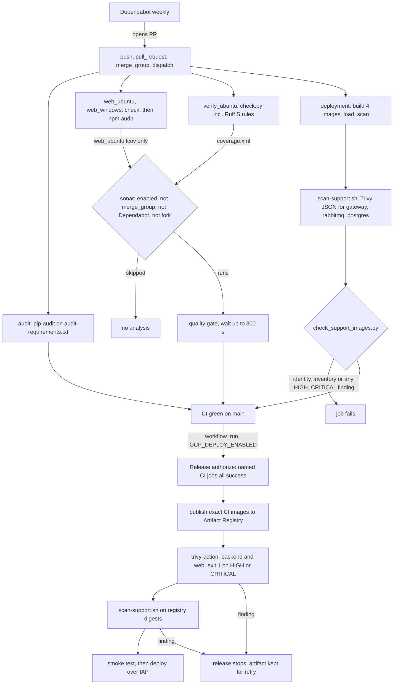

# Scan code, dependencies and images

GitHub Actions runs the scans: CI on every push to `main`, pull request, merge group and manual dispatch, and Release again for the images it publishes. Dependabot opens weekly update pull requests that go through the same CI. A red scan fails its CI run (whether that blocks a merge depends on branch protection, which is outside the repository) and keeps Release from deploying; no scan result is stored or shown anywhere in the product.

## Entry points

- No screen, endpoint, table or application permission. Actors: CI, the release workflow, Dependabot and a developer.
- `.github/workflows/ci.yml` job `audit` (display name "Dependency audit"): `uv export` then `pip-audit --strict --no-deps --disable-pip`.
- `.github/workflows/ci.yml` jobs `web_ubuntu` and `web_windows` (shared `*web-steps` anchor): step `npm audit --audit-level=low` in `web/`, after `npm run check` (Windows) or `check:coverage` (Linux) and before the browser test.
- `.github/workflows/ci.yml` job `deployment`, step "Scan gateway, RabbitMQ and PostgreSQL": `deploy/scan-support.sh`, which ends in `deploy/check_support_images.py`.
- `.github/workflows/ci.yml` job `sonar` with `sonar-project.properties`: Sonar quality gate over Python and TypeScript, only when `vars.SONAR_ENABLED == 'true'`.
- `.github/workflows/release.yml` job `deploy`: two `aquasecurity/trivy-action` steps (backend, web), then `deploy/scan-support.sh` again. Job `authorize` re-checks the CI scan jobs.
- `.github/dependabot.yml`: ten weekly ecosystems (uv, github-actions, four docker directories, docker-compose, gomod, terraform, npm).
- `scripts/check.py` lint runs Ruff with the bandit rules (`S` in `pyproject.toml`, `S101` allowed in tests), so `verify_ubuntu` and both `verify_windows_shards` jobs also do static security linting of Python; `verify_windows` runs `check.py --combine-shards`, which replaces the command list with coverage combine, report and xml and runs no Ruff.
- `qodana.yaml` is local-only (no workflow, script or hook runs Qodana). A developer runs the two README `pip-audit` commands or `bash deploy/scan-support.sh GATEWAY_IMAGE POSTGRES_IMAGE`.

## Sequence

## Data

No database table is read or written. Artifacts:

| Artifact | R/W | What |
| --- | --- | --- |
| `audit-requirements.txt` | W (CI, git-ignored) | Fully pinned export of every group and extra, input to `pip-audit` |
| `coverage.xml`, `web/coverage/lcov.info` | W then R | Produced by the Linux test jobs, uploaded, consumed by `sonar` (paths in `sonar-project.properties`) |
| `compose.json`, `<service>.json`, `<service>.image` in a temp dir; Docker volume `pyracast-trivy-<run>-<pid>` | W then R | Resolved compose file, Trivy report and image id per support image, Trivy DB cache; all removed by the `scan-support.sh` trap |
| Artifact `release-images-<sha>-<attempt>`; `BACKEND_IMAGE` ... `POSTGRES_IMAGE` in `$GITHUB_ENV` | R; W then R | Release reads the CI image archives; `oci-images.sh publish` writes the registry digest refs that the Trivy steps and `scan-support.sh` read; job `cleanup` deletes the artifact only after `deploy` succeeds |

## Authorization

- Sonar: `SONAR_TOKEN` secret plus `SONAR_PROJECT_KEY` and `SONAR_ORGANIZATION` variables, validated by the "Validate Sonar configuration" step. The job `if:` skips fork pull requests and `dependabot[bot]` runs (which get no Actions secrets) and every `merge_group` run.
- Release: `authorize` runs only with `vars.GCP_DEPLOY_ENABLED == 'true'` on `main` after a successful CI `workflow_run` (or a dispatch), and accepts only the current `main` SHA with a successful `push`/`workflow_dispatch` `ci.yml` run of this repository and one unexpired image artifact. `deploy` runs in environment `production` with a workload-identity token. The Trivy steps run after registry login and publication and before any production change.

## Failure paths

| Condition | Result |
| --- | --- |
| Any Python advisory in any group or extra, or a pin pip-audit cannot collect (`--strict`) | Job `audit` fails |
| Any npm advisory of any severity, including dev dependencies | Step fails in both web jobs; the browser test after it does not run |
| Support image has a HIGH or CRITICAL finding, fixed or not | `check_support_images.py` exits "Support image gate failed: ..." naming the first finding; CI `deployment` or Release `deploy` fails |
| Report is for another or non-`sha256:` image id, has no OS family, an empty `Results` list or no packages | Same gate: "scan does not match the selected immutable image", "image inventory is missing" or "package inventory is missing" |
| Wrong argument count, failed pull, Trivy error, or a report without `Results` (`jq '.Results[]'` aborts) | `scan-support.sh` exits non-zero under `set -e` (usage: exit 2) before the checker runs |
| Non-gateway compose image not pinned by digest | `scan-support.sh` exits 1 "Pin the <service> image to an immutable digest." |
| Backend or web image has HIGH or CRITICAL finding | Release `deploy` fails at the `trivy-action` step; images stay in the registry, production untouched |
| Sonar quality gate red or timeout (300 s) | Job `sonar` fails, so the CI run fails and `authorize` is skipped (or, on dispatch, finds no successful run) |
| Sonar variables missing | "Missing Sonar configuration: ..." |
| Required job missing or not `success` (including skipped) at authorize | "Every required CI job must pass for this run" |

## Rules and invariants

- No vulnerability exceptions: `--ignore-unfixed=false`, `--ignorefile /dev/null` in `scan-support.sh`, no `.trivyignore` tracked. Trivy itself never sets a failing exit code in `scan-support.sh`; the Python checker is the gate, and it trusts Trivy's `--severity` filter.
- A scan only counts for the image it names: Trivy scans the local image id, and the checker compares `Metadata.ImageID` with the recorded id. The gateway alone may be a mutable tag (`pyracast-gateway:ci` in CI).
- Backend and web images are scanned only at Release, after publication. CI never scans them.
- Results depend on today's advisory databases, so an unchanged SHA can turn red. Release re-runs only the image scans: a Python or npm advisory published after the green CI run does not stop the release.
- Release matches CI job display names as strings (`Dependency audit`, `Web (ubuntu-latest)`, `Sonar quality gate`, ...). Renaming a job in `ci.yml` breaks authorization until `release.yml` is changed.
- Trivy 0.76.2 is written in three places (`release.yml` twice as an action input, `scan-support.sh` as an image digest). No Dependabot entry covers action inputs or shell scripts.
- Sonar analyses only `src,scripts,.agents/hooks.py,.github,web/src,web/testing`; `deploy/`, `infra/` and Dockerfiles are outside. Coverage comes from the Linux jobs only.

## Tests

- `tests/test_support_images.py` pins `check_support_images`: clean reports, any vulnerability per service, mismatched id, missing OS, results or packages, missing report file.
- CI validates the workflows and shell scripts (`actionlint`, `shellcheck deploy/*.sh` in job `deployment`).
- Gaps: `deploy/check_support_images.py main`, `scan-support.sh`, `.github/dependabot.yml`, `sonar-project.properties`, `qodana.yaml` and the `authorize` script have no automated test. `deploy/` is outside the coverage source and outside Sonar. No Playwright test applies.
