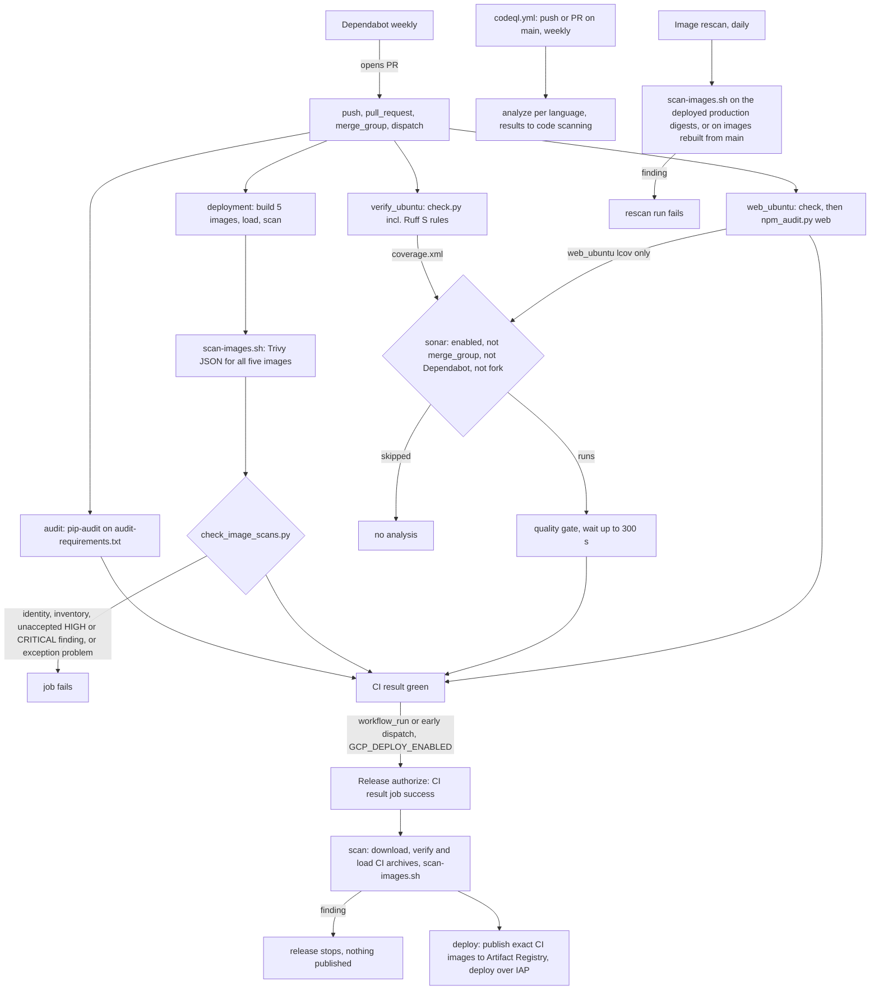

# Scan code, dependencies and images

GitHub Actions runs the scans: CI on every push to `main`, pull request, merge group and manual dispatch, CodeQL code scanning on pushes to and pull requests for `main` and weekly, Release again for the images it publishes, and a daily rescan of the release images. Dependabot opens weekly update pull requests that go through the same CI. A red scan fails its CI run (whether that blocks a merge depends on branch protection, which is outside the repository) and keeps Release from deploying; no scan result is stored or shown anywhere in the product.

## Entry points

- No screen, endpoint, table or application permission. Actors: CI, the code scanning workflow, the release workflow, the rescan workflow, Dependabot and a developer.
- `.github/workflows/codeql.yml` job `analyze` ("CodeQL Advanced"; push and pull request on `main`, weekly schedule): one matrix entry per language (`actions`, `javascript-typescript`, `python`, each `build-mode: none`) runs `github/codeql-action` `init` and `analyze` and uploads its results to GitHub code scanning under `/language:<language>`.
- `.github/workflows/ci.yml` job `audit` (display name "Dependency audit"): `uv export` then `pip-audit --strict --no-deps --disable-pip`.
- `.github/workflows/ci.yml` job `web_ubuntu` (shared `*web-steps` anchor with `web_windows`): step `scripts/npm_audit.py web`, after `check:coverage` and before the browser scenarios; the Windows job skips it.
- `.github/workflows/ci.yml` job `deployment`, step "Scan every image; block every high or critical vulnerability": `deploy/scan-images.sh` for the backend, web, gateway, RabbitMQ and PostgreSQL images, which ends in `deploy/check_image_scans.py`.
- `.github/workflows/ci.yml` job `sonar` with `sonar-project.properties`: Sonar quality gate over Python, TypeScript, deployment code and Dockerfiles, only when `vars.SONAR_ENABLED == 'true'`.
- `.github/workflows/release.yml` job `scan`: downloads the CI image archives, verifies and loads them and runs `deploy/scan-images.sh` again before job `deploy` authenticates to the cloud. Job `authorize` (`deploy/release_authorization.py`) accepts a CI run only when its `CI result` job succeeded.
- `.github/workflows/image-rescan.yml` job `rescan` ("Image rescan", daily and on dispatch): with the repository variable `GCP_IMAGE_RESCAN` (Terraform's `image_rescan_setting`, read by `deploy/image_rescan.py`) it logs in to the registry with a read-only workload identity and scans the five deployed `production` images; without it, it rebuilds the five images from `main` and scans those.
- `.github/dependabot.yml`: six weekly ecosystems (uv, github-actions, docker with five directories, gomod, terraform, npm), Monday 05:00 Europe/Istanbul, each with a cooldown (5 days; 14 for uv and npm majors), groups for uv, npm and actions, and ignores for the `python` and `node` base-image majors (python minors too), `uv-build` and `typescript` 6 and later.
- `scripts/check.py` lint runs Ruff with the bandit rules (`S` in `pyproject.toml`, `S101` allowed in tests), so `verify_ubuntu` and Windows shard 1 of `verify_windows_shards` also do static security linting of Python; shards 2 to 4 run `--tests-only` and `verify_windows` runs `check.py --combine-shards`, which run no Ruff.
- Qodana is local-only (no workflow, script or hook runs it): `qodana scan --config qodana.yaml` for Python and `qodana scan --only-directory web --config qodana-js.yaml` for `web/`, both native, both failing on a critical or high finding, with `QODANA_TOKEN` in the environment. A developer runs the README `pip-audit` commands or `bash deploy/scan-images.sh BACKEND_IMAGE WEB_IMAGE GATEWAY_IMAGE POSTGRES_IMAGE RABBITMQ_IMAGE`.

## Sequence

## Data

No database table is read or written. Artifacts:

| Artifact | R/W | What |
| --- | --- | --- |
| `audit-requirements.txt` | W (CI, git-ignored) | Fully pinned export of every group and extra, input to `pip-audit` |
| `coverage.xml`, `web/coverage/lcov.info` | W then R | Produced by the Linux test jobs, uploaded, consumed by `sonar` (paths in `sonar-project.properties`) |
| `compose.json`, `<service>.json`, `<service>.image` in a temp dir; Docker volume `pyracast-trivy-<run>-<pid>` | W then R | Resolved compose file, Trivy report and image id per image, Trivy DB cache; all removed by the `scan-images.sh` trap |
| Artifact `release-images-<sha>-<attempt>` | W (CI `deployment`), R | Release `scan` and `deploy` read the CI image archives; job `cleanup` deletes the artifact only after `deploy` succeeds |

## Authorization

- Sonar: `SONAR_TOKEN` secret plus `SONAR_PROJECT_KEY` and `SONAR_ORGANIZATION` variables, validated by the "Validate Sonar configuration" step. The job `if:` skips fork pull requests and `dependabot[bot]` runs (which get no Actions secrets) and every `merge_group` run.
- Release: `authorize` runs only with `vars.GCP_DEPLOY_ENABLED == 'true'` on `main` after a successful CI `workflow_run` or a dispatch, and accepts only the current `main` SHA with a successful `push`/`workflow_dispatch` `ci.yml` run of this repository whose `CI result` job passed, and one unexpired image artifact. `scan` holds read permissions only and no cloud credential; `deploy` runs in environment `production` with a workload-identity token.
- Rescan: only the read-only registry identity named by `GCP_IMAGE_RESCAN`; a run without the variable has no cloud access.
- Code scanning: the workflow token reads contents only; job `analyze` adds `security-events: write` for the upload, and the checkout keeps no credential (`persist-credentials: false`).

## Failure paths

| Condition | Result |
| --- | --- |
| Any Python advisory in any group or extra, or a pin pip-audit cannot collect (`--strict`) | Job `audit` fails |
| An npm advisory (any severity, dev dependencies included) that `web/audit-exceptions.json` does not accept for its package, an exception without a reason, past its expiry date or no longer reported, a malformed file or report, an exception with a date not in canonical `YYYY-MM-DD` form or a blank advisory or package, or a second exception for the same advisory and package | `npm_audit.py` prints each advisory and exception failure and exits 1; a malformed file, report or exception (bad date, blank field, duplicate) stops it at once with an error; the browser scenarios after it do not run |
| An image has a HIGH or CRITICAL finding, fixed or not, that `deploy/image-scan-exceptions.json` does not accept for exactly that service, id and package until the end date (UTC day) | `check_image_scans.py` prints every unaccepted finding and exits "Image scan gate failed: N high or critical findings and M exception problems."; CI `deployment`, Release `scan` or the rescan fails |
| Exception without a reason, expired, no longer reported, malformed, duplicated or the file missing | Same gate, "Image scan gate failed: ..." |
| A finding whose `VulnerabilityID` or `PkgName` is not text | The gate fails with "Image scan gate failed: `<service>`: `<field>` of a finding is not text." |
| Report is for another or non-`sha256:` image id, has no OS family, an empty `Results` list or no packages, or a service report is missing | Same gate: "scan does not match the selected immutable image", "image inventory is missing" or "package inventory is missing" |
| Report without a `Results` or `Metadata` key | Same gate, naming the missing key ("Image scan gate failed: 'Results'") |
| Wrong argument count, Compose config error, an image reference `jq` cannot read from the rendered Compose file, or a Trivy error | `scan-images.sh` exits non-zero under `set -e` (usage: exit 2) before the checker runs |
| Sonar quality gate red or timeout (300 s) | Job `sonar` fails, so the CI run fails and `authorize` finds no passing `CI result` |
| Sonar variables missing | "Missing Sonar configuration: ..." |
| `CI result` job missing or not `success` at authorize | "The CI result job of CI run N did not pass" |
| A CodeQL analysis fails or exceeds 30 minutes | That language's job fails (the others still run, `fail-fast: false`); CI and Release do not read it |

## Rules and invariants

- Image scan exceptions exist only as entries of `deploy/image-scan-exceptions.json` (`service`, `vulnerability`, `package`, `reason`, `expires`), which `check_image_scans.py` reads from the `deploy/` tree mounted beside it; Trivy keeps `--ignore-unfixed=false` and `--ignorefile /dev/null`, and no `.trivyignore` is tracked. Every accepted finding is printed with its end date and each service line reads `HIGH/CRITICAL=N, accepted=N`. Trivy itself never sets a failing exit code; the Python checker is the gate, and it trusts Trivy's `--severity` filter. npm advisories follow the same discipline in `web/audit-exceptions.json`.
- A scan only counts for the image it names: `scan-images.sh` scans each image by the id of the image the release built (`docker image inspect`), pulls nothing, and the checker compares `Metadata.ImageID` with the recorded id. CI and Release scan the archives they built or downloaded; the rescan pulls the deployed tags itself before the script runs.
- Results depend on today's advisory databases, so an unchanged SHA can turn red. Release re-runs only the image scans: a Python or npm advisory published after the green CI run does not stop the release, and the daily rescan reports image advisories published after a deploy.
- CodeQL runs once per ref (`concurrency` group `codeql-<ref>`): a newer run cancels an older one except on `main`, where runs queue. Its findings live in GitHub code scanning only; whether they block a merge is a repository setting.
- Release authorizes by the display name `CI result` (and names a few other CI jobs). Renaming a job in `ci.yml` breaks authorization until `deploy/release_authorization.py` is changed.
- Trivy is pinned once, as an image digest in `deploy/scan-images.sh`; `tests/test_version_pins.py` checks every location of each pinned version, image digest and action commit. No Dependabot entry covers shell scripts.
- Sonar analyses `src`, `scripts`, `deploy`, `infra`, both Dockerfiles, `.agents/hooks.py`, `.github`, `web/src` and `web/testing`; coverage comes from the Linux jobs only and excludes `scripts`, `.github` and `web/testing`.

## Tests

- `tests/test_image_scans.py` pins `check_image_scans` and the script text: five images, no pull, no ignore file, every finding and report defect, and every exception rule (exact match, end date, reason, unneeded, malformed, duplicate, missing file).
- `tests/test_npm_audit.py`: advisory identity, exceptions by package, expiry, reason and removal, malformed files and reports, npm statuses.
- `tests/test_version_pins.py`: one version, digest and action commit everywhere; Dependabot coverage and cooldown. `tests/test_release_workflow.py` and `tests/test_release_authorization.py`: the release `scan` job, the rescan workflow, authorization by `CI result`, every workflow's actions pinned by commit and its calls within its job's permissions (the CodeQL upload included).
- CI validates the workflows and shell scripts (`actionlint`, `shellcheck deploy/*.sh` in job `deployment`).
- Gaps: `scan-images.sh` and the rescan workflow's scan steps are checked by text only, `sonar-project.properties` and the two Qodana configurations have no automated test. No Playwright test applies.
