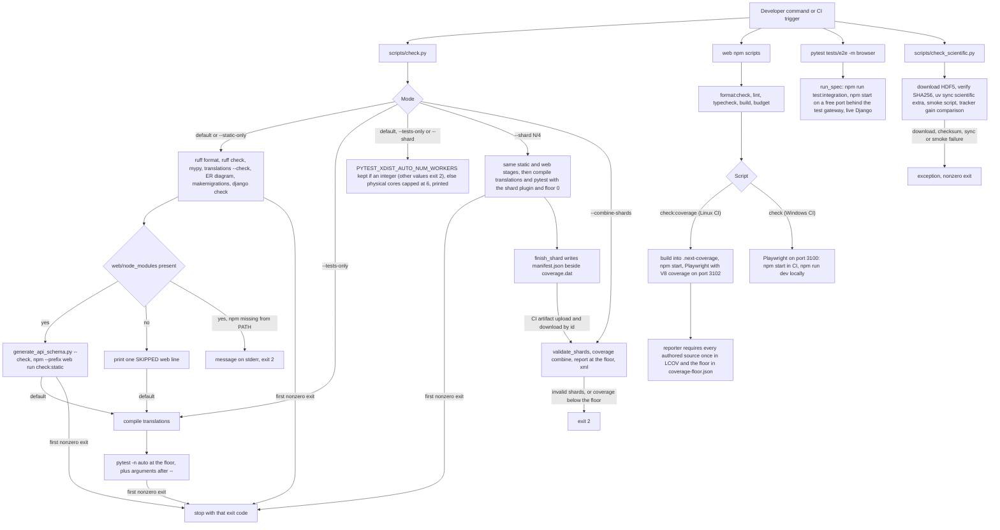

# Run the backend and frontend quality gate locally and in CI

A developer runs `scripts/check.py`, the `web` npm scripts or `scripts/check_scientific.py`; GitHub Actions runs the same commands on push to `main`, pull requests, merge groups and manual dispatch. The outcome is a pass or a nonzero exit, a 100% Python branch-coverage floor, a frontend coverage floor, and the coverage artifacts that Sonar consumes. No production data or tenant is involved; tests build their own fixtures in a throwaway test database.

## Entry points

- `scripts/check.py` `main`: default run, `--shard INDEX/COUNT --shard-output DIR`, or `--combine-shards DIR...`; `--static-only` or `--tests-only` select stages, and arguments after `--` go to pytest unchanged (pass `--no-cov` with a test selection, since the floor applies to the whole suite). Every pytest run is preceded by the `compile translations` stage (`scripts/translations.py`). `web_npm` decides whether the web stages run. Pytest settings live in the native `[tool.pytest]` table of `pyproject.toml` (`strict = true`, list `addopts` including `-m "not browser"`, `faulthandler_timeout = 300`). `scripts/pytest_shard.py` is its pytest plugin (`pytest_collection_modifyitems`) and manifest validator (`validate_shards`, `finish_shard`).
- `web/package.json` scripts: `check` (static + `test`), `check:coverage` (static + `test:coverage`), `check:static` (format:check, lint, typecheck, `knip`, build, `budget`), `test:integration`, `api:generate`. `scripts/generate_api_schema.py --check` compares a fresh schema and types with the committed files. `lint` (`web/eslint.config.mjs`) adds the type-checked typescript-eslint rules (without the `no-unsafe-*` family), `jsx-a11y-x`, the design-token rule and the import direction app -> features -> ui -> lib. `knip` (`web/knip.json`) fails on an unused file, export or dependency of the web app. `budget` (`web/testing/check-bundle-budget.mjs`, measured by `web/testing/bundle-budget.ts` `measure`) checks the build against the sizes recorded in `web/bundle-budget.json`: the first load of `/app`, the portfolio and the plant route, one entry per on-demand plant section and language catalog, and one for the remaining on-demand chunks. Each fails above its recorded size plus `tolerancePercent`; an on-demand entry is found by the export name its chunk registers, and a chunk counts once. Configs: `web/playwright.config.ts`, `web/playwright.integration.config.ts`; coverage in `web/testing/` and `web/coverage-floor.json`.
- `tests/e2e/test_*_spec.py`: the real-backend suite, seven scenarios marked `browser`, one per `web/integration/*.spec.ts`. Each seeds its data through `tests/support/browser.py`, serves Django on a live server behind a test gateway that routes `/api`, `/admin`, `/static/` and `/health/` to it as `deploy/routes.yml` does and everything else to the frontend, and `run_spec` runs `npm run test:integration` for its spec; Playwright starts `npm start` (the production build) on a free port.
- `scripts/check_scientific.py` `main`: probe of the optional `scientific` extra (pvlib, h5py, HDF5), then recomputes two pvlib tables, `tracking_gain_reference.json` (v1) and `tracking_gain_reference_v2.json` (v2: true zenith for Erbs, apparent for the geometry), and checks `tracking_gain` against both; optional as a dependency, but CI runs it on every run.
- `tests/conftest.py`: registers the Hypothesis profiles `gate` (derandomized, no deadline, no example database), loaded unless `HYPOTHESIS_PROFILE` names another, and `explore` (randomized, 2000 examples) for local searches with `--hypothesis-profile=explore`.
- `.github/workflows/ci.yml`: `verify_ubuntu` (whole `check.py`), `verify_windows_shards` (four `--shard N/4` runs; shard 1 also runs the static stages, shards 2 to 4 pass `--tests-only`) then `verify_windows` (`--combine-shards`), `web_ubuntu` (`generate_api_schema.py --check`, `check:coverage`, `scripts/npm_audit.py web`) and `web_windows` (the same with `check`, without the audit), both then running `pytest tests/e2e -m browser`, `scientific` (both OS), `audit` (`pip-audit`), `sonar`, and `ci_result` (`scripts/ci_result.py`), which needs every other CI job and fails unless each passed (Sonar may be skipped). Before `check.py` the verify jobs start a throwaway non-durable PostgreSQL (`scripts.start_postgres --ephemeral --non-durable`, as do the web jobs) and RabbitMQ, run `pyracast migrate`, `migrate --check` and `pyracast check`; web jobs compile the catalogs before pytest. The `deployment` job (workflow, shell, boot-script and Terraform checks, image builds and scans, smoke) and the release hand-off jobs belong to the release pipeline flow.

## Sequence

## Data

| Table | R/W | What |
| --- | --- | --- |
| application schema (CI) | W | CI runs `pyracast migrate` on `PGDATABASE=pyracast` before the gate; `makemigrations --check` may read `django_migrations` when the database is reachable. |
| test databases | W then drop | pytest-django creates and drops its own test database for `default` on the server named by `PG*` variables; `auth_cache` sets `TEST.MIRROR = "default"`, so it uses that database and gets none of its own. `tests/settings.py` adds `synchronous_commit=off` to the shared session options, so test commits do not wait for the WAL flush. |
| `coverage.dat`, `manifest.json`, `collection-<worker>.json` | W then R | Per-shard coverage data and test inventory in `--shard-output`; read by `--combine-shards`. |
| `coverage.xml`, `web/coverage/lcov.info` | W | Backend and frontend coverage, uploaded for Sonar by `ci.yml` (Linux only; the Windows combine writes `coverage.xml` but does not upload it). |
| `test-results/pytest.xml` | W | JUnit XML and `--durations=25` from every verify job, uploaded for 7 days. |
| `web/test-results`, `web/integration-results`, `web/coverage/test-results` | W | Playwright traces and `error-context.md`, the upload step always runs; traces exist only for failed tests. |

## Authorization

None for users. Privilege boundaries: workflow `permissions: contents: read` (`actions: read` only where a job downloads artifacts by id through the REST API) and `persist-credentials: false`; every action pinned by commit SHA; `PYRACAST_SECRET_KEY` is a CI-only constant; the Linux RabbitMQ password is random per run and masked; `sonar` runs only when `SONAR_ENABLED` is `true`, never for merge groups, Dependabot or fork pull requests (they receive no token); `check_scientific.py` trusts the HDF5 download only through a pinned SHA256.

## Failure paths

| Condition | Result |
| --- | --- |
| Any `check.py` step exits nonzero | That exit code is returned at once; later steps do not run. |
| Coverage below `fail_under` (default run) | pytest-cov failure from `--cov-fail-under`. |
| Bad `--shard` value, `--shard` with `--combine-shards`, `--shard` without `--shard-output` or the reverse | argparse error, exit 2. |
| `--static-only` with `--tests-only`, `--shard` or pytest arguments; `--combine-shards` with a stage selection or pytest arguments | argparse error, exit 2, before any stage runs. |
| `web/node_modules` exists but `npm` is not on PATH | Message on stderr, exit 2 before any stage runs. |
| A stage exits nonzero | `Failed <stage> in <seconds>s (exit <code>)`; a passing stage prints `Finished <stage> in <seconds>s`. |
| `--shard-output` directory already exists | Uncaught `FileExistsError` traceback before any step runs. |
| `PYTEST_XDIST_AUTO_NUM_WORKERS` set to a value `int()` rejects | Message on stderr, exit 2 before any step runs. |
| Unknown pytest configuration key | `ERROR: Unknown config option` at startup under `strict = true`, exit 4; no test runs. |
| Unregistered marker or duplicate parametrize id | Collection error under `strict = true`; no test runs. |
| A test runs longer than 300 s | `faulthandler_timeout` prints every thread's stack (also from xdist workers); the run continues. |
| Selected shard is empty | `pytest.UsageError` "The test shard is empty". |
| xdist workers collected different shards | `finish_shard` raises `ValueError` after the tests passed; no `manifest.json`. |
| Missing, duplicate, foreign or empty-coverage shard on combine | "Invalid test shards: ..." on stderr, exit 2. |
| Combined coverage below the floor | `coverage report` exit 2, no `coverage.xml`. |
| An artifact id of a shard or coverage upload is empty | The `Require the artifacts` step fails before the download (an empty id would fetch every artifact of the run). |
| Fresh schema or types differ from the committed files, or a committed file is missing or not valid JSON | `generate_api_schema.py --check` names each stale file and the fix command `npm --prefix web run api:generate`, exit 1 (a semantic `openapi.json` difference is reported before Node runs). |
| `npx`, `openapi-typescript` or prettier fails during `--check` | Its stderr and exit code (1 when `npx` is missing). |
| A first load or on-demand entry above its recorded size plus the tolerance | `npm run budget` prints each size and limit and exits 1; a larger size is recorded in `bundle-budget.json` only as a decision. |
| An on-demand entry matching no chunk or two, or two entries on one chunk | The measurement throws and `npm run budget` fails. |
| Frontend line, branch or function coverage below `web/coverage-floor.json` | The coverage reporter throws "Frontend coverage fell: ..."; the run fails. |
| New npm advisory, or an exception in `web/audit-exceptions.json` without a reason, past its expiry date or no longer reported (Ubuntu web job) | `scripts/npm_audit.py web` prints each failure and exits 1. |
| New Python advisory | `pip-audit --strict` fails the `audit` job without a code change. |
| Playwright test fails in CI (main config) | Retried twice; a test that passes only on a retry is flaky and fails the job (`failOnFlakyTests`). The integration config has no retries. |
| `test.only` left in a spec in CI | `forbidOnly` fails both configurations. |
| Mocked suite exceeds 15 min, integration spec exceeds 240 s | Playwright's `globalTimeout` stops the run and reports the unfinished tests; the 300 s subprocess timeout of `run_spec` remains the outer limit. |
| `-m browser` selects no test | pytest collects nothing and exits nonzero, so the web job fails. |
| `check_scientific.py` on another OS, failed download, bad checksum, missing `uv`, failed sync or smoke assertion | `RuntimeError`, `URLError` or `CalledProcessError` (smoke assertions fail inside the child interpreter). |
| Sonar enabled but token, project key or organization missing | "Missing Sonar configuration: ..." and the job fails. |
| A CI job other than Sonar failed, was cancelled or skipped | `CI result` fails and names the jobs. |

## Rules and invariants

- Unused code and texts fail a check: `knip` in `check:static`, `scripts/translations.py --check` in the static stages (a marked msgid without a translation, a catalogued msgid nothing marks) and `web/tests/message-keys.spec.ts` in the mocked web suite (a web message key nothing reads); the rules are in `i18n-and-language`.
- Property tests are reproducible: the `gate` profile derives examples from the test itself, so every shard, worker and rerun checks the same cases; a counterexample found with `explore` is pinned with `@example`, and no line is covered only by a property test.
- The floor has one source, `tool.coverage.report.fail_under` in `pyproject.toml`; `deploy` is in the coverage source. Shards run with floor 0; only the combine step enforces it.
- Worker count: `check.py` keeps an explicit integer `PYTEST_XDIST_AUTO_NUM_WORKERS` (it refuses any other value, which xdist would ignore in favour of every physical core) and otherwise sets it to the physical core count (logical count when psutil cannot tell) capped at 6, printing the value; CI pins 2. Shard mode replaces `addopts` through `-o` without the `--cov-report` entries, and `strict = true` still applies there.
- Only throwaway CI clusters run without `fsync`; a developer cluster keeps it on, and test sessions only relax `synchronous_commit`. Throwaway clusters run production's PostgreSQL 18.7 (Linux: the production Dockerfile's image; Windows: the 18.7 EDB archive); the shared development cluster stays on 18.6.
- `selected_nodes` keeps all tests of one file in one shard and balances by test count. `validate_shards` recomputes the partition and requires one shared inventory and one `run_identity` (SHA, run id, platform, Python; the attempt is not part of it, so shards of different attempts of one run combine and a re-run repeats only failed shards).
- Windows shards upload `windows-shards/<n>`; the combine job and Sonar download by the artifact ids their producer jobs expose as outputs (one output per shard), after a step that requires every id. Linux runs one unsharded `check.py`; `uv build` and the wheel import check run on Linux and in Windows shard 1.
- `check:coverage` runs on Linux and `check` on Windows. Only coverage mode builds `.next-coverage` and asserts production-only CSP behaviour in `web/tests/security-headers.spec.ts`. Mocked specs and the real-backend scans of the web app check pages with axe through `web/tests/support/accessibility.ts`; the Django console keeps its WCAG 2.1 scan (`web/integration/support/console.ts`).
- Real-backend scenarios wait for no clock: the console scenarios answer both second-factor prompts with recovery codes seeded for their administrators (`BROWSER_ADMIN_RECOVERY_CODES`, `BROWSER_CONSOLE_RECOVERY_CODES`), and `auth-security.spec.ts` mints its activation code for the live server's pinned TOTP clock (`BROWSER_TOTP_NOW`).
- Browser coverage is read once, when a test ends, from the document then shown (`web/tests/support/test.ts`): what ran in a document the scenario reloaded or left is not counted, so a scenario that must count ends in the document whose behaviour it shows.
- Normal mode starts `npm start` in CI (the build from `check:static`) and `npm run dev` locally; coverage mode always builds and starts; the real-backend suite always starts `npm start` on a free port. Ports 3100 and 3102 keep the mocked suites apart.
- The web stages of `check.py` run only when `web/node_modules` exists; otherwise it prints one `SKIPPED web` line, and with it but without `npm` it fails and proves nothing about the web. They run `check:static`, not the Playwright suites. The real-backend suite is deselected by the default `-m "not browser"`; only the web jobs select it.
- `tests/settings.py` fixes every settings-derived `PYRACAST_*` value in `os.environ` before importing `pyracast.settings`, so neither the shell nor a local `.env` changes test settings or the environment subprocess tests inherit; `PG*`, `PYRACAST_RABBITMQ_URL`, the live-test gates and the shard variables stay external.
- CI cancels superseded runs per ref (`concurrency`); Sonar needs `verify_ubuntu` and `web_ubuntu`. Every job that installs locked dependencies enables the uv cache (`scientific` under its own key); `deployment` disables it.

## Tests

- `tests/test_pytest_shard.py`: shard parsing, partition, six aggregate rejections (missing, duplicate, overlap, inventory, identity, missing coverage), shards of different attempts, worker mismatch, the `--help` entrypoint, and a real two-shard xdist run merged through `check.main` (shards run by direct pytest calls, not `check.py --shard`).
- `tests/test_quality_gate.py`: the worker count passed to every gate command (capped, fallback, explicit value kept) and its printed line; the gate covers every static `ci.yml` command except `migrate`; every pytest run compiles the catalogs first; the web skip line and the failure when `npm` is missing beside `web/node_modules`; `--static-only`, `--tests-only`, pytest arguments after `--` (also in shard mode), contradictory modes, per-stage timing and the stop at the first failing stage.
- `tests/test_operations_contracts.py`: CI job names, four Windows shards combined by `verify_windows`, uv caches. `tests/test_ci_result.py`, `tests/test_ci_artifacts.py`, `tests/test_npm_audit.py`, `tests/test_version_pins.py` (one version, digest and action commit everywhere; CI clusters run production's PostgreSQL).
- `tests/test_api_schema_generation.py`: generation ignores local configuration, the runtime cookie name; `--check` reports a semantically or only formatting-wise stale `openapi.json` and stale `schema.d.ts` without writing them, reports a missing or unparsable committed file as stale, accepts current files, and returns the exit code of a missing `npx` or a failing Node tool.
- `tests/test_browser_gateway.py`: the test gateway routes as production does and answers 502 while an upstream is down.
- `tests/test_session_cookies.py`: under the `pyracast.production` cookie names and flags both `Set-Cookie` headers carry `Secure`, `Path=/` and no `Domain`.
- `tests/test_start_postgres.py`: `--non-durable` adds the three server options on Windows (`pg_ctl -o`) and Linux (`postgres -c` after the image), is off by default and needs `--ephemeral`.
- `tests/test_test_settings.py`: both database aliases report `synchronous_commit = off`; a hostile `.env` and shell environment leave the test settings unchanged.
- `tests/test_translations.py`: `compile_catalogs` (the translations step), compiled catalogs never committed, and every CI job that runs pytest compiles them first.
- `tests/test_er_diagram.py`: `generate_er_diagram` generation, `--check` against temporary files, and the direct entrypoint without a database.
- `web/tests/coverage-paths.spec.ts`, `coverage-floor.spec.ts`, `bundle-budget.spec.ts`, `import-direction.spec.ts`, `lint-rules.spec.ts`: the coverage helpers, the floor, the budget, and the lint rules.
- Gaps: the real `npx` calls of `generate_api_schema.py --check` run only in CI and in a local gate with `web/node_modules`; `validate_shards` count mismatch, empty `coverage.dat` and non-object manifests are untested; `check_scientific.py`, `coverage-reporter.ts` and `ci.yml` have no test of their own; the committed `docs/DATA_MODEL.md` is guarded only by the `check.py` step.
