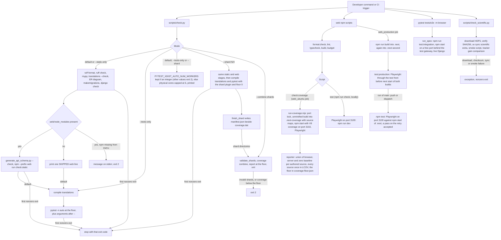

# Run the backend and frontend quality gate locally and in CI

A developer runs `scripts/check.py`, the `web` npm scripts or `scripts/check_scientific.py`; GitHub Actions runs the same commands on push to `main`, pull requests that are ready for review and manual dispatch; a draft pull request runs none of them. The outcome is a pass or a nonzero exit, a 100% Python branch-coverage floor, a frontend coverage floor, and the coverage artifacts that Sonar consumes. No production data or tenant is involved; tests build their own fixtures in a throwaway test database.

## Entry points

- `scripts/check.py` `main`: default run, `--shard INDEX/COUNT --shard-output DIR`, or `--combine-shards DIR...`; `--static-only` or `--tests-only` select stages, and arguments after `--` go to pytest unchanged (pass `--no-cov` with a test selection, since the floor applies to the whole suite). Every pytest run is preceded by the `compile translations` stage (`scripts/translations.py`). `web_npm` decides whether the web stages run. Pytest settings live in the native `[tool.pytest]` table of `pyproject.toml` (`strict = true`, list `addopts` including `-m "not browser"`, `faulthandler_timeout = 300`). `scripts/pytest_shard.py` is its pytest plugin (`pytest_collection_modifyitems`) and manifest validator (`validate_shards`, `finish_shard`).
- `web/package.json` scripts: `check` (static + `test`), `check:coverage` (static + `test:coverage`), `check:static` (format:check, lint, typecheck, `knip`, build, `budget`), `test:integration`, `test:production`, `api:generate`. `scripts/generate_api_schema.py --check` compares a fresh schema and types with the committed files. `lint` (`web/eslint.config.mjs`) adds the type-checked typescript-eslint rules (without the `no-unsafe-*` family), `jsx-a11y-x`, the design-token rule and the import direction app -> features -> ui -> lib. `knip` (`web/knip.json`) fails on an unused file, export or dependency of the web app. `budget` (`web/testing/check-bundle-budget.mjs`, measured by `web/testing/bundle-budget.ts` `measure`) checks the build against the sizes recorded in `web/bundle-budget.json`: the first load of `/app`, the portfolio and the plant route, one entry per on-demand plant section and language catalog, and one for the remaining on-demand chunks. Each fails above its recorded size plus `tolerancePercent`; an on-demand entry is found by the export name its chunk registers, and a chunk counts once. Configs: `web/playwright.config.ts` (mocked API), `web/playwright.integration.config.ts` (real backend), both with `serviceWorkers: "block"`, and `web/playwright.production.config.ts` (specs in `web/production-tests/`, workers allowed, one worker, CI retries 2): `next start` of `.next` on 3110 and of a second build of the same source in `.next-second` on 3112 (`web/testing/builds.ts`) behind `web/testing/front.ts` on 3111, a test front that forwards everything outside `/__front/` to the selected build (`PUT /__front/build`: `first` or `second`), sends `/api/` to that build's API mock (3113 or 3114, served by `release.spec.ts`; elsewhere the front answers 503), names the answering build in `x-front-build`, can answer `/app/sw.js` with another script (`PUT /__front/script`: `build`, `withdrawal` or `previous`) or answer a plain 503 as if no server answered (`PUT /__front/upstream`: `answering` or `absent`), and returns to its initial state on `DELETE /__front/state`. Coverage in `web/testing/` and `web/coverage-floor.json`.
- `tests/e2e/test_*_spec.py`: the real-backend suite, seven scenarios marked `browser`, one per `web/integration/*.spec.ts`. Each seeds its data through `tests/support/browser.py`, serves Django on a live server behind a test gateway that routes `/api`, `/admin`, `/static/` and `/health/` to it as `deploy/routes.yml` does and everything else to the frontend, and `run_spec` runs `npm run test:integration` for its spec; Playwright starts `npm start` (the production build) on a free port.
- `scripts/check_scientific.py` `main`: probe of the optional `scientific` extra (pvlib, h5py, HDF5), then recomputes two pvlib tables, `tracking_gain_reference.json` (v1) and `tracking_gain_reference_v2.json` (v2: true zenith for Erbs, apparent for the geometry), and checks `tracking_gain` against both; optional as a dependency, but every CI run that is not a draft's runs it.
- `tests/conftest.py`: registers the Hypothesis profiles `gate` (derandomized, no deadline, no example database), loaded unless `HYPOTHESIS_PROFILE` names another, and `explore` (randomized, 2000 examples) for local searches with `--hypothesis-profile=explore`.
- `.github/workflows/ci.yml`: `verify_ubuntu` (75 min: whole `check.py`, then `uv build` and the wheel import check), `web_ubuntu` (40 min: compiles the catalogs, starts PostgreSQL, `generate_api_schema.py --check`, `check:coverage`, then `pytest tests/e2e -m browser` against the ordinary build of `check:static`), `web_production` (45 min, Node only: `npm ci`, Chromium, its own `npm run build` into `.next`, a second `npm run build` with `NEXT_DIST_DIR=.next-second`, `npm run test:production`; in a run of `main` that can be released, a push or a manual dispatch, then `npm test`, the mocked suite against `.next`), `scientific`, `audit` (`pip-audit`, then `scripts/npm_audit.py web` on the lockfile alone, which also runs after a failed `pip-audit` once `uv sync` passed), `sonar`, `merge_proof` (push only: whether the merged pull request's run passed every job on the same tree, see `release-pipeline`), and `ci_result` (`scripts/ci_result.py`), which needs every other CI job and fails unless each passed (Sonar may be skipped; on a push `merge_proof` must pass, and when it answered `proven=true` `verify_ubuntu`, `web_ubuntu` and `scientific` may be skipped). A proven push skips those three jobs and Sonar with them; every other job, the audits and the suite against the shipped build included, runs on every push. CI runs on the pull request types `opened`, `synchronize`, `reopened`, `ready_for_review` and `converted_to_draft`. Every job without `needs` but `merge_proof` carries the condition `!github.event.pull_request.draft` (one YAML anchor), and the three suites need `merge_proof` and carry `!cancelled()`, the same draft condition and `proven != 'true'` (so a skipped or failed `merge_proof` leaves them running), so a draft skips them and the jobs that need them; `ci_result` still runs and fails, because a skipped job counts as passed for a required check. `.github/workflows/dependency-audit.yml` runs the steps of the audit job daily on `main` on `ubuntu-slim`; its failure fails only that run. Before `check.py` the verify job starts a throwaway non-durable PostgreSQL (`scripts.start_postgres --ephemeral --non-durable`, as does `web_ubuntu`) and RabbitMQ, runs `pyracast migrate`, `migrate --check` and `pyracast check`. The `deployment` job (workflow, shell, boot-script and Terraform checks, image builds and scans, smoke) and the release hand-off jobs belong to the release pipeline flow.

## Sequence

## Data

| Table | R/W | What |
| --- | --- | --- |
| application schema (CI) | W | CI runs `pyracast migrate` on `PGDATABASE=pyracast` before the gate; `makemigrations --check` may read `django_migrations` when the database is reachable. |
| test databases | W then drop | pytest-django creates and drops its own test database for `default` on the server named by `PG*` variables; `auth_cache` sets `TEST.MIRROR = "default"`, so it uses that database and gets none of its own. `tests/settings.py` adds `synchronous_commit=off` to the shared session options, so test commits do not wait for the WAL flush. |
| `coverage.dat`, `manifest.json`, `collection-<worker>.json` | W then R | Per-shard coverage data and test inventory in `--shard-output`; read by `--combine-shards`. |
| `coverage.xml`, `web/coverage/lcov.info` | W | Backend and frontend coverage, uploaded for Sonar by `verify_ubuntu` and `web_ubuntu`. The frontend run also writes the server's raw V8 JSON to `web/coverage/v8/<run identifier>`, per-script Istanbul JSON to `web/coverage/{browser,server,baseline}` and the browser scripts it did not count to `web/coverage/uncounted` (not uploaded). |
| `test-results/pytest.xml` | W | JUnit XML and `--durations=25` from the verify job, uploaded for 7 days. |
| `web/test-results`, `web/integration-results`, `web/coverage/test-results`, `web/production-results` | W | Playwright traces and `error-context.md`, the upload step always runs; traces exist only for failed tests. |

## Authorization

None for users. Privilege boundaries: workflow `permissions: contents: read` (`actions: read` only where a job downloads artifacts by id through the REST API; `actions: write` only in the stop jobs, which check out no code; `merge_proof` reads actions and pull requests) and `persist-credentials: false`; every action pinned by commit SHA; `PYRACAST_SECRET_KEY` is a CI-only constant; the Linux RabbitMQ password is random per run and masked; `sonar` runs only when `SONAR_ENABLED` is `true`, never for Dependabot or fork pull requests (they receive no token); `check_scientific.py` trusts the HDF5 download only through a pinned SHA256.

## Failure paths

| Condition | Result |
| --- | --- |
| Any `check.py` step exits nonzero | That exit code is returned at once; later steps do not run. |
| Coverage below `fail_under` (default run) | pytest-cov failure from `--cov-fail-under`. |
| Bad `--shard` value, `--shard` with `--combine-shards`, `--shard` without `--shard-output` or the reverse | argparse error, exit 2. |
| `--static-only` with `--tests-only`, `--shard` or pytest arguments; `--combine-shards` with a stage selection or pytest arguments | argparse error, exit 2, before any stage runs. |
| `web/node_modules` exists but `npm` is not on PATH | Message on stderr, exit 2 before any stage runs. |
| A stage exits nonzero | `Failed <stage> in <seconds>s (exit <code>)`; a passing stage prints `Finished <stage> in <seconds>s`. |
| `--shard-output` directory already exists | Uncaught `FileExistsError` traceback before any step runs. |
| `PYTEST_XDIST_AUTO_NUM_WORKERS` set to a value `int()` rejects | Message on stderr, exit 2 before any step runs. |
| Unknown pytest configuration key | `ERROR: Unknown config option` at startup under `strict = true`, exit 4; no test runs. |
| Unregistered marker or duplicate parametrize id | Collection error under `strict = true`; no test runs. |
| A test runs longer than 300 s | `faulthandler_timeout` prints every thread's stack (also from xdist workers); the run continues. |
| Selected shard is empty | `pytest.UsageError` "The test shard is empty". |
| xdist workers collected different shards | `finish_shard` raises `ValueError` after the tests passed; no `manifest.json`. |
| Missing, duplicate, foreign or empty-coverage shard on combine | "Invalid test shards: ..." on stderr, exit 2. |
| Combined coverage below the floor | `coverage report` exit 2, no `coverage.xml`. |
| An artifact id of a coverage upload is empty | The `Require the artifacts` step fails before the download (an empty id would fetch every artifact of the run). |
| Fresh schema or types differ from the committed files, or a committed file is missing or not valid JSON | `generate_api_schema.py --check` names each stale file and the fix command `npm --prefix web run api:generate`, exit 1 (a semantic `openapi.json` difference is reported before Node runs). |
| `npx`, `openapi-typescript` or prettier fails during `--check` | Its stderr and exit code (1 when `npx` is missing). |
| A first load or on-demand entry above its recorded size plus the tolerance | `npm run budget` prints each size and limit and exits 1; a larger size is recorded in `bundle-budget.json` only as a decision. |
| An on-demand entry matching no chunk or two, or two entries on one chunk | The measurement throws and `npm run budget` fails. |
| Frontend line, branch or function coverage below `web/coverage-floor.json` | The coverage reporter throws "Frontend coverage fell: ..."; the run fails. |
| `test:coverage` in Playwright UI mode, or while another coverage run on the machine holds 127.0.0.1:9103 | Refused with exit 2 before anything is deleted or built |
| A source map of another shape than a version 3 flat map or an index of flat maps at line offsets, a mapping onto a line outside an authored text, or an embedded text that is not the file | The run fails naming script and map |
| Code that is not this build's output executed in the browser | Each uncounted script is printed first; the reporter fails with "Code that is not this build's output ran in the browser: <URLs>" (a script whose text the browser did not give is printed and never fails) |
| The browser or the Next server coverage maps no execution of an authored source | The reporter fails with "No mapped execution of an authored source in the coverage of: <sides>" |
| New npm advisory, or an exception in `web/audit-exceptions.json` without a reason, past its expiry date or no longer reported (`audit`) | `scripts/npm_audit.py web` prints each failure and exits 1. |
| New Python or npm advisory | The `audit` job fails without a code change: in the next CI run that is not a draft's or the daily scheduled audit, whichever comes first. Every run of `main` runs `audit`, and its release waits for that run's successful `audit`. |
| Playwright test fails in CI (main config) | Retried twice; a test that passes only on a retry is flaky and fails the job (`failOnFlakyTests`), except in the run of `main` in `web_production` (`PLAYWRIGHT_ACCEPT_PASS_ON_RETRY=1`), since the pull request's coverage run already fails such a test. The integration config has no retries. |
| `test.only` left in a spec in CI | `forbidOnly` fails both configurations. |
| Mocked suite exceeds 28 min (inside `web_ubuntu`, limited to 40 min, and `web_production`, limited to 45 min), integration spec exceeds 240 s, production-build suite exceeds 10 min | Playwright's `globalTimeout` stops the run and reports the unfinished tests; the 300 s subprocess timeout of `run_spec` remains the outer limit of an integration spec. |
| `-m browser` selects no test | pytest collects nothing and exits nonzero, so the web job fails. |
| `check_scientific.py` on another OS, failed download, bad checksum, missing `uv`, failed sync or smoke assertion | `RuntimeError`, `URLError` or `CalledProcessError` (smoke assertions fail inside the child interpreter). |
| Sonar enabled but token, project key or organization missing | "Missing Sonar configuration: ..." and the job fails. |
| A CI job other than Sonar failed, was cancelled or skipped (on a push, the three suites skipped without `proven=true` from a passing `merge_proof`, or `merge_proof` not passed) | `CI result` fails and names the jobs. |
| A pull request is a draft (opened, pushed to, reopened or converted, which also cancels its running run) | Only `CI result` runs and fails with "A draft pull request is not verified; mark it ready for review to run CI."; nothing records a tested tree, and the release never takes the run as proof. Marking it ready starts the full run on its head. |
| A job of a pull request run fails | Its stop job cancels the run: the jobs still running, `CI result` and `Record the tested tree` end cancelled, so the run has no passing result and records no tested tree. A fork's read-only token cannot cancel; its stop job fails and the run goes to the end. |

## Rules and invariants

- Unused code and texts fail a check: `knip` in `check:static`, `scripts/translations.py --check` in the static stages (a marked msgid without a translation, a catalogued msgid nothing marks) and `web/tests/message-keys.spec.ts` in the mocked web suite (a web message key nothing reads); the rules are in `i18n-and-language`.
- Property tests are reproducible: the `gate` profile derives examples from the test itself, so every shard, worker and rerun checks the same cases; a counterexample found with `explore` is pinned with `@example`, and no line is covered only by a property test.
- The floor has one source, `tool.coverage.report.fail_under` in `pyproject.toml`; `deploy` is in the coverage source. Shards run with floor 0; only the combine step enforces it.
- Worker count: `check.py` keeps an explicit integer `PYTEST_XDIST_AUTO_NUM_WORKERS` (it refuses any other value, which xdist would ignore in favour of every physical core) and otherwise sets it to the physical core count (logical count when psutil cannot tell) capped at 6, printing the value; CI pins 2. Shard mode replaces `addopts` through `-o` without the `--cov-report` entries, and `strict = true` still applies there.
- Only throwaway CI clusters run without `fsync`; a developer cluster keeps it on, and test sessions only relax `synchronous_commit`. Throwaway clusters run production's PostgreSQL 18.7 (on Linux, as in CI, the production Dockerfile's image; on a Windows workstation the 18.7 EDB archive); the shared development cluster stays on 18.6.
- `selected_nodes` keeps all tests of one file in one shard and balances by test count. `validate_shards` recomputes the partition and requires one shared inventory and one `run_identity` (SHA, run id, platform, Python; the attempt is not part of it, so shards of different attempts of one run combine and a re-run repeats only failed shards).
- The Python suite runs once in CI, unsharded on Ubuntu; no CI job runs `--shard` or `--combine-shards`. Sonar downloads the coverage reports by the artifact ids their producer jobs expose as outputs, after a step that requires every id.
- CI runs the mocked suite with `check:coverage` in `web_ubuntu` in every run that is not a draft's, and with `npm test` against the shipped build in `web_production` in a run of `main` that can be released, proven or not. Only coverage mode builds `.next-coverage`. Coverage mode and CI test a production server (`productionServer` in `web/tests/support/server.ts`: `npm start` instead of `npm run dev`), so `web/tests/security-headers.spec.ts` asserts the production-only CSP behaviour in both runs. `PLAYWRIGHT_COVERAGE=1`, which `web/testing/run-coverage.mjs` sets for that build and its server, turns on browser source maps and turns off Turbopack minification (`web/next.config.ts`); without it the configuration is the ordinary one. The minified build is exercised by the mocked suite in `web_production`, the real-backend scenarios, the `web_production` worker scenarios, the production image with `deploy/smoke.sh`, and the bundle budget. Mocked specs and the real-backend scans of the web app check pages with axe through `web/tests/support/accessibility.ts`; the Django console keeps its WCAG 2.1 scan (`web/integration/support/console.ts`).
- Real-backend scenarios wait for no clock: the console scenarios answer both second-factor prompts with recovery codes seeded for their administrators (`BROWSER_ADMIN_RECOVERY_CODES`, `BROWSER_CONSOLE_RECOVERY_CODES`), and `auth-security.spec.ts` mints its activation code for the live server's pinned TOTP clock (`BROWSER_TOTP_NOW`).
- Coverage run (`web/testing/run-coverage.mjs`): it holds a listener on 127.0.0.1:9103 for its whole life (the operating system frees it however the run ends), deletes `web/coverage`, builds `.next-coverage` without `NODE_V8_COVERAGE` and starts Playwright with a fresh run identifier in `PLAYWRIGHT_COVERAGE_RUN` (coverage mode refuses to start without one). The server runs `npm start` with `NODE_V8_COVERAGE=web/coverage/v8/<run identifier>` and `--inspect=127.0.0.1:9102`, ready on `/identity/microsoft.svg`; the global teardown (`web/testing/server-coverage.ts`) checks the inspector's run directory and process, has it write its coverage and reads that process's one snapshot.
- Browser coverage is read through the fixture's own CDP session (`startBrowserCoverage` in `web/testing/coverage-maps.ts`: precise counts, block coverage, no reset on navigation), once, when a test ends (`web/tests/support/test.ts`); whether code that ran in a document the scenario reloaded or left is still counted depends on Chromium, so a scenario that must count ends in the document whose behaviour it shows. Only a script whose text is the build's file is converted.
- Maps are prepared by `web/testing/coverage-maps.ts` before conversion: build scripts and maps are read only inside the physical `<dist>/static` and `<dist>/server`, a map directive counts only as the script's last line, and each generated script is identified by its URL with a digest of its text and prepared map. The reporter (`web/testing/coverage-combine.ts`) adds a zero baseline from every build script that maps an authored source (a TypeScript transpile only for sources no build script maps), takes lines as the union of all records, and unites functions and branches of one source across records by identity (a function by the end of its body, a branch group by type, start line and end, an arm by the end of its location; repeated identities unite only on equal full ranges); counts are sums. It prints `Measured frontend coverage: {...}` and `Coverage union statistics: {...}`, then checks the floor. Routes prerendered at build (`robots.ts`, `sitemap.ts`, the `opengraph-image` routes) stay unmeasured.
- Normal mode starts `npm start` in CI (the `.next` that `web_production` built) and `npm run dev` locally; coverage mode always builds and starts; the real-backend suite always starts `npm start` on a free port. Ports 3100 and 3102 keep the mocked suites apart.
- The web stages of `check.py` run only when `web/node_modules` exists; otherwise it prints one `SKIPPED web` line, and with it but without `npm` it fails and proves nothing about the web. They run `check:static`, not the Playwright suites. The real-backend suite is deselected by the default `-m "not browser"`; only `web_ubuntu` selects it.
- Selection sets in `tests/conftest.py` mark modules by name; `migration` holds the modules that move the schema to an earlier state, and `tests/test_suite_conventions.py` requires every module that drives `MigrationExecutor` or `tests.support.migrations` to be in it. After each passing database test of an `INVARIANT_AUDIT` module the stored rows are checked against the raw rules of `tests/support/invariants.py` (`STORED_RULES`); `tests/test_invariant_audit.py` stages its listed breaches of each rule on the current schema: one case per breach shows the database's own guard refusing it, a second that the audit reports exactly that rule once the guard is lifted; a rule without a breach fails the suite.
- `tests/settings.py` fixes every settings-derived `PYRACAST_*` value in `os.environ` before importing `pyracast.settings`, so neither the shell nor a local `.env` changes test settings or the environment subprocess tests inherit; `PG*`, `PYRACAST_RABBITMQ_URL`, the live-test gates and the shard variables stay external.
- CI cancels superseded runs per ref (`concurrency`), and a pull request run as soon as `deployment`, `verify_ubuntu`, `web_ubuntu`, `web_production`, `scientific` or `audit` fails: each has a stop job that needs only it (a job waits for every job it needs) and calls `cancelWorkflowRun` with `actions: write` and no checkout. Runs of `main` go to the end. No CI job has a matrix, so `fail-fast` plays no part. Sonar needs `verify_ubuntu` and `web_ubuntu`. Every job that installs locked dependencies enables the uv cache (`scientific` under its own key); `deployment` disables it. `ci_result` runs on `ubuntu-slim`, as does the scheduled audit; the jobs of a CI run that test, build or scan run on `ubuntu-latest`.

## Tests

- `tests/test_pytest_shard.py`: shard parsing, partition, six aggregate rejections (missing, duplicate, overlap, inventory, identity, missing coverage), shards of different attempts, worker mismatch, the `--help` entrypoint, and a real two-shard xdist run merged through `check.main` (shards run by direct pytest calls, not `check.py --shard`).
- `tests/test_quality_gate.py`: the worker count passed to every gate command (capped, fallback, explicit value kept) and its printed line; the gate covers every static `ci.yml` command except `migrate`; every pytest run compiles the catalogs first; the web skip line and the failure when `npm` is missing beside `web/node_modules`; `--static-only`, `--tests-only`, pytest arguments after `--` (also in shard mode), contradictory modes, per-stage timing and the stop at the first failing stage.
- `tests/test_release_workflow.py`: the jobs `ci_result` needs, the stop job of each job of a pull request run, one job runs both dependency audits in CI and the same steps daily and both report, the draft rule on every job without `needs`, each with a synthetic workflow for each broken shape, the small jobs run on `ubuntu-slim` within its limits and Python 3.12 and every other job on `ubuntu-latest`, and the suite against the shipped build (its command, condition, environment and build, that a failure fails the job, that `ci_result` needs its job), the first job of a push and the only jobs it may skip, each with a synthetic workflow for each broken shape.
- `tests/test_operations_contracts.py`: CI job names, uv caches. `tests/test_ci_result.py` (a draft's run never passes; skipped suites pass only on a push whose first job passed and said proven), `tests/test_ci_artifacts.py`, `tests/test_npm_audit.py`, `tests/test_version_pins.py` (one version, digest and action commit everywhere; CI clusters run production's PostgreSQL).
- `tests/test_api_schema_generation.py`: generation ignores local configuration, the runtime cookie name; `--check` reports a semantically or only formatting-wise stale `openapi.json` and stale `schema.d.ts` without writing them, reports a missing or unparsable committed file as stale, accepts current files, and returns the exit code of a missing `npx` or a failing Node tool.
- `tests/test_browser_gateway.py`: the test gateway routes as production does and answers 502 while an upstream is down.
- `tests/test_session_cookies.py`: under the `pyracast.production` cookie names and flags both `Set-Cookie` headers carry `Secure`, `Path=/` and no `Domain`.
- `tests/test_start_postgres.py`: `--non-durable` adds the three server options on Windows (`pg_ctl -o`) and Linux (`postgres -c` after the image), is off by default and needs `--ephemeral`.
- `tests/test_test_settings.py`: both database aliases report `synchronous_commit = off`; a hostile `.env` and shell environment leave the test settings unchanged.
- `tests/test_translations.py`: `compile_catalogs` (the translations step), compiled catalogs never committed, and every CI job that runs pytest compiles them first.
- `tests/test_er_diagram.py`: `generate_er_diagram` generation, `--check` against temporary files, and the direct entrypoint without a database.
- `web/tests/coverage-paths.spec.ts` (measured entries, map preparation, script identity, the union and its statistics, uncounted browser scripts, the CDP capture, the baseline, the teardown's snapshot choice, the wrapper's port lock, the unminified coverage build only), `coverage-floor.spec.ts`, `bundle-budget.spec.ts`, `import-direction.spec.ts`, `lint-rules.spec.ts`: the coverage helpers, the floor, the budget, and the lint rules.
- `web/tests/browser-workers.spec.ts`: the mocked and integration configurations block service workers. `web/tests/app-manifest.spec.ts`: manifest members and each icon file (PNG signature, size, opaque maskable icons with the mark in the safe zone). `web/tests/app-worker.spec.ts` and `web/tests/saved-pages.spec.ts`: the worker scripts in a Node context (through `web/tests/support/worker-script.ts` with an in-memory IndexedDB, `web/tests/support/worker-database.ts`) and the source scan for `serviceWorker`; `web/tests/support/worker-state.ts` tells three states apart: saved figures on, saved figures withdrawn (`SAVED_FIGURES` false in `web/src/lib/saved/feature.ts`, the worker kept) and the worker withdrawn; `web/tests/saved-figures-withdrawn.spec.ts` runs only in the second. `web/production-tests/`: the worker against the production build through the test front. `web/tests/saved-copy.spec.ts`: the saved copy in a real IndexedDB, seeded and read by `web/tests/support/saved-copy.ts`. `web/tests/leave-guard.spec.ts`: the leave guard. `tests/test_operations_contracts.py` also runs the smoke's `app_file` in bash against recorded answers (skipped on Windows).
- Gaps: the real `npx` calls of `generate_api_schema.py --check` run only in CI and in a local gate with `web/node_modules`; `validate_shards` count mismatch, empty `coverage.dat` and non-object manifests are untested; `check_scientific.py` and `coverage-reporter.ts` have no test of their own; the committed `docs/DATA_MODEL.md` is guarded only by the `check.py` step.
